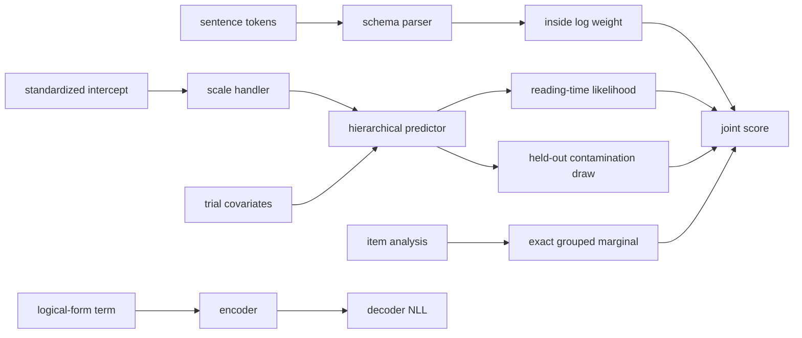

# Bayesian Semantics Case Study

## Overview

This example places four views of a reading experiment in one checked module.
A schema-backed categorial parser sums over the derivations of a sentence; a
structural autoencoder learns codes for logical forms; an indexed family
separates observed from missing reading times under a contamination measure;
and a hierarchical reading-time program puts a prior on its intercept through
an authored handler, pools participant and item effects, and marginalizes an
item-level analysis exactly.

The module's point is not that one inference algorithm should fit every
component at once. Its point is that each component has a typed entry, the
calls among them form one inspected graph, and an unsupported deployment
target must name the exact boundary it cannot preserve. The components are
also deliberately independent in one respect: the reading-time program does
not read the autoencoder's codes, so nothing here amortizes inference over
the response model. The autoencoder is trained only by its own
reconstruction loss.

[Open the complete QVR source](qiec/amortized-bayesian-semantics.qvr).

## Understanding the model

Read the response model one trial at a time. The trial belongs to one
participant and one item, so [two index lookups](../tutorials/qvr/09-indexed-data.md#5-transfer-the-pattern-to-statistical-data) select the corresponding
random effects. An item can have two analyses; all trials for that item
share its analysis, so their evidence is combined before [summing over the two possibilities](../tutorials/qvr/04-marginalize.md#hierarchical-mixtures-with-grouping). The parser contributes a different source of evidence,
the summed weight of the sentence's derivations.

The [structural encoder and decoder](../tutorials/qvr/12-structural-autoencoders.md#3-invoke-the-checked-loss) map logical forms to codes and back, under
the `reconstruct` loss. No entry of the response program calls them, so their
parameters receive no gradient from the reading-time likelihood.

## Statistical structure

For trial $n$ with participant $p[n]$ and item $i[n]$, the response model is

\[
\log y_n \sim \operatorname{Normal}(\mu_n, \sigma),
\qquad
\mu_n = \underbrace{6 + \tfrac{1}{2} a}_{\text{intercept}} +
        \tau_p u_{p[n]} +
        \tau_i v_{i[n]},
\]

with $a, u_p, v_i \sim \operatorname{Normal}(0, 1)$, so the intercept is
$\operatorname{Normal}(6, 0.5)$ on the log-millisecond scale, a prior centred
near $e^{6} \approx 403$ ms. The scales are half-Student-t:
$\tau_p, \tau_i \sim t^{+}_{3}(0, 0.5)$ and $\sigma \sim t^{+}_{4}(0, 0.25)$.
Participant and item effects are non-centered. Each item $i$ also has a
two-state latent analysis $z_i$ with its own simplex
$\pi_i \sim \operatorname{Dirichlet}(c, c)$, and each trial's ambiguity rating
$r_n \sim \operatorname{Normal}(\delta_{z_{i[n]}}, \sigma)$ with
$\delta_a \sim \operatorname{Normal}(0, 0.5)$. The program integrates $z_i$
out exactly, per item:

\[
\sum_i \log \sum_{a \in \{0, 1\}} \pi_{i,a}
\prod_{n : i[n] = i} \operatorname{Normal}(r_n; \delta_a, \sigma).
\]

The parser's inside log weight adds a sentence-level factor, and the
held-out reading time adds its contamination density at a predicted value.
Thus syntactic evidence and experimental variation are separate terms of one
joint score.

The module's data flow is:



## Indexed missingness

The `Measurement` family makes observation status part of the type:

<!-- compile: qiec -->
```qvr
index Availability = Observed | Missing

family Measurement(s : Availability) : Type
    constructor Present : Real -> Measurement(Observed)
    constructor Absent : Measurement(Missing)

instance random : Random
instance score : Score

define contamination(location : Real, scale : Real) : Sampleable[Real] !{} =
    return Mixture([0.95, 0.05], [Normal(location, scale), StudentT(3.0, location, scale)])

define complete[s : Availability](measurement : Measurement(s), location : Real, scale : Real) : Real !{random, score} =
    let likelihood <- contamination(location, scale)
    case measurement motive (t : Availability) => Real
        Present(value) =>
            perform score.add(log_prob(likelihood, value))
            return value
        Absent =>
            let value <- perform random.sample[Real](site("held_out_reading_time"), likelihood)
            return value
```

The observed branch scores a supplied value. The missing branch draws a
predictive value under the parameters supplied to it; posterior prediction
requires those parameters to come from a posterior. `contamination` uses the
measure algebra to mix a 95% Normal component with a 5% Student-t component
on three degrees of freedom, with density

\[
0.95\,\operatorname{Normal}(y; \mu, \sigma) +
0.05\,t_{3}(y; \mu, \sigma),
\]

without introducing a sampled mixture label. A caller cannot construct
`Present` at the `Missing` index or reach the wrong branch through a runtime
flag. The reading-time program calls `complete[Missing]` at the model's
intercept and residual scale, so the held-out site's density is that mixture.

## Authored scale handler

The program samples its intercept on a standardized scale and asks a handler
to place it on the measurement scale:

<!-- compile: qiec -->
```qvr
effect Scale
    locate : Real -> Real

instance scale : Scale

handler log_milliseconds for Scale : Real -> Real [coverage=total, forwards=none, implementation=authored]
    return x =>
        return x
    locate(z : Real) resumes 1 =>
        resume(6.0 + 0.5 * z)

define locate_intercept(z : Real) : Real !{} =
    handle scale with log_milliseconds in
        let located <- perform scale.locate(z)
        return located
```

Because the program draws `intercept_raw` from a unit Normal and passes it
through `locate_intercept`, the handler fixes the intercept's prior:
$6 + 0.5\,a$ with $a \sim \operatorname{Normal}(0, 1)$ is
$\operatorname{Normal}(6, 0.5)$. This is the non-centered form of that prior,
and the handler is where the measurement scale lives. A study that records
reading times in seconds would swap in a handler resuming with
$-0.91 + 0.5\,z$ (since $\log 0.403 \approx -0.91$) and leave the model text alone.
`locate_intercept` is pure after handling, though its trace still records the
request, the clause, and the resumption.

## Parser and structural heads

The parser instantiates three schemas over the depth-one free residuated
inventory on $\{N, NP, S\}$, that is, the three atoms and the eighteen
categories $A/B$ and $A\backslash B$ with atomic $A$ and $B$ (in this
source's notation `X \ Y` takes its `Y` argument on the left and returns
`X`):

- `fwd_app`: $X/Y,\ Y \vdash X$;
- `bwd_app`: $Y,\ X\backslash Y \vdash X$;
- `fwd_comp`: $X/Y,\ Y/Z \vdash X/Z$, harmonic forward composition.

All three preserve word order, so the grammar is order-sensitive: no rule
lets a functor take its argument on the side its slash does not name. The
lexicon assigns every token a learnable weight for each category. At zero
weights every derivation counts once, so the inside weight of a sentence is
the log of its number of `S`-rooted derivations: 6 for two tokens, 45 for
three, 378 for four. The checked search entry sums those derivations under a
`Weight[LogWeight]` handler by explicit enumeration, so its cost grows with
that count; the Try-it uses a two-token sentence for that reason.

The structural head lowers `Enc`, `Dec`, and `Dec__nll` to typed `Compute`
requests, with `reconstruct` as their composed loss. These entries use
different runtime capabilities. The core provider can run the authored
handler and the parser search; the structural loss also needs the compiled
PyTorch attachments. A transpiler must preserve the capability of every entry
the selected program can reach.

## Grouped exact marginalization

The response model gives each item its own probability over two analyses:

<!-- compile: false -->
```qvr
sample analysis_prob : Item <- Dirichlet(concentration=concentration) [over=Analysis, iid_over=Item]

marginalize analysis : Analysis <- Categorical(probs=analysis_prob) [over=Item, reduction=logsumexp]
    observe ambiguity_rating : Trial <- Normal(loc=analysis_shift[analysis], scale=residual_scale) [via=item_idx]
```

`item_idx` maps trials to items. The runtime first sums trial log likelihoods
within each item-analysis cell, then reduces over the analysis atoms with
`logsumexp`, which is the per-item sum in the display above. This differs
from marginalizing every trial independently: the item shares one latent
analysis across its trials. The Try-it measures that difference.

## Try it

Compile the mixed module, inspect its entries, and run the authored handler:

```python
from quivers.dsl import load

model = load("docs/examples/qiec/amortized-bayesian-semantics.qvr")
entries = {entry.name: entry for entry in model.entry_points()}

assert entries["semantic_parser__run"].kind == "computation"
assert entries["reconstruct"].kind == "computation"
assert entries["reading_times"].kind == "program"
assert entries["complete"].statics == ("s",)
assert entries["contamination"].result == "Sampleable[Real]"

run = model.run("locate_intercept", 2.0)
assert run.value == 7.0
assert run.result.runtime == "core+structural"
print(run.value, len(run.result.trace), "trace events")
```

The runtime label includes `structural` because the compiled module owns the
encoder and decoder attachments, even though this entry does not call them.

### The parser against an independent count

At zero weights the parser's inside weight is the log number of derivations.
A short CKY count over the same 21-category inventory and the same three
rules, written without reference to the compiler, gives that number:

```python
import math
from quivers.qiec.program_runtime import run_deduction

atoms = ["N", "NP", "S"]
categories = atoms + [(slash, a, b) for slash in "/\\" for a in atoms for b in atoms]


def combine(left, right):
    """Categories that fwd_app, bwd_app, and fwd_comp build from a pair."""
    out = []
    if isinstance(left, tuple) and left[0] == "/" and left[2] == right:
        out.append(left[1])
    if isinstance(right, tuple) and right[0] == "\\" and right[2] == left:
        out.append(right[1])
    if (isinstance(left, tuple) and isinstance(right, tuple)
            and left[0] == right[0] == "/" and left[2] == right[1]):
        out.append(("/", left[1], right[2]))
    return out


def count_s_derivations(n):
    chart = {(i, i + 1): {c: 1 for c in categories} for i in range(n)}
    for width in range(2, n + 1):
        for i in range(n - width + 1):
            cell = {}
            for k in range(i + 1, i + width):
                for a, x in chart[(i, k)].items():
                    for b, y in chart[(k, i + width)].items():
                        for c in combine(a, b):
                            cell[c] = cell.get(c, 0) + x * y
            chart[(i, i + width)] = cell
    return chart[(0, n)].get("S", 0)


assert [count_s_derivations(n) for n in (2, 3, 4)] == [6, 45, 378]
sentence = ("linguist", "predicts")
parser_weight = run_deduction(model.qiec, "semantic_parser", tokens=sentence).weight
assert abs(parser_weight - math.log(count_s_derivations(2))) < 1e-12
print("inside log weight:", parser_weight)
```

### The reading-time joint against a hand-written density

Replaying every latent at known values and scoring the program on the
reference machine with
[`run_program`](../api/qiec/program_runtime.md#quivers.qiec.program_runtime.run_program)
must give the density written out above, term by term, with raw
`torch.distributions`. The data are drawn from the model itself at those
values.

```python
import torch
from torch.distributions import Dirichlet, Normal, StudentT
from quivers.qiec.program_runtime import run_program

torch.manual_seed(1)
torch.set_default_dtype(torch.float64)
P, I, T = 40, 64, 640
participant_idx = torch.arange(T) % P
item_idx = torch.arange(T) % I
concentration = 2.0
truth = {
    "participant_scale": 0.3, "item_scale": 0.2, "residual_scale": 0.4,
    "participant_raw": torch.randn(P), "item_raw": torch.randn(I),
    "analysis_shift": torch.tensor([-0.5, 0.7]),
    "analysis_prob": Dirichlet(torch.full((2,), concentration)).sample((I,)),
    "intercept_raw": 0.3,
}
analysis = torch.multinomial(truth["analysis_prob"], 1).squeeze(1)
intercept = 6.0 + 0.5 * truth["intercept_raw"]
mean_log_rt = (intercept
               + truth["participant_scale"] * truth["participant_raw"][participant_idx]
               + truth["item_scale"] * truth["item_raw"][item_idx])
log_rt = mean_log_rt + truth["residual_scale"] * torch.randn(T)
rating = truth["analysis_shift"][analysis][item_idx] + truth["residual_scale"] * torch.randn(T)
held_out = 6.4


def host(value):
    """A tensor as the nested tuples the reference machine reads."""
    value = value.tolist() if torch.is_tensor(value) else value
    return tuple(host(v) for v in value) if isinstance(value, list) else value


replayed = {name: host(value) for name, value in truth.items()}
replayed["held_out_reading_time"] = held_out
scored = run_program(
    model.qiec,
    "reading_times",
    data={
        "concentration": concentration,
        "sentence": sentence,
        "participant_idx": host(participant_idx),
        "item_idx": host(item_idx),
        "log_rt": host(log_rt),
        "ambiguity_rating": host(rating),
    },
    sites=replayed,
)


def half_student_t(df, scale, x):
    return math.log(2.0) + float(StudentT(df, 0.0, scale).log_prob(torch.tensor(x)))


sigma = truth["residual_scale"]
per_item = torch.stack([
    torch.zeros(I).index_add(0, item_idx, Normal(truth["analysis_shift"][a], sigma).log_prob(rating))
    for a in range(2)
], dim=1)
grouped = torch.logsumexp(per_item + truth["analysis_prob"].log(), dim=1).sum()
y = torch.tensor(held_out)
contamination = torch.logsumexp(torch.stack([
    math.log(0.95) + Normal(intercept, sigma).log_prob(y),
    math.log(0.05) + StudentT(3.0, intercept, sigma).log_prob(y),
]), dim=0)
hand = (
    parser_weight
    + half_student_t(3.0, 0.5, truth["participant_scale"])
    + half_student_t(3.0, 0.5, truth["item_scale"])
    + half_student_t(4.0, 0.25, sigma)
    + float(Normal(0.0, 1.0).log_prob(truth["participant_raw"]).sum())
    + float(Normal(0.0, 1.0).log_prob(truth["item_raw"]).sum())
    + float(Normal(0.0, 0.5).log_prob(truth["analysis_shift"]).sum())
    + float(Dirichlet(torch.full((2,), concentration)).log_prob(truth["analysis_prob"]).sum())
    + float(Normal(0.0, 1.0).log_prob(torch.tensor(truth["intercept_raw"])))
    + float(Normal(mean_log_rt, sigma).log_prob(log_rt).sum())
    + float(grouped)
    + float(contamination)
)
print(f"reference machine: {scored.log_joint:.6f}   hand-written: {hand:.6f}")
assert abs(scored.log_joint - hand) < 1e-9

# Marginalizing each trial on its own scores a different quantity.
ungrouped = torch.logsumexp(torch.stack([
    Normal(truth["analysis_shift"][a], sigma).log_prob(rating)
    + truth["analysis_prob"][item_idx, a].log()
    for a in range(2)
], dim=1), dim=1).sum()
print(f"grouped minus per-trial marginal: {float(grouped - ungrouped):.2f} nats")
assert abs(float(grouped - ungrouped)) > 1.0
```

The two numbers agree to round-off, so the parser factor, the half-Student-t
scales, the non-centered effects, the handler-located intercept, the grouped
analysis marginal, and the contamination density at the held-out draw are each
the term the display above states. The last check shows why `over=Item`
matters: treating each trial's analysis as its own latent changes the score by
hundreds of nats on these data.

Check target boundaries before choosing a backend:

```bash
qvr check docs/examples/qiec/amortized-bayesian-semantics.qvr
qvr check --target pyro docs/examples/qiec/amortized-bayesian-semantics.qvr
qvr run docs/examples/qiec/amortized-bayesian-semantics.qvr --list
```

The target check reports the search and neural-attachment requirements it
cannot preserve. Those diagnostics are part of the example: the module keeps
a complete graph while each deployment selects only a supported entry and
provider set.

## What to vary

First, replace `log_milliseconds` with a handler resuming with
`-0.91 + 0.5 * z` and confirm that the prior moves to the seconds scale while
the model text is unchanged. Second, replace the item-level `logsumexp` with
`mean` and state the different estimand. Third, add a product group over item
and experimental list; the corresponding `via=[item_idx, list_idx]` should
make the shared latent explicit. Finally, connect the autoencoder to the
response model, for instance by predicting each item's analysis probabilities
from the code of its logical form, and check which encoder parameters then
receive gradients from the reading-time likelihood.

## See also

- [QVR language reference](../reference/qvr/index.md)
- [Parsing as an effectful computation](../tutorials/qvr/11-parsing-and-search.md)
- [Structural autoencoders](../tutorials/qvr/12-structural-autoencoders.md)
- [Mixtures and discrete latents](../tutorials/qvr/04-marginalize.md)
- [Transpilation support](../transpile-support.md)
