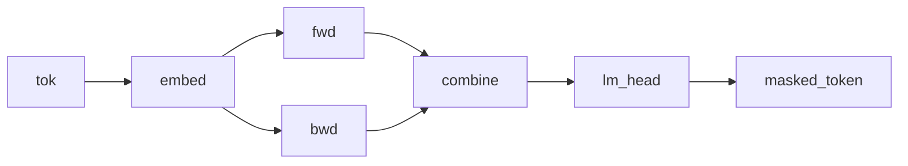

# Dual-RNN masked-token model

## Overview

Two independently parameterized recurrent cells scan the same token sequence, and a `combine` morphism merges their outputs before a Categorical masked-token score. Both `scan` calls run left to right on the supplied input. The source does not reverse the second sequence, so it does not provide right-context conditioning unless the caller constructs a reversed branch separately.

## QVR source

```qvr
# Dual-RNN Masked-Token Model
#
# Two independently parameterized cells scan the same token
# sequence from left to right. A combine morphism merges their
# summaries, and a Categorical lm_head over Token scores a
# masked-token target. The second path is named backward_path
# for contrast, but the source does not reverse its input; a
# caller must supply a reversed branch to obtain right context.
#
# Generative structure:
#
#   h_fwd    ~ scan(fwd_cell)(tok_embed(x))    forward hidden states
#   h_alt    ~ scan(bwd_cell)(tok_embed(x))    second left-to-right summary
#   h        ~ combine(h_fwd, h_bwd)           merged representation
#   masked_t ~ Categorical(logits=lm_head(h))  observed masked token
#
# Each input row is one context window, and one run of the program
# scores its masked token: the windows of a corpus are independent
# runs that share the model's parameters. Token is the vocabulary, so
# it is the value space of what lm_head draws and of what the program
# returns.
#
# The fan-out fan(forward_path, backward_path) runs the two
# paths in parallel over the same token sequence in the
# Kleisli category; the backbone is
# fan(forward_path, backward_path) >> combine.

object Token : FinSet 256
object Embedded, FwdHidden, BwdHidden : Real 64
object Combined : Real 128

morphism tok_embed : Token -> Embedded [role=embed]
morphism fwd_cell : Embedded * FwdHidden -> FwdHidden [param_source=mlp] ~ Normal
morphism bwd_cell : Embedded * BwdHidden -> BwdHidden [param_source=mlp] ~ Normal
morphism combine : Combined -> Combined [param_source=mlp] ~ Normal
morphism lm_head : Combined -> Token ~ Categorical

define forward_path = tok_embed >> scan(fwd_cell)
define backward_path = tok_embed >> scan(bwd_cell)
define backbone = fan(forward_path, backward_path) >> combine

program bidirectional_rnn_lm : Token -> Token
    sample h <- backbone

    observe masked_token <- lm_head(h)
    return masked_token

export bidirectional_rnn_lm
```

## Understanding the model

The data are a context of token IDs and one target token. An embedding turns
each ID into a vector; each [recurrent branch](vanilla-rnn-lm.md#understanding-the-model) compresses the context into a
running state; the merge turns the two summaries into the parameters of a
distribution over target tokens. A high target probability lowers that row's
negative log likelihood.

Both branches read the supplied order, even though their variable names say
forward and backward. Separate parameters allow different summaries, but do
not create right-to-left information flow. The synthetic experiment also
exposes hidden values for checking scores; distinguish a fit conditioned on
those values from a prediction that must integrate uncertainty about them.

## Walkthrough

### Two independent scans

`forward_path = tok_embed >> scan(fwd_cell)` and
`backward_path = tok_embed >> scan(bwd_cell)` are two independent Kleisli
morphisms, `Token -> FwdHidden` and `Token -> BwdHidden`. Both use `scan` to
thread state from left to right over the same token sequence. Their cells carry
independent parameters and thus learn separate sequence summaries.

### Parallel composition

`fan(forward_path, backward_path) >> combine` runs the two paths in parallel via the `fan` combinator, the Kleisli fan-out that feeds the same input to two morphisms and pairs their outputs in the [Giry monad](https://doi.org/10.1007/BFb0092872)'s Kleisli category. The result lives in `FwdHidden * BwdHidden`, which by the type aliases above has total dimension 128, matching `Combined`. The `combine` Bayesian morphism is the merge that mixes the two streams into a single combined representation. [@giry1982categorical]

### Masked LM head

The Categorical `lm_head : Combined -> Token` scores a masked-token target from the two learned summaries. In the current source, both summaries use the same input order; the name `backward_path` does not itself reverse data.

The program scores one context window per run. Each input row is a window, and a corpus of windows is a batch of independent runs that share the model's parameters, so every window draws its own branch trajectories and scores its own masked-token label. `Token : FinSet 256` sits in `lm_head`'s codomain and in the program's own codomain, so it is the value space the draw ranges over.



## Try it

> The short fits below demonstrate the API. Assess convergence with multiple chains and diagnostics before interpreting a posterior.


### Generating synthetic data

Trace the two fixed branches once to obtain their latent trajectories, the merged `h`, and the target. Each branch is a scan, whose embedding and cell draws are sites at every position: the scans sit in the branches of a `fan`, so their sites are named under the binding `h`, as `h$<branch>@t` for the cell's draw and `h$<branch>$x_in@t` for the embedding. Reuse every latent in `observations` so later likelihood evaluations score that same realization; otherwise each evaluation draws a new one. Each input row is one run: an int64 context of length `seq_len`, scored against one masked-token label.

```python
import torch
from quivers.dsl import load
from quivers.inference.trace import trace

torch.manual_seed(0)
prog = load("docs/examples/source/bidirectional_rnn_lm.qvr")
model = prog.morphism

# Fix the model's kernel parameters to chosen values, then run one
# forward trace so the captured hidden state and the masked-token target it
# generated are jointly consistent under the same weights.
for _, p in model.named_parameters():
    p.data.copy_(torch.randn_like(p) * 0.3)

rows, seq_len, vocab = 32, 8, 256
contexts = torch.randint(0, vocab, (rows, seq_len))
with torch.no_grad():
    forward = trace(model, contexts)
# Every latent the run drew: both branches' per-position sites and the
# merged `h` the `combine` kernel draws from their final states.
latents = {
    name: site.value.detach()
    for name, site in forward.sites.items()
    if not site.is_deterministic and name != "masked_token"
}
masked_token = forward.sites["masked_token"].value.detach()

x_in = contexts
observations = {"masked_token": masked_token, **latents}
print("contexts:", contexts.shape, contexts.dtype)
print("latent sites:", len(latents))
print("masked_token:", masked_token.shape, masked_token.dtype)
```

### SVI fit

Reinitialize `tok_embed`, `fwd_cell`, `bwd_cell`, `combine`, and `lm_head`, then fit a mean-field posterior over their parameters and the latents with an [`AutoNormalGuide`](../api/inference/guide.md) and [`SVI`](../api/inference/svi.md). The branches' scans draw at every position, so their trajectories and the merged `h` are lifted beside the parameters with [`bayesian_lift_parameters`](../api/inference/lifts.md#quivers.inference.lifts.bayesian_lift_parameters), each per-position label stacked over positions. The [`ELBO`](../api/inference/elbo.md) scores the Categorical `masked_token` site for each context.

```python
import torch
from quivers.dsl import load
from quivers.inference import AutoNormalGuide, ELBO, SVI, bayesian_lift_parameters
from quivers.inference.trace import trace

torch.manual_seed(0)
prog = load("docs/examples/source/bidirectional_rnn_lm.qvr")
model = prog.morphism

for _, p in model.named_parameters():
    p.data.copy_(torch.randn_like(p) * 0.3)
rows, seq_len, vocab = 32, 8, 256
contexts = torch.randint(0, vocab, (rows, seq_len))
targets = model.rsample(contexts)
observations = {"masked_token": targets}

torch.manual_seed(1)
for _, p in model.named_parameters():
    p.data.copy_(torch.randn_like(p) * 0.3)

# The latents: each label a branch's scan reaches per position, stacked
# as (rows, seq_len, ...), and the merged `h`.
forward = trace(model, contexts, observations)
per_position: dict[str, list[torch.Tensor]] = {}
latent_shapes: dict[str, tuple[int, ...]] = {}
for name, site in forward.sites.items():
    if site.is_deterministic or site.is_observed:
        continue
    label, at, _ = name.partition("@")
    if at:
        per_position.setdefault(label, []).append(site.value)
    else:
        latent_shapes[name] = tuple(site.value.shape)
for label, values in per_position.items():
    latent_shapes[label] = tuple(torch.stack(values, dim=1).shape)
lifted, lx, lobs = bayesian_lift_parameters(
    model, contexts, observations,
    prior_scale=1.0,
    additional_latents=latent_shapes,
)

guide = AutoNormalGuide(lifted, observed_names=set(lobs))
optim = torch.optim.Adam(guide.parameters(), lr=1e-2)
svi = SVI(lifted, guide, optim, ELBO(num_particles=1))

losses = [svi.step(lx, lobs)]
for _ in range(40):
    losses.append(svi.step(lx, lobs))

print(f"initial loss: {losses[0]:.2f}")
print(f"final loss:   {losses[-1]:.2f}")
```

### NUTS posterior

The forward / backward cells and the combine morphism are kernel Bayesian morphisms whose weights live as `nn.Parameter`s inside the program. [`bayesian_lift_parameters`](../api/inference/lifts.md#quivers.inference.lifts.bayesian_lift_parameters) lifts those parameters into Normal-prior sample sites so [`NUTSKernel`](../api/inference/mcmc.md#quivers.inference.mcmc.NUTSKernel) has a continuous unconstrained state space. The branches' per-position draws and the merged `h` are lifted beside the parameters through `additional_latents`, each per-position label stacked as `(rows, seq_len, ...)`, so the likelihood scores the masked-token target via the Categorical [`lm_head`](../api/continuous/families.md) at the merged state those latents determine.

```python
import torch
from quivers.dsl import load
from quivers.inference import MCMC, NUTSKernel, bayesian_lift_parameters
from quivers.inference.trace import trace

torch.manual_seed(0)
prog = load("docs/examples/source/bidirectional_rnn_lm.qvr")
model = prog.morphism
for _, p in model.named_parameters():
    p.data.copy_(torch.randn_like(p) * 0.3)
rows, seq_len, vocab = 32, 8, 256
contexts = torch.randint(0, vocab, (rows, seq_len))
targets = model.rsample(contexts)
observations = {"masked_token": targets}

# The latents: each label a branch's scan reaches per position, stacked
# as (rows, seq_len, ...), and the merged `h`.
forward = trace(model, contexts, observations)
per_position: dict[str, list[torch.Tensor]] = {}
latent_shapes: dict[str, tuple[int, ...]] = {}
for name, site in forward.sites.items():
    if site.is_deterministic or site.is_observed:
        continue
    label, at, _ = name.partition("@")
    if at:
        per_position.setdefault(label, []).append(site.value)
    else:
        latent_shapes[name] = tuple(site.value.shape)
for label, values in per_position.items():
    latent_shapes[label] = tuple(torch.stack(values, dim=1).shape)
lifted, lx, lobs = bayesian_lift_parameters(
    model, contexts, observations,
    prior_scale=1.0,
    additional_latents=latent_shapes,
)
kernel = NUTSKernel(step_size=0.005, max_tree_depth=3, target_accept=0.8)
mc     = MCMC(kernel, num_warmup=10, num_samples=10, num_chains=1)
result = mc.run(lifted, lx, lobs)

print(f"acceptance:  {float(result.acceptance_rates.mean()):.2f}")
print(f"divergences: {int(result.divergence_counts.sum())}")
```


## Categorical perspective

The model denotes a Kleisli morphism $\mathrm{Token} \to \mathcal{G}(\mathrm{Token})$ assembled by `fan`-composing two independent scan-folds and following with a merge. The `fan` combinator is the diagonal-pair construction $(f \times g) \circ \Delta$ in the Kleisli category that delivers a common input to both branches, landing in $\mathrm{FwdHidden} \times \mathrm{BwdHidden}$. Because that product carries the same 128 dimensions as $\mathrm{Combined}$, the Normal-kernel morphism `combine` $: \mathrm{Combined} \to \mathcal{G}(\mathrm{Combined})$ consumes the paired streams directly and mixes them into a single object. The Categorical head closes with the masked-token likelihood as a sub-probability kernel.


## Sources and further reading

- *A categorical approach to probability theory* [@giry1982categorical].
