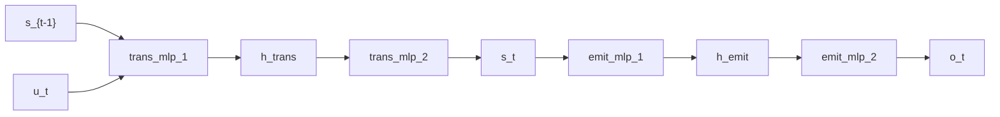

# Deep Markov Model

## Overview

The [deep Markov model](https://doi.org/10.1609/aaai.v31i1.10779) of Krishnan, Shalit, and Sontag (2017) is a state-space model with nonlinear, neural-network-parameterized transition and emission kernels: [@krishnan2017structured]

$$
\begin{aligned}
s_t &= f_\theta(s_{t-1}) + \varepsilon_t,
& \varepsilon_t &\sim \mathcal{N}(0, \sigma_s^2 I), \\
o_t &= g_\phi(s_t) + \eta_t,
& \eta_t &\sim \mathcal{N}(0, \sigma_o^2 I).
\end{aligned}
$$

The transition and emission means are MLPs; per-step Normal noise gives a tractable density. A separate `scan(infer_cell)` declaration has the shape of a recognition recurrence, but it is not connected to the exported `generative_step` or used by the fitted guide below. The combinator structure mirrors the [linear-Gaussian SSM](linear-gaussian-ssm.md): only the per-step cells change.

## QVR source

```qvr
# Deep Markov Model
#
# A state-space model with nonlinear, neural-network-parameterized
# transition and emission kernels. The combinator structure mirrors the
# linear-Gaussian SSM and replaces its linear maps with kernels whose
# parameters come from an MLP.
#
# Generative structure:
#
#   s_t  ~ trans_mlp(s_{t-1}, driver)             nonlinear transition
#   o_t  ~ emit_mlp(s_t)                          nonlinear emission
#   s_t  ~ infer_cell(o_t, s_{t-1})               variational recognition
#
# The nonlinearity is the ``param_source=mlp`` option, which routes a
# kernel's input to its Normal parameters through a tanh MLP. Without
# it a kernel's parameters are linear in its input, and composing two
# of them stays linear: the depth would buy nothing but a rank bound.
#
# The inference cell q_phi(o_t, s_{t-1}) -> s_t has the shape of a
# recognition network. Its scan is declared separately; the exported
# generative_step does not call it, and this file does not train an
# amortized posterior over the latent trajectory.
#
# Reference: [Krishnan, Shalit, and Sontag 2017](https://doi.org/10.1609/aaai.v31i1.10779).

object Driver : Real 4
object Hidden : Real 32
object State : Real 8
object Obs : Real 4

morphism trans_mlp_1 : Driver * State -> Hidden [param_source=mlp] ~ Normal
morphism trans_mlp_2 : Hidden -> State [param_source=mlp] ~ Normal
morphism emit_mlp_1 : State -> Hidden [param_source=mlp] ~ Normal
morphism emit_mlp_2 : Hidden -> Obs [param_source=mlp] ~ Normal
morphism infer_cell : Obs * State -> State [param_source=mlp] ~ Normal

define transition_cell = trans_mlp_1 >> trans_mlp_2
define emission = emit_mlp_1 >> emit_mlp_2
define generate = scan(transition_cell) >> emission
define recognize = scan(infer_cell)

# Probabilistic model: the exported one-step kernel pushes the
# previous (driver, state) pair through the two-layer transition
# MLP, then scores one observation under the emission MLP. The
# separate `generate` composition scans transition_cell and
# applies emission to the terminal state; it does not call this
# program or score an observation at every scan position.
program generative_step : Driver * State -> State
    sample s_new <- transition_cell

    observe o <- emission(s_new)
    return s_new

export generative_step
```

## Understanding the model

A linear transition uses one affine map to predict the next state. Here a
neural parameter network can bend that relationship: the same change in the
previous state can have different consequences in different regions. The
Normal kernel then adds uncertainty around its input-dependent mean. The
emission uses the same idea to relate states to measurements.

Executing the transition and emission draws an intermediate state and then
an observation. Scoring only the observation requires integrating over that
state. The fitting code below supplies the synthetic states, so it evaluates
[conditional densities](../tutorials/python/03-probabilistic-programs.md#building-a-monadicprogram) at known transitions while learning the kernel parameters.

## Walkthrough

The transition stack `trans_mlp_1 >> trans_mlp_2` maps `(u_t, s_{t-1})` through a hidden width of 32 to the 8-dimensional state; the emission stack returns to the 4-dimensional observation. Both stacks compose Gaussian kernels through sampled intermediate values. They support reparameterized draws, but the marginal composite is not generally Gaussian and does not provide the invertible density transformation required of a normalizing flow.

`scan(transition_cell) >> emission` is the generative pipeline. The separate `scan(infer_cell)` declaration is a [variational autoencoder](https://arxiv.org/abs/1312.6114)-style, recognition-shaped recurrence that threads the previous state and a new observation through `infer_cell`. It is not an implemented posterior until a guide connects it to the exported model and trains it against the full latent trajectory. The choice of `Driver` width controls the exogenous input; a non-driven model declares `object Driver : Real 1` and feeds a zero vector. [@kingma2014autoencoding]

## Try it

> The short fits below demonstrate the API. Assess convergence with multiple chains and diagnostics before interpreting a posterior.


### Generating synthetic data

Pick concrete ground-truth nonlinear dynamics (tanh recurrence on the latent, tanh decoder to observations) and forward-sample a single trajectory of length `T`. The latent dimension matches `State = Real 8`; the observation dimension matches `Obs = Real 4`. The single-step program `generative_step : Driver * State -> State` reads the previous (driver, state) pair as input and returns the new state, so its codomain is `State`; the per-step pair `(s_new, o)` is supplied as the observation dict, with `true_s_new` naming the ground-truth trajectory the latent site is clamped to.

```python
import torch
from quivers.dsl import load

torch.manual_seed(0)
prog = load("docs/examples/source/deep_markov.qvr")
model = prog.morphism

T = 32
state_dim, obs_dim, driver_dim = 8, 4, 4
W_s = 0.5 * torch.randn(state_dim, state_dim)
W_o = 0.3 * torch.randn(obs_dim, state_dim)
s = torch.zeros(T + 1, state_dim)
o = torch.zeros(T, obs_dim)
u = torch.randn(T, driver_dim)
for t in range(T):
    s[t + 1] = torch.tanh(s[t] @ W_s.T) + 0.1 * torch.randn(state_dim)
    o[t] = torch.tanh(s[t + 1] @ W_o.T) + 0.1 * torch.randn(obs_dim)

state_prev = torch.cat([u, s[:T]], dim=-1)
true_s_new = s[1:T + 1]
sites = {"s_new": true_s_new, "o": o}
x_in = state_prev
observations = sites
```

### SVI fit

The exported `generative_step` is a monadic program whose transition and emission MLP weights are kernel parameters without explicit priors; [`bayesian_lift_parameters`](../api/inference/lifts.md#quivers.inference.lifts.bayesian_lift_parameters) lifts each leaf into a unit-Normal sample site so [`AutoNormalGuide`](../api/inference/guide.md#quivers.inference.guides.AutoNormalGuide) can build a mean-field surrogate over the parameters. The per-step `(s_new, o)` trajectory is supplied as the observation dict, so `log_joint` scores the clamped trajectory under each lifted parameter draw.

```python
from quivers.inference import AutoNormalGuide, ELBO, SVI, bayesian_lift_parameters

torch.manual_seed(1)
prog = load("docs/examples/source/deep_markov.qvr")
inner = prog.morphism
model, x_lift, obs_lift = bayesian_lift_parameters(
    inner, x_in, observations, prior_scale=1.0,
)

guide = AutoNormalGuide(model, observed_names=set())
optim = torch.optim.Adam(
    list(model.parameters()) + list(guide.parameters()), lr=1e-2,
)
svi = SVI(model, guide, optim, ELBO())

loss0 = svi.step(x_lift, obs_lift)
losses = [svi.step(x_lift, obs_lift) for _ in range(300)]
loss_final = sum(losses[-20:]) / 20.0
oracle_ll = inner.log_joint(x_in, observations).sum().item()
print(f"initial ELBO loss: {loss0:.1f}")
print(f"final ELBO loss:   {loss_final:.1f}")
print(f"oracle -log p(h):  {-oracle_ll:.1f}")
```

### NUTS posterior

The lifted model carries one Normal sample site per leaf parameter; [`NUTSKernel`](../api/inference/mcmc.md#quivers.inference.mcmc.NUTSKernel) samples them directly.

```python
from quivers.inference import MCMC, NUTSKernel, bayesian_lift_parameters

torch.manual_seed(2)
prog = load("docs/examples/source/deep_markov.qvr")
model, x_lift, obs_lift = bayesian_lift_parameters(
    prog.morphism, x_in, observations, prior_scale=1.0,
)

kernel = NUTSKernel(step_size=0.05, max_tree_depth=3, target_accept=0.8)
mc = MCMC(kernel, num_warmup=15, num_samples=15, num_chains=1)
result = mc.run(model, x_lift, obs_lift)

print("acceptance:", float(result.acceptance_rates.mean()))
print("divergences:", int(result.divergence_counts.sum()))
```


## Categorical perspective

The transition stack is the Kleisli composition of two Gaussian kernels; the second kernel's mean depends on the sample from the first, so the joint per-step kernel is no longer Gaussian, only a reparameterizable density. `scan` realizes the iterated Kleisli composition over the time index and returns the terminal latent state. The declared `generate` path then emits one observation from that terminal state.

The separately declared recognizer has the shape of an amortized inference network. The exported `generative_step` and the `AutoNormalGuide` fit on this page do not call `recognize`, however. Joint training would require using that network as, or inside, the variational guide.




## Sources and further reading

- *Auto-Encoding Variational Bayes* [@kingma2014autoencoding].
- *Structured Inference Networks for Nonlinear State Space Models* [@krishnan2017structured].
