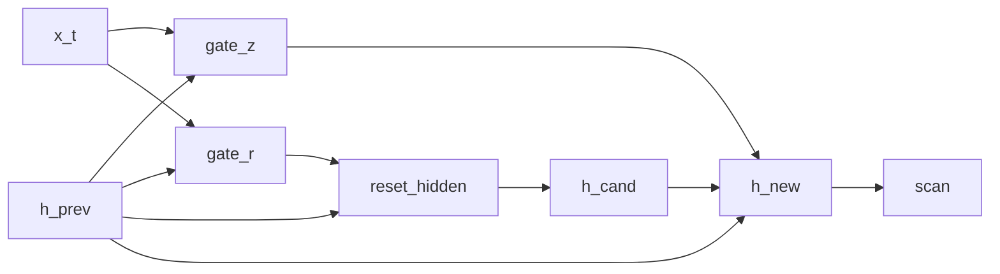

# GRU-shaped language model

## Overview

This stochastic recurrent cell is shaped after a [GRU](https://doi.org/10.3115/v1/D14-1179): it samples update and reset gates and mixes a candidate with the previous hidden state. It is not the canonical GRU equation. In particular, the candidate is centered directly on `r * h_prev` and does not use `x_t` or a learned candidate transformation. [@cho2014encoder]

## QVR source

```qvr
# GRU-Shaped Stochastic Language Model
#
# A stochastic gated recurrence wrapped in scan and used as a
# causal language model. It borrows the update and reset gates
# of a GRU, but its candidate is centered directly on the
# reset-gated previous state rather than on a learned transform
# of (x_t, r_t * h_{t-1}).
#
# Generative structure:
#
#   z_t      ~ LogitNormal(gate_z(x_t, h_{t-1}))  update gate
#   r_t      ~ LogitNormal(gate_r(x_t, h_{t-1}))  reset gate
#   h_cand   ~ Normal(r_t * h_{t-1}, 0.5)         simplified candidate
#   h_t      = (1 - z_t) * h_{t-1} + z_t * h_cand gated update
#   next_t   ~ Categorical(logits=lm_head(h_t))   next-token target
#
# scan threads hidden state across each sequence and returns its
# terminal state; a Categorical lm_head projects that summary
# onto the Token vocabulary.
#
# Resp is the plate: it indexes the 32 scored rows of the corpus,
# one next-token target per context. Token is the vocabulary, so it
# is the value space of what lm_head draws and of what the program
# returns.
#
# Reference: [Cho et al. 2014](https://doi.org/10.3115/v1/D14-1179).

object Token : FinSet 256
object Resp : FinSet 32
object Embedded : Real 64
object Hidden : Real 128

morphism tok_embed : Token -> Embedded [role=embed]
morphism gate_z, gate_r : Embedded * Hidden -> Hidden ~ LogitNormal
morphism lm_head : Hidden -> Token ~ Categorical

program gru_cell(x_t, h_prev) : Embedded * Hidden -> Hidden
    sample z <- gate_z(x_t, h_prev)
    sample r <- gate_r(x_t, h_prev)

    let reset_hidden = r * h_prev

    sample h_cand <- Normal(loc=reset_hidden, scale=0.5)

    let z_complement = 1.0 - z
    let h_new = z_complement * h_prev + z * h_cand
    return h_new

define backbone = tok_embed >> scan(gru_cell)

program gru_lm : Token -> Token
    sample h <- backbone

    observe next_token : Resp <- lm_head(h)
    return next_token

export gru_lm
```

## Understanding the model

A gate near zero retains little of the term it multiplies; a gate near one
retains almost all of it. In the update equation, a small `z` keeps the
[previous hidden state](vanilla-rnn-lm.md#understanding-the-model), while a
large `z` favors the new candidate. The reset gate `r` controls how much
previous state informs that candidate. In a [standard GRU cell](https://colah.github.io/posts/2015-08-Understanding-LSTMs/#variants-on-long-short-term-memory),
the candidate also depends on the current input through a learned
transformation [@olah2015lstm].

Here the gates and candidate are [random draws](../getting-started/concepts.md#5-a-distribution-is-more-than-one-sample), so two executions with the
same inputs can have different hidden states. The categorical head converts
the terminal summary to probabilities over the next token. The table below
should be read with that sampling interpretation: the gate means motivate
the architecture, but a sampled LogitNormal gate is not a deterministic sigmoid.

## Walkthrough

### Cell equations

| Step | DSL | Meaning |
|---|---|---|
| update gate | `z <- gate_z(x_t, h_prev)` | $z_t \sim \mathrm{LogitNormal}(\mu_z(x_t,h_{t-1}), \sigma_z(x_t,h_{t-1}))$ |
| reset gate | `r <- gate_r(x_t, h_prev)` | $r_t \sim \mathrm{LogitNormal}(\mu_r(x_t,h_{t-1}), \sigma_r(x_t,h_{t-1}))$ |
| reset-gated state | `let reset_hidden = r * h_prev` | $r_t \odot h_{t-1}$ |
| candidate | `h_cand <- Normal(reset_hidden, 0.5)` | $\tilde h_t \sim \mathcal{N}(r_t \odot h_{t-1}, 0.5)$ |
| update | `let h_new = z_complement * h_prev + z * h_cand` | $h_t = (1 - z_t)\,h_{t-1} + z_t \,\tilde h_t$ |

The candidate is drawn from a Normal centered on the reset-gated previous state; the update-gate convex combination $(1 - z_t)\,h_{t-1} + z_t \,\tilde h_t$ interpolates between persistence and the new candidate.

### State threading

`scan(gru_cell)` threads the hidden state $h_t$ across the sequence; the `Categorical` `lm_head` scores the next-token target from the terminal state $h_T$.

The two `FinSet` objects play different roles. `Resp : FinSet 32` sits in the observe step's index slot, so it is the plate: 32 scored rows, one next-token target per context. `Token : FinSet 256` sits in `lm_head`'s codomain and in the program's own codomain, so it is the value space the draw ranges over.



## Try it

> The short fits below demonstrate the API. Assess convergence with multiple chains and diagnostics before interpreting a posterior.

### Generating synthetic data

Trace the fixed GRU-shaped recurrence once to obtain its terminal `h` and target. Reuse `true_h` in `observations` so later likelihood evaluations score that same realization; otherwise each evaluation resamples `h`. Each `Resp` row contains an int64 prompt of length `seq_len` and one next-token label.

```python
import torch
from quivers.dsl import load
from quivers.inference.trace import trace

torch.manual_seed(0)
prog = load("docs/examples/source/gru_lm.qvr")
model = prog.morphism

# Fix the model's kernel parameters to chosen values, then run one
# forward trace so the captured hidden state and the next-token target it
# generated are jointly consistent under the same weights.
for _, p in model.named_parameters():
    p.data.copy_(torch.randn_like(p) * 0.3)

rows, seq_len, vocab = 32, 8, 256
prompts = torch.randint(0, vocab, (rows, seq_len))
with torch.no_grad():
    forward = trace(model, prompts)
true_h = forward.sites["h"].value.detach()
next_token = forward.sites["next_token"].value.detach()

x_in = prompts
observations = {"next_token": next_token, "h": true_h}
print("prompts:", prompts.shape, prompts.dtype)
print("true_h:", true_h.shape)
print("next_token:", next_token.shape, next_token.dtype)
```

### SVI fit

Reinitialize `tok_embed`, `gate_z`, `gate_r`, and `lm_head`, then fit their latent parameters with an [`AutoNormalGuide`](../api/inference/guide.md) and [`SVI`](../api/inference/svi.md). The [`ELBO`](../api/inference/elbo.md) scores the Categorical `next_token` site for each prompt.

```python
import torch
from quivers.dsl import load
from quivers.inference import AutoNormalGuide, ELBO, SVI

torch.manual_seed(0)
prog = load("docs/examples/source/gru_lm.qvr")
model = prog.morphism

for _, p in model.named_parameters():
    p.data.copy_(torch.randn_like(p) * 0.3)
rows, seq_len, vocab = 32, 8, 256
prompts = torch.randint(0, vocab, (rows, seq_len))
targets = model.rsample(prompts)
observations = {"next_token": targets}

torch.manual_seed(1)
for _, p in model.named_parameters():
    p.data.copy_(torch.randn_like(p) * 0.3)

guide = AutoNormalGuide(model, observed_names={"next_token"})
optim = torch.optim.Adam(
    list(model.parameters()) + list(guide.parameters()), lr=5e-2,
)
svi = SVI(model, guide, optim, ELBO(num_particles=1))

losses = [svi.step(prompts, observations)]
for _ in range(30):
    losses.append(svi.step(prompts, observations))

print(f"initial loss: {losses[0]:.2f}")
print(f"final loss:   {losses[-1]:.2f}")
```

### NUTS posterior

The lifted Bayesian model treats both the parameters $\theta$ and the per-token hidden state $h$ as latents: $p(\theta, h \mid x, y) \propto p(\theta) \, p(h \mid x, \theta) \, p(y \mid h, \theta)$. [`bayesian_lift_parameters`](../api/inference/lifts.md#quivers.inference.lifts.bayesian_lift_parameters) declares Normal priors on every learnable parameter and accepts an `additional_latents` mapping that lifts the intermediate `sample h` site as a NUTS variable with a placeholder Normal prior. The score step substitutes both into the inner program and cancels the placeholder, leaving $\log p(\theta) + \log p_{\text{inner}}(h, y \mid x, \theta)$. Given the full $(\theta, h)$ state, this log density is deterministic and introduces no Monte Carlo estimate during leapfrog steps.

```python
import torch
from quivers.dsl import load
from quivers.inference import MCMC, NUTSKernel, bayesian_lift_parameters

torch.manual_seed(0)
prog = load("docs/examples/source/gru_lm.qvr")
model = prog.morphism
for _, p in model.named_parameters():
    p.data.copy_(torch.randn_like(p) * 0.3)
rows, seq_len, vocab = 32, 8, 256
prompts = torch.randint(0, vocab, (rows, seq_len))
targets = model.rsample(prompts)
observations = {"next_token": targets}

h_shape = tuple(model._step_h.rsample(prompts).shape)
lifted, lx, lobs = bayesian_lift_parameters(
    model, prompts, observations,
    prior_scale=1.0,
    additional_latents={"h": h_shape},
)
kernel = NUTSKernel(step_size=0.005, max_tree_depth=3, target_accept=0.8)
mc     = MCMC(kernel, num_warmup=10, num_samples=10, num_chains=1)
result = mc.run(lifted, lx, lobs)

print(f"acceptance:  {float(result.acceptance_rates.mean()):.2f}")
print(f"divergences: {int(result.divergence_counts.sum())}")
```

## Categorical perspective

The GRU cell is a Kleisli morphism $\mathrm{Embedded} \times \mathrm{Hidden} \to \mathcal{G}(\mathrm{Hidden})$ in the [Giry monad](https://doi.org/10.1007/BFb0092872)'s Kleisli category; `scan(gru_cell)` is its iterated composition along the sequence. The Categorical head and `observe` step close the composite into the LM likelihood by accumulating per-batch categorical log-probabilities. [@giry1982categorical]

## Sources and further reading

- *Learning Phrase Representations using RNN Encoder–Decoder for Statistical Machine Translation* [@cho2014encoder].
- *A categorical approach to probability theory* [@giry1982categorical].
