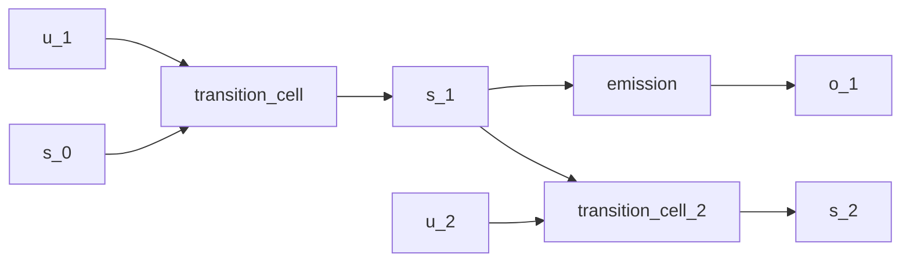

# Gaussian-kernel state-space model

## Overview

The classical linear-Gaussian [state-space model](https://en.wikipedia.org/wiki/State-space_representation) has a closed-form [Kalman filter](https://doi.org/10.1115/1.3662552) and [Rauch-Tung-Striebel smoother](https://doi.org/10.2514/3.3166): [@kalman1960filtering] [@rauch1965smoothing]

$$
\begin{aligned}
s_t &= A s_{t-1} + B u_t + w_t,
& w_t &\sim \mathcal{N}(0, Q), \\
o_t &= C s_t + v_t,
& v_t &\sim \mathcal{N}(0, R).
\end{aligned}
$$

The QVR source uses learned conditional-Normal kernels whose means and diagonal scales depend on their inputs. The separate `filter_cell` is another learned kernel; the Kalman update equations are absent. The [continuous-state](continuous-hmm.md) and [deep Markov](deep-markov.md) examples use the same state-space wiring.

## QVR source

```qvr
# Learned Gaussian State-Space Cells
#
# Conditional-Normal transition, emission, and recognition cells
# with the wiring of a state-space model. The parameter maps may
# make both the means and diagonal scales depend on their inputs,
# so this source is more general than a classical linear-Gaussian
# model and does not implement an analytic Kalman update.
#
# Generative structure:
#
#   s_t  ~ Normal(transition_cell(driver, s_{t-1}), Q)
#   o_t  ~ Normal(emission(s_t), R)
#   h_t  ~ Normal(filter_cell(o_t, h_{t-1}))       learned summary
#
# `scan` iterates each cell across runtime sequence data. The
# separately declared filter_cell is a learned recognition
# kernel, not a derived Bayesian inverse of transition_cell and
# emission.
#
# Reference: [Kalman 1960](https://doi.org/10.1115/1.3662552).

object Driver : Real 2
object State : Real 4
object Obs : Real 2

morphism transition_cell : Driver * State -> State ~ Normal
morphism emission : State -> Obs ~ Normal
morphism filter_cell : Obs * State -> State ~ Normal

define generate = scan(transition_cell) >> emission
define filter = scan(filter_cell)

# Probabilistic model: the exported one-step kernel takes the
# previous (driver, state) pair, draws a new state, and scores one
# observation under the emission kernel. The separate `generate`
# composition scans transition_cell and emits once from the
# terminal state; it does not call this program at every position.
program generative_step : Driver * State -> State
    sample s_new <- transition_cell

    observe o <- emission(s_new)
    return s_new

export generative_step
```

## Understanding the model

A driver is an observed external input, a state is the evolving internal
quantity, and an observation is a noisy readout of that state. A transition
combines the driver with the previous state to predict the next one. Repeating
that step builds a trajectory; the current [`scan`](../tutorials/qvr/05-time-series.md#scan-for-left-to-right-evaluation) interface returns its last
state, so the following emission produces a terminal observation.

The classic Kalman filter analytically updates a Gaussian state distribution
under specific linear, Gaussian, constant-covariance assumptions. The learned
kernels here are more general, and the separately declared `filter_cell` does
not enforce that update. The synthetic fitting blocks condition on [known states](continuous-hmm.md#understanding-the-model), which illustrates parameter learning rather than hidden-state filtering.

## Walkthrough

`Driver`, `State`, and `Obs` are Euclidean spaces; `Driver` carries an exogenous input concatenated with the previous state at each step. The transition and emission are conditional-Normal kernels with learned input-dependent means and diagonal scales.

`scan(transition_cell)` threads the latent state forward across a driver sequence and returns the terminal state; composing with `emission` draws one observation from that terminal state. `scan(filter_cell)` is a separately learned recognition path. Nothing in the declaration constrains `filter_cell` to equal the closed-form posterior update.

A matrix-Normal prior on the transition matrix is the natural conjugate choice when the analyst wants to separate row and column correlation structure: `~ MatrixNormal(loc, row_scale, col_scale) over (dom, cod)` puts a [Kronecker-covariance](https://en.wikipedia.org/wiki/Kronecker_product) prior on the representing tensor of a finite-state transition morphism. The Euclidean state space here uses parameter networks instead, but the same axis-role syntax applies once the state factorizes into named components.

## Try it

> The short fits below demonstrate the API. Assess convergence with multiple chains and diagnostics before interpreting a posterior.


### Generating synthetic data

Pick concrete ground-truth dynamics `(A, B, C)` with isotropic process and observation noise, then forward-sample a single trajectory of latent states and observations. The driver inputs `u_t` are independent Normal draws; the per-step recurrence is the standard LGSSM kalman setup. The single-step program `generative_step : Driver * State -> State` reads the previous (driver, state) pair as input; the per-step pair `(s_new, o)` is supplied as the observation dict.

```python
import torch
from quivers.dsl import load

torch.manual_seed(0)
prog = load("docs/examples/source/linear_gaussian_ssm.qvr")
model = prog.morphism

T = 32
state_dim = 4
obs_dim = 2
driver_dim = 2
A = 0.9 * torch.eye(state_dim)
B = 0.1 * torch.randn(state_dim, driver_dim)
C = torch.randn(obs_dim, state_dim)
Q_scale, R_scale = 0.1, 0.1

u = torch.randn(T, driver_dim)
s = torch.zeros(T + 1, state_dim)
o = torch.zeros(T, obs_dim)
for t in range(T):
    s[t + 1] = s[t] @ A.T + u[t] @ B.T + Q_scale * torch.randn(state_dim)
    o[t] = s[t + 1] @ C.T + R_scale * torch.randn(obs_dim)

state_prev = torch.cat([u, s[:T]], dim=-1)
sites = {"s_new": s[1:T + 1], "o": o}
x_in = state_prev
observations = sites
```

### SVI fit

The exported `generative_step` is a monadic program whose linear-Gaussian
transition and emission weights are kernel parameters without explicit
`sample` priors.
[`bayesian_lift_parameters`](../api/inference/lifts.md#quivers.inference.lifts.bayesian_lift_parameters)
lifts each leaf parameter into a unit-Normal sample site, allowing the standard
guide and ELBO implementation to apply uniformly. The per-step `(s_new, o)`
trajectory is supplied as the observation dictionary, so `log_joint` scores
the clamped trajectory under each lifted parameter draw.

```python
from quivers.inference import AutoNormalGuide, ELBO, SVI, bayesian_lift_parameters

torch.manual_seed(1)
prog = load("docs/examples/source/linear_gaussian_ssm.qvr")
inner = prog.morphism
model, x_lift, obs_lift = bayesian_lift_parameters(
    inner, x_in, observations, prior_scale=1.0,
)

guide = AutoNormalGuide(model, observed_names=set())
optim = torch.optim.Adam(
    list(model.parameters()) + list(guide.parameters()), lr=1e-2,
)
svi = SVI(model, guide, optim, ELBO())

loss0 = svi.step(x_lift, obs_lift)
losses = [svi.step(x_lift, obs_lift) for _ in range(300)]
loss_final = sum(losses[-20:]) / 20.0
oracle_ll = inner.log_joint(x_in, observations).sum().item()
print(f"initial ELBO loss: {loss0:.1f}")
print(f"final ELBO loss:   {loss_final:.1f}")
print(f"oracle -log p(h):  {-oracle_ll:.1f}")
```

### NUTS posterior

The lifted model is a [`MonadicProgram`](../api/monadic/monads.md) with one Normal sample site per leaf parameter; [`NUTSKernel`](../api/inference/mcmc.md#quivers.inference.mcmc.NUTSKernel) samples them directly. Small budgets keep the snippet inside tens of seconds for an API demonstration; longer, diagnosed runs are needed for posterior interpretation.

```python
from quivers.inference import MCMC, NUTSKernel, bayesian_lift_parameters

torch.manual_seed(2)
prog = load("docs/examples/source/linear_gaussian_ssm.qvr")
model, x_lift, obs_lift = bayesian_lift_parameters(
    prog.morphism, x_in, observations, prior_scale=1.0,
)

kernel = NUTSKernel(step_size=0.05, max_tree_depth=3, target_accept=0.8)
mc = MCMC(kernel, num_warmup=15, num_samples=15, num_chains=1)
result = mc.run(model, x_lift, obs_lift)

print("acceptance:", float(result.acceptance_rates.mean()))
print("divergences:", int(result.divergence_counts.sum()))
```


## Categorical perspective

`scan` iterates the conditional Gaussian kernel along the time index. Because each intermediate state is stochastic and the kernel parameters can depend on their inputs, the full composed distribution need not remain a single Gaussian. The synthetic-data block uses a classical linear-Gaussian process for comparison, but the QVR declarations are more general.




## Sources and further reading

- *Maximum likelihood estimates of linear dynamic systems* [@rauch1965smoothing].
- *A New Approach to Linear Filtering and Prediction Problems* [@kalman1960filtering].
