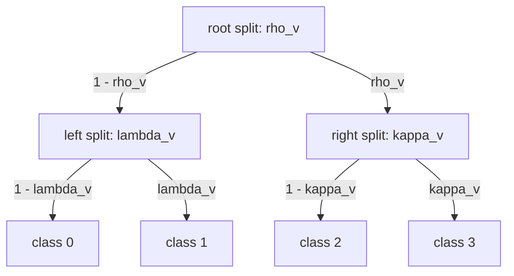

# Tree-Structured Categorical Model

## Overview

This program models a categorical response over four classes whose probabilities come from a binary tree of splits, a tree-structured categorical in which every internal node of the tree is a binary split. Each response belongs to a verb, and each verb has its own split probabilities: a population-level logit for each split plus a per-verb random effect. A root split chooses between the leaf pairs $\{0, 1\}$ and $\{2, 3\}$, and a second split chooses within the pair, so a leaf's probability is the product of the two branch probabilities on its path:

$$
p_v(0) = (1 - \rho_v)(1 - \lambda_v), \quad
p_v(1) = (1 - \rho_v)\lambda_v, \quad
p_v(2) = \rho_v (1 - \kappa_v), \quad
p_v(3) = \rho_v \kappa_v,
$$

where $\rho_v$, $\lambda_v$, and $\kappa_v$ are the [logistic](https://en.wikipedia.org/wiki/Logistic_function) transforms of verb $v$'s root, left, and right split logits $\eta_{\mathrm{root},v} = a_{\mathrm{root}} + \sigma_v e_{\mathrm{root},v}$ (and likewise for the other two splits), with $e_{s,v} \sim \mathcal{N}(0, 1)$. The four probabilities sum to one by construction, so they serve directly as the probabilities of a Categorical likelihood.

The example shows both forms of the [`factor`](../guides/dsl-programs-and-lets.md#factor-expressions-assembling-indexed-tensors) expression: the pattern-match form spells out the shape of the tree one leaf at a time, and the multi-binder form evaluates every leaf's path probability for every verb.



## QVR source

```qvr
# Tree-Structured Categorical Model
#
# A categorical response over four leaf classes whose probabilities
# come from a binary tree of splits, with per-verb random effects on
# each split's logit. A root split chooses between the left pair
# {0, 1} and the right pair {2, 3}; a second split then chooses
# within the pair. A leaf's probability is the product of the
# branch probabilities on its path, so the four probabilities are
# normalized by construction.
#
# Generative structure:
#
#   a_s       ~ Normal(0, 1.5)            population logit of split s
#   sigma_v   ~ HalfNormal(1)             spread of verb effects
#   e_s[v]    ~ Normal(0, 1)              standardized verb effect
#   eta_s[v]  = a_s + sigma_v * e_s[v]    verb v's logit of split s
#   y_n       ~ Categorical(leaf_prob[verb_idx[n]])
#
# for s in {root, left, right}, where with p(x) = sigmoid(x),
#
#   leaf_prob[v] = ( p(-eta_root) * p(-eta_left),
#                    p(-eta_root) * p(eta_left),
#                    p(eta_root)  * p(-eta_right),
#                    p(eta_root)  * p(eta_right) ).
#
# Three pattern-match factors spell out the tree, one case per leaf:
# which side of the root the leaf lies on, which side of its inner
# split, and whether that inner split is the left or the right one.
# A uniform factor over (Verb, Class) then evaluates the path
# probability of every leaf for every verb; its rows are the
# response probabilities.
# There is no free per-class offset: adding one would let the class
# effects absorb any change in the splits, leaving the splits
# unidentified.

object Verb : FinSet 12
object Class : FinSet 4
object Resp : FinSet 2400
object LeafProb : Real 4

# Resp is the plate of observed class labels and verb_idx maps each
# label to its verb. LeafProb is the value space of the returned rows
# of leaf probabilities, one real coordinate per class.

program tree_categorical : Resp -> LeafProb
    sample a_root <- Normal(loc=0.0, scale=1.5)
    sample a_left <- Normal(loc=0.0, scale=1.5)
    sample a_right <- Normal(loc=0.0, scale=1.5)
    sample sigma_v <- HalfNormal(scale=1.0)
    sample e_root : Verb <- Normal(loc=0.0, scale=1.0)
    sample e_left : Verb <- Normal(loc=0.0, scale=1.0)
    sample e_right : Verb <- Normal(loc=0.0, scale=1.0)

    let eta_root = a_root + sigma_v * e_root
    let eta_left = a_left + sigma_v * e_left
    let eta_right = a_right + sigma_v * e_right

    let root_side = factor cls : Class in { 0 -> -1.0, 1 -> -1.0, 2 -> 1.0, 3 -> 1.0, }
    let inner_side = factor cls : Class in { 0 -> -1.0, 1 -> 1.0, 2 -> -1.0, 3 -> 1.0, }
    let under_left = factor cls : Class in { 0 -> 1.0, 1 -> 1.0, 2 -> 0.0, 3 -> 0.0, }

    let leaf_prob = factor v : Verb, cls : Class in sigmoid(root_side[cls] * eta_root[v]) * sigmoid(inner_side[cls] * (under_left[cls] * eta_left[v] + (1.0 - under_left[cls]) * eta_right[v]))
    let row_probs = leaf_prob[verb_idx]

    observe y : Resp <- Categorical(probs=row_probs)
    return leaf_prob

export tree_categorical
```

## Understanding the model

A binary tree assigns a probability to a leaf by multiplying the branch probabilities along its path. For a split with logit $\eta$, the two branches have probabilities $\sigma(\eta)$ and $\sigma(-\eta) = 1 - \sigma(\eta)$, so writing every branch as $\sigma(\pm\eta)$ with the sign set by the side of the split makes all four leaves one expression with different signs. The tree encodes a hypothesis about which classes resemble one another: a verb effect on the root logit moves probability between the two pairs as a block, while an effect on the left or right logit moves it only within a pair.

Each verb has its own three split logits, drawn around shared population logits $a_s$ with spread $\sigma_v$. The data inform each verb's logits through that verb's responses, and the population logits through all verbs together.

The model has no free per-class offset. With one, the four class offsets could absorb any change in the population split logits and leave the likelihood unchanged, so the splits would not be identified; and since the tree's leaf probabilities already sum to one, an offset would also require renormalizing. Keeping the tree as the only source of class probabilities makes every parameter identified from per-verb class frequencies.

## Walkthrough

### What the four objects name

`Verb` indexes the verbs and `Class` the four leaves. `Resp` is the plate of observed class labels, and the host datum `verb_idx` maps each label to its verb. `LeafProb : Real 4` is the value space of the returned rows of leaf probabilities, one real coordinate per class.

### Split logits

The three `a_*` sites are the population split logits, `sigma_v` the spread of verb effects, and the three `e_*` sites the standardized per-verb effects, one per verb for each split. The `let eta_*` steps form each verb's split logits in non-centered form, $\eta_{s} = a_s + \sigma_v e_s$, which tends to sample better than drawing the effects directly at scale $\sigma_v$ when $\sigma_v$ is uncertain.

### Pattern-match factors: the shape of the tree

<!-- compile: false -->
```qvr
let root_side = factor cls : Class in { 0 -> -1.0, 1 -> -1.0, 2 -> 1.0, 3 -> 1.0, }
let inner_side = factor cls : Class in { 0 -> -1.0, 1 -> 1.0, 2 -> -1.0, 3 -> 1.0, }
let under_left = factor cls : Class in { 0 -> 1.0, 1 -> 1.0, 2 -> 0.0, 3 -> 0.0, }
```

The pattern-match form `factor cls : I in { 0 -> e_0, ..., n-1 -> e_{n-1} }` denotes a tensor of shape `(|I|, ...)` whose `i`-th cell is `e_i`. These three tables record the path to each leaf: `root_side` says which branch of the root the leaf lies under ($-1$ for the left branch, whose probability is $\sigma(-\eta) = 1 - \sigma(\eta)$, and $+1$ for the right), `inner_side` says the same for the leaf's second split, and `under_left` says whether that second split is the left one (classes 0 and 1) or the right one (classes 2 and 3). The compiler enforces label coverage of `{0, ..., |Class|-1}` exactly and rejects gaps, duplicates, or out-of-range labels at compile time, so a table cannot silently omit a leaf.

### Multi-binder factor: leaf probabilities for every verb

<!-- compile: false -->
```qvr
let leaf_prob = factor v : Verb, cls : Class in sigmoid(root_side[cls] * eta_root[v]) * sigmoid(inner_side[cls] * (under_left[cls] * eta_left[v] + (1.0 - under_left[cls]) * eta_right[v]))
```

The multi-binder form `factor v_1 : I_1, ..., v_n : I_n in <body>` constructs a tensor of shape `(|I_1|, ..., |I_n|, *body_shape)` whose `(i_1, ..., i_n)`-th cell is the body evaluated with each binder `v_k := i_k`. Here the body multiplies the probability of the leaf's root branch by the probability of its inner branch, choosing the left or the right inner split's logit by `under_left`, so `leaf_prob` has shape `(Verb, Class)`: one row of leaf probabilities per verb, with the class axis last, where the Categorical family expects it. The binder variables `v` and `cls` are integer-valued and visible only inside the body.

### Likelihood

`let row_probs = leaf_prob[verb_idx]` gathers each response's verb row, and `observe y : Resp <- Categorical(probs=row_probs)` scores the observed class. Each row of `leaf_prob` already sums to one, so no renormalization is needed.

### Why factor and not a plate

A plate-bound draw such as `sample e_root : Verb <- Normal(...)` and a factor expression are not interchangeable. The plate draws an `|Verb|`-shaped tensor of independent samples from one kernel; the factor evaluates a deterministic body once per index and assembles the results. Use `factor` when cells need different expressions in upstream latents, as the four leaves do here.

## Try it

The blocks below simulate labels from the model, check the compiled joint against a hand-written Categorical log density, fit by SVI and check the recovered leaf probabilities, and run a short NUTS chain on the same joint. The program's scalar sites (the population logits and `sigma_v`) combine with `Verb`-shaped sites, so the program input is a single row, `torch.zeros(1, 1)`; the `Resp` plate's extent comes from the observed labels.

### Generating synthetic data

```python
import torch
import torch.nn.functional as F
from quivers.dsl import load

D = torch.distributions

torch.manual_seed(0)
prog = load("docs/examples/source/tree_categorical.qvr")
model = prog.morphism

n_verb, n_class, n_resp = 12, 4, 2400

true_a_root, true_a_left, true_a_right = 0.8, -0.8, 0.4
true_sigma_v = 0.7
true_e_root = torch.randn(n_verb)
true_e_left = torch.randn(n_verb)
true_e_right = torch.randn(n_verb)


def leaf_probs(a_root, a_left, a_right, sigma_v, e_root, e_left, e_right):
    eta_root = a_root + sigma_v * e_root
    eta_left = a_left + sigma_v * e_left
    eta_right = a_right + sigma_v * e_right
    q = F.logsigmoid
    return torch.stack([
        q(-eta_root) + q(-eta_left),
        q(-eta_root) + q(eta_left),
        q(eta_root) + q(-eta_right),
        q(eta_root) + q(eta_right),
    ], dim=-1).exp()


true_leaf = leaf_probs(
    true_a_root, true_a_left, true_a_right, true_sigma_v,
    true_e_root, true_e_left, true_e_right,
)
verb_idx = torch.arange(n_verb).repeat_interleave(n_resp // n_verb)
y = D.Categorical(probs=true_leaf[verb_idx]).sample()

observations = {"y": y, "verb_idx": verb_idx}
x_in = torch.zeros(1, 1)
```

### Checking the joint density

At the true values, [`log_joint`](../api/continuous/programs.md#quivers.continuous.programs.MonadicProgram.log_joint) should equal the Normal and half-Normal prior terms plus $\sum_n \log p_{v_n}(y_n)$, written out by hand from the leaf probabilities.

```python
truth = {
    "a_root": torch.tensor(true_a_root),
    "a_left": torch.tensor(true_a_left),
    "a_right": torch.tensor(true_a_right),
    "sigma_v": torch.tensor(true_sigma_v),
    "e_root": true_e_root,
    "e_left": true_e_left,
    "e_right": true_e_right,
}
log_joint = model.log_joint(x_in, {**truth, **observations})[0]

by_hand = (
    sum(D.Normal(0.0, 1.5).log_prob(truth[k]) for k in ("a_root", "a_left", "a_right"))
    + D.HalfNormal(1.0).log_prob(truth["sigma_v"])
    + sum(D.Normal(0.0, 1.0).log_prob(truth[k]).sum() for k in ("e_root", "e_left", "e_right"))
    + true_leaf[verb_idx, y].log().sum()
)
assert torch.allclose(log_joint, by_hand, rtol=1e-5)
print(f"log joint at the truth: {float(log_joint):.2f}")
```

### SVI fit

Fit an [`AutoNormalGuide`](../api/inference/guide.md#quivers.inference.guides.AutoNormalGuide) by [`SVI`](../api/inference/svi.md#svi), push 200 guide draws through `leaf_probs`, and compare the posterior-mean leaf probabilities of every verb with the truth. The comparison point is each verb's raw class frequencies: with 200 labels per verb, the frequencies are themselves about 0.04 (in mean total variation) from the truth, so the fit should be about that close.

```python
from quivers.inference import AutoNormalGuide, ELBO, SVI

torch.manual_seed(1)
guide = AutoNormalGuide(model, observed_names={"y", "verb_idx"})
optim = torch.optim.Adam(
    list(model.parameters()) + list(guide.parameters()), lr=5e-2,
)
svi = SVI(model, guide, optim, ELBO(num_particles=1))
losses = [svi.step(x_in, observations) for _ in range(1000)]

sites = ("a_root", "a_left", "a_right", "sigma_v", "e_root", "e_left", "e_right")
with torch.no_grad():
    draws = [guide.rsample(x_in) for _ in range(200)]
fit_leaf = torch.stack([
    leaf_probs(*(d[k].reshape(-1) if k.startswith("e_") else d[k].reshape(-1)[0] for k in sites))
    for d in draws
]).mean(0)

counts = torch.zeros(n_verb, n_class).index_put_(
    (verb_idx, y), torch.ones(n_resp), accumulate=True,
)
freq = counts / counts.sum(-1, keepdim=True)
model_tv = float(0.5 * (fit_leaf - true_leaf).abs().sum(-1).mean())
freq_tv = float(0.5 * (freq - true_leaf).abs().sum(-1).mean())

split_truth = torch.sigmoid(torch.tensor([true_a_root, true_a_left, true_a_right]))
split_fit = torch.stack([
    torch.sigmoid(torch.stack([d[k].reshape(-1)[0] for d in draws])).mean()
    for k in ("a_root", "a_left", "a_right")
])

print(f"ELBO loss: {losses[0]:.1f} -> {sum(losses[-100:]) / 100:.1f}")
print(f"leaf TV: model {model_tv:.3f}, raw frequencies {freq_tv:.3f}")
print(f"population splits: fitted {split_fit.numpy().round(2)}, true {split_truth.numpy().round(2)}")

assert model_tv < 0.08
assert (split_fit - split_truth).abs().max() < 0.15
```

The split tolerance reflects that the population logits are informed by only 12 verbs: with $\sigma_v = 0.7$, the mean of 12 verb effects has a standard error of about 0.2 on the logit scale, or roughly 0.05 on the probability scale.

### NUTS posterior

[`NUTSKernel`](../api/inference/mcmc.md#quivers.inference.mcmc.NUTSKernel) targets the same joint; every site has an explicit prior, so no parameter lift is needed. The chain below is short; a real analysis would run several chains and check their diagnostics.

```python
from quivers.inference import MCMC, NUTSKernel

torch.manual_seed(2)
kernel = NUTSKernel(step_size=0.05, max_tree_depth=3, target_accept=0.8)
mc     = MCMC(kernel, num_warmup=15, num_samples=15, num_chains=1)
result = mc.run(model, x_in, observations)

assert torch.isfinite(result.log_densities).all()
print(f"acceptance:  {float(result.acceptance_rates.mean()):.2f}")
print(f"divergences: {int(result.divergence_counts.sum())}")
```

## Categorical perspective

Operationally, `factor` constructs a tensor by finite index binding, while `arr[i]` eliminates an index by lookup. The program uses both: the pattern-match factors introduce the `Class` index case by case, the uniform factor introduces `Verb` and `Class` together around lookups into those tables and into the per-verb logits, and the gather `leaf_prob[verb_idx]` pulls the verb-indexed table back along the map from responses to verbs. Each row of the result is a point of the four-class simplex, and the Categorical likelihood is the kernel from that simplex to `Class` that it parameterizes.

## See also

- [DSL Guide: Factor expressions](../guides/dsl-programs-and-lets.md#factor-expressions-assembling-indexed-tensors)
- [Bayesian Gaussian Mixture Model](mixture-model.md), whose class weights come from a flat Dirichlet over `Component` rather than a tree of splits.
