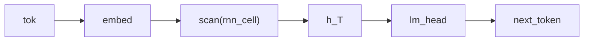

# Vanilla RNN Language Model

## Overview

This recurrent language model uses a [`rnn_cell`](../guides/dsl-programs-and-lets.md) program to update the hidden state from the current embedded token and the previous state. [`scan(rnn_cell)`](../guides/dsl-declarations.md#scan-temporal-recurrence) threads that state across a sequence, and a `Categorical` [`lm_head`](../api/continuous/families.md) maps the terminal hidden state to a distribution over the vocabulary for one next-token observation.

## QVR source

```qvr
# Bayesian Vanilla RNN Language Model
#
# A standard vanilla RNN used as a causal language model. The
# recurrent cell is written as a program so every step of the
# recurrence is a declared site. scan threads hidden state across
# each input sequence and returns its terminal state, which a
# Categorical lm_head projects onto the Token vocabulary.
#
# Generative structure:
#
#   h_t      = tanh(W [x_t ; h_{t-1}])           recurrent update
#   next_t   ~ Categorical(logits=lm_head(h_t))  next-token target
#
# The tanh is drawn rather than applied. A LogitNormal draw is a
# sigmoid of a Gaussian pre-activation, and tanh(u) = 2 sigmoid(2u) - 1,
# so squashing that draw onto (-1, 1) with an affine let is exactly a
# tanh-transformed Gaussian pre-activation. The cell's single weight
# matrix is the linear parameter map its arrow already carries, which
# is what makes this the one-matrix recurrence a vanilla RNN is
# defined to be.
#
# Resp is the plate: it indexes the 32 scored rows of the corpus,
# one next-token target per context. Token is the vocabulary, so it
# is the value space of what lm_head draws and of what the program
# returns.
#
# This is the simplest sequence model in the gallery and the
# baseline against which gru_lm.qvr and lstm_lm.qvr add gating
# structure.

object Token : FinSet 256
object Resp : FinSet 32
object Embedded : Real 64
object Hidden : Real 128

morphism tok_embed : Token -> Embedded [role=embed]
morphism cell : Embedded * Hidden -> Hidden ~ LogitNormal
morphism lm_head : Hidden -> Token ~ Categorical

program rnn_cell(x_t, h_prev) : Embedded * Hidden -> Hidden
    sample squashed <- cell(x_t, h_prev)

    let h_new = 2.0 * squashed - 1.0
    return h_new

define backbone = tok_embed >> scan(rnn_cell)

program vanilla_rnn_lm : Token -> Token
    sample h <- backbone

    observe next_token : Resp <- lm_head(h)
    return next_token

export vanilla_rnn_lm
```

## Understanding the model

A [recurrent state](https://colah.github.io/posts/2015-08-Understanding-LSTMs/#recurrent-neural-networks)
summarizes the preceding context [@olah2015lstm]. Each new token updates
that summary, so the same token can lead to different predictions depending
on what preceded it. The terminal state summarizes the supplied prefix;
the head turns it into probabilities for one following token.

This cell includes random hidden draws. Forward executions can thus differ
even at fixed parameters, unlike a deterministic RNN. Scoring an explicit
trajectory and scoring only the final output are different operations: the
latter generally requires [integrating hidden draws](../tutorials/python/03-probabilistic-programs.md#building-a-monadicprogram). The [trajectory addresses](../tutorials/qvr/05-time-series.md#scan-for-left-to-right-evaluation)
below keep repeated sites distinguishable when replaying and checking a run.

## Walkthrough

Tokens are embedded into the 64-dimensional `Embedded` space, after which `scan(rnn_cell)` threads a 128-dimensional hidden state across the sequence. At each step, `rnn_cell` consumes `(x_t, h_{t-1})`, draws `s_t` from the `LogitNormal` cell, and returns $h_t = 2s_t - 1$ on $(-1, 1)$. The program form exposes this draw as a declared site. Since $2\sigma(u)-1=\tanh(u/2)$, the affine `let` is a scaled tanh transform of a Gaussian pre-activation; unlike a deterministic vanilla-RNN update, it retains the `LogitNormal` family's learned scale. The terminal state $h_T$ summarizes the prefix, and the `Categorical` [`lm_head`](../api/continuous/families.md) maps it to a distribution over the 256-symbol vocabulary for `observe next_token`.

The two `FinSet` objects play different roles, and the positions they appear in are what fix them. `Resp : FinSet 32` sits in the observe step's index slot, so it is the plate: 32 scored rows, one next-token target per context. `Token : FinSet 256` sits in `lm_head`'s codomain and in the program's own codomain, so it is the value space: the 256 outcomes a draw ranges over, and the space the returned `next_token` lives in.

`scan(rnn_cell)` elaborates to a one-position step computation
and a recursive helper over the input's open sequence extent. Repeated sites
receive stable trajectory addresses such as `s@0`, `s@1`, and so on, which the
reference machine can replay and score. Current transpile targets refuse the
scan under `scan:no-lowering:rnn_cell`; the open sequence extent is runtime
data rather than a declared object the target can use as a static loop bound.
See the [probabilistic-program reference](../reference/qvr/probabilistic-programs.md#scans).



## Try it

> The short fits below demonstrate the API. Assess convergence with multiple chains and diagnostics before interpreting a posterior.

### Generating synthetic data

Trace the fixed vanilla recurrence once to obtain its terminal `h` and target. Reuse `true_h` in `observations` so later likelihood evaluations score that same realization; otherwise each evaluation resamples `h`. Each `Resp` row contains an int64 prompt of length `seq_len` and one next-token label.

```python
import torch
from quivers.dsl import load
from quivers.inference.trace import trace

torch.manual_seed(0)
prog = load("docs/examples/source/vanilla_rnn_lm.qvr")
model = prog.morphism

# Fix the model's kernel parameters to chosen values, then run one
# forward trace so the captured hidden state and the next-token target it
# generated are jointly consistent under the same weights.
for _, p in model.named_parameters():
    p.data.copy_(torch.randn_like(p) * 0.3)

rows, seq_len, vocab = 32, 8, 256
prompts = torch.randint(0, vocab, (rows, seq_len))
with torch.no_grad():
    forward = trace(model, prompts)
true_h = forward.sites["h"].value.detach()
next_token = forward.sites["next_token"].value.detach()

x_in = prompts
observations = {"next_token": next_token, "h": true_h}
print("prompts:", prompts.shape, prompts.dtype)
print("true_h:", true_h.shape)
print("next_token:", next_token.shape, next_token.dtype)
```

### SVI fit

Reinitialize `tok_embed`, the recurrent `cell`, and `lm_head`, then fit their latent parameters with an [`AutoNormalGuide`](../api/inference/guide.md) and [`SVI`](../api/inference/svi.md). The [`ELBO`](../api/inference/elbo.md) scores the Categorical `next_token` site for each prompt.

```python
import torch
from quivers.dsl import load
from quivers.inference import AutoNormalGuide, ELBO, SVI

torch.manual_seed(0)
prog = load("docs/examples/source/vanilla_rnn_lm.qvr")
model = prog.morphism

# Regenerate the synthetic corpus under the same seed used for
# data generation.
for _, p in model.named_parameters():
    p.data.copy_(torch.randn_like(p) * 0.3)
rows, seq_len, vocab = 32, 8, 256
prompts = torch.randint(0, vocab, (rows, seq_len))
targets = model.rsample(prompts)
observations = {"next_token": targets}

# Fresh weights for fitting.
torch.manual_seed(1)
for _, p in model.named_parameters():
    p.data.copy_(torch.randn_like(p) * 0.3)

guide = AutoNormalGuide(model, observed_names={"next_token"})
optim = torch.optim.Adam(
    list(model.parameters()) + list(guide.parameters()), lr=5e-2,
)
svi = SVI(model, guide, optim, ELBO(num_particles=1))

losses = [svi.step(prompts, observations)]
for _ in range(30):
    losses.append(svi.step(prompts, observations))

print(f"initial loss: {losses[0]:.2f}")
print(f"final loss:   {losses[-1]:.2f}")
```

### NUTS posterior

The lifted Bayesian model treats both the parameters $\theta$ and the per-token hidden state $h$ as latents: $p(\theta, h \mid x, y) \propto p(\theta) \, p(h \mid x, \theta) \, p(y \mid h, \theta)$. [`bayesian_lift_parameters`](../api/inference/lifts.md#quivers.inference.lifts.bayesian_lift_parameters) declares Normal priors on every learnable parameter and accepts an `additional_latents` mapping that lifts the intermediate `sample h` site as a NUTS variable with a placeholder Normal prior. The score step substitutes both into the inner program and cancels the placeholder, leaving $\log p(\theta) + \log p_{\text{inner}}(h, y \mid x, \theta)$. Given the full $(\theta, h)$ state, this log density is deterministic and introduces no Monte Carlo estimate during leapfrog steps.

```python
import torch
from quivers.dsl import load
from quivers.inference import MCMC, NUTSKernel, bayesian_lift_parameters

torch.manual_seed(0)
prog = load("docs/examples/source/vanilla_rnn_lm.qvr")
model = prog.morphism
for _, p in model.named_parameters():
    p.data.copy_(torch.randn_like(p) * 0.3)
rows, seq_len, vocab = 32, 8, 256
prompts = torch.randint(0, vocab, (rows, seq_len))
targets = model.rsample(prompts)
observations = {"next_token": targets}

h_shape = tuple(model._step_h.rsample(prompts).shape)
lifted, lx, lobs = bayesian_lift_parameters(
    model, prompts, observations,
    prior_scale=1.0,
    additional_latents={"h": h_shape},
)
kernel = NUTSKernel(step_size=0.005, max_tree_depth=3, target_accept=0.8)
mc     = MCMC(kernel, num_warmup=10, num_samples=10, num_chains=1)
result = mc.run(lifted, lx, lobs)

print(f"acceptance:  {float(result.acceptance_rates.mean()):.2f}")
print(f"divergences: {int(result.divergence_counts.sum())}")
```

## Categorical perspective

The model is a Kleisli morphism $\mathrm{Token} \to \mathcal{G}(\mathrm{Token})$ in the [Giry monad](https://doi.org/10.1007/BFb0092872)'s Kleisli category. [`scan(rnn_cell)`](../guides/dsl-declarations.md#scan-temporal-recurrence) is the recursive [fold](https://ncatlab.org/nlab/show/fold) along the sequence in the Kleisli category: each step composes the previous step's output kernel with the new cell. The closing Categorical head observes the next-token label as a sub-probability kernel in $\mathcal{G}_{\le 1}$. [@giry1982categorical]

## Sources and further reading

- *A categorical approach to probability theory* [@giry1982categorical].
