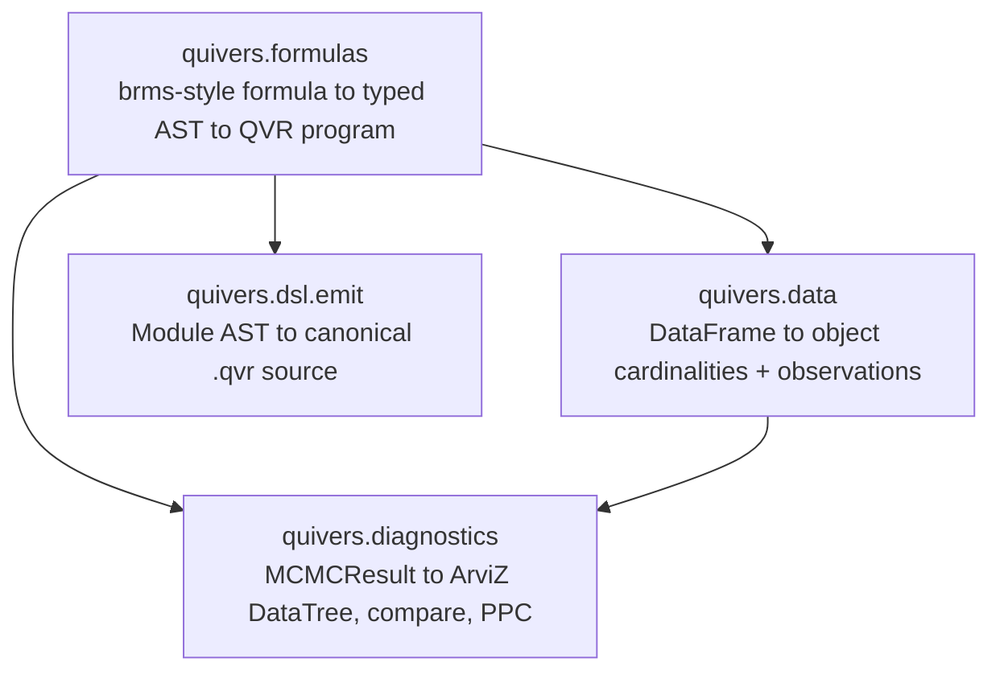

# Analysis: Data and Formulas

The analysis stack turns a dataframe and a brms-style formula into a
QVR model. You can inspect the generated source to see the response
family, predictors, group effects, and priors.
[Fitting and Diagnostics](analysis-fitting-and-diagnostics.md) covers
posterior inference and checks on the fitted model.

## Architecture

Four small subpackages, each consumable independently:



Each subpackage is gated behind an optional dependency extra, so a
user who only wants the DSL and inference does not pull dataframe,
ArviZ, or formula dependencies. Install the full stack with
`pip install "quivers[formulas]"`.

## Dataframes: `quivers.data`

A model needs both values and a consistent interpretation of their
indices. If a subject column contains `s1, s2, s1`, the corresponding
index array might be `0, 1, 0`. The repeated zero makes both rows use
the same subject-level parameter. `DatasetSchema` creates that mapping,
the finite object describing the subjects, and the tensors supplied at
runtime. Category ordering is thus part of the model/data interface,
not merely a display choice.

[`DatasetSchema`](../api/data/schema.md) is a typed
[`didactic.api.Model`](https://didactic.dev/api/Model) that maps
dataframe columns to QVR-program artifacts. It accepts pandas,
polars, or any other
[Narwhals](https://narwhals-dev.github.io/narwhals/)-compatible
dataframe.

<!-- python: skip -->
```python
import pandas as pd
from quivers.data import DatasetSchema, compose

df = pd.DataFrame({
    "verb": ["eat", "drink", "run", "eat", ...],
    "subject": ["s1", "s2", "s1", "s3", ...],
    "rt": [0.31, 0.42, 0.28, 0.55, ...],
    "response": [1, 0, 1, 1, ...],
})

schema = DatasetSchema(
    df=df,
    objects={"verb": "Verb", "subject": "Subject"},
    plate_indices={"verb": "verb_idx", "subject": "subj_idx"},
    covariates={"rt": "rt"},
    observations={"response": "y"},
)

print(schema.declarations())          # object Verb : FinSet 17 / object Subject : FinSet 50
print(schema.cardinalities)           # {"Verb": 17, "Subject": 50}
obs = schema.observations_dict()      # {"verb_idx": tensor, "subj_idx": tensor, ...}
```

Two artifacts come out:

- [`declarations()`](../api/data/schema.md#quivers.data.schema.DatasetSchema.declarations)
  emits a `.qvr` prelude with one `object X : FinSet N` line per declared
  object axis. The cardinality is inferred from
  `df[col].n_unique()`; canonical category ordering is the column's
  sorted unique non-null values so plate indices are reproducible
  across reruns.
- [`observations_dict()`](../api/data/schema.md#quivers.data.schema.DatasetSchema.observations_dict)
  packs the per-row tensors that inference consumes (response,
  plate indices, numeric covariates), ready to pass into
  [`SVI.step`](../api/inference/svi.md) or
  [`MCMC.run`](../api/inference/mcmc.md).

The companion
[`compose(qvr_body, schema)`](../api/data/schema.md#quivers.data.schema.compose)
prepends the schema's declarations to a user's `.qvr` body before
compiling, so the user writes only the program body and the
cardinalities come from the data.

Missing-data handling is configurable per schema via
[`MissingPolicy`](../api/data/encoding.md#quivers.data.encoding.MissingPolicy):
`RAISE` (default), `DROP`, `IMPUTE`, or `MASK`.

## Formulas: `quivers.formulas`

Read `y ~ x + (1 | g)` as: predict response `y` from predictor `x`,
with an intercept that may differ by group `g`. The intercept is the
baseline; the slope multiplies `x`; the grouped offsets come from a
shared distribution, enabling partial pooling. The formula chooses the
structure of the predictor, while the family chooses the distribution
of responses and priors describe unknown coefficients. [@gelman2013bayesian]

The **link function** connects a response distribution's parameter to
the predictor. For Bernoulli outcomes the inverse logit, or sigmoid,
turns any real predictor into a valid probability. The formula's `~`
introduces a response model; it is not the same operation as drawing
a value with `sample` inside QVR.

The [formula frontend](../api/formulas/index.md) compiles a
[brms](https://paul-buerkner.github.io/brms/) /
[`lme4`](https://cran.r-project.org/package=lme4)-style formula
into a typed QVR [`Module`](../api/dsl/ast_nodes.md) AST. No
source-string concatenation: the translation
[`FormulaToQVRModule`](../api/formulas/compile.md#quivers.formulas.compile.FormulaToQVRModule)
is a [`didactic.api.Lens`](https://didactic.dev/api/Lens) from
`Formula` to `Module`, mirroring the existing resolution-lens
pattern in
[`quivers.dsl.resolution`](../api/dsl/resolution.md). Formula
syntax is parsed by the
[`formulae`](https://bambinos.github.io/formulae/) library (the
[Bambi](https://bambinos.github.io/bambi/) team's pure-Python
brms-style parser), then lifted into a typed `Formula` record.

### Inspect or dump the generated QVR

<!-- python: skip -->
```python
from quivers.formulas import formula_to_qvr

src = formula_to_qvr("y ~ poly(x, 2) + (1 | g)", data=df)
print(src)                                  # canonical .qvr source
```

The emit goes through
[`quivers.dsl.emit.module_to_source`](../api/dsl/emit.md), which
walks the `Module` AST and produces canonical `.qvr` source. The
emitted source re-parses through
[`quivers.dsl.loads`](../api/dsl/parser.md) into a `Module` that
compiles to the same program: the round-trip is exercised on every
formula in the test suite.

### R / brms conventions

- **Orthogonal polynomials by default.** `poly(x, k)` produces $k$
  orthonormal centered columns, matching R's
  [`stats::poly`](https://stat.ethz.ch/R-manual/R-devel/library/stats/html/poly.html).
  Raw monomials remain available via `I(x**k)`.
- **One coefficient per design-matrix column** (matches brms
  display). `poly(x, 2)` produces two named coefficients
  `beta_poly_x_2_1` and `beta_poly_x_2_2`; `x*z` produces three
  named coefficients (`beta_x`, `beta_z`, `beta_x_z`). The
  per-column data flows in as a free variable via the host-data
  channel (see the
  [conditioning API](inference-foundations.md#host-data-per-row-covariates-and-index-arrays)).
- **R-style transforms** preloaded into the formulae evaluation
  namespace: `log`, `exp`, `sqrt`, `abs`, `sin`, `cos`, `tan`,
  `log10`, `log2`, `log1p`, `expm1`, `asin`, `acos`, `atan`,
  `sinh`, `cosh`, `tanh`. No registration required.
- **Random-effect groups** `(1 | g)`, `(1 + x | g)`, `(x | g)`,
  `(0 + x | g)` parse identically to brms / lme4. Multiple slopes
  per group emit independent random-effect terms (the lme4
  `(... || g)` uncorrelated semantics); correlated LKJ-prior slopes
  are future scope.
- **Interactions** `x:z` (elementwise product, one coefficient) and
  `x*z` (expands to `x + z + x:z`, three coefficients).

### Family registry

`fit(..., family=...)` accepts a string name or a
[`Family`](../api/formulas/family.md#quivers.formulas.family.Family)
value. The built-in families:

| Family | Link (inverse) | Auxiliary parameters |
|---|---|---|
| `gaussian` | identity | `sigma ~ HalfCauchy(2.0)` |
| `bernoulli` | logit (sigmoid) | – |
| `binomial` | logit (sigmoid) | known trial count |
| `categorical` | reference-category multinomial logit | one coefficient and random effect per non-reference category |
| `poisson` | log (exp) | – |
| `negative_binomial` | log (exp) | `disp ~ Gamma(2.0, 2.0)` |
| `gamma` | log (exp) | `shape ~ Gamma(2.0, 2.0)` |
| `beta` | logit (sigmoid) | `phi ~ HalfCauchy(2.0)` |
| `student_t` | identity | `nu ~ Gamma(2.0, 0.1)`, `sigma ~ HalfCauchy(2.0)` |
| `cumulative` | identity | learned ordered cutpoints |
| `zero_inflated_poisson` | log (exp) | `zi ~ Beta(2.0, 2.0)` |
| `hurdle_poisson` | log (exp) | `zi ~ Beta(2.0, 2.0)` |
| `mixture` | identity | component logits, centered location offsets, and positive scales |

Custom families are pluggable: subclass
[`Family`](../api/formulas/family.md#quivers.formulas.family.Family)
and register your own observe kernel and link.

For binomial data, `binomial_trials` is either one common positive
integer or the name of a per-row data column:

<!-- python: skip -->
```python
fit(
    "successes ~ condition + (1 | participant)",
    data=df,
    family="binomial",
    binomial_trials="trials",
)
```

The emitted likelihood is `Binomial(trials, sigmoid(eta))`. The
negative-binomial family uses the NB2 mean/concentration form in the
formula DSL: `mu = exp(eta)`, `disp > 0`, and the compiler emits
`NegativeBinomial(disp, mu / (mu + disp))`, matching QVR's
`(total_count, probs)` convention.

The other scalar response families likewise use regression-facing
parameters rather than exposing constructor-specific slots. Gamma uses
mean `mu` and shape `shape`, then emits `Gamma(shape, shape / mu)`.
Beta uses mean `mu` and precision `phi`, then emits
`Beta(mu * phi, (1 - mu) * phi)`. Student-t maps `nu`, `mu`, and
`sigma` to QVR's `(df, loc, scale)` order. Zero-inflated and hurdle
Poisson models interpret `zi` as the structural-zero probability and
`mu` as the Poisson rate.

### Unordered categorical mixed models

Adding the same constant to every logit leaves softmax unchanged.
Without a constraint, many coefficient settings would describe exactly
the same probabilities. Fixing category zero's logit to zero removes
that redundant direction; the other logits describe comparisons with
that reference category. With logits `[0, 0, 0]`, for instance, each
category has probability `1/3`, including the reference category.

The categorical family infers `K` from contiguous integer labels
`0, ..., K-1` and uses category zero as the reference. Every fixed-effect
coefficient and random effect is thus a vector of `K - 1` logits.
The compiler prepends the reference logit of zero and applies softmax to
the resulting per-row `K`-vector. This parameterization removes the
unidentified common shift in an unconstrained set of `K` logits.

<!-- python: skip -->
```python
choice_fit = fit(
    "choice ~ surprisal + condition + (1 + surprisal | participant)",
    data=choices,
    family="categorical",
    method="nuts",
)
```

Categorical responses must contain every label between zero and `K - 1`.
Class-specific random effects currently use the default non-centered
parameterization; `reparameterize="centered"` is rejected when a
categorical formula contains random effects.

An external categorical predictor may return either the `K - 1`
non-reference logits with shape `(N, K - 1)` or a full `(N, K)` logit
matrix. In the latter case, `fit` subtracts the reference-category logit
before combining the predictor with formula terms. A binary categorical
predictor may also return shape `(N,)`.

### Gaussian mixture regressions

A mixture says that each response could have come from one of several
component distributions. Its likelihood sums their weighted densities,
so fitting need not select a component for every observation. Swapping
component labels leaves the same distribution; centering component
offsets solves a different ambiguity, separating overall location from
relative component locations. Interpret component summaries with both
symmetries in mind.

The mixture family represents each response as a finite Gaussian mixture.
`mixture_components` sets the number of components, while the formula's
linear predictor shifts every component location for a row. Component
weights are shared across rows, location offsets are centered to separate
them from the formula intercept, and every component has its own positive
scale. The `K - 1` free logits and offsets are projected through an
orthonormal Helmert basis. Thus the default isotropic Normal priors induce
permutation-symmetric distributions on the sum-zero `K`-vectors without a
redundant common direction:

<!-- python: skip -->
```python
mixture_fit = fit(
    "reaction_time ~ condition + (1 | participant)",
    data=trials,
    family="mixture",
    mixture_components=3,
    priors={
        "mixture_logit": "Normal(0.0, 0.5)",
        "mixture_offset": "Normal(0.0, 2.0)",
        "mixture_scale": "HalfNormal(1.0)",
    },
    method="nuts",
)
```

`MixtureNormal` sums over component assignments in the likelihood.
Centering separates the shared regression location from component
offsets. Permuting the component labels leaves the likelihood unchanged,
so summarize permutation-invariant quantities or align labels before
comparing component-specific posterior draws.

### Ordinal mixed models and neural predictors

For ordered ratings, imagine a continuous latent response divided by
ordered cutpoints. Moving the predictor changes which intervals are
likely; changing the spacings changes how broadly particular rating
categories are used. Group-specific spacings can represent differences
in scale use without changing the order of the categories.

The cumulative family infers the number of categories from contiguous
integer response labels `0, ..., K-1`. Shared cutpoints are represented
by cumulative positive spacings and centered to separate their location
from the formula intercept. `thresholds_by` replaces the shared spacing
vector with partially pooled group-specific spacings:

<!-- python: skip -->
```python
ordinal_fit = fit(
    "rating ~ condition + (1 | participant) + (1 | item)",
    data=df,
    family="cumulative",
    thresholds_by="participant",
    method="nuts",
)
```

Every participant's cutpoints remain ordered. Their vector is centered,
so a participant random intercept controls location while the random
threshold spacings model differences in scale use.

A differentiable PyTorch predictor can contribute directly to `eta`.
Pass the module and its input tensor separately from the dataframe:

<!-- python: skip -->
```python
parser = NeuralChartParser(...)

joint_fit = fit(
    "rating ~ condition + (1 | participant) + (1 | item)",
    data=df,
    family="cumulative",
    thresholds_by="participant",
    predictor=parser,
    predictor_data=sentence_features,
    method="svi",
    num_samples=4000,
)
```

The runtime recomputes `parser(sentence_features)` on every SVI step
and places the result in the emitted program's `neural_eta` host-data
slot. The SVI optimizer includes the predictor parameters, so gradients
flow through the ordinal likelihood into the parser. A trainable external
predictor is restricted to SVI; NUTS and [HMC](inference-mcmc.md#mcmc-hmc-and-nuts) accept it only after its
parameters have been frozen.

Every [`ParamSource`](../api/continuous/param_source.md) is an
`nn.Module`, so `LinearSource`, `MLPSource`, and `FunctionSource` can be
passed as `predictor` directly. The predictor must return one location
value per response row, with shape `(N,)` or `(N, 1)`, except for the
categorical shapes described above.

An arbitrary Python module is a runtime attachment and cannot be encoded
inside portable QVR source. `joint_fit.qvr_source` thus names the
`neural_eta` input explicitly. To emit the same interface without fitting,
use `formula_to_qvr(..., predictor_name="neural_eta")` and supply that
tensor from the host runtime.

### Coefficient priors are autoscaled

A column enters the linear predictor as `beta * column`, so a prior on
the coefficient alone is really a statement about the coefficient's
contribution, and the same nominal prior means something different for
every column. The default fixed-effect prior is thus autoscaled:
its scale is divided by the column's root-mean-square, which states it
in contribution space so that `Normal(0.0, 5.0)` means the same thing
on a raw predictor and on an orthonormal `poly` column. The
coefficients themselves stay on their own column's scale, so nothing
needs transforming back. The [generated QVR](#inspect-or-dump-the-generated-qvr)
records the selected scales. Before fitting, [prior predictive checks](https://mc-stan.org/docs/stan-users-guide/posterior-predictive-checks.html#prior-predictive-checks)
show whether those scales imply plausible responses [@stanPredictiveChecks].

This matters most for a basis whose columns are not O(1). `poly(x, k)`
returns columns of norm one, whose entries run about $1/\sqrt{N}$; an
unscaled `Normal(0.0, 5.0)` would assert that the contribution is near
zero, and the fit would agree with the prior rather than the data,
putting the noise scale at the marginal spread of the response and
leaving the coefficients where they started.

### Prior overrides

Prior overrides are keyed by the latent's name in the emitted QVR
program (which `formula_to_qvr` lets you inspect upfront). The
prior template is a brms-style `Family(arg, arg, ...)` call;
numeric args become floats, identifier args stay as references to
other latents in the program. An explicit prior is your statement
about that coefficient and is emitted exactly as written, without the
autoscaling above. The full call shape lives in
[Fitting and Diagnostics](analysis-fitting-and-diagnostics.md#prior-overrides).

## See also

- [Fitting and Diagnostics](analysis-fitting-and-diagnostics.md):
  the `fit(...)` entry point, diagnostics, and algebra-guided
  training tooling.
- [DSL Overview](dsl-overview.md): the typed DSL the formula
  frontend emits source for.
- [Hierarchical Programs](programs-hierarchical.md): the program
  representation that random-effects formulas compile to.
