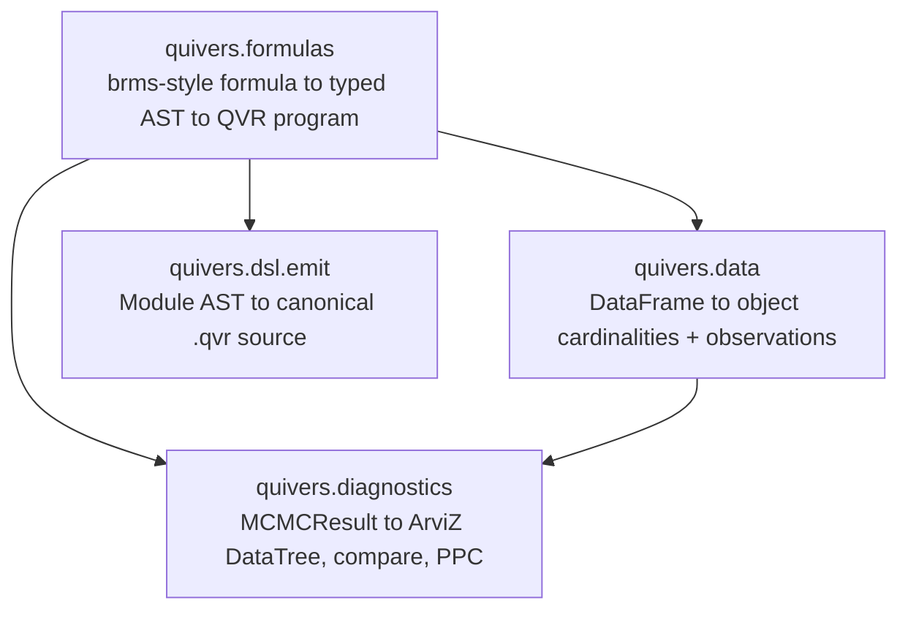

# Analysis: Data and Formulas

The analysis packages turn a dataframe and a regression formula in the style of brms
and lme4 [@burkner2017brms; @bates2015lme4] into a QVR model, whose generated source
shows the response family, predictors, group effects, and priors.
[Fitting and Diagnostics](analysis-fitting-and-diagnostics.md) covers
posterior inference and checks on the fitted model.

## Architecture

Four subpackages, each usable on its own:



Each subpackage needs an optional dependency group, so installing the DSL and inference
alone does not install dataframe, ArviZ, or formula libraries. `pip install "quivers[formulas]"`
installs all four.

## Dataframes: `quivers.data`

A model needs the data's values and a fixed coding of their categories. If a subject
column holds `s1, s2, s1`, its index array is `0, 1, 0`, and the repeated zero makes
both rows use the same subject parameter. [`DatasetSchema`](../api/data/schema.md)
builds that coding, the finite object for the subjects, and the tensors passed at run
time, so the order of the categories is part of the model's interface to the data. It
is a typed [`didactic.api.Model`](https://didactic.dev/api/Model) and accepts a pandas,
polars, or any other [Narwhals](https://narwhals-dev.github.io/narwhals/)-compatible
dataframe.

<!-- python: skip -->
```python
import pandas as pd
from quivers.data import DatasetSchema, compose

df = pd.DataFrame({
    "verb": ["eat", "drink", "run", "eat", ...],
    "subject": ["s1", "s2", "s1", "s3", ...],
    "rt": [0.31, 0.42, 0.28, 0.55, ...],
    "response": [1, 0, 1, 1, ...],
})

schema = DatasetSchema(
    df=df,
    objects={"verb": "Verb", "subject": "Subject"},
    plate_indices={"verb": "verb_idx", "subject": "subj_idx"},
    covariates={"rt": "rt"},
    observations={"response": "y"},
)

print(schema.declarations())          # object Verb : FinSet 17 / object Subject : FinSet 50
print(schema.cardinalities)           # {"Verb": 17, "Subject": 50}
obs = schema.observations_dict()      # {"verb_idx": tensor, "subj_idx": tensor, ...}
```

The schema gives two things:

- [`declarations()`](../api/data/schema.md#quivers.data.schema.DatasetSchema.declarations)
  returns `.qvr` source with one `object X : FinSet N` line per categorical column. The
  cardinality is the column's number of distinct values, and the categories are coded
  in the sorted order of the distinct non-null values, so the indices are the same on
  every run.
- [`observations_dict()`](../api/data/schema.md#quivers.data.schema.DatasetSchema.observations_dict)
  returns the tensors, one entry per row, that inference reads (responses, index arrays, numeric
  covariates), ready for [`SVI.step`](../api/inference/svi.md) or
  [`MCMC.run`](../api/inference/mcmc.md).

[`compose(qvr_body, schema)`](../api/data/schema.md#quivers.data.schema.compose) puts
the schema's declarations before a program body and compiles the result, so the body
need not state the cardinalities.

[`MissingPolicy`](../api/data/encoding.md#quivers.data.encoding.MissingPolicy) sets how
a column's missing entries are handled: `RAISE` (the default) raises, `DROP` drops the
rows, `IMPUTE` replaces a missing entry with the column's mean or most frequent value,
and `MASK` codes it as `NaN` for a numeric column or `-1` for a categorical one, to be
paired with a likelihood that handles missing values.

## Formulas: `quivers.formulas`

`y ~ x + (1 | g)` predicts the response `y` from the predictor `x`, with an intercept
that may differ by group `g`. The intercept is the baseline, the slope multiplies `x`,
and the group offsets come from a shared distribution, which gives partial pooling
[@gelman2013bayesian]. The formula fixes the linear predictor, the family fixes the
response distribution, and priors describe the unknown coefficients. The
[link function](https://en.wikipedia.org/wiki/Generalized_linear_model#Link_function)
connects the linear predictor to a parameter of the response distribution
[@nelder1972glm]: for Bernoulli outcomes the inverse logit (sigmoid) turns any real
predictor into a probability. The `~` of a formula introduces a response model and is
unrelated to drawing a value with `sample` in QVR.

The [formula frontend](../api/formulas/index.md) compiles a formula into a typed QVR
[`Module`](../api/dsl/ast_nodes.md) AST, not into a string. The translation
[`FormulaToQVRModule`](../api/formulas/compile.md#quivers.formulas.compile.FormulaToQVRModule)
is a [`didactic.api.Lens`](https://didactic.dev/api/Lens) from `Formula` to `Module`, a
pair of maps between the two representations. The
[`formulae`](https://bambinos.github.io/formulae/) library, the formula parser of
[Bambi](https://bambinos.github.io/bambi/), parses the syntax, and the result becomes a
typed `Formula` record.

### Inspect or dump the generated QVR

<!-- python: skip -->
```python
from quivers.formulas import formula_to_qvr

src = formula_to_qvr("y ~ poly(x, 2) + (1 | g)", data=df)
print(src)                                  # canonical .qvr source
```

[`quivers.dsl.emit.module_to_source`](../api/dsl/emit.md) writes the `Module` AST as
`.qvr` source, and parsing that source with [`quivers.dsl.loads`](../api/dsl/parser.md)
gives a `Module` that compiles to the same program.

### R / brms conventions

- **Orthogonal polynomials by default.** `poly(x, k)` produces $k$
  orthonormal centered columns, matching R's
  [`stats::poly`](https://stat.ethz.ch/R-manual/R-devel/library/stats/html/poly.html).
  Raw monomials remain available via `I(x**k)`.
- **One coefficient per column of the design matrix** (matches brms
  display). `poly(x, 2)` produces two named coefficients
  `beta_poly_x_2_1` and `beta_poly_x_2_2`, and `x*z` produces three
  named coefficients (`beta_x`, `beta_z`, `beta_x_z`). Each column's values reach the
  program as a [data input](inference-foundations.md#host-data-per-row-covariates-and-index-arrays).
- **R-style transforms** are available in formulas without registration: `log`, `exp`,
  `sqrt`, `abs`, `sin`, `cos`, `tan`, `log10`, `log2`, `log1p`, `expm1`, `asin`, `acos`,
  `atan`, `sinh`, `cosh`, `tanh`.
- **Random-effect groups** `(1 | g)`, `(1 + x | g)`, `(x | g)`,
  `(0 + x | g)` parse as in brms and lme4. Several slopes in one group become
  independent random-effect terms, as with lme4's uncorrelated `(... || g)`, and
  correlated slopes are not supported.
- **Interactions** `x:z` (elementwise product, one coefficient) and
  `x*z` (expands to `x + z + x:z`, three coefficients).

### Family registry

`fit(..., family=...)` accepts a string name or a
[`Family`](../api/formulas/family.md#quivers.formulas.family.Family)
value. The built-in families:

| Family | Link (inverse) | Auxiliary parameters |
|---|---|---|
| `gaussian` | identity | `sigma ~ HalfCauchy(2.0)` |
| `bernoulli` | logit (sigmoid) | none |
| `binomial` | logit (sigmoid) | known trial count |
| `categorical` | reference-category multinomial logit | one coefficient and random effect per non-reference category |
| `poisson` | log (exp) | none |
| `negative_binomial` | log (exp) | `disp ~ Gamma(2.0, 2.0)` |
| `gamma` | log (exp) | `shape ~ Gamma(2.0, 2.0)` |
| `beta` | logit (sigmoid) | `phi ~ HalfCauchy(2.0)` |
| `student_t` | identity | `nu ~ Gamma(2.0, 0.1)`, `sigma ~ HalfCauchy(2.0)` |
| `cumulative` | logit on the cumulative probabilities (`OrderedLogistic`) | learned ordered cutpoints |
| `zero_inflated_poisson` | log (exp) | `zi ~ Beta(2.0, 2.0)` |
| `hurdle_poisson` | log (exp) | `zi ~ Beta(2.0, 2.0)` |
| `mixture` | identity | component logits, centered location offsets, and positive scales |

A new family is a [`Family`](../api/formulas/family.md#quivers.formulas.family.Family)
value with its own observation family and link. The table's priors on auxiliary
parameters are the library's defaults.

For binomial data, `binomial_trials` is either one common positive
integer or the name of a data column with one count per row:

<!-- python: skip -->
```python
fit(
    "successes ~ condition + (1 | participant)",
    data=df,
    family="binomial",
    binomial_trials="trials",
)
```

The emitted likelihood is `Binomial(trials, sigmoid(eta))`. The negative-binomial family
uses the NB2 form [@cameron1986econometric], with mean $\mu$ and variance
$\mu + \mu^2 / \mathrm{disp}$: `mu = exp(eta)`, `disp > 0`, and the compiler emits
`NegativeBinomial(disp, mu / (mu + disp))`, matching QVR's
`(total_count, probs)` convention.

The other scalar response families likewise take the parameters
named in regression rather than the slots of their constructors. Gamma uses
mean `mu` and shape `shape`, then emits `Gamma(shape, shape / mu)`.
Beta uses mean `mu` and precision `phi`, then emits
`Beta(mu * phi, (1 - mu) * phi)`. Student-t maps `nu`, `mu`, and
`sigma` to QVR's `(df, loc, scale)` order. The beta family is the mean and precision form of beta
regression [@ferrari2004beta]. Zero-inflated [@lambert1992zip] and hurdle
Poisson models read `zi` as the probability of a structural zero and `mu` as the
Poisson rate.

### Unordered categorical mixed models

Adding one constant to every logit leaves the softmax unchanged, so without a
constraint many coefficient settings give the same probabilities. Fixing category
zero's logit at zero removes that direction, and the other logits compare each category
with the reference. With logits `[0, 0, 0]`, for instance, each category has
probability `1/3`.

The categorical family infers `K` from contiguous integer labels
`0, ..., K-1` and uses category zero as the reference. Every fixed-effect
coefficient and random effect is thus a vector of `K - 1` logits.
The compiler prepends the reference logit of zero and applies softmax to
the resulting `K`-vector of each row. This parameterization removes the
unidentified common shift in an unconstrained set of `K` logits.

<!-- python: skip -->
```python
choice_fit = fit(
    "choice ~ surprisal + condition + (1 + surprisal | participant)",
    data=choices,
    family="categorical",
    method="nuts",
)
```

Categorical responses must contain every label between zero and `K - 1`.
Random effects for each class use the
[non-centered parameterization](https://mc-stan.org/docs/stan-users-guide/efficiency-tuning.html),
which writes a group effect as its scale times a standard normal draw, and
`reparameterize="centered"` is rejected when a categorical formula has random effects.

An external categorical predictor may return either the `K - 1`
non-reference logits with shape `(N, K - 1)` or a full `(N, K)` logit
matrix. In the latter case, `fit` subtracts the reference-category logit
before combining the predictor with formula terms. A binary categorical
predictor may also return shape `(N,)`.

### Gaussian mixture regressions

In a mixture each response comes from one of several component distributions, and the
likelihood sums their weighted densities, so fitting need not assign a component to
each observation. The mixture family represents each response as a finite Gaussian mixture.
`mixture_components` sets the number of components, while the formula's
linear predictor shifts every component location for a row. Component
weights are shared across rows, location offsets are centered to separate
them from the formula intercept, and every component has its own positive
scale. The `K - 1` free logits and offsets are mapped to sum-to-zero `K`-vectors through
an orthonormal Helmert basis, a set of `K - 1` orthonormal contrasts, so the default
isotropic normal priors give distributions on those vectors that are symmetric under
permuting the components and have no redundant common direction:

<!-- python: skip -->
```python
mixture_fit = fit(
    "reaction_time ~ condition + (1 | participant)",
    data=trials,
    family="mixture",
    mixture_components=3,
    priors={
        "mixture_logit": "Normal(0.0, 0.5)",
        "mixture_offset": "Normal(0.0, 2.0)",
        "mixture_scale": "HalfNormal(1.0)",
    },
    method="nuts",
)
```

`MixtureNormal` sums over the component assignments in the likelihood, and centering
separates the shared regression location from the component offsets. Permuting the
component labels leaves the likelihood unchanged, so posterior draws can switch labels
[@stephens2000labels]: summaries should use quantities that do not depend on the labels,
or align the labels first.

### Ordinal mixed models and neural predictors

The cumulative model for ordered ratings divides a continuous latent response at ordered
cutpoints, with the probability of rating at most $k$ equal to
$\sigma(c_k - \eta)$ [@mccullagh1980regression]. Moving the predictor changes which
intervals are likely, and changing the spacings changes how widely particular ratings
are used, so group-specific spacings represent differences in scale use. The
cumulative family infers the number of categories from contiguous
integer response labels `0, ..., K-1`. Shared cutpoints are represented
by cumulative positive spacings and centered to separate their location
from the formula intercept. `thresholds_by` replaces the shared spacing
vector with partially pooled group-specific spacings:

<!-- python: skip -->
```python
ordinal_fit = fit(
    "rating ~ condition + (1 | participant) + (1 | item)",
    data=df,
    family="cumulative",
    thresholds_by="participant",
    method="nuts",
)
```

Every participant's cutpoints remain ordered. Their vector is centered,
so a participant random intercept controls location while the random
threshold spacings model differences in scale use.

A differentiable PyTorch module can add to the linear predictor directly. It is passed
with its input tensor, apart from the dataframe:

<!-- python: skip -->
```python
import torch

parser = torch.nn.Sequential(          # any module returning one value per row
    torch.nn.Linear(64, 32), torch.nn.Tanh(), torch.nn.Linear(32, 1)
)

joint_fit = fit(
    "rating ~ condition + (1 | participant) + (1 | item)",
    data=df,
    family="cumulative",
    thresholds_by="participant",
    predictor=parser,
    predictor_data=sentence_features,
    method="svi",
    num_steps=4000,
)
```

With `method="svi"`, `num_steps` is the number of stochastic variational inference (SVI) steps. The runtime recomputes
`parser(sentence_features)` on every step and passes the result to the generated
program as the data input `neural_eta`. The SVI optimizer includes the predictor parameters, so gradients
flow through the ordinal likelihood into the parser. A trainable external
predictor is restricted to SVI, and the No-U-Turn Sampler (NUTS) and [HMC](inference-mcmc.md#mcmc-hmc-and-nuts) accept it only after its
parameters have been frozen.

Every [`ParamSource`](../api/continuous/param_source.md) is an
`nn.Module`, so `LinearSource`, `MLPSource`, and `FunctionSource` can be
passed as `predictor` directly. The predictor must return one location
value per response row, with shape `(N,)` or `(N, 1)`, except for the
categorical shapes described above.

A Python module cannot be written into QVR source, so `joint_fit.qvr_source` reads
`neural_eta` as a data input. `formula_to_qvr(..., predictor_name="neural_eta")` emits
the same program without fitting, and the tensor is then passed with the
observations.

### Coefficient priors are autoscaled

A column enters the linear predictor as `beta * column`, so a prior on
the coefficient alone is really a statement about the coefficient's
contribution, and the same nominal prior means something different for every column.
The default fixed-effect prior is thus scaled to each column:
its scale is divided by the column's root-mean-square, which states it
in contribution space so that `Normal(0.0, 5.0)` means the same thing
on a raw predictor and on an orthonormal `poly` column. The
coefficients themselves stay on their own column's scale, so nothing
needs transforming back. The [generated QVR](#inspect-or-dump-the-generated-qvr)
records the selected scales. Before fitting, [prior predictive checks](https://mc-stan.org/docs/stan-users-guide/posterior-predictive-checks.html#prior-predictive-checks)
show whether those scales imply plausible responses [@stanPredictiveChecks].

This matters most for a basis whose columns are far from unit scale. `poly(x, k)`
returns columns of norm one, whose entries are about $1/\sqrt{N}$, so an unscaled
`Normal(0.0, 5.0)` would say the contribution is near zero. The fit would then follow
the prior rather than the data, putting the noise scale at the response's marginal
spread and leaving the coefficients where they started.

### Prior overrides

Prior overrides are keyed by the latent's name in the generated program, which
`formula_to_qvr` shows before fitting. A prior is, as in brms, a `Family(arg, arg, ...)`
call, whose numeric arguments become floats and whose identifier arguments refer to
other latents of the program. An explicit prior is emitted exactly as written, without
the scaling above. The full call shape lives in
[Fitting and Diagnostics](analysis-fitting-and-diagnostics.md#prior-overrides).

## See also

- [Fitting and Diagnostics](analysis-fitting-and-diagnostics.md): the `fit(...)` entry
  point, diagnostics, and initialization tools.
- [The QVR DSL: Overview](dsl-overview.md): the typed DSL the formula
  frontend emits source for.
- [Hierarchical Programs](programs-hierarchical.md): the program
  representation that random-effects formulas compile to.
