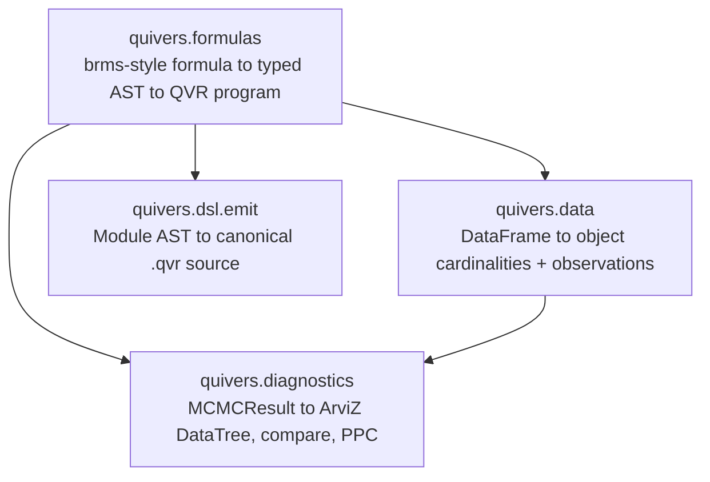

# Analysis: Data and Formulas

The analysis packages turn a dataframe and a regression formula in the style of brms
and lme4 [@burkner2017brms; @bates2015lme4] into a QVR model, whose generated source
shows the response family, predictors, group effects, and priors.
[Fitting and Diagnostics](analysis-fitting-and-diagnostics.md) covers
posterior inference and checks on the fitted model.

## Architecture

Four subpackages, each usable on its own:



Each subpackage needs an optional dependency group, so installing the DSL and inference
alone does not install dataframe, ArviZ, or formula libraries. `pip install "quivers[formulas]"`
installs all four.

## Dataframes: `quivers.data`

A model needs the data's values and a fixed coding of their categories. If a subject
column holds `s1, s2, s1`, its index array is `0, 1, 0`, and the repeated zero makes
both rows use the same subject parameter. [`DatasetSchema`](../api/data/schema.md)
builds that coding, the finite object for the subjects, and the tensors passed at run
time, so the order of the categories is part of the model's interface to the data. It
is a typed [`didactic.api.Model`](https://didactic.dev/api/Model) and accepts a pandas,
polars, or any other [Narwhals](https://narwhals-dev.github.io/narwhals/)-compatible
dataframe.

<!-- python: skip -->
```python
import pandas as pd
from quivers.data import DatasetSchema, compose

df = pd.DataFrame({
    "verb": ["eat", "drink", "run", "eat", ...],
    "subject": ["s1", "s2", "s1", "s3", ...],
    "rt": [0.31, 0.42, 0.28, 0.55, ...],
    "response": [1, 0, 1, 1, ...],
})

schema = DatasetSchema(
    df=df,
    objects={"verb": "Verb", "subject": "Subject"},
    plate_indices={"verb": "verb_idx", "subject": "subj_idx"},
    covariates={"rt": "rt"},
    observations={"response": "y"},
)

print(schema.declarations())          # object Verb : FinSet 17 / object Subject : FinSet 50
print(schema.cardinalities)           # {"Verb": 17, "Subject": 50}
obs = schema.observations_dict()      # {"verb_idx": tensor, "subj_idx": tensor, ...}
```

The schema gives two things:

- [`declarations()`](../api/data/schema.md#quivers.data.schema.DatasetSchema.declarations)
  returns `.qvr` source with one `object X : FinSet N` line per categorical column. The
  cardinality is the column's number of distinct values, and the categories are coded
  in the sorted order of the distinct non-null values, so the indices are the same on
  every run.
- [`observations_dict()`](../api/data/schema.md#quivers.data.schema.DatasetSchema.observations_dict)
  returns the tensors, one entry per row, that inference reads (responses, index arrays, numeric
  covariates), ready for [`SVI.step`](../api/inference/svi.md) or
  [`MCMC.run`](../api/inference/mcmc.md).

[`compose(qvr_body, schema)`](../api/data/schema.md#quivers.data.schema.compose) puts
the schema's declarations before a program body and compiles the result, so the body
need not state the cardinalities.

[`MissingPolicy`](../api/data/encoding.md#quivers.data.encoding.MissingPolicy) sets how
a column's missing entries are handled: `RAISE` (the default) raises, `DROP` drops the
rows, `IMPUTE` replaces a missing entry with the column's mean or most frequent value,
and `MASK` codes it as `NaN` for a numeric column or `-1` for a categorical one, to be
paired with a likelihood that handles missing values.

## Formulas: `quivers.formulas`

`y ~ x + (1 | g)` predicts the response `y` from the predictor `x`, with an intercept
that may differ by group `g`. The intercept is the baseline, the slope multiplies `x`,
and the group offsets come from a shared distribution, which gives partial pooling
[@gelman2013bayesian]. The formula fixes the linear predictor, the family fixes the
response distribution, and priors describe the unknown coefficients. The
[link function](https://en.wikipedia.org/wiki/Generalized_linear_model#Link_function)
connects the linear predictor to a parameter of the response distribution
[@nelder1972glm]: for Bernoulli outcomes the inverse logit (sigmoid) turns any real
predictor into a probability. The `~` of a formula introduces a response model and is
unrelated to drawing a value with `sample` in QVR.

The [formula frontend](../api/formulas/index.md) compiles a formula into a typed QVR
[`Module`](../api/dsl/ast_nodes.md) AST, not into a string. The translation
[`FormulaToQVRModule`](../api/formulas/compile.md#quivers.formulas.compile.FormulaToQVRModule)
is a [`didactic.api.Lens`](https://didactic.dev/api/Lens) from `Formula` to `Module`, a
pair of maps between the two representations. The
[`formulae`](https://bambinos.github.io/formulae/) library, the formula parser of
[Bambi](https://bambinos.github.io/bambi/), parses the syntax, and the result becomes a
typed `Formula` record.

### Inspect or dump the generated QVR

<!-- python: skip -->
```python
from quivers.formulas import formula_to_qvr

src = formula_to_qvr("y ~ poly(x, 2) + (1 | g)", data=df)
print(src)                                  # canonical .qvr source
```

[`quivers.dsl.emit.module_to_source`](../api/dsl/emit.md) writes the `Module` AST as
`.qvr` source, and parsing that source with [`quivers.dsl.loads`](../api/dsl/parser.md)
gives a `Module` that compiles to the same program.

### R / brms conventions

- **Orthogonal polynomials by default.** `poly(x, k)` produces $k$
  orthonormal centered columns, matching R's
  [`stats::poly`](https://stat.ethz.ch/R-manual/R-devel/library/stats/html/poly.html).
  Raw monomials remain available via `I(x**k)`.
- **One coefficient per column of the design matrix** (matches brms
  display). `poly(x, 2)` produces two named coefficients
  `beta_poly_x_2_1` and `beta_poly_x_2_2`, and `x*z` produces three
  named coefficients (`beta_x`, `beta_z`, `beta_x_z`). Each column's values reach the
  program as a [data input](inference-foundations.md#host-data-per-row-covariates-and-index-arrays).
- **R-style transforms** are available in formulas without registration: `log`, `exp`,
  `sqrt`, `abs`, `sin`, `cos`, `tan`, `log10`, `log2`, `log1p`, `expm1`, `asin`, `acos`,
  `atan`, `sinh`, `cosh`, `tanh`.
- **Random-effect groups** `(1 | g)`, `(1 + x | g)`, `(x | g)`,
  `(0 + x | g)` use one group coefficient per design column. Coefficients within
  a single-bar block share an LKJ correlation prior; `(1 + x || g)` makes them
  independent. Explicit IDs, as in `(1 + x | effects | g)`, can share a
  correlation block across location and auxiliary formulas.
- **Interactions** `x:z` (elementwise product, one coefficient) and
  `x*z` (expands to `x + z + x:z`, three coefficients).

### Offsets and observation exposure

An offset is a known contribution to a linear predictor with coefficient one.
Write `offset(expr)` to add the evaluated expression, or `exposure(expr)` to
add its natural logarithm. With a log link, exposure multiplies the response
mean. For instance, this count model accounts for different observation times:

```python
import pandas as pd
from quivers.formulas import fit

counts = pd.DataFrame({
    "events": [0, 2, 1, 4],
    "temperature": [-1.0, 0.0, 0.5, 1.0],
    "hours": [0.5, 1.0, 2.0, 4.0],
})
rate_fit = fit(
    "events ~ temperature + exposure(hours)",
    data=counts,
    family="poisson",
    method="svi",
    num_steps=10,
    seed=7,
)
# The native predictor is intercept + beta_temperature * temperature + log(hours).
mean_counts = rate_fit.posterior_epred(num_samples=5)
assert mean_counts.shape == (1, 5, 4)
assert set(rate_fit.fixed_effects(num_samples=5)) == {"Intercept", "temperature"}
```

`offset(log(hours))` expresses the same model. Offset columns receive no prior
or fitted coefficient, and `get_prior` excludes them. Their evaluated values
are retained in `Formula.offsets`, the lens complement, and the fitted data;
posterior predictors use the same native bindings as fitting.

Offsets also work in auxiliary formulas, for instance
`distributional={"sigma": "~ z + offset(log(known_scale))"}`. They apply before
the selected inverse link. Several offset terms add together, and `~ 0 + offset(z)`
requires no population coefficient. Categorical models add a scalar row offset
to every non-reference-category logit; the reference logit remains zero.

Every offset must produce one finite numeric value per response row. Exposures
must additionally be strictly positive. Offset and exposure modifiers must be
standalone additive terms; interactions, wrappers around these modifiers, and
random coefficients on them raise errors. The modifiers' names are reserved in
the formula evaluation namespace.

### Likelihood weights

Pass `weights="column"` to multiply each response log density by its row's
weight. Priors retain their original scores. The weights keep their supplied
scale; the interface does not divide them by their sum or mean. For instance,
this count model includes both observation exposure and likelihood weights:

```python
import pandas as pd
from quivers.formulas import fit, get_prior

weighted_counts = pd.DataFrame({
    "events": [0, 2, 1, 4],
    "x": [-1.0, 0.0, 0.5, 1.0],
    "hours": [0.5, 1.0, 2.0, 4.0],
    "importance": [0.0, 0.5, 2.0, 1.0],
})
weighted_fit = fit(
    "events ~ x + exposure(hours)",
    data=weighted_counts,
    family="poisson",
    weights="importance",
    method="svi",
    num_steps=10,
    seed=7,
)
priors = get_prior(
    "events ~ x + exposure(hours)",
    data=weighted_counts,
    family="poisson",
    weights="importance",
)
assert set(priors) == {"intercept", "beta_x"}
assert weighted_fit.posterior_epred(num_samples=5).shape == (1, 5, 4)
```

The exposure changes the Poisson mean. The likelihood weight scales the log
density at that mean; fractional weights are allowed, and a zero weight excludes
the row's likelihood contribution. Group and auxiliary-parameter priors are
also unweighted. Changing weights changes the fitted posterior. At fixed
posterior coefficients, the response distribution used for predictions is
unchanged, and raw pointwise likelihoods retain the unweighted density.

A weight column must contain finite nonnegative real numbers. Boolean, string,
and complex columns are rejected. The evaluated response and weight rows must
remain aligned; missing model values that would drop weighted rows raise an
error. Prepare a common set of rows before fitting. The read-only column is
retained in `Formula.response_weights` and its lens complement. Emitted QVR
declares a checked `Tensor[Real]([Resp])` input and attaches
`[weights=formula_weights]` to the response observation, with no weight
coefficient or prior.

### Correlated group effects

A random-effects block assigns a joint distribution to its coefficients. For
`(1 + x | group)`, the group intercept and slope have separate positive scales
and a shared correlation. QVR emits an LKJ Cholesky draw `cor_group` and the
coefficient scales `sigma_group_Intercept` and `sigma_group_x`. Its covariance is
`diag(scale) @ cor_group @ cor_group.T @ diag(scale)`.

The default `correlation_prior="LKJCholesky(1.0)"` is uniform over correlation
matrices. `priors={"cor_group": "LKJCholesky(2.0)"}` changes one block's prior;
`correlation_prior` changes the default for every block. Both `fit` and
`formula_to_qvr` accept it. Centered scalar-response models draw the group
coefficients through Gaussian conditional distributions. Noncentered models draw
standard Normal innovations and multiply by the same Cholesky factor. These give
the same covariance model, with different inference coordinates.

Separate blocks remain independent. For instance, `(1 | group) + (0 + x | group)`
has no intercept–slope correlation, while `(1 + x || group)` explicitly requests
independence within one block. To share a correlation across formulas, give the
blocks the same ID:

<!-- python: skip -->
```python
from quivers.formulas import formula_to_qvr

# Use the same dataframe for the location and scale predictors.
shared_source = formula_to_qvr(
    "y ~ x + (1 | effects | group)",
    data=frame,
    distributional={"sigma": "~ z + (1 | effects | group)"},
)
```

This emits a single `cor_shared_effects` matrix joining the location and scale
intercepts. Shared IDs require the same grouping factor and coding. Ambiguous
block names and repeated coefficients across blocks fail before fitting.

Categorical models expand each block over all non-reference logits, so a
three-category `(1 + x | group)` model has a four-dimensional correlation
matrix. This includes correlations between slopes and between response-category
coefficients. Categorical group effects currently use the noncentered
parameterization. Numeric transforms and categorical slope contrasts retain their
evaluated design columns, including when the corresponding fixed slope is absent.
The generated runtime telescope declares each group index array as
`Tensor[Int]([Resp])`.

### Inspecting priors

`get_prior` evaluates the design matrices and returns the actual overrideable
parameter names and distribution calls before inference. Default slope scales
include column autoscaling; explicit overrides retain their supplied scale.
Conditional group draws and standard Normal innovations define the group
parameterization and are excluded from the override mapping.

```python
import pandas as pd
from quivers.formulas import get_prior, formula_to_qvr

prior_data = pd.DataFrame({
    "y": [0.1, 0.5, 0.2, 0.7],
    "x": [1.0, 2.0, 3.0, 4.0],
    "group": ["a", "a", "b", "b"],
})
priors = get_prior("y ~ x + (1 + x | group)", data=prior_data)
assert "beta_x" in priors and "cor_group" in priors
source = formula_to_qvr(
    "y ~ x + (1 + x | group)",
    data=prior_data,
    priors={"beta_x": "Normal(0.0, 0.5)", "cor_group": "LKJCholesky(2.0)"},
)
```

Misspelled and unused prior names raise `ValueError` before fitting. This also
catches an override for a scalar auxiliary parameter after that parameter has
received a distributional formula: its coefficient names must be used instead.

### Family registry

`fit(..., family=...)` accepts a string name or a
[`Family`](../api/formulas/family.md#quivers.formulas.family.Family)
value. The built-in families:

| Family | Link (inverse) | Auxiliary parameters |
|---|---|---|
| `gaussian` | identity | `sigma ~ HalfCauchy(2.0)` |
| `bernoulli` | logit (sigmoid) | none |
| `binomial` | logit (sigmoid) | known trial count |
| `beta_binomial` | logit (sigmoid) | known trial count, precision `phi ~ HalfCauchy(2.0)` |
| `categorical` | reference-category multinomial logit | one coefficient and random effect per non-reference category |
| `poisson` | log (exp) | none |
| `negative_binomial` | log (exp) | `disp ~ Gamma(2.0, 2.0)` |
| `gamma` | log (exp) | `shape ~ Gamma(2.0, 2.0)` |
| `beta` | logit (sigmoid) | `phi ~ HalfCauchy(2.0)` |
| `student_t` | identity | `nu ~ Gamma(2.0, 0.1)`, `sigma ~ HalfCauchy(2.0)` |
| `cumulative` | logit on the cumulative probabilities (`OrderedLogistic`) | learned ordered cutpoints |
| `zero_inflated_poisson` | log (exp) | `zi ~ Beta(2.0, 2.0)` |
| `hurdle_poisson` | log (exp) | `zi ~ Beta(2.0, 2.0)` |
| `hurdle_gamma` | log | `shape`, `hu` (zero probability) |
| `hurdle_lognormal` | identity | `sigma` (log-scale), `hu` (zero probability) |
| `zero_inflated_beta` | logit | `phi` (precision), `zi` (zero probability) |
| `zero_one_inflated_beta` | logit (sigmoid) | precision `phi` and boundary probabilities `zoi`, `coi` |
| `asym_laplace` | identity for the selected quantile | `sigma ~ HalfCauchy(2.0)`, `quantile ~ Beta(2.0, 2.0)` unless fixed |
| `lognormal` | identity for log-location | `sigma ~ HalfCauchy(2.0)` |
| `exgaussian` | identity for the response mean | Normal scale `sigma`, Exponential mean `beta` |
| `inverse_gaussian` | log for the response mean | `shape ~ Gamma(2.0, 2.0)` |
| `exponential` | log for mean | none |
| `geometric` | log for mean count | none |
| `weibull` | log for mean | `shape ~ Gamma(2.0, 2.0)` |
| `von_mises` | tangent half-angle (`2 * atan`) | `kappa ~ Gamma(2.0, 2.0)` |
| `mixture` | identity | component logits, centered location offsets, and positive scales |

A new family is a [`Family`](../api/formulas/family.md#quivers.formulas.family.Family)
value with its own observation family and link. The table's priors on auxiliary
parameters are the library's defaults.

### Response-time families

`exgaussian` models a response as a Normal component plus an independent
Exponential component. The formula predictor gives the response mean `mu`, not
the Normal component's mean: compilation uses `loc = mu - beta`, Normal scale
`sigma`, and Exponential rate `1 / beta`. `inverse_gaussian` likewise predicts
the response mean, with variance `mu**3 / shape`. Both parameterizations follow
[brms's response-distribution definitions](https://paulbuerkner.com/brms/articles/brms_families.html#response-time-models).

```python
import pandas as pd
from quivers.formulas import formula_to_qvr

latency_data = pd.DataFrame({
    "latency": [0.3, 0.8, 1.1, 1.8],
    "condition": [-1.0, -1.0, 1.0, 1.0],
})
latency_source = formula_to_qvr(
    "latency ~ condition", data=latency_data, family="exgaussian",
    distributional={"beta": "~ condition"},
    fixed_parameters={"sigma": 0.2},
)
positive_source = formula_to_qvr(
    "latency ~ condition", data=latency_data, family="inverse_gaussian",
    distributional={"shape": "~ condition"},
)
```

The ExGaussian sampler adds reparameterized Normal and Exponential draws.
The inverse Gaussian sampler has no rejection loop and uses implicit CDF
derivatives for gradients, with common tail-density factors canceled before
evaluation. Independent SciPy densities and CDFs, numerical derivative checks,
Monte Carlo moments and moment gradients, and SVI/HMC/NUTS execution are covered
in `tests/continuous/test_response_time_families.py` and
`tests/test_formula_distributional.py`. External transpilation backends currently
reject both families with explicit unsupported-family diagnostics.

### Positive hurdle regressions

Use `hurdle_gamma` or `hurdle_lognormal` for nonnegative responses with a
structural zero process and a positive component. The `hu` parameter gives the
probability of zero. Each component parameter and `hu` can be regressed,
assigned a prior, or fixed on its natural scale:

```python
import pandas as pd
from quivers.formulas import fit

amounts = pd.DataFrame({
    "amount": [0.0, 0.2, 0.7, 0.0],
    "x": [-1.0, 0.0, 1.0, 2.0],
    "z": [0.2, -0.3, 0.0, 0.5],
})
hurdle_fit = fit(
    "amount ~ x",
    data=amounts,
    family="hurdle_gamma",
    distributional={"hu": "~ z"},
    fixed_parameters={"shape": 0.4},
    method="svi",
    num_steps=10,
    seed=19,
)
mean_amounts = hurdle_fit.posterior_epred(num_samples=5)
assert mean_amounts.shape == (1, 5, 4)
```

For Gamma, the main predictor's inverse link gives the positive-component mean
`mu`, and `shape` gives its shape. The complete response mean is `(1-hu)*mu`.
For LogNormal, the main predictor gives the underlying Normal mean `mu`, and
`sigma` gives its standard deviation. Its response mean is
`(1-hu)*exp(mu + sigma**2/2)`. `posterior_epred` includes these component moments
and hurdle weights; `posterior_linpred` reports the selected predictor.

Fixed `hu=0` recovers the positive component, and fixed `hu=1` gives a point
mass at zero. Native sampling draws the structural zero gate exactly, while
likelihood derivatives remain available for fitting observed responses.
External backend emission currently reports these native families as unsupported.

### Zero-inflated beta regression

Use `zero_inflated_beta` for responses with exact zeros and continuous values
strictly below one. `zi` is the zero-atom probability; `mu` is the mean of the
interior Beta component, and `phi` is its precision. The response expectation is
`(1 - zi) * mu`:

```python
import pandas as pd
from quivers.formulas import fit

proportions = pd.DataFrame({
    "fraction": [0.0, 0.2, 0.7, 0.0],
    "x": [-1.0, 0.0, 1.0, 2.0],
    "z": [0.2, -0.3, 0.0, 0.5],
})
zero_beta_fit = fit(
    "fraction ~ x",
    data=proportions,
    family="zero_inflated_beta",
    distributional={"zi": "~ z"},
    fixed_parameters={"phi": 8.0},
    method="svi",
    num_steps=10,
    seed=13,
)
interior_means = zero_beta_fit.posterior_linpred(transform=True, num_samples=5)
response_means = zero_beta_fit.posterior_epred(num_samples=5)
assert interior_means.shape == response_means.shape == (1, 5, 4)
```

Both `phi` and `zi` can be regressed or fixed, with log and logit links by
default. Fixed `zi=0` gives an ordinary Beta distribution; fixed `zi=1` gives a
point mass at zero. Observations equal to one require the
`zero_one_inflated_beta` family. The emitted QVR reuses that native distribution
with its conditional one-atom probability `coi` fixed at zero, so zero-only
inflation creates no one-atom latent or prior. External backend emission follows
the native family's capability checks and currently reports unsupported targets.

### Quantile regression and fixed auxiliary parameters

The asymmetric Laplace family predicts a selected response quantile rather than
its mean. `fixed_parameters` holds auxiliary parameters constant on their natural
scale; the compiler emits deterministic bindings and inference allocates no
latent coordinates for them. This option also applies to other families, for
instance `fixed_parameters={"sigma": 0.5}` for a known Gaussian residual scale.

```python
import pandas as pd
from quivers.formulas import fit, get_prior

quantile_data = pd.DataFrame({
    "y": [-0.5, 0.2, 0.7, 1.2],
    "x": [-1.0, 0.0, 1.0, 2.0],
})
quantile_fit = fit(
    "y ~ x",
    data=quantile_data,
    family="asym_laplace",
    fixed_parameters={"quantile": 0.9},
    method="svi",
    num_steps=10,
)
assert "let quantile = 0.9" in quantile_fit.qvr_source
assert "quantile" not in get_prior(
    "y ~ x", data=quantile_data, family="asym_laplace",
    fixed_parameters={"quantile": 0.9},
)
```

The density is `q * (1-q) / sigma * exp(-rho_q((y-mu)/sigma))`, where
`rho_q(u) = u * (q - I[u < 0])`. Thus the probability below `mu` is `q`.
At `q=0.5`, this equals a Laplace distribution with scale `2 * sigma`;
`sigma` is the check-loss scale, not the response standard deviation.
The native implementation also provides CDF and inverse-CDF evaluation and
reparameterized draws through a difference of two exponential variables.
These parameterizations are checked against
[brms's definition](https://paulbuerkner.com/brms/articles/brms_families.html#quantile-regression)
and an independent SciPy density in `tests/continuous/test_asymmetric_laplace.py`.
External transpilation backends currently reject this family with an explicit
unsupported-family diagnostic.

Fixed parameters cannot also have distributional formulas or prior overrides.
Quantiles must lie strictly between zero and one, scales must be positive, and
inflation probabilities may include either endpoint. If the quantile is left
unfixed, its default prior is `Beta(2.0, 2.0)`; it may also have a distributional
formula with a logit link.

### Distributional regression and link selection

A **distributional regression** gives a response parameter its own predictor. For
instance, a Gaussian model may let both the mean and the residual scale vary with
observed predictors. `distributional` maps an auxiliary parameter to its formula;
`"~ z"` and `"sigma ~ z"` are equivalent when the parameter is `sigma`.

```python
import pandas as pd
from quivers.formulas import families, formula_to_qvr

frame = pd.DataFrame({
    "y": [0.1, 1.0, -0.5, 0.7],
    "x": [-1.0, 0.0, 1.0, 2.0],
    "z": [0.0, 1.0, -1.0, 0.5],
    "group": ["a", "a", "b", "b"],
})
source = formula_to_qvr(
    "y ~ x + (1 | group)",
    data=frame,
    family=families["gaussian"].with_links(sigma="softplus"),
    distributional={"sigma": "~ z + (1 | group)"},
    priors={"dpar_sigma_intercept": "Normal(0.0, 1.0)"},
)
```

The mean and scale predictors have separate coefficients and group effects. The
scale predictor's names start with `dpar_sigma_`: its intercept is
`dpar_sigma_intercept`, the slope of `z` is `dpar_sigma_beta_z`, and its group
scale is `dpar_sigma_sigma_group_Intercept`. Both predictors share the same
coding of `group`, so each row refers to the same group in both predictors.
The group effects themselves are independent across predictors unless their
blocks carry the same explicit ID, such as `(1 | effects | group)` in both
formulas.

`fit` accepts the same `distributional` mapping and retains the evaluated design
matrices in `BayesianFit.distributional`. Each predictor supports the existing
fixed terms, transforms, and group effects. The compiler evaluates
these design matrices once, then emits one QVR program; optimization does not
reparse formulas. Group coding or row-count conflicts fail before inference.

Unspecified auxiliary parameters retain their scalar priors from the family
registry. A regressed parameter instead receives priors on its coefficients;
for instance, the prior on `dpar_sigma_intercept` describes the scale predictor
before its inverse link. Giving a prior for `sigma` itself at the same time
raises an error. `fixed_prior` and `random_scale_prior` apply to both location
and auxiliary predictors, with the same column autoscaling rules.

[`Family.with_links`](../api/formulas/family.md#quivers.formulas.family.Family.with_links)
returns a family value with selected links, using `mu` for location and auxiliary
parameter names for other predictors. For instance,
`families["bernoulli"].with_links(mu="probit")` chooses probit regression.
The link registry includes `identity`, `logit`, `log`, `softmax`, `inverse`,
`probit`, `probit_approx`, `cloglog`, `cauchit`, `sqrt`, `inverse_square`, `logm1`,
`log1p`, `softplus`, and `tan_half`. Link names describe the forward link;
the compiler emits its inverse. `sqrt` thus squares the predictor, while
`inverse_square` emits its reciprocal square root. Positive and probability
parameters must still lie in their distribution's support. Categorical models
require softmax; cumulative ordinal models support logit and probit, which select
`OrderedLogistic` and `OrderedProbit` respectively.

For binomial and beta-binomial data, `binomial_trials` is either one common positive
integer or the name of a data column with one count per row:

<!-- python: skip -->
```python
fit(
    "successes ~ condition + (1 | participant)",
    data=df,
    family="binomial",
    binomial_trials="trials",
)
```

The emitted likelihood is `Binomial(trials, sigmoid(eta))`. The negative-binomial family
uses the NB2 form [@cameron1986econometric], with mean $\mu$ and variance
$\mu + \mu^2 / \mathrm{disp}$: `mu = exp(eta)`, `disp > 0`, and the compiler emits
`NegativeBinomial(disp, mu / (mu + disp))`, matching QVR's
`(total_count, probs)` convention.

The other scalar response families likewise take the parameters
named in regression rather than the slots of their constructors. Gamma uses
mean `mu` and shape `shape`, then emits `Gamma(shape, shape / mu)`.
Beta uses mean `mu` and precision `phi`, then emits
`Beta(mu * phi, (1 - mu) * phi)`. Student-t maps `nu`, `mu`, and
`sigma` to QVR's `(df, loc, scale)` order. The beta family is the mean and precision form of beta
regression [@ferrari2004beta]. Zero-inflated [@lambert1992zip] and hurdle
Poisson models read `zi` as the probability of a structural zero and `mu` as the
Poisson rate. Exponential and geometric models likewise predict their response
mean: they emit rates `1 / mu` and success probabilities `1 / (1 + mu)`.
Following the [brms response parameterizations](https://paulbuerkner.com/brms/articles/brms_families.html),
Weibull models use `scale = mu / Gamma(1 + 1 / shape)`, so `mu` remains the mean
rather than the Weibull scale. Lognormal models predict the Normal location of
the log response, and von Mises models predict its circular location.

### Unordered categorical mixed models

Adding one constant to every logit leaves the softmax unchanged, so without a
constraint many coefficient settings give the same probabilities. Fixing category
zero's logit at zero removes that direction, and the other logits compare each category
with the reference. With logits `[0, 0, 0]`, for instance, each category has
probability `1/3`.

The categorical family infers `K` from contiguous integer labels
`0, ..., K-1` and uses category zero as the reference. Every fixed-effect
coefficient and random effect is thus a vector of `K - 1` logits.
The compiler prepends the reference logit of zero and applies softmax to
the resulting `K`-vector of each row. This parameterization removes the
unidentified common shift in an unconstrained set of `K` logits.

<!-- python: skip -->
```python
choice_fit = fit(
    "choice ~ surprisal + condition + (1 + surprisal | participant)",
    data=choices,
    family="categorical",
    method="nuts",
)
```

Categorical responses must contain every label between zero and `K - 1`.
Random effects for each class use the
[non-centered parameterization](https://mc-stan.org/docs/stan-users-guide/efficiency-tuning.html),
which writes a group effect as its scale times a standard normal draw, and
`reparameterize="centered"` is rejected when a categorical formula has random effects.

An external categorical predictor may return either the `K - 1`
non-reference logits with shape `(N, K - 1)` or a full `(N, K)` logit
matrix. In the latter case, `fit` subtracts the reference-category logit
before combining the predictor with formula terms. A binary categorical
predictor may also return shape `(N,)`.

### Gaussian mixture regressions

In a mixture each response comes from one of several component distributions, and the
likelihood sums their weighted densities, so fitting need not assign a component to
each observation. The mixture family represents each response as a finite Gaussian mixture.
`mixture_components` sets the number of components, while the formula's
linear predictor shifts every component location for a row. Component
weights are shared across rows, location offsets are centered to separate
them from the formula intercept, and every component has its own positive
scale. The `K - 1` free logits and offsets are mapped to sum-to-zero `K`-vectors through
an orthonormal Helmert basis, a set of `K - 1` orthonormal contrasts, so the default
isotropic normal priors give distributions on those vectors that are symmetric under
permuting the components and have no redundant common direction:

<!-- python: skip -->
```python
mixture_fit = fit(
    "reaction_time ~ condition + (1 | participant)",
    data=trials,
    family="mixture",
    mixture_components=3,
    priors={
        "mixture_logit": "Normal(0.0, 0.5)",
        "mixture_offset": "Normal(0.0, 2.0)",
        "mixture_scale": "HalfNormal(1.0)",
    },
    method="nuts",
)
```

`MixtureNormal` sums over the component assignments in the likelihood, and centering
separates the shared regression location from the component offsets. Permuting the
component labels leaves the likelihood unchanged, so posterior draws can switch labels
[@stephens2000labels]: summaries should use quantities that do not depend on the labels,
or align the labels first.

### Ordinal mixed models and neural predictors

The cumulative model for ordered ratings divides a continuous latent response at ordered
cutpoints, with the probability of rating at most $k$ equal to
$\sigma(c_k - \eta)$ [@mccullagh1980regression]. Moving the predictor changes which
intervals are likely, and changing the spacings changes how widely particular ratings
are used, so group-specific spacings represent differences in scale use. The
cumulative family infers the number of categories from contiguous
integer response labels `0, ..., K-1`. Shared cutpoints are represented
by cumulative positive spacings and centered to separate their location
from the formula intercept. `thresholds_by` replaces the shared spacing
vector with partially pooled group-specific spacings:

<!-- python: skip -->
```python
ordinal_fit = fit(
    "rating ~ condition + (1 | participant) + (1 | item)",
    data=df,
    family="cumulative",
    thresholds_by="participant",
    method="nuts",
)
```

Every participant's cutpoints remain ordered. Their vector is centered,
so a participant random intercept controls location while the random
threshold spacings model differences in scale use.

A differentiable PyTorch module can add to the linear predictor directly. It is passed
with its input tensor, apart from the dataframe:

<!-- python: skip -->
```python
import torch

parser = torch.nn.Sequential(          # any module returning one value per row
    torch.nn.Linear(64, 32), torch.nn.Tanh(), torch.nn.Linear(32, 1)
)

joint_fit = fit(
    "rating ~ condition + (1 | participant) + (1 | item)",
    data=df,
    family="cumulative",
    thresholds_by="participant",
    predictor=parser,
    predictor_data=sentence_features,
    method="svi",
    num_steps=4000,
)
```

With `method="svi"`, `num_steps` is the number of stochastic variational inference (SVI) steps. The runtime recomputes
`parser(sentence_features)` on every step and passes the result to the generated
program as the data input `neural_eta`. The SVI optimizer includes the predictor parameters, so gradients
flow through the ordinal likelihood into the parser. A trainable external
predictor is restricted to SVI, and the No-U-Turn Sampler (NUTS) and [HMC](inference-mcmc.md#mcmc-hmc-and-nuts) accept it only after its
parameters have been frozen.

Every [`ParamSource`](../api/continuous/param_source.md) is an
`nn.Module`, so `LinearSource`, `MLPSource`, and `FunctionSource` can be
passed as `predictor` directly. The predictor must return one location
value per response row, with shape `(N,)` or `(N, 1)`, except for the
categorical shapes described above.

A Python module cannot be written into QVR source, so `joint_fit.qvr_source` reads
`neural_eta` as a data input. `formula_to_qvr(..., predictor_name="neural_eta")` emits
the same program without fitting, and the tensor is then passed with the
observations.

### Coefficient priors are autoscaled

A column enters the linear predictor as `beta * column`, so a prior on
the coefficient alone is really a statement about the coefficient's
contribution, and the same nominal prior means something different for every column.
The default fixed-effect prior is thus scaled to each column:
its scale is divided by the column's root-mean-square, which states it
in contribution space so that `Normal(0.0, 5.0)` means the same thing
on a raw predictor and on an orthonormal `poly` column. The
coefficients themselves stay on their own column's scale, so nothing
needs transforming back. The [generated QVR](#inspect-or-dump-the-generated-qvr)
records the selected scales. Before fitting, [prior predictive checks](https://mc-stan.org/docs/stan-users-guide/posterior-predictive-checks.html#prior-predictive-checks)
show whether those scales imply plausible responses [@stanPredictiveChecks].

This matters most for a basis whose columns are far from unit scale. `poly(x, k)`
returns columns of norm one, whose entries are about $1/\sqrt{N}$, so an unscaled
`Normal(0.0, 5.0)` would say the contribution is near zero. The fit would then follow
the prior rather than the data, putting the noise scale at the response's marginal
spread and leaving the coefficients where they started.

### Prior overrides

Prior overrides are keyed by the latent's name in the generated program, which
`formula_to_qvr` shows before fitting. A prior is, as in brms, a `Family(arg, arg, ...)`
call, whose numeric arguments become floats and whose identifier arguments refer to
other latents of the program. An explicit prior is emitted exactly as written, without
the scaling above. The full call shape lives in
[Fitting and Diagnostics](analysis-fitting-and-diagnostics.md#prior-overrides).

### Posterior coefficients and predictions

`BayesianFit` reuses the fitted native program for posterior inspection.
`fixed_effects` labels population coefficients by their evaluated design columns;
`random_effects` reads native per-group adjustments, including their scales and
correlations; and `coefficients` combines population coefficients with those
adjustments. Correlated transforms are evaluated once per group before gathering
the adjustments for response rows.

```python
import pandas as pd
import torch
from quivers.formulas import fit

posterior_data = pd.DataFrame({
    "y": [0.1, 0.8, -0.2, 0.4],
    "x": [-1.0, 0.0, 1.0, 2.0],
    "z": [0.2, -0.5, 0.0, 0.7],
    "participant": ["a", "a", "b", "b"],
})
# A short run illustrates the returned array structure.
posterior_fit = fit(
    "y ~ x + (1 + x | participant)", data=posterior_data,
    distributional={"sigma": "~ z"}, method="svi", num_steps=10,
)
fixed = posterior_fit.fixed_effects(num_samples=5, seed=7)
adjustments = posterior_fit.random_effects(num_samples=5, seed=7)
combined = posterior_fit.coefficients(num_samples=5, seed=7)
assert fixed["x"].shape == (1, 5)
assert adjustments["participant"]["x"].shape == (1, 5, 2)
assert posterior_fit.group_levels["participant"] == ("a", "b")

linear = posterior_fit.posterior_linpred(num_samples=5, seed=7)
expected = posterior_fit.posterior_epred(num_samples=5, seed=7)
assert linear.shape == expected.shape == (1, 5, 4)
torch.testing.assert_close(linear, expected)  # Gaussian identity-link mean.
replicated = posterior_fit.posterior_predict(num_samples=5, seed=7)
assert replicated.shape == (1, 5, 4)
assert not torch.equal(replicated, expected)  # Includes response noise.
scale_coefficients = posterior_fit.fixed_effects(parameter="sigma", num_samples=5)
assert "z" in scale_coefficients
```

Arrays retain separate `chain` and `draw` axes. An SVI guide supplies one
pseudo-chain; it does not supply an MCMC convergence diagnostic. MCMC results
retain their actual chains. `num_samples` caps retained draws per chain, or
selects the number of fresh guide samples; its default keeps every MCMC draw
and draws 100 guide samples. Guide draws are reproducible under `seed` and
preserve the caller's CPU random state.

`posterior_linpred` returns the native linear predictor on the retained training
rows, or on `new_data` when supplied. `transform=True` instead returns the inverse-link binding. These differ
from `posterior_epred`, which evaluates the native response expectation. For
instance, a binomial transformed predictor is a success probability, while its
expected response multiplies that probability by the actual trial count. An
asymmetric Laplace predictor specifies a quantile, while its expected response
is the distribution's mean. Mixture expectations include component weights, and
inflated-beta expectations include boundary mass.

`posterior_predict` returns a tensor of replicated responses with shape
`(chain, draw, row)`. Each posterior draw supplies an independent response
for each requested row, including when rows share all distribution parameters.
It uses the native response sampler, so binomial draws respect each row's trial
count and hurdle draws include the zero atom. Categorical and ordinal draws are
integer codes in `category_labels` order. Likelihood weights affect fitting;
they do not change this response law at a fixed posterior draw. Sampling uses
separate latent and response random streams and preserves the caller's CPU
random state, including when sampling fails.

Ordinal and categorical expected responses are category probabilities with shape
`(chain, draw, row, category)`; `category_labels` gives the category-axis order.
Categorical linear predictors include the reference category's zero logit.
Their coefficient arrays use `K-1` entries in `category_labels[1:]` order, with
an additional level axis for group adjustments. For ordinal models,
`posterior_linpred(transform=True)` fails because probabilities also depend on
thresholds; `posterior_epred` evaluates those probabilities directly.

These helpers use the evaluated design matrices and fitted group coding.
They do not reparse formulas or compile a new program for each draw.
Undefined means, including a Cauchy mean or a Student-t draw without a finite
mean, raise an error. Circular responses require an angular convention and are
also refused by `posterior_epred`.
`posterior_predict` can still sample these families because it does not require
a response expectation.

### Predictions on new rows

Pass `new_data` to `posterior_linpred`, `posterior_epred`, or
`posterior_predict` to change the prediction rows while retaining the fitted
coefficients and group effects. The frame supplies every predictor used by
the location and auxiliary formulas. It does not need the response or
likelihood-weight column:

```python
future_participants = pd.DataFrame({
    "x": [-0.5, 1.5, 0.2],
    "z": [0.1, -0.3, 0.4],
    "participant": ["b", "a", "b"],
})
future_linear = posterior_fit.posterior_linpred(
    new_data=future_participants, num_samples=5, seed=7,
)
future_mean = posterior_fit.posterior_epred(
    new_data=future_participants, num_samples=5, seed=7,
)
future_response = posterior_fit.posterior_predict(
    new_data=future_participants, num_samples=5, seed=7,
)
assert future_linear.shape == future_mean.shape == future_response.shape == (1, 5, 3)
torch.testing.assert_close(future_linear, future_mean)

# A weighted count fit also predicts without responses or likelihood weights.
future_counts = pd.DataFrame({"x": [-0.5, 0.5], "hours": [1.0, 2.0]})
assert weighted_fit.posterior_epred(new_data=future_counts, num_samples=5).shape == (1, 5, 2)
```

The result preserves input row order, with separate chain and draw axes.
The row count may change. Fitted transforms, including centering, scaling,
and orthogonal polynomial bases, retain their training state; categorical
predictors retain their contrasts and column order. Known categorical and
group levels may appear in any order, repeat, or be absent from the new
frame. An unseen categorical level or group raises `ValueError`; this
interface does not create coefficients or sample effects for a new group.
The fitted latent layout and coefficient priors remain fixed.

Include columns used by offsets and exposures, and by auxiliary formulas.
Exposures remain strictly positive. A binomial or beta-binomial fit with
per-row trials needs its column of positive integer trial counts on the new
rows; a fixed trial count is reused. Missing predictors, nonfinite evaluated values, incompatible
design widths, and missing categorical or group values are refused before
posterior draws are taken. Prediction frames must be nonempty and have
unique column names. Response and likelihood-weight values, if present,
do not determine the predicted response law.

A neural fit additionally requires `predictor_data` for the new rows:
`neural_fit.posterior_epred(new_data=future, predictor_data=new_features)`.
The input must have the required row count and produce finite predictor
values. Evaluation temporarily uses the fitted module's evaluation mode
and restores its prior mode. Supplying `predictor_data` without `new_data`,
or for a fit without a neural predictor, raises an error.

The fitted evaluator prepares the new design columns once per request and
compiles one row-specialized native program, then replays it for all draws
into one allocated output tensor. Training observations and the fitted
source remain unchanged. These retained evaluators are live runtime state;
the versioned prediction plan explicitly refuses serialization. Keep the
fit in the current process until a portable fitted-artifact format is
available.

## See also

- [Fitting and Diagnostics](analysis-fitting-and-diagnostics.md): the `fit(...)` entry
  point, diagnostics, and initialization tools.
- [The QVR DSL: Overview](dsl-overview.md): the typed DSL the formula
  frontend emits source for.
- [Hierarchical Programs](programs-hierarchical.md): the program
  representation that random-effects formulas compile to.
