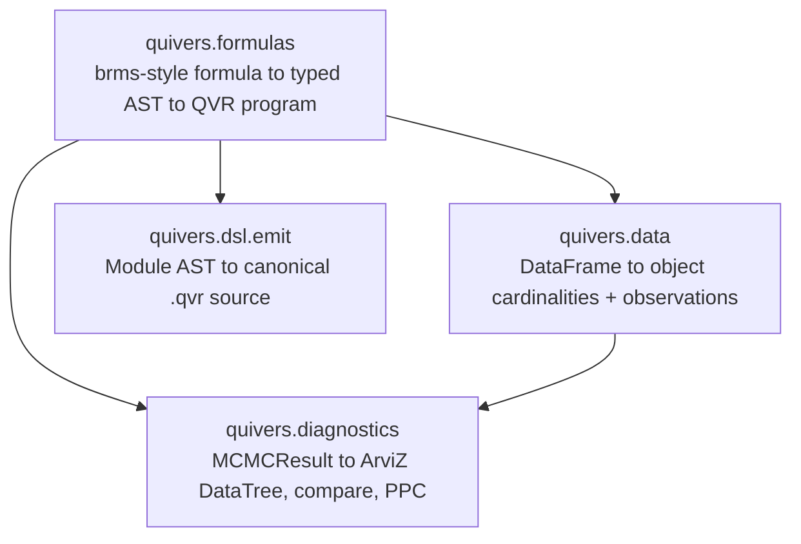

# Analysis: Data and Formulas

The analysis packages turn a dataframe and a regression formula in the style of brms
and lme4 [@burkner2017brms; @bates2015lme4] into a QVR model, whose generated source
shows the response family, predictors, group effects, and priors.
[Fitting and Diagnostics](analysis-fitting-and-diagnostics.md) covers
posterior inference and checks on the fitted model.

## Architecture

Four subpackages, each usable on its own:



Each subpackage needs an optional dependency group, so installing the DSL and inference
alone does not install dataframe, ArviZ, or formula libraries. `pip install "quivers[formulas]"`
installs all four.

## Dataframes: `quivers.data`

A model needs the data's values and a fixed coding of their categories. If a subject
column holds `s1, s2, s1`, its index array is `0, 1, 0`, and the repeated zero makes
both rows use the same subject parameter. [`DatasetSchema`](../api/data/schema.md)
builds that coding, the finite object for the subjects, and the tensors passed at run
time, so the order of the categories is part of the model's interface to the data. It
is a typed [`didactic.api.Model`](https://didactic.dev/api/Model) and accepts a pandas,
polars, or any other [Narwhals](https://narwhals-dev.github.io/narwhals/)-compatible
dataframe.

<!-- python: skip -->
```python
import pandas as pd
from quivers.data import DatasetSchema, compose

df = pd.DataFrame({
    "verb": ["eat", "drink", "run", "eat", ...],
    "subject": ["s1", "s2", "s1", "s3", ...],
    "rt": [0.31, 0.42, 0.28, 0.55, ...],
    "response": [1, 0, 1, 1, ...],
})

schema = DatasetSchema(
    df=df,
    objects={"verb": "Verb", "subject": "Subject"},
    plate_indices={"verb": "verb_idx", "subject": "subj_idx"},
    covariates={"rt": "rt"},
    observations={"response": "y"},
)

print(schema.declarations())          # object Verb : FinSet 17 / object Subject : FinSet 50
print(schema.cardinalities)           # {"Verb": 17, "Subject": 50}
obs = schema.observations_dict()      # {"verb_idx": tensor, "subj_idx": tensor, ...}
```

The schema gives two things:

- [`declarations()`](../api/data/schema.md#quivers.data.schema.DatasetSchema.declarations)
  returns `.qvr` source with one `object X : FinSet N` line per categorical column. The
  cardinality is the column's number of distinct values, and the categories are coded
  in the sorted order of the distinct non-null values, so the indices are the same on
  every run.
- [`observations_dict()`](../api/data/schema.md#quivers.data.schema.DatasetSchema.observations_dict)
  returns the tensors, one entry per row, that inference reads (responses, index arrays, numeric
  covariates), ready for [`SVI.step`](../api/inference/svi.md) or
  [`MCMC.run`](../api/inference/mcmc.md).

[`compose(qvr_body, schema)`](../api/data/schema.md#quivers.data.schema.compose) puts
the schema's declarations before a program body and compiles the result, so the body
need not state the cardinalities.

[`MissingPolicy`](../api/data/encoding.md#quivers.data.encoding.MissingPolicy) sets how
a column's missing entries are handled: `RAISE` (the default) raises, `DROP` drops the
rows, `IMPUTE` replaces a missing entry with the column's mean or most frequent value,
and `MASK` codes it as `NaN` for a numeric column or `-1` for a categorical one, to be
paired with a likelihood that handles missing values.

## Formulas: `quivers.formulas`

`y ~ x + (1 | g)` predicts the response `y` from the predictor `x`, with an intercept
that may differ by group `g`. The intercept is the baseline, the slope multiplies `x`,
and the group offsets come from a shared distribution, which gives partial pooling
[@gelman2013bayesian]. The formula fixes the linear predictor, the family fixes the
response distribution, and priors describe the unknown coefficients. The
[link function](https://en.wikipedia.org/wiki/Generalized_linear_model#Link_function)
connects the linear predictor to a parameter of the response distribution
[@nelder1972glm]: for Bernoulli outcomes the inverse logit (sigmoid) turns any real
predictor into a probability. The `~` of a formula introduces a response model and is
unrelated to drawing a value with `sample` in QVR.

The [formula frontend](../api/formulas/index.md) compiles a formula into a typed QVR
[`Module`](../api/dsl/ast_nodes.md) AST, not into a string. The translation
[`FormulaToQVRModule`](../api/formulas/compile.md#quivers.formulas.compile.FormulaToQVRModule)
is a [`didactic.api.Lens`](https://didactic.dev/api/Lens) from `Formula` to `Module`, a
pair of maps between the two representations. The
[`formulae`](https://bambinos.github.io/formulae/) library, the formula parser of
[Bambi](https://bambinos.github.io/bambi/), parses the syntax, and the result becomes a
typed `Formula` record.

### Inspect or dump the generated QVR

<!-- python: skip -->
```python
from quivers.formulas import formula_to_qvr

src = formula_to_qvr("y ~ poly(x, 2) + (1 | g)", data=df)
print(src)                                  # canonical .qvr source
```

[`quivers.dsl.emit.module_to_source`](../api/dsl/emit.md) writes the `Module` AST as
`.qvr` source, and parsing that source with [`quivers.dsl.loads`](../api/dsl/parser.md)
gives a `Module` that compiles to the same program.

### R / brms conventions

- **Orthogonal polynomials by default.** `poly(x, k)` produces $k$
  orthonormal centered columns, matching R's
  [`stats::poly`](https://stat.ethz.ch/R-manual/R-devel/library/stats/html/poly.html).
  Raw monomials remain available via `I(x**k)`.
- **One coefficient per column of the design matrix** (matches brms
  display). `poly(x, 2)` produces two named coefficients
  `beta_poly_x_2_1` and `beta_poly_x_2_2`, and `x*z` produces three
  named coefficients (`beta_x`, `beta_z`, `beta_x_z`). Each column's values reach the
  program as a [data input](inference-foundations.md#host-data-per-row-covariates-and-index-arrays).
- **R-style transforms** are available in formulas without registration: `log`, `exp`,
  `sqrt`, `abs`, `sin`, `cos`, `tan`, `log10`, `log2`, `log1p`, `expm1`, `asin`, `acos`,
  `atan`, `sinh`, `cosh`, `tanh`.
- **Random-effect groups** `(1 | g)`, `(1 + x | g)`, `(x | g)`,
  `(0 + x | g)` use one group coefficient per design column. Coefficients within
  a single-bar block share an LKJ correlation prior; `(1 + x || g)` makes them
  independent. Explicit IDs, as in `(1 + x | effects | g)`, can share a
  correlation block across location and auxiliary formulas.
- **Interactions** `x:z` (elementwise product, one coefficient) and
  `x*z` (expands to `x + z + x:z`, three coefficients).

### Nonlinear parameter predictors

The `nonlinear` mapping assigns additive formulas or deterministic
expressions to named parameters. With this argument present, the main
formula's right side is a QVR value expression. Additive leaves use the
same design matrices, group blocks, priors, and retained new-data encodings
as ordinary regression; `NonlinearExpression` combines their values without
introducing additional coefficient sites.

```python
import pandas as pd
from quivers.formulas import NonlinearExpression, fit

curve_data = pd.DataFrame({
    "y": [0.2, 0.4, 0.7, 0.8], "x": [0.1, 0.5, 1.0, 1.5],
})
curve = fit(
    "y ~ amplitude * (1 - exp(-rate * x))", data=curve_data,
    nonlinear={
        "amplitude": "~1",
        "log_rate": "~1",
        "rate": NonlinearExpression(expression="exp(log_rate)"),
    },
    fixed_parameters={"sigma": 0.3},
    priors={
        "nlpar_amplitude_intercept": "Normal(1.0, 0.5)",
        "nlpar_log_rate_intercept": "Normal(0.0, 0.5)",
    },
    method="svi", num_steps=2, seed=7,
)
curve_mean = curve.posterior_epred(
    new_data=pd.DataFrame({"x": [0.25, 0.75]}), num_samples=3, seed=7,
)
assert curve_mean.shape == (1, 3, 2)
```

Intermediate parameters use the identity link. Each final family output
is evaluated on its link scale and receives its inverse link once.
For instance, `distributional={"sigma": NonlinearExpression(expression="s0+s1*x")}`
uses the sigma inverse link after that expression; define `s0` and `s1`
in `nonlinear`. Coefficients have the `nlpar_<parameter>_` namespace, and
`get_prior` and `formula_to_qvr` accept the same graph arguments.
QVR retains its proper default coefficient priors when no override is
provided; brms's [nonlinear workflow](https://paulbuerkner.com/brms/articles/brms_nonlinear.html)
instead requires explicit priors for nonlinear population coefficients.

An explicit component mapping supplies a vector-valued output. For
`family=families["multinomial"].with_reference("A")` and response
`cbind(A,B,C)`, use the main formula `cbind(A,B,C) ~ 0` and
`distributional={"mu": NonlinearExpression(expression={"B": "a*x", "C": "b*x"})}`,
with additive leaves `a` and `b`. Keys must match the retained free
coordinate labels exactly; extent equality cannot establish that mapping.
Intermediate component expressions retain the same labels. Unknown names,
dependency cycles, and references to another family output are refused
before inference. The generated QVR uses existing typed inputs and `let`
expressions; nonlinear formulas add no new language construct.

### Offsets and observation exposure

An offset is a known contribution to a linear predictor with coefficient one.
Write `offset(expr)` to add the evaluated expression, or `exposure(expr)` to
add its natural logarithm. With a log link, exposure multiplies the response
mean. For instance, this count model accounts for different observation times:

```python
import pandas as pd
from quivers.formulas import fit

counts = pd.DataFrame({
    "events": [0, 2, 1, 4],
    "temperature": [-1.0, 0.0, 0.5, 1.0],
    "hours": [0.5, 1.0, 2.0, 4.0],
})
rate_fit = fit(
    "events ~ temperature + exposure(hours)",
    data=counts,
    family="poisson",
    method="svi",
    num_steps=10,
    seed=7,
)
# The native predictor is intercept + beta_temperature * temperature + log(hours).
mean_counts = rate_fit.posterior_epred(num_samples=5)
assert mean_counts.shape == (1, 5, 4)
assert set(rate_fit.fixed_effects(num_samples=5)) == {"Intercept", "temperature"}
```

`offset(log(hours))` expresses the same model. Offset columns receive no prior
or fitted coefficient, and `get_prior` excludes them. Their evaluated values
are retained in `Formula.offsets`, the lens complement, and the fitted data;
posterior predictors use the same native bindings as fitting.

Offsets also work in auxiliary formulas, for instance
`distributional={"sigma": "~ z + offset(log(known_scale))"}`. They apply before
the selected inverse link. Several offset terms add together, and `~ 0 + offset(z)`
requires no population coefficient. Categorical models add a scalar row offset
to every non-reference-category logit; the reference logit remains zero.

Every offset must produce one finite numeric value per response row. Exposures
must additionally be strictly positive. Offset and exposure modifiers must be
standalone additive terms; interactions, wrappers around these modifiers, and
random coefficients on them raise errors. The modifiers' names are reserved in
the formula evaluation namespace.

### Response modifiers and recorded events

Response modifiers bind observation roles separately from predictor terms.
Their arguments are bare dataframe column names or scalar numeric/Boolean
literals; quoted column names and evaluated expressions are refused.
For instance, this fit combines recorded censoring events, a truncated
response law, known measurement errors, row selection, and likelihood weights:

```python
import pandas as pd
from quivers.formulas import fit

records = pd.DataFrame({
    "y": [0.2, 0.6, 0.4, 9.0], "x": [-1.0, 0.0, 1.0, 2.0],
    "status": [0, 1, 2, 0], "upper": [None, None, 0.8, None],
    "error": [0.1, 0.1, 0.2, 0.1], "keep": [True, True, True, False],
    "w": [1.0, 2.0, 1.0, 1.0],
})
event_fit = fit(
    "y | cens(status, upper) + trunc(lb=0, ub=3) + se(error) "
    "+ subset(keep) + weights(w, scale=True) ~ x",
    data=records, family="gaussian", method="svi", num_steps=2, seed=19,
)
assert event_fit.log_likelihood(num_samples=2)["y"].shape == (1, 2, 3)
fresh = pd.DataFrame({"x": [-0.5, 0.5], "error": [0.1, 0.2]})
responses = event_fit.posterior_predict(new_data=fresh, num_samples=2, seed=7)
assert responses.shape == (1, 2, 2)
assert ((responses >= 0) & (responses <= 3)).all()
```

`subset(keep)` runs first, before validating response roles or constructing
primary, auxiliary, neural, and group designs. The immutable `RowSelection`
retains the original row positions. Fresh prediction rows are not filtered
by the training subset again.

`cens(status, upper)` uses codes $-1$ for a left event $Y\leq y$,
$0$ for an exact observation, $1$ for a right event $Y>y$, and $2$ for
an interval $y<Y\leq\text{upper}$. The formula binder also accepts
matching status labels and Boolean false/true for exact/right. An active
interval requires a finite upper endpoint greater than its response;
missing upper values on other rows are permitted.

`trunc(lb=low, ub=high)` conditions the response law on inclusive bounds.
Bounds may be infinite, and equal bounds are valid only when they retain
positive mass. Predictions sample this conditional law; censoring instead
changes the recorded likelihood event. Thus raw `log_likelihood` reports
unweighted event log probabilities under the truncated law, including exact
response densities where status is zero.

`se(error)` supports Gaussian, Student-t, and skew-normal responses.
By default, known errors combine with residual `sigma` through
$\sqrt{\text{error}^2+\sigma^2}$; `se(error, sigma=False)` uses strictly
positive known errors alone and omits the residual-scale latent and prior.
`trials(n)` shares the finite-trial family's checked $0\ldots2^{53}$
integer contract and must agree with any `binomial_trials` keyword.
`weights(w, scale=True)` normalizes retained weights to the included row
count after subsetting and refuses zero total weight.

The single `Formula.modifiers` record retains these typed roles and their
column-or-constant sources. Fresh rows need predictors and the sampling-law
roles they use, such as measurement error, truncation bounds, and trials.
Response, censoring, likelihood-weight, and training-subset columns are
unnecessary. Constant roles are reused without new columns.

Native execution and the checked reference support recorded-event options.
The direct QVR form uses `observe` options `cens`, `cens_upper`,
`trunc_lower`, and `trunc_upper`; all 11 external targets currently refuse
these options explicitly.

### Likelihood weights

Pass `weights="column"` to multiply each response log density by its row's
weight. Priors retain their original scores. The weights keep their supplied
scale; the interface does not divide them by their sum or mean. For instance,
this count model includes both observation exposure and likelihood weights:

```python
import pandas as pd
from quivers.formulas import fit, get_prior

weighted_counts = pd.DataFrame({
    "events": [0, 2, 1, 4],
    "x": [-1.0, 0.0, 0.5, 1.0],
    "hours": [0.5, 1.0, 2.0, 4.0],
    "importance": [0.0, 0.5, 2.0, 1.0],
})
weighted_fit = fit(
    "events ~ x + exposure(hours)",
    data=weighted_counts,
    family="poisson",
    weights="importance",
    method="svi",
    num_steps=10,
    seed=7,
)
priors = get_prior(
    "events ~ x + exposure(hours)",
    data=weighted_counts,
    family="poisson",
    weights="importance",
)
assert set(priors) == {"intercept", "beta_x"}
assert weighted_fit.posterior_epred(num_samples=5).shape == (1, 5, 4)
```

The exposure changes the Poisson mean. The likelihood weight scales the log
density at that mean; fractional weights are allowed, and a zero weight excludes
the row's likelihood contribution. Group and auxiliary-parameter priors are
also unweighted. Changing weights changes the fitted posterior. At fixed
posterior coefficients, the response distribution used for predictions is
unchanged, and raw pointwise likelihoods retain the unweighted density.

A weight column must contain finite nonnegative real numbers. Boolean, string,
and complex columns are rejected. The evaluated response and weight rows must
remain aligned; missing model values that would drop weighted rows raise an
error. Prepare a common set of rows before fitting. The read-only column is
retained in `Formula.modifiers.weights` and its lens complement. Emitted QVR
declares a checked `Tensor[Real]([Resp])` input and attaches
`[weights=formula_weights]` to the response observation, with no weight
coefficient or prior.

### Correlated group effects

A random-effects block assigns a joint distribution to its coefficients. For
`(1 + x | group)`, the group intercept and slope have separate positive scales
and a shared correlation. QVR emits an LKJ Cholesky draw `cor_group` and the
coefficient scales `sigma_group_Intercept` and `sigma_group_x`. Its covariance is
`diag(scale) @ cor_group @ cor_group.T @ diag(scale)`.

The default `correlation_prior="LKJCholesky(1.0)"` is uniform over correlation
matrices. `priors={"cor_group": "LKJCholesky(2.0)"}` changes one block's prior;
`correlation_prior` changes the default for every block. Both `fit` and
`formula_to_qvr` accept it. With `reparameterize="centered"`, each group
receives one multivariate Normal coefficient draw for the entire block.
The default `"noncentered"` draws standard Normal innovations and multiplies
by the same Cholesky factor and scales. Both coordinates define the same
conditional Gaussian law, including blocks that combine scalar,
category-specific, and response-component coefficients.

Separate blocks remain independent. For instance, `(1 | group) + (0 + x | group)`
has no intercept–slope correlation, while `(1 + x || group)` explicitly requests
independence within one block. To share a correlation across formulas, give the
blocks the same ID:

<!-- python: skip -->
```python
from quivers.formulas import formula_to_qvr

# Use the same dataframe for the location and scale predictors.
shared_source = formula_to_qvr(
    "y ~ x + (1 | effects | group)",
    data=frame,
    distributional={"sigma": "~ z + (1 | effects | group)"},
)
```

This emits a single `cor_shared_effects` matrix joining the location and scale
intercepts. Shared IDs require the same grouping factor and coding. Ambiguous
block names and repeated coefficients across blocks fail before fitting.

Categorical models expand each block over all non-reference logits, so a
three-category `(1 + x | group)` model has a four-dimensional correlation
matrix. This includes correlations between slopes and between response-category
coefficients. Both parameterizations retain this full covariance.
Numeric transforms and categorical slope contrasts retain their
evaluated design columns, including when the corresponding fixed slope is absent.
The generated runtime telescope declares each group index array as
`Tensor[Int]([Resp])`.

### Inspecting priors

`get_prior` evaluates the design matrices and returns the actual overrideable
parameter names and distribution calls before inference. Default slope scales
include column autoscaling; explicit overrides retain their supplied scale.
Conditional group draws and standard Normal innovations define the group
parameterization and are excluded from the override mapping.

```python
import pandas as pd
from quivers.formulas import get_prior, formula_to_qvr

prior_data = pd.DataFrame({
    "y": [0.1, 0.5, 0.2, 0.7],
    "x": [1.0, 2.0, 3.0, 4.0],
    "group": ["a", "a", "b", "b"],
})
priors = get_prior("y ~ x + (1 + x | group)", data=prior_data)
assert "beta_x" in priors and "cor_group" in priors
source = formula_to_qvr(
    "y ~ x + (1 + x | group)",
    data=prior_data,
    priors={"beta_x": "Normal(0.0, 0.5)", "cor_group": "LKJCholesky(2.0)"},
)
```

Misspelled and unused prior names raise `ValueError` before fitting. This also
catches an override for a scalar auxiliary parameter after that parameter has
received a distributional formula: its coefficient names must be used instead.

### Family registry

`fit(..., family=...)` accepts a string name or a
[`Family`](../api/formulas/family.md#quivers.formulas.family.Family)
value. The built-in families:

| Family | Link (inverse) | Auxiliary parameters |
|---|---|---|
| `gaussian` | identity | `sigma ~ HalfCauchy(2.0)` |
| `bernoulli` | logit (sigmoid) | none |
| `binomial` | logit (sigmoid) | known trial count |
| `beta_binomial` | logit (sigmoid) | known trial count, precision `phi ~ HalfCauchy(2.0)` |
| `categorical` | reference-category multinomial logit | one coefficient and random effect per non-reference category |
| `multinomial` | softmax category probabilities | known or observed-row trial total |
| `dirichlet_multinomial` | softmax category probabilities | total concentration `phi ~ HalfCauchy(2.0)`, trial total |
| `dirichlet` | softmax compositional mean | total concentration `phi ~ HalfCauchy(2.0)` |
| `dirichlet2` | log for every concentration | no reference component |
| `logistic_normal` | identity for additive log ratios | coordinate scales `sigma`, LKJ response correlation |
| `poisson` | log (exp) | none |
| `com_poisson` | log for the rate, not response mean | `shape ~ Gamma(0.01, 0.01)` |
| `cox` | log for the proportional hazard rate | normalized spline weights `sbhaz ~ Dirichlet(1)` |
| `negative_binomial` | log (exp) | `disp ~ Gamma(2.0, 2.0)` |
| `negbinomial2` | log for response mean | reciprocal shape `sigma ~ Gamma(0.4, 0.3)` |
| `discrete_weibull` | logit for survival parameter `q` | `shape ~ HalfCauchy(2.0)` |
| `gamma` | log (exp) | `shape ~ Gamma(2.0, 2.0)` |
| `beta` | logit (sigmoid) | `phi ~ HalfCauchy(2.0)` |
| `student_t` | identity | `nu ~ Gamma(2.0, 0.1)`, `sigma ~ HalfCauchy(2.0)` |
| `cumulative` | cumulative logit | ordered cutpoints, discrimination `disc=1` |
| `acat` | adjacent-category logit | centered thresholds, `disc=1` |
| `sratio` | stopping-ratio logit | centered thresholds, `disc=1` |
| `cratio` | continuation-ratio logit | centered thresholds, `disc=1` |
| `hurdle_cumulative` | cumulative logit above category zero | ordered positive-category cutpoints, `disc=1`, `hu ~ Beta(2, 2)` |
| `zero_inflated_poisson` | log (exp) | `zi ~ Beta(2.0, 2.0)` |
| `zero_inflated_negbinomial` | log for the component mean | `shape ~ Gamma(2.0, 2.0)`, `zi ~ Beta(2.0, 2.0)` |
| `zero_inflated_binomial` | logit for the component success probability | known trial count, `zi ~ Beta(2.0, 2.0)` |
| `zero_inflated_beta_binomial` | logit for the component success probability | known trial count, `phi ~ HalfCauchy(2.0)`, `zi ~ Beta(2.0, 2.0)` |
| `hurdle_poisson` | log (exp) | `zi ~ Beta(2.0, 2.0)` |
| `hurdle_negbinomial` | log for the untruncated component mean | `shape ~ Gamma(2.0, 2.0)`, `hu ~ Beta(2.0, 2.0)` |
| `hurdle_gamma` | log | `shape`, `hu` (zero probability) |
| `hurdle_lognormal` | identity | `sigma` (log-scale), `hu` (zero probability) |
| `zero_inflated_beta` | logit | `phi` (precision), `zi` (zero probability) |
| `zero_one_inflated_beta` | logit (sigmoid) | precision `phi` and boundary probabilities `zoi`, `coi` |
| `xbeta` | logit (sigmoid) | Beta precision `phi` and symmetric extension `kappa`, both with log links |
| `asym_laplace` | identity for the selected quantile | `sigma ~ HalfCauchy(2.0)`, `quantile ~ Beta(2.0, 2.0)` unless fixed |
| `zero_inflated_asym_laplace` | identity for the continuous component's selected quantile | `sigma ~ HalfCauchy(2.0)`, `quantile ~ Beta(2.0, 2.0)`, `zi ~ Beta(2.0, 2.0)` |
| `lognormal` | identity for log-location | `sigma ~ HalfCauchy(2.0)` |
| `skew_normal` | identity for response mean | response SD `sigma ~ HalfCauchy(2.0)`, skewness `alpha ~ Normal(0, 4)` |
| `shifted_lognormal` | identity for log-location | `sigma ~ HalfCauchy(2.0)`, `ndt ~ Uniform(0, min(response))` |
| `frechet` | log for response mean | `nu ~ Gamma(2, 0.1)` conditioned on `nu > 1` |
| `gen_extreme_value` | identity for location | `sigma ~ HalfCauchy(2.0)`, `xi ~ Normal(0, 0.3)` |
| `exgaussian` | identity for the response mean | Normal scale `sigma`, Exponential mean `beta` |
| `inverse_gaussian` | log for the response mean | `shape ~ Gamma(2.0, 2.0)` |
| `exponential` | log for mean | none |
| `geometric` | log for mean count | none |
| `weibull` | log for mean | `shape ~ Gamma(2.0, 2.0)` |
| `von_mises` | tangent half-angle (`2 * atan`) | `kappa ~ Gamma(2.0, 2.0)` |
| `mixture` | identity | component logits, centered location offsets, and positive scales |

A new family is a [`Family`](../api/formulas/family.md#quivers.formulas.family.Family)
value with its own observation family and link. The table's priors on auxiliary
parameters are the library's defaults.

### Factor and vector responses

A factor response remains one scalar code per row. `ResponseLayout` retains
its category labels and declared order, including unobserved levels of a
pandas categorical. `BayesianFit.category_labels` labels the response codes;
`coefficient_labels` labels the fitted non-reference coordinates. Thus a
three-level categorical response has scalar predictive draws and three
category probabilities, rather than a three-component response event.

`cbind(a, b, c)` instead declares one joint vector event in the authored
component order. The `multinomial` and `dirichlet_multinomial` families model
nonnegative integer count vectors. The `dirichlet`, `dirichlet2`, and
`logistic_normal` families model strictly positive compositions whose rows
sum to one. Component axes remain separate from observation axes, even
when their cardinalities coincide.

```python
import pandas as pd
import torch
from quivers.formulas import families, fit

counts = pd.DataFrame({
    "a": [1, 2, 0, 3], "b": [2, 1, 0, 1], "c": [1, 0, 0, 2],
    "x": [-1.0, 0.0, 1.0, 2.0],
})
result = fit(
    "cbind(a, b, c) ~ x", data=counts,
    family=families["multinomial"].with_reference("b"),
    method="svi", num_steps=3, seed=7,
)
assert result.category_labels == ("a", "b", "c")
assert result.coefficient_labels == ("a", "c")
fresh = pd.DataFrame({"x": [0.2, 0.8], "trials": [5, 7]})
expected = result.posterior_epred(
    new_data=fresh, trials="trials", num_samples=2, seed=8,
)
predicted = result.posterior_predict(
    new_data=fresh, trials="trials", num_samples=2, seed=8,
)
assert expected.shape == predicted.shape == (1, 2, 2, 3)
torch.testing.assert_close(expected.sum(-1), torch.tensor([5., 7.]).to(expected).expand(1, 2, 2))
assert torch.equal(predicted.sum(-1), torch.tensor([5, 7]).expand(1, 2, 2))
```

Training count totals are inferred from each observed row. An explicit
`binomial_trials` value or column must agree with those totals. New-row
expectations and draws require `trials=integer_or_column` when training used
inferred totals; a fitted trial column can otherwise be reused.
`posterior_linpred` needs no trial counts. Zero trials produce the all-zero
event, and exact row totals must not exceed `2**53`.

`Family.with_reference(index_or_label)` selects one zero predictor coordinate;
the default is the first retained component. `dirichlet` uses a softmax mean
and total precision `phi`, whereas `dirichlet2` estimates every concentration
through an exponential predictor and has no reference. `logistic_normal`
uses correlated Normal log ratios against its selected component, with one
`sigma` per non-reference coordinate and an LKJ response correlation. It
requires a reference; `with_reference(None)` fails explicitly. Distributional
scale predictors and shared group effects retain these coordinate widths.

The additive log-ratio Normal has no analytic simplex mean in this interface.
Its `posterior_epred` thus requires explicit `mc_samples`; the method averages
native response samples in bounded chunks, with an isolated random seed.
The softmax of a Normal location is not generally the response expectation.

```python
import pandas as pd
from quivers.formulas import families, fit

compositions = pd.DataFrame({
    "a": [0.2, 0.3, 0.15, 0.4], "b": [0.3, 0.2, 0.25, 0.3],
    "c": [0.5, 0.5, 0.6, 0.3], "x": [-1.0, 0.0, 1.0, 2.0],
})
composition_fit = fit(
    "cbind(a, b, c) ~ x", data=compositions,
    family=families["logistic_normal"].with_reference("c"),
    method="svi", num_steps=3, seed=9,
)
new_rows = pd.DataFrame({"x": [0.2, 0.8]})
log_ratios = composition_fit.posterior_linpred(new_data=new_rows, num_samples=2)
mean_composition = composition_fit.posterior_epred(
    new_data=new_rows, num_samples=2, mc_samples=64, seed=10,
)
assert log_ratios.shape == (1, 2, 2, 2)
assert mean_composition.shape == (1, 2, 2, 3)
```

Vector event scores reduce the component axis once, giving one raw likelihood
value per row for posterior analysis. Likelihood weights multiply that joint
score. References change the predictor coordinate system while predictive
outputs retain the original component order. Native and checked-reference
execution support these kernels; external renderer capability remains a
separate family-specific check.

### COM-Poisson rate and response mean

`com_poisson` uses rate `mu=lambda` and positive dispersion `shape=nu`:
its mass is proportional to `lambda**y / factorial(y)**nu`. The default
location and shape links are log; the scalar shape prior is
`Gamma(0.01, 0.01)`. At `nu=1` this is Poisson, but elsewhere the rate
usually differs from the response mean. `posterior_linpred(transform=True)`
returns the rate; `posterior_epred` computes the normalized response mean.
The generated source passes `log_rate=eta` directly, avoiding an unnecessary
exponential when the rate itself would overflow.

```python
from quivers.formulas import formula_to_qvr

com_source = formula_to_qvr(
    "y ~ x", data=pd.DataFrame({"y": [0, 1, 3], "x": [-1., 0., 1.]}),
    family="com_poisson", fixed_parameters={"shape": 1.5},
)
assert "COMPoisson(log_rate=" in com_source
```

This rate convention matches the pinned brms
[compiled Stan density](https://github.com/cran/brms/blob/b124949c14067aa658b176d26477ccf715881bf9/inst/chunks/fun_com_poisson.stan).
But its released [R distribution helpers](https://github.com/cran/brms/blob/b124949c14067aa658b176d26477ccf715881bf9/R/distributions.R#L1222-L1300)
use a mode-like parameter `m`, with rate `lambda=m**nu`; the released
[prediction helper](https://github.com/cran/brms/blob/b124949c14067aa658b176d26477ccf715881bf9/R/posterior_predict.R#L571)
passes its fitted `mu` to that helper unchanged. QVR uses the compiled
rate law consistently for fitting, expectations, and predictive draws.
Comparisons against those R helpers must first convert
`m=lambda**(1/nu)`; agreement of parameter names would not establish
agreement of response laws.

Native and checked-reference execution support this family. Normalization
and moments use certified bounded sums; inability to certify a result
raises explicitly. Sampling uses a separate exact rejection envelope with
a proposal budget. No CDF, censoring, or truncation capability is implied.

### Count dispersion and a zero atom at a quantile

`discrete_weibull` predicts the survival parameter `q` through a logit
link and uses a positive `shape`, whose distributional link is log.
Its count probabilities are `q**(k**shape) - q**((k+1)**shape)`.
The parameter called `mu` in the formula interface is thus a probability,
not the response mean. `posterior_linpred(transform=True)` returns this
parameter; `posterior_epred` evaluates the response mean's infinite
tail sum. A bounded numerical calculation must certify its omitted tail
or refuse the requested moment.

`negbinomial2` instead predicts a response mean with a log link. Its
positive `sigma` is reciprocal shape, giving variance
`mu + sigma * mu**2`. It is not a response standard deviation. The
frontend reuses `NegativeBinomial(total_count=1/sigma, probs=mu/(mu+1/sigma))`.
The scalar default `Gamma(0.4, 0.3)` is a prior on `sigma` itself,
following the [pinned brms family definition](https://github.com/cran/brms/blob/b124949c14067aa658b176d26477ccf715881bf9/R/family-lists.R).
It does not match the prior induced by the existing `negative_binomial`
family's `disp ~ Gamma(2, 2)`. A distributional `sigma` predictor uses
the log link and priors on its coefficients.

`zero_inflated_asym_laplace` models a continuous quantile with an added
atom at zero. Its `mu` is the `quantile` parameter's quantile of the
continuous component; adding the atom changes the whole response's
quantiles. `sigma` has a log link, while `quantile` and `zi` have
logit links. At zero the observation log score is `log(zi)`; elsewhere
it is `log(1-zi)` plus the asymmetric Laplace log density. Its expected
response is `(1-zi) * (mu + sigma*(1-2*quantile)/(quantile*(1-quantile)))`.
The exact atom remains part of predictive draws and raw pointwise
likelihoods.

All three use the existing `fixed_parameters` and `distributional`
interfaces. For instance, the following source keeps the component's
quantile fixed while regressing its scale and zero probability:

```python
import pandas as pd
from quivers.formulas import formula_to_qvr

quantile_data = pd.DataFrame({
    "response": [0.0, -0.2, 0.4, 0.0],
    "x": [-1.0, 0.0, 1.0, 2.0],
    "z": [0.2, -0.3, 0.1, 0.5],
})
quantile_source = formula_to_qvr(
    "response ~ x",
    data=quantile_data,
    family="zero_inflated_asym_laplace",
    fixed_parameters={"quantile": 0.35},
    distributional={"sigma": "~ z", "zi": "~ x"},
)
```

The [formal kernels](../semantics/programs.md#discrete-weibull-counts)
distinguish the count law, mixed atom/density law, and reciprocal
dispersion map. Their parameters remain runtime values; these family
names add no new program-header syntax.

### Skew, shifted, and extreme-value regressions

A family name determines which response quantity the main predictor
describes. These four parameterizations use different quantities:

| Formula family | Main parameter | Auxiliary links |
| --- | --- | --- |
| `skew_normal` | response mean `mu`, identity link | log for response standard deviation `sigma`; identity for skewness `alpha` |
| `shifted_lognormal` | Normal location of `log(y - ndt)`, identity link | log for log-scale `sigma` and nondecision time `ndt` |
| `frechet` | positive response mean `mu`, log link | `logm1` for `nu`, with inverse `1 + exp(eta)` |
| `gen_extreme_value` | response location `mu`, identity link | log for scale `sigma`; identity for shape `xi` |

The skew-normal frontend converts its response mean and standard
deviation into the native location and scale. With
`delta = alpha / sqrt(1 + alpha**2)`, it uses
`scale = sigma / sqrt(1 - 2*delta**2/pi)` and
`loc = mu - scale*delta*sqrt(2/pi)`. Thus `posterior_epred` returns the
main response mean, rather than that native location.

For shifted lognormal responses, `ndt` shifts the entire positive
component, and every observation must exceed it. The response expectation
is `ndt + exp(mu + sigma**2/2)`. A main linear predictor or its transformed
value is thus distinct from a response expectation. A fixed
`ndt` must be below every observed response; scalar-prior initialization
also needs to respect that support.

Fréchet regression uses `scale = mu / Gamma(1 - 1/nu)`. The `logm1`
link keeps `nu > 1`, giving a finite response mean. It does not ensure a
finite variance, which requires `nu > 2`. The native Fréchet kernel
separately allows any positive concentration.

GEV's `mu` is location. Its expectation includes a shape-dependent
correction and exists only for `xi < 1`; at `xi=0`, the correction is
`sigma * EulerGamma`. QVR uses a direct shape with an identity link.
The pinned brms release uses a different default shape link and an
additional [scalar-shape transformation](https://github.com/cran/brms/blob/b124949c14067aa658b176d26477ccf715881bf9/inst/chunks/fun_scale_xi.stan)
whose bounds depend on the observed responses, location, and scale.
Matching the conditional density does not establish that same shape prior.

These conversions agree with the released
[likelihood code](https://github.com/cran/brms/blob/b124949c14067aa658b176d26477ccf715881bf9/R/stan-likelihood.R)
and [response-expectation code](https://github.com/cran/brms/blob/b124949c14067aa658b176d26477ccf715881bf9/R/posterior_epred.R)
where their parameter policies coincide.

Scalar `sigma` defaults to `HalfCauchy(2)`, and skewness `alpha` to
`Normal(0, 4)`. The shifted-lognormal scalar `ndt` prior is
`Uniform(0, min(response))`, retaining the observed support. A
regressed `ndt` remains the exponential of its predictor; there is no
hidden rescaling by the smallest response. Initialization must respect
that support, especially for small responses; the fitting API accepts
[named initial values](../api/formulas/fit.md#named-initial-values)
on the latent parameters' natural scales.

The Fréchet scalar `nu` prior is `Gamma(2, 0.1)` conditioned on `nu > 1`
with its interval-mass normalizer. A custom scalar prior is restricted
in the same way; an explicitly restricted prior must have a literal
lower bound at least one. A regressed `nu` requires `logm1`, so the
response-mean conversion cannot silently enter an undefined regime.
GEV's scalar `xi` default is `Normal(0, 0.3)` on its direct real shape.
Predicted means require the finite-moment domain; response sampling
and linear predictors remain distinct operations.

```python
import pandas as pd
from quivers.formulas import formula_to_qvr

response_times = pd.DataFrame({
    "reaction": [0.7, 1.1, 1.5, 0.9],
    "x": [-1.0, 0.0, 1.0, 2.0],
    "z": [0.0, 1.0, -1.0, 0.5],
})
shifted_source = formula_to_qvr(
    "reaction ~ x",
    data=response_times,
    family="shifted_lognormal",
    fixed_parameters={"ndt": 0.1},
    distributional={"sigma": "~ z"},
)
```

The shape, skewness, and time-shift parameters are runtime real values.
They do not introduce static type indices or additional syntax in a
program header. Distributional formulas and fixed parameters use the
same interfaces as for the existing response families.

### Zero-inflated and hurdle counts

A zero-inflated count model adds a structural zero to a count distribution
that can already produce zero. Its `zi` parameter is the probability of the
structural zero, so the total zero probability also includes the component's
zero mass. A hurdle model instead uses `hu` for the entire zero probability
and conditions its count component to be positive. The existing
`hurdle_poisson` interface currently calls this auxiliary `zi`; the
negative-binomial hurdle interface uses `hu`.

For `zero_inflated_negbinomial` and `hurdle_negbinomial`, the location
predictor gives the untruncated negative-binomial mean $\mu$. The positive
`shape` parameter gives variance $\mu+\mu^2/\mathrm{shape}$ before inflation
or truncation. Native parameters are `total_count=shape` and
`probs=mu/(mu+shape)`, using PyTorch's negative-binomial probability
convention. The existing `negative_binomial` family calls this same
dispersion auxiliary `disp`.

`zero_inflated_binomial` and `zero_inflated_beta_binomial` use a success
probability as location, with `binomial_trials` supplying the trial count.
The beta-binomial additionally uses precision `phi`, giving component
concentrations `mu*phi` and `(1-mu)*phi`. For instance, this model allows a
separate predictor for the structural-zero probability:

```python
import pandas as pd
from quivers.formulas import fit

count_data = pd.DataFrame({
    "successes": [0, 1, 0, 2, 4],
    "trials": [0, 4, 3, 5, 6],
    "x": [-1.0, -0.5, 0.0, 0.5, 1.0],
    "z": [0.2, -0.1, 0.4, 0.0, 0.5],
})
count_fit = fit(
    "successes ~ x", data=count_data,
    family="zero_inflated_beta_binomial", binomial_trials="trials",
    distributional={"zi": "~ z"}, method="svi", num_steps=10, seed=7,
)
new_counts = pd.DataFrame({
    "x": [-0.25, 0.75], "z": [0.1, 0.3], "trials": [0, 8],
})
counts_mean = count_fit.posterior_epred(new_data=new_counts, num_samples=5)
counts_rep = count_fit.posterior_predict(new_data=new_counts, num_samples=5)
assert counts_mean.shape == counts_rep.shape == (1, 5, 2)
assert (counts_mean[..., 0] == 0).all()
assert (counts_rep[..., 0] == 0).all()
```

Zero trials require a zero response and produce a zero prediction.
For the three zero-inflated families, `posterior_epred` multiplies the
component mean by `1-zi`. The hurdle negative-binomial expectation instead
divides its component mean by the component's positive probability before
multiplying by `1-hu`. `posterior_linpred(transform=True)` returns the
component mean or success probability, not this mixture expectation.
At native negative-binomial `probs=0`, the hurdle's positive component uses
the limiting point mass at one; its full response expectation is `1-hu`.

### Response-time families

`exgaussian` models a response as a Normal component plus an independent
Exponential component. The formula predictor gives the response mean `mu`, not
the Normal component's mean: compilation uses `loc = mu - beta`, Normal scale
`sigma`, and Exponential rate `1 / beta`. `inverse_gaussian` likewise predicts
the response mean, with variance `mu**3 / shape`. Both parameterizations follow
[brms's response-distribution definitions](https://paulbuerkner.com/brms/articles/brms_families.html#response-time-models).

```python
import pandas as pd
from quivers.formulas import formula_to_qvr

latency_data = pd.DataFrame({
    "latency": [0.3, 0.8, 1.1, 1.8],
    "condition": [-1.0, -1.0, 1.0, 1.0],
})
latency_source = formula_to_qvr(
    "latency ~ condition", data=latency_data, family="exgaussian",
    distributional={"beta": "~ condition"},
    fixed_parameters={"sigma": 0.2},
)
positive_source = formula_to_qvr(
    "latency ~ condition", data=latency_data, family="inverse_gaussian",
    distributional={"shape": "~ condition"},
)
```

The ExGaussian sampler adds reparameterized Normal and Exponential draws.
The inverse Gaussian sampler has no rejection loop and uses implicit CDF
derivatives for gradients, with common tail-density factors canceled before
evaluation. Independent SciPy densities and CDFs, numerical derivative checks,
Monte Carlo moments and moment gradients, and SVI/HMC/NUTS execution are covered
in `tests/continuous/test_response_time_families.py` and
`tests/test_formula_distributional.py`. External transpilation backends currently
reject both families with explicit unsupported-family diagnostics.

### Joint reaction times and decisions

The `wiener` family models two measurements jointly: (i) a positive reaction
time and (ii) the boundary reached by a diffusion process. Write
`rt | dec(choice) ~ condition`, or pass `decision="choice"` alongside
`"rt ~ condition"`. Numeric choices must be exactly `0` for the lower boundary
or `1` for the upper boundary; the strings `"lower"` and `"upper"` are also
accepted. Boolean, fractional, missing, and other choice values are rejected.

The location predictor is drift `mu`. The auxiliary parameters are boundary
separation `bs > 0`, nondecision delay `ndt >= 0`, and starting fraction
`0 < bias < 1`; diffusion variance is fixed to one. Their default links are
identity, log, log, and logit, respectively. Each auxiliary can be fixed or
given a distributional formula through the existing formula interface.
Observed times must be finite, positive, and greater than a fixed delay.

This fit includes a decision column and a likelihood weight, then predicts
fresh rows containing only the covariate:

```python
import pandas as pd
import torch
from quivers.formulas import fit

rt_data = pd.DataFrame({
    "rt": [0.3, 0.4, 0.5, 0.6],
    "choice": ["lower", "upper", "lower", "upper"],
    "condition": [-0.2, 0.0, 0.3, 0.8],
    "importance": [0.0, 0.5, 1.0, 2.0],
})
rt_fit = fit(
    "rt | dec(choice) + weights(importance) ~ condition",
    data=rt_data,
    family="wiener",
    fixed_parameters={"bs": 1.2, "ndt": 0.1, "bias": 0.4},
    method="svi",
    num_steps=5,
    seed=11,
)
new_trials = pd.DataFrame({"condition": [-0.3, 0.7]})
signed = rt_fit.posterior_predict(new_data=new_trials, num_samples=3, seed=17)
decoded = rt_fit.posterior_response(new_data=new_trials, num_samples=3, seed=17)
assert signed.shape == decoded.value.shape == (1, 3, 2)
assert decoded.decision_labels == ("lower", "upper")
torch.testing.assert_close(signed, decoded.value * (2 * decoded.decision - 1))
mean_rt = rt_fit.posterior_epred(new_data=new_trials, num_samples=3)
choices = rt_fit.posterior_choice_probs(new_data=new_trials, num_samples=3)
assert mean_rt.shape == (1, 3, 2)
assert choices.shape == (1, 3, 2, 2)
torch.testing.assert_close(choices.sum(-1), torch.ones_like(mean_rt))
```

`posterior_predict` preserves the native signed representation: positive times
indicate the upper boundary and negative times indicate the lower boundary.
`posterior_response` returns a `ResponseDraws` record with positive `value`
times and matching integer `decision` codes from the same joint draw. It
decodes one prediction call; it does not draw the time and choice separately.
`posterior_epred` returns expected positive time, including delay, while
`posterior_choice_probs` returns lower/upper probabilities. The latter is also
available as `posterior_epred(component="decision")`.

`Formula.modifiers` is one immutable `ResponseModifiers` record holding the
checked `weights` and `decision` columns. Matching surface and keyword
declarations agree; conflicting column names fail. The compiler retains
positive times in the formula metadata and emits typed raw-time and Boolean
choice inputs, followed by the visible adaptation
`let rt = formula_response * (2.0 * real(formula_decision) - 1.0)`.
Thus `log_likelihood()` evaluates the joint time-and-choice density, and
`analysis().observed_data` retains the original positive times. Weights scale
that joint likelihood during fitting; raw likelihoods and the conditional
response sampling law remain unweighted.

The default auxiliary priors are `Gamma(1.0, 1.0)` for `bs`,
`LogNormal(-2.0, 0.5)` for `ndt`, and `Beta(1.0, 1.0)` for `bias`.
These are QVR defaults. A learned scalar delay starts at one quarter of the
minimum observed time; a regressed log delay with an intercept receives the
corresponding coefficient center. Explicit `initial_values` override these
centers without changing the prior or adding an offset.

Native Torch execution and the checked reference implement the joint law.
Sampling uses one-sided first-passage proposals with certified density-ratio
comparisons, with explicit term, precision, and proposal budgets; exhaustion
raises an error. There is no discretized diffusion fallback. External
transpilation targets currently refuse Wiener explicitly. The signed kernel,
choice probabilities, and moment conventions are specified in
[Programs as kernels](../semantics/programs.md#62-joint-reaction-time-and-decision-responses).

### Positive hurdle regressions

Use `hurdle_gamma` or `hurdle_lognormal` for nonnegative responses with a
structural zero process and a positive component. The `hu` parameter gives the
probability of zero. Each component parameter and `hu` can be regressed,
assigned a prior, or fixed on its natural scale:

```python
import pandas as pd
from quivers.formulas import fit

amounts = pd.DataFrame({
    "amount": [0.0, 0.2, 0.7, 0.0],
    "x": [-1.0, 0.0, 1.0, 2.0],
    "z": [0.2, -0.3, 0.0, 0.5],
})
hurdle_fit = fit(
    "amount ~ x",
    data=amounts,
    family="hurdle_gamma",
    distributional={"hu": "~ z"},
    fixed_parameters={"shape": 0.4},
    method="svi",
    num_steps=10,
    seed=19,
)
mean_amounts = hurdle_fit.posterior_epred(num_samples=5)
assert mean_amounts.shape == (1, 5, 4)
```

For Gamma, the main predictor's inverse link gives the positive-component mean
`mu`, and `shape` gives its shape. The complete response mean is `(1-hu)*mu`.
For LogNormal, the main predictor gives the underlying Normal mean `mu`, and
`sigma` gives its standard deviation. Its response mean is
`(1-hu)*exp(mu + sigma**2/2)`. `posterior_epred` includes these component moments
and hurdle weights; `posterior_linpred` reports the selected predictor.

Fixed `hu=0` recovers the positive component, and fixed `hu=1` gives a point
mass at zero. Native sampling draws the structural zero gate exactly, while
likelihood derivatives remain available for fitting observed responses.
External backend emission currently reports these native families as unsupported.

### Zero-inflated beta regression

Use `zero_inflated_beta` for responses with exact zeros and continuous values
strictly below one. `zi` is the zero-atom probability; `mu` is the mean of the
interior Beta component, and `phi` is its precision. The response expectation is
`(1 - zi) * mu`:

```python
import pandas as pd
from quivers.formulas import fit

proportions = pd.DataFrame({
    "fraction": [0.0, 0.2, 0.7, 0.0],
    "x": [-1.0, 0.0, 1.0, 2.0],
    "z": [0.2, -0.3, 0.0, 0.5],
})
zero_beta_fit = fit(
    "fraction ~ x",
    data=proportions,
    family="zero_inflated_beta",
    distributional={"zi": "~ z"},
    fixed_parameters={"phi": 8.0},
    method="svi",
    num_steps=10,
    seed=13,
)
interior_means = zero_beta_fit.posterior_linpred(transform=True, num_samples=5)
response_means = zero_beta_fit.posterior_epred(num_samples=5)
assert interior_means.shape == response_means.shape == (1, 5, 4)
```

Both `phi` and `zi` can be regressed or fixed, with log and logit links by
default. Fixed `zi=0` gives an ordinary Beta distribution; fixed `zi=1` gives a
point mass at zero. Observations equal to one require the
`zero_one_inflated_beta` family. The emitted QVR reuses that native distribution
with its conditional one-atom probability `coi` fixed at zero, so zero-only
inflation creates no one-atom latent or prior. External backend emission follows
the native family's capability checks and currently reports unsupported targets.

### Spline proportional hazards

A `cox` regression predicts a positive hazard multiplier, with default
`mu = exp(eta)`. Its baseline is a normalized mixture of M-splines:
`sbhaz` supplies positive simplex weights, while the ordinary intercept
controls the overall hazard rate. Increasing the transformed predictor
thus increases risk at each time; it does not increase expected event time.

```python
import pandas as pd
from quivers.formulas import families, fit

followup = pd.DataFrame({
    "time": [0.2, 0.5, 0.8, 1.4, 2.0],
    "exposure": [-1.0, 0.0, 1.0, 0.3, 0.2],
})
survival_fit = fit(
    "time ~ exposure", data=followup,
    family=families["cox"].with_baseline(df=5, degree=3),
    method="svi", num_steps=2, seed=14,
)
fresh_followup = pd.DataFrame({"exposure": [0.2, -0.1]})
rates = survival_fit.posterior_linpred(
    transform=True, new_data=fresh_followup, num_samples=2,
)
times = survival_fit.posterior_predict(
    new_data=fresh_followup, num_samples=2, seed=15,
)
mean_times = survival_fit.posterior_epred(
    new_data=fresh_followup, num_samples=2, mc_samples=64, seed=15,
)
assert rates.shape == times.shape == mean_times.shape == (1, 2, 2)
```

Automatic knots use training event quantiles and the full training follow-up
span; exact events determine interior quantiles, while censored follow-up
and active interval upper endpoints determine the boundary span. Subsets are
selected before this calculation. Fresh predictor rows cannot rebuild knots.
An explicit immutable
`MSplineBasis` can instead be passed to `with_baseline(basis)`. The generated
QVR retains one coefficient table and contracts it with `sbhaz`, independently
of the number of observation rows. `priors={"sbhaz": "Dirichlet(2.0)"}`
changes every concentration; a vector prior supplies separate concentrations.
`get_prior` reports the resulting source call.

The baseline's finite-interval integral is one. Beyond the final knot,
the positive endpoint hazard continues constantly, yielding a normalized
response law with finite moments at each fixed parameter draw and events
beyond the training interval.
This tail policy is part of the model, rather than a fitted-data boundary
restriction. The [hazard guide](continuous-families.md#positive-time-spline-hazards)
gives the structural source types and knot policy.

Response sampling uses the retained inverse cumulative hazard. No closed
response mean is provided, so `posterior_epred` requires an explicit
`mc_samples` budget and reports a simulation average. The shared collector
uses chunks of at most 64 and restores the caller's random state. These
examples contain exact event times. Recorded censoring events use the common
`cens(status, upper)` response modifier and the same survival law.

A grouping factor can select a separate normalized baseline profile without
adding a varying coefficient to the rate predictor:

```python
import pandas as pd
from quivers.continuous import MSplineBasis
from quivers.formulas import families, fit

followup = pd.DataFrame({
    "y": [0.2, 0.5, 1.0, 1.5], "x": [-1.0, 0.0, 1.0, 0.5],
    "site": ["a", "b", "a", "b"],
})
site_fit = fit(
    "y ~ x", data=followup,
    family=families["cox"].with_baseline(
        MSplineBasis((0.0, 2.0), (), degree=1), by="site",
    ),
    method="svi", num_steps=1, seed=7,
)
fresh_sites = pd.DataFrame({"x": [0.0, 0.5], "site": ["a", "new"]})
site_times = site_fit.posterior_predict(
    new_data=fresh_sites, num_samples=2, seed=13,
    allow_new_levels=True, sample_new_levels="gaussian", re_formula="~0",
)
assert site_times.shape == (1, 2, 2) and (site_times > 0).all()
```

Every site shares the retained basis and has its own `sbhaz` simplex. The
compiler contracts its profile once per group, then gathers profiles through
the checked row-to-group map. `re_formula="~0"` removes varying rate effects
but retains baseline conditioning. The `uncertainty` and `old_levels` policies
use the same donor identity for baseline profiles and ordinary group effects.
For `gaussian`, a new profile follows its Dirichlet prior, while supported
Normal/LKJ rate effects follow their fitted conditional laws; the policy does
not approximate a simplex with a Gaussian. Repeated new identities share one
profile. Direct lens users can retain a structural group with
`formula_from_data(..., groups=("site",))` without introducing a random term.

### Censored extended Beta regression

The `xbeta` family generates a Beta component with mean `mu` and precision
`phi`, extends its unit interval by `kappa` on each side, then censors the
result at zero and one. This mechanism creates both boundary masses from
the same three component parameters. It may be useful when bounded
measurements reach their recording limits.

```python
import pandas as pd
from quivers.formulas import fit

bounded = pd.DataFrame({"y": [0.0, 0.3, 1.0, 0.7], "x": [-1.0, 0.0, 1.0, 2.0]})
bounded_fit = fit(
    "y ~ x", data=bounded, family="xbeta",
    fixed_parameters={"phi": 4.0, "kappa": 0.2},
    method="svi", num_steps=2, seed=9,
)
fresh = pd.DataFrame({"x": [-0.5, 1.5]})
component_means = bounded_fit.posterior_linpred(transform=True, new_data=fresh, num_samples=3)
response_means = bounded_fit.posterior_epred(new_data=fresh, num_samples=3)
responses = bounded_fit.posterior_predict(new_data=fresh, num_samples=3, seed=12)
assert component_means.shape == response_means.shape == responses.shape == (1, 3, 2)
```

`posterior_linpred(transform=True)` returns the underlying Beta mean;
`posterior_epred` integrates the censored response, including both atoms.
It uses bounded deterministic quadrature and raises if its numerical
budget cannot certify the requested moments. Both `phi` and `kappa` can
be fixed or regressed using the common `distributional` interface. Setting
`kappa=0` gives ordinary Beta responses. The default scalar extension prior
is `Gamma(0.01, 0.01)` on the natural scale. Distributional coefficient
priors follow QVR's common coefficient rules; they do not reproduce brms's
default Student-t prior on a log-extension predictor.

### Quantile regression and fixed auxiliary parameters

The asymmetric Laplace family predicts a selected response quantile rather than
its mean. `fixed_parameters` holds auxiliary parameters constant on their natural
scale; the compiler emits deterministic bindings and inference allocates no
latent coordinates for them. This option also applies to other families, for
instance `fixed_parameters={"sigma": 0.5}` for a known Gaussian residual scale.

```python
import pandas as pd
from quivers.formulas import fit, get_prior

quantile_data = pd.DataFrame({
    "y": [-0.5, 0.2, 0.7, 1.2],
    "x": [-1.0, 0.0, 1.0, 2.0],
})
quantile_fit = fit(
    "y ~ x",
    data=quantile_data,
    family="asym_laplace",
    fixed_parameters={"quantile": 0.9},
    method="svi",
    num_steps=10,
)
assert "let quantile = 0.9" in quantile_fit.qvr_source
assert "quantile" not in get_prior(
    "y ~ x", data=quantile_data, family="asym_laplace",
    fixed_parameters={"quantile": 0.9},
)
```

The density is `q * (1-q) / sigma * exp(-rho_q((y-mu)/sigma))`, where
`rho_q(u) = u * (q - I[u < 0])`. Thus the probability below `mu` is `q`.
At `q=0.5`, this equals a Laplace distribution with scale `2 * sigma`;
`sigma` is the check-loss scale, not the response standard deviation.
The native implementation also provides CDF and inverse-CDF evaluation and
reparameterized draws through a difference of two exponential variables.
These parameterizations are checked against
[brms's definition](https://paulbuerkner.com/brms/articles/brms_families.html#quantile-regression)
and an independent SciPy density in `tests/continuous/test_asymmetric_laplace.py`.
External transpilation backends currently reject this family with an explicit
unsupported-family diagnostic.

Fixed parameters cannot also have distributional formulas or prior overrides.
Quantiles must lie strictly between zero and one, scales must be positive, and
inflation probabilities may include either endpoint. If the quantile is left
unfixed, its default prior is `Beta(2.0, 2.0)`; it may also have a distributional
formula with a logit link.

### Distributional regression and link selection

A **distributional regression** gives a response parameter its own predictor. For
instance, a Gaussian model may let both the mean and the residual scale vary with
observed predictors. `distributional` maps an auxiliary parameter to its formula;
`"~ z"` and `"sigma ~ z"` are equivalent when the parameter is `sigma`.

```python
import pandas as pd
from quivers.formulas import families, formula_to_qvr

frame = pd.DataFrame({
    "y": [0.1, 1.0, -0.5, 0.7],
    "x": [-1.0, 0.0, 1.0, 2.0],
    "z": [0.0, 1.0, -1.0, 0.5],
    "group": ["a", "a", "b", "b"],
})
source = formula_to_qvr(
    "y ~ x + (1 | group)",
    data=frame,
    family=families["gaussian"].with_links(sigma="softplus"),
    distributional={"sigma": "~ z + (1 | group)"},
    priors={"dpar_sigma_intercept": "Normal(0.0, 1.0)"},
)
```

The mean and scale predictors have separate coefficients and group effects. The
scale predictor's names start with `dpar_sigma_`: its intercept is
`dpar_sigma_intercept`, the slope of `z` is `dpar_sigma_beta_z`, and its group
scale is `dpar_sigma_sigma_group_Intercept`. Both predictors share the same
coding of `group`, so each row refers to the same group in both predictors.
The group effects themselves are independent across predictors unless their
blocks carry the same explicit ID, such as `(1 | effects | group)` in both
formulas.

`fit` accepts the same `distributional` mapping and retains the evaluated design
matrices in `BayesianFit.distributional`. Each predictor supports the existing
fixed terms, transforms, and group effects. The compiler evaluates
these design matrices once, then emits one QVR program; optimization does not
reparse formulas. Group coding or row-count conflicts fail before inference.

Unspecified auxiliary parameters retain their scalar priors from the family
registry. A regressed parameter instead receives priors on its coefficients;
for instance, the prior on `dpar_sigma_intercept` describes the scale predictor
before its inverse link. Giving a prior for `sigma` itself at the same time
raises an error. `fixed_prior` and `random_scale_prior` apply to both location
and auxiliary predictors, with the same column autoscaling rules.

[`Family.with_links`](../api/formulas/family.md#quivers.formulas.family.Family.with_links)
returns a family value with selected links, using `mu` for location and auxiliary
parameter names for other predictors. For instance,
`families["bernoulli"].with_links(mu="probit")` chooses probit regression.
The link registry includes `identity`, `logit`, `log`, `softmax`, `inverse`,
`probit`, `probit_approx`, `cloglog`, `cauchit`, `sqrt`, `inverse_square`, `logm1`,
`log1p`, `softplus`, `squareplus`, `softit`, and `tan_half`. Link names describe the forward link;
the compiler emits its inverse. `sqrt` thus squares the predictor, while
`inverse_square` emits its reciprocal square root. Positive and probability
parameters must still lie in their distribution's support. Categorical models
require softmax. Ordinal link support depends on the construction, as
described in [ordinal families](#ordinal-families-thresholds-and-category-specific-effects).
The default cumulative logit/probit paths retain `OrderedLogistic` and
`OrderedProbit`, respectively.

`squareplus` maps a real predictor to a positive parameter through
`(eta + sqrt(eta**2 + 4)) / 2`. `softit` maps it to a probability
through `softplus(eta) / (1 + softplus(eta))`. These are the
[released brms inverse links](../semantics/programs.md#inverse-links-as-value-maps).
The compiler stages shared intermediate values and uses equivalent
forms that avoid cancellation and overflow in large finite predictors.
Their value and first/second derivative checks include the origin and
tail regimes in `tests/test_formula_link_tails.py`.

```python
from quivers.formulas import families

positive_scale = families["gaussian"].with_links(sigma="squareplus")
softit_bernoulli = families["bernoulli"].with_links(mu="softit")
```

Use `positive_scale` with a distributional scale predictor such as
`distributional={"sigma": "~ z"}`. A scalar scale prior is unchanged
when no scale predictor is supplied. Link selection changes the
deterministic value map, without introducing a new program-header form.

For binomial, beta-binomial, and their zero-inflated variants,
`binomial_trials` is either one common nonnegative integer or the name of a
data column with one trial count per row:

<!-- python: skip -->
```python
fit(
    "successes ~ condition + (1 | participant)",
    data=df,
    family="binomial",
    binomial_trials="trials",
)
```

Trial counts must satisfy `0 <= n <= 2**53`. This family-specific bound
preserves exact integer representation in native float64 arithmetic; the
language's general `Int` carrier remains signed 64-bit. Boolean, fractional,
nonfinite, negative, and out-of-range values are refused at fitting and prediction.
Zero trials are allowed; their observed and predicted counts must be zero.

Native Binomial, BetaBinomial, NegativeBinomial, Poisson, and the four count-mixture
kernels use float64 parameters, log scores, and moments. Learned heads may
remain float32: promotion retains their autograd connections, and gradients
return in the heads' original dtype. Supply large trial counts as integer
arrays or integer source literals so their original values reach validation;
promoting an already-rounded float32 count preserves its rounded value.
Scores still use floating-point arithmetic. Native arithmetic-count kernels
and their checked reference adapters reject original finite observations
outside `[-2**53, 2**53]` before conversion. This is distinct from a support
violation within that numerical range, which has zero mass when distribution
argument validation is disabled. Categorical and ordinal responses retain
exact category-index comparisons instead of applying this arithmetic ceiling.

The emitted binomial likelihood is `Binomial(trials, sigmoid(eta))`. The negative-binomial family
uses the NB2 form [@cameron1986econometric], with mean $\mu$ and variance
$\mu + \mu^2 / \mathrm{disp}$: `mu = exp(eta)`, `disp > 0`, and the compiler emits
`NegativeBinomial(disp, mu / (mu + disp))`, matching QVR's
`(total_count, probs)` convention.

The other scalar response families likewise take the parameters
named in regression rather than the slots of their constructors. Gamma uses
mean `mu` and shape `shape`, then emits `Gamma(shape, shape / mu)`.
Beta uses mean `mu` and precision `phi`, then emits
`Beta(mu * phi, (1 - mu) * phi)`. Student-t maps `nu`, `mu`, and
`sigma` to QVR's `(df, loc, scale)` order. The beta family is the mean and precision form of beta
regression [@ferrari2004beta]. Zero-inflated [@lambert1992zip] and hurdle
Poisson models read `zi` as the probability of a structural zero and `mu` as the
Poisson rate. Exponential and geometric models likewise predict their response
mean: they emit rates `1 / mu` and success probabilities `1 / (1 + mu)`.
Following the [brms response parameterizations](https://paulbuerkner.com/brms/articles/brms_families.html),
Weibull models use `scale = mu / Gamma(1 + 1 / shape)`, so `mu` remains the mean
rather than the Weibull scale. Lognormal models predict the Normal location of
the log response, and von Mises models predict its circular location.

### Unordered categorical mixed models

Adding one constant to every logit leaves the softmax unchanged, so without a
constraint many coefficient settings give the same probabilities. Fixing category
zero's logit at zero removes that direction, and the other logits compare each category
with the reference. With logits `[0, 0, 0]`, for instance, each category has
probability `1/3`.

The categorical family infers `K` from contiguous integer labels
`0, ..., K-1` and uses category zero as the reference. Every fixed-effect
coefficient and random effect is thus a vector of `K - 1` logits.
The compiler prepends the reference logit of zero and applies softmax to
the resulting `K`-vector of each row. This parameterization removes the
unidentified common shift in an unconstrained set of `K` logits.

<!-- python: skip -->
```python
choice_fit = fit(
    "choice ~ surprisal + condition + (1 + surprisal | participant)",
    data=choices,
    family="categorical",
    method="nuts",
)
```

Categorical responses must contain every label between zero and `K - 1`.
Random effects for each class default to the
[non-centered parameterization](https://mc-stan.org/docs/stan-users-guide/efficiency-tuning.html),
which transforms standard Normal innovations into coefficients.
`reparameterize="centered"` instead draws the coefficients directly under
the same Gaussian covariance model. The retained category labels and
coefficient views agree across these choices.

An external categorical predictor may return either the `K - 1`
non-reference logits with shape `(N, K - 1)` or a full `(N, K)` logit
matrix. In the latter case, `fit` subtracts the reference-category logit
before combining the predictor with formula terms. A binary categorical
predictor may also return shape `(N,)`.

### Gaussian mixture regressions

In a mixture each response comes from one of several component distributions, and the
likelihood sums their weighted densities, so fitting need not assign a component to
each observation. The mixture family represents each response as a finite Gaussian mixture.
`mixture_components` sets the number of components, while the formula's
linear predictor shifts every component location for a row. Component
weights are shared across rows, location offsets are centered to separate
them from the formula intercept, and every component has its own positive
scale. The `K - 1` free logits and offsets are mapped to sum-to-zero `K`-vectors through
an orthonormal Helmert basis, a set of `K - 1` orthonormal contrasts, so the default
isotropic normal priors give distributions on those vectors that are symmetric under
permuting the components and have no redundant common direction:

<!-- python: skip -->
```python
mixture_fit = fit(
    "reaction_time ~ condition + (1 | participant)",
    data=trials,
    family="mixture",
    mixture_components=3,
    priors={
        "mixture_logit": "Normal(0.0, 0.5)",
        "mixture_offset": "Normal(0.0, 2.0)",
        "mixture_scale": "HalfNormal(1.0)",
    },
    method="nuts",
)
```

`MixtureNormal` sums over the component assignments in the likelihood, and centering
separates the shared regression location from the component offsets. Permuting the
component labels leaves the likelihood unchanged, so posterior draws can switch labels
[@stephens2000labels]: summaries should use quantities that do not depend on the labels,
or align the labels first.

### Ordinal families, thresholds, and category-specific effects

Five formula families model ordered response labels: `cumulative`,
`acat` (adjacent category), `sratio` (stopping ratio), `cratio`
(continuation ratio), and `hurdle_cumulative`. Their static
[`OrdinalSpec`](../api/formulas/family.md#quivers.formulas.family.OrdinalSpec)
selects the probability construction, link, and threshold structure.
Labels are contiguous integers `0, ..., K-1`; hurdle category zero is a
separate atom, leaving `K-1` positive categories and `K-2` cutpoints.
A binary hurdle model thus requires no cutpoints for its positive part.

All five support `logit`, `probit`, `probit_approx`, `cloglog`, and
`cauchit`. Cumulative, adjacent-category, and hurdle-cumulative models
also support `softit`; the two sequential families refuse it. Link and
threshold choices are family values, without new QVR header syntax:

```python
from quivers.formulas import families, formula_to_qvr

rating_data = pd.DataFrame({
    "rating": [0, 1, 2, 0, 1, 2], "x": [-1., 0., 1., -.5, .2, .8],
})
adjacent = families["acat"].with_links(mu="probit").with_thresholds("equidistant")
adjacent_source = formula_to_qvr(
    "rating ~ x + cs(1)", data=rating_data, family=adjacent,
    fixed_parameters={"disc": 1.0},
)
assert "Categorical(logits=" in adjacent_source
```

Discrimination `disc` multiplies the threshold-minus-predictor contrast.
It is fixed to one unless explicitly fixed, assigned a prior, or given a
formula such as `distributional={"disc": "~ z"}`. Estimated scalar
`disc` has default `LogNormal(0, 1)`; its distributional link is log.
Every evaluated discrimination must be finite and strictly positive.
Estimating both response scale and thresholds may require additional
identification choices appropriate to the application.

`with_thresholds("flexible")` gives free centered thresholds, ordered
only for cumulative models. QVR's ordered defaults use Normal log
spacings; noncumulative defaults use Normal threshold contrasts.
`"equidistant"` uses one centered spacing, with default `LogNormal(0, 1)`
for cumulative models and `Normal(0, 1)` otherwise. The latter spacing
may be negative. `"sum_to_zero"` explicitly centers the threshold
construction. `get_prior` reports the generated latent names and priors,
which can be overridden through `priors`.

These are QVR identification and prior choices. The released brms
[threshold priors](https://github.com/cran/brms/blob/b124949c14067aa658b176d26477ccf715881bf9/R/priors.R#L734-L741)
and [threshold construction](https://github.com/cran/brms/blob/b124949c14067aa658b176d26477ccf715881bf9/R/stan-response.R#L287-L373)
do not establish the same induced prior: in particular, its default
equidistant spacing prior is flat, and centering a sampled threshold
vector differs from sampling a minimal contrast representation.

`cs(expr)` gives a fixed or group coefficient one value per
transition, including cumulative and hurdle-cumulative models. In
noncumulative models, `cs(1)` supplies a transition intercept;
`cs(x)` supplies transition-specific slopes. Shared correlation
IDs may couple ordinary scalar and transition-valued coefficients,
including across auxiliary predictors. `fixed_effects` and
`random_effects` preserve the final transition axis.
`posterior_linpred` returns `(chain, draw, row, transition)` when such
terms are present; `posterior_epred` returns category probabilities.
`posterior_linpred(transform=True)` refuses because a transition predictor
alone is not a response probability.

For cumulative and hurdle-cumulative `cs` terms, the compiler constructs
ordered *effective cutpoints* on every training row. It bounds each
adjacent spacing using the largest adjacent difference in the fitted
category-specific predictors, then adds a positive slack. Flexible
thresholds use Normal log-slack priors; equidistant thresholds use one
positive spacing slack above the largest bound. The predictor remains
the linear `cs(expr)` effect. The [formal construction](../semantics/programs.md#ordinal-probability-constructions)
states the support inequalities.

These are proper conditional slack priors, rather than the independent
threshold priors in released brms. Its
[experimental warning](https://github.com/cran/brms/blob/b124949c14067aa658b176d26477ccf715881bf9/R/brmsterms.R#L1097-L1112)
allows cumulative category-specific terms without establishing row ordering.
QVR retains the actual fitted cutpoints at each draw when predicting or
selecting effects; it never recomputes them from a new frame. New covariates
or effect selections that cross cutpoints fail with the chain, draw, row,
and adjacent-spacing positions. The maximum defining a spacing bound
need not be differentiable at a tie. A fixed `cs(1)` together with freely
estimated cumulative or hurdle thresholds and a proportional intercept
has redundant coordinates and is refused, including when its coefficient
has an explicit prior. Use the ordinary intercept and thresholds for that
profile, or a row-varying term such as `cs(x)`. Both centered and
noncentered category-specific group effects use the same support construction.

```python
constrained = fit(
    "rating ~ x + cs(x)", data=rating_data, family="cumulative",
    method="svi", num_steps=2, seed=7,
)
threshold_draws = constrained.posterior_thresholds(num_samples=3, seed=7)
assert threshold_draws.shape == (1, 3, 6, 2)
assert (threshold_draws[..., 1:] > threshold_draws[..., :-1]).all()
assert constrained.threshold_labels == ((0, 1), (1, 2))
```

`posterior_thresholds` returns `(chain, draw, row, threshold)` effective
cutpoints. It includes selected varying location/slope effects and
category-specific shifts; the proportional population predictor, fixed
offsets, neural contribution, and discrimination are excluded. Its
`threshold_labels` are adjacent category pairs, excluding the structural
zero boundary of a hurdle model. All four posterior prediction methods
share the new-data and group-selection policies described below.

### Ordinal mixed models and neural predictors

The cumulative model for ordered ratings divides a continuous latent response at ordered
cutpoints, with the probability of rating at most $k$ equal to
$\sigma(c_k - \eta)$ [@mccullagh1980regression]. Moving the predictor changes which
intervals are likely, and changing the spacings changes how widely particular ratings
are used, so group-specific spacings represent differences in scale use. The
cumulative family infers the number of categories from contiguous
integer response labels `0, ..., K-1`. Shared cutpoints are represented
by cumulative positive spacings and centered to separate their location
from the formula intercept. `thresholds_by` constructs a complete partially
pooled profile for each group: a centered shape and one varying location.
It reuses an existing ordinary varying intercept for that factor, or adds
one when absent. For a binary cumulative response, location alone supplies
the single cutpoint. This is one identified construction, without a duplicate free
location parameter:

<!-- python: skip -->
```python
ordinal_fit = fit(
    "rating ~ condition + (1 | participant) + (1 | item)",
    data=df,
    family="cumulative",
    thresholds_by="participant",
    method="nuts",
)
```

Every participant's effective cutpoints remain ordered on the training
rows. Their centered shape controls spacing, while the one participant
intercept controls location. Flexible and sum-to-zero profiles span all
cutpoint coordinates; equidistant profiles retain their common-spacing
constraint. Flexible and sum-to-zero profiles have one log-slack coordinate
per adjacent gap; equidistant profiles have one per group, with a common
gap above that group's largest category-specific feasibility bound.
Their hierarchical prior uses Normal `(0, 1)` means and HalfNormal `0.5`
scales. Noncentered coordinates transform standard Normal group noise;
centered coordinates draw the log slacks directly from the corresponding
Normal distributions. Both choices retain the centered profile shape and
the same prior on it. Profile centering identifies location; it does not
select inference coordinates. Override the shared hyperpriors through
`priors={"cutpoint_log_spacing_mean": "Normal(0, 0.5)",
"cutpoint_log_spacing_scale": "Gamma(2, 3)"}`. A supplied scale prior is
conditioned on nonnegative values through the existing `Restrict` measure;
`get_prior` reports that normalized call. Conditional log-slack draws and
standard Normal innovations remain part of the parameterization.

Category-specific group slopes may coexist with these profiles in either
parameterization. A same-factor category-specific intercept would duplicate
the complete profile and is refused. `posterior_thresholds` exposes the
resulting row profiles directly. For instance, this centered equidistant
model estimates one spacing and one location per participant:

```python
import pandas as pd
from quivers.formulas import families, fit

profile_data = pd.DataFrame({
    "rating": [0, 1, 2, 3, 0, 1, 2, 3],
    "x": [-0.6, -0.2, 0.2, 0.6, -0.5, -0.1, 0.3, 0.5],
    "participant": ["a"] * 4 + ["b"] * 4,
})
profile_fit = fit(
    "rating ~ x + (1 | participant)", data=profile_data,
    family=families["cumulative"].with_thresholds("equidistant"),
    thresholds_by="participant", reparameterize="centered",
    method="svi", num_steps=2, seed=7,
)
profiles = profile_fit.posterior_thresholds(num_samples=3, seed=7)
assert profiles.shape == (1, 3, 8, 3)
assert (profiles[..., 1:] > profiles[..., :-1]).all()
```

The generated centered threshold site is `cutpoint_log_spacing_value`;
its noncentered counterpart is `cutpoint_log_spacing_noise`. Correlated
centered group blocks use `group_coefficients_<block>`, while coefficient
inspection retains the same term and component labels. These generated
names can also be used for natural-scale initial values.

A differentiable PyTorch module can add to the linear predictor directly. It is passed
with its input tensor, apart from the dataframe:

<!-- python: skip -->
```python
import torch

parser = torch.nn.Sequential(          # any module returning one value per row
    torch.nn.Linear(64, 32), torch.nn.Tanh(), torch.nn.Linear(32, 1)
)

joint_fit = fit(
    "rating ~ condition + (1 | participant) + (1 | item)",
    data=df,
    family="cumulative",
    thresholds_by="participant",
    predictor=parser,
    predictor_data=sentence_features,
    method="svi",
    num_steps=4000,
)
```

With `method="svi"`, `num_steps` is the number of stochastic variational inference (SVI) steps. The runtime recomputes
`parser(sentence_features)` on every step and passes the result to the generated
program as the data input `neural_eta`. The SVI optimizer includes the predictor parameters, so gradients
flow through the ordinal likelihood into the parser. A trainable external
predictor is restricted to SVI, and the No-U-Turn Sampler (NUTS) and [HMC](inference-mcmc.md#mcmc-hmc-and-nuts) accept it only after its
parameters have been frozen.

Every [`ParamSource`](../api/continuous/param_source.md) is an
`nn.Module`, so `LinearSource`, `MLPSource`, and `FunctionSource` can be
passed as `predictor` directly. The predictor must return one location
value per response row, with shape `(N,)` or `(N, 1)`, except for the
categorical shapes described above.

A Python module cannot be written into QVR source, so `joint_fit.qvr_source` reads
`neural_eta` as a data input. `formula_to_qvr(..., predictor_name="neural_eta")` emits
the same program without fitting, and the tensor is then passed with the
observations.

### Coefficient priors are autoscaled

A column enters the linear predictor as `beta * column`, so a prior on
the coefficient alone is really a statement about the coefficient's
contribution, and the same nominal prior means something different for every column.
The default fixed-effect prior is thus scaled to each column:
its scale is divided by the column's root-mean-square, which states it
in contribution space so that `Normal(0.0, 5.0)` means the same thing
on a raw predictor and on an orthonormal `poly` column. The
coefficients themselves stay on their own column's scale, so nothing
needs transforming back. The [generated QVR](#inspect-or-dump-the-generated-qvr)
records the selected scales. Before fitting, [prior predictive checks](https://mc-stan.org/docs/stan-users-guide/posterior-predictive-checks.html#prior-predictive-checks)
show whether those scales imply plausible responses [@stanPredictiveChecks].

This matters most for a basis whose columns are far from unit scale. `poly(x, k)`
returns columns of norm one, whose entries are about $1/\sqrt{N}$, so an unscaled
`Normal(0.0, 5.0)` would say the contribution is near zero. The fit would then follow
the prior rather than the data, putting the noise scale at the response's marginal
spread and leaving the coefficients where they started.

### Prior overrides

Prior overrides are keyed by the latent's name in the generated program, which
`formula_to_qvr` shows before fitting. A prior is, as in brms, a `Family(arg, arg, ...)`
call, whose numeric arguments become floats and whose identifier arguments refer to
other latents of the program. An explicit prior is emitted exactly as written, without
the scaling above. The full call shape lives in
[Fitting and Diagnostics](analysis-fitting-and-diagnostics.md#prior-overrides).

### Posterior coefficients and predictions

`BayesianFit` reuses the fitted native program for posterior inspection.
`fixed_effects` labels population coefficients by their evaluated design columns;
`random_effects` reads native per-group adjustments, including their scales and
correlations; and `coefficients` combines population coefficients with those
adjustments. Correlated transforms are evaluated once per group before gathering
the adjustments for response rows.

```python
import pandas as pd
import torch
from quivers.formulas import fit

posterior_data = pd.DataFrame({
    "y": [0.1, 0.8, -0.2, 0.4],
    "x": [-1.0, 0.0, 1.0, 2.0],
    "z": [0.2, -0.5, 0.0, 0.7],
    "participant": ["a", "a", "b", "b"],
})
# A short run illustrates the returned array structure.
posterior_fit = fit(
    "y ~ x + (1 + x | participant)", data=posterior_data,
    distributional={"sigma": "~ z"}, method="svi", num_steps=10,
)
fixed = posterior_fit.fixed_effects(num_samples=5, seed=7)
adjustments = posterior_fit.random_effects(num_samples=5, seed=7)
combined = posterior_fit.coefficients(num_samples=5, seed=7)
assert fixed["x"].shape == (1, 5)
assert adjustments["participant"]["x"].shape == (1, 5, 2)
assert posterior_fit.group_levels["participant"] == ("a", "b")

linear = posterior_fit.posterior_linpred(num_samples=5, seed=7)
expected = posterior_fit.posterior_epred(num_samples=5, seed=7)
assert linear.shape == expected.shape == (1, 5, 4)
torch.testing.assert_close(linear, expected)  # Gaussian identity-link mean.
replicated = posterior_fit.posterior_predict(num_samples=5, seed=7)
assert replicated.shape == (1, 5, 4)
assert not torch.equal(replicated, expected)  # Includes response noise.
scale_coefficients = posterior_fit.fixed_effects(parameter="sigma", num_samples=5)
assert "z" in scale_coefficients
```

Arrays retain separate `chain` and `draw` axes. An SVI guide supplies one
pseudo-chain; it does not supply an MCMC convergence diagnostic. MCMC results
retain their actual chains. `num_samples` caps retained draws per chain, or
selects the number of fresh guide samples; its default keeps every MCMC draw
and draws 100 guide samples. Guide draws are reproducible under `seed` and
preserve the caller's CPU random state.

`posterior_linpred` returns the native linear predictor on the retained training
rows, or on `new_data` when supplied. `transform=True` instead returns the inverse-link binding. These differ
from `posterior_epred`, which evaluates the native response expectation. For
instance, a binomial transformed predictor is a success probability, while its
expected response multiplies that probability by the actual trial count. An
asymmetric Laplace predictor specifies a quantile, while its expected response
is the distribution's mean. Mixture expectations include component weights, and
inflated-beta expectations include boundary mass.

`posterior_predict` returns a tensor of replicated responses with shape
`(chain, draw, row)`. Each posterior draw supplies an independent response
for each requested row, including when rows share all distribution parameters.
It uses the native response sampler, so binomial draws respect each row's trial
count and hurdle draws include the zero atom. Categorical and ordinal draws are
integer codes in `category_labels` order. Likelihood weights affect fitting;
they do not change this response law at a fixed posterior draw. Sampling uses
separate latent and response random streams and preserves the caller's CPU
random state, including when sampling fails.

Ordinal and categorical expected responses are category probabilities with shape
`(chain, draw, row, category)`; `category_labels` gives the category-axis order.
Categorical linear predictors include the reference category's zero logit.
Their coefficient arrays use `K-1` entries in `category_labels[1:]` order, with
an additional level axis for group adjustments. For ordinal models,
`posterior_linpred(transform=True)` fails because probabilities also depend on
thresholds; `posterior_epred` evaluates those probabilities directly.

These helpers use the evaluated design matrices and fitted group coding.
They do not reparse formulas or compile a new program for each draw.
Undefined means, including a Cauchy mean or a Student-t draw without a finite
mean, raise an error. Circular responses require an angular convention and are
also refused by `posterior_epred`.
`posterior_predict` can still sample these families because it does not require
a response expectation.

### Regression variance ratios

`result.bayes_r2()` reports a Bayesian coefficient of determination (R²) for
each retained chain and draw. It compares row variation in expected responses
with unexplained variation. `method="model"` uses each draw's average conditional
response variance; `method="residual"` instead uses the sample variance of actual
minus expected responses. These quantities can differ at the same draw.

```python
import pandas as pd
from quivers.formulas import fit

regression = fit(
    "y ~ x",
    data=pd.DataFrame({"y": [0.2, 0.7, -0.3, 0.5], "x": [-1., 0., 1., 2.]}),
    fixed_parameters={"sigma": 0.7},
    method="svi", num_steps=2, seed=2,
)
model_r2 = regression.bayes_r2(method="model", num_samples=5, seed=7)
residual_r2 = regression.bayes_r2(method="residual", num_samples=5, seed=7)
assert model_r2.shape == residual_r2.shape == (1, 5)
```

The default `method="auto"` uses model variances for ordinary Gaussian and
Bernoulli responses and residual variances otherwise. Supplying `observed`
selects the residual definition under auto. Model variances use the native
response law, including row-specific trials, auxiliary predictors, known
standard errors, and any available conditional truncation moments. A Wiener
model uses positive response-time moments, including nondecision delay.
Ordinal models use ordered scores `0..K-1` in `category_labels` order;
unordered categories require an explicitly chosen metric through the
[pure diagnostic](../api/diagnostics/regression.md).

All ordinary prediction options apply, including `new_data`, selected varying
effects, new-group policies, and draw counts. The model definition needs no
response columns in new data. The residual definition evaluates the retained
response transform on those rows, or accepts a tensor through `observed` in
that transformed measurement scale. Recorded censoring bounds do not supply
actual training responses; provide their actual values explicitly. Likelihood
weights affect the fitted posterior but do not reweight either diagnostic's
row variances. Constant predictions with positive unexplained variance give
zero; zero total variation gives NaN. Each vector event coordinate receives its
own ratio. Training calculations reuse the compiled model and each requested
posterior draw once.

### Raw likelihoods and retained analysis

`result.log_likelihood(num_samples=100, seed=7)` returns a mapping from
response names to raw conditional log densities with shape `(chain, draw, row)`.
These scores exclude priors and likelihood weights, including for rows with
zero fitting weight. One multivariate event is one score unit; its event
coordinates are reduced together. An observation hidden by exact marginalization
requires a corresponding likelihood observer and otherwise raises an error.

`analysis` retains those scores together with the same posterior draws, observed
responses, and recorded sampler statistics. Subsequent summaries, WAIC, and
ArviZ conversion reuse these tensors. A variational guide is sampled once per
`analysis` request, and the requested seed preserves the caller's CPU random
state:

```python
import pandas as pd

from quivers.formulas import fit

result = fit(
    "y ~ x",
    data=pd.DataFrame({"y": [0.2, 0.7, -0.3, 0.5], "x": [-1., 0., 1., 2.]}),
    fixed_parameters={"sigma": 0.7},
    method="svi", num_steps=10, seed=2,
)
analysis = result.analysis(num_samples=32, seed=7)
assert analysis.log_likelihood["y"].shape == (1, 32, 4)
uncertainty = analysis.summary(probs=(0.1, 0.5, 0.9))
assert uncertainty["intercept"].convergence is None
criterion = analysis.waic(var_name="y")
assert criterion.num_samples == 32
```

The single variational pseudo-chain supplies uncertainty summaries, with no
MCMC convergence diagnostic. An MCMC fit retains its recorded chains and attaches
convergence summaries. `analysis.to_datatree()` and `analysis.loo(var_name="y")`
use the optional `diagnostics` extra. PSIS-LOO results expose `elpd`, `elpd_i`,
and `pareto_k`; inspect unstable importance weights before interpreting predictive
comparisons. Variational LOO uses relative efficiency one, which does not correct
variational approximation error. The
[shared analysis API](../api/diagnostics/posterior.md) specifies the empirical
WAIC convention and observation-unit requirements.

### Predictions on new rows

Pass `new_data` to `posterior_linpred`, `posterior_epred`, or
`posterior_predict` to change the prediction rows while retaining the fitted
coefficients and group effects. The frame supplies predictors used by
the retained location and auxiliary terms. It does not need the response or
likelihood-weight column:

```python
future_participants = pd.DataFrame({
    "x": [-0.5, 1.5, 0.2],
    "z": [0.1, -0.3, 0.4],
    "participant": ["b", "a", "b"],
})
future_linear = posterior_fit.posterior_linpred(
    new_data=future_participants, num_samples=5, seed=7,
)
future_mean = posterior_fit.posterior_epred(
    new_data=future_participants, num_samples=5, seed=7,
)
future_response = posterior_fit.posterior_predict(
    new_data=future_participants, num_samples=5, seed=7,
)
assert future_linear.shape == future_mean.shape == future_response.shape == (1, 5, 3)
torch.testing.assert_close(future_linear, future_mean)

# A weighted count fit also predicts without responses or likelihood weights.
future_counts = pd.DataFrame({"x": [-0.5, 0.5], "hours": [1.0, 2.0]})
assert weighted_fit.posterior_epred(new_data=future_counts, num_samples=5).shape == (1, 5, 2)
```

The result preserves input row order, with separate chain and draw axes.
The row count may change. Fitted transforms, including centering, scaling,
and orthogonal polynomial bases, retain their training state; categorical
predictors retain their contrasts and column order. Known categorical and
group levels may appear in any order, repeat, or be absent from the new
frame. An unseen ordinary categorical predictor level raises
`ValueError`. New group identities require an explicit policy, described below.
The fitted latent layout and coefficient priors remain fixed.

Include columns used by offsets and exposures, and by auxiliary formulas.
Exposures remain strictly positive. A binomial, beta-binomial, or
zero-inflated trial-count fit with per-row trials needs its column of
nonnegative integer trial counts on the new rows; a fixed trial count is
reused. Zero trials imply a zero count. Missing predictors, nonfinite
evaluated values, incompatible design widths, and missing categorical
values are refused before posterior draws are taken. Missing group
identities follow the explicit new-group policy below. Prediction frames
must be nonempty and have unique column names. Response and likelihood-weight values, if present,
do not determine the predicted response law.

#### Selecting effects and predicting for new groups

`posterior_linpred`, `posterior_epred`, `posterior_predict`, and
`posterior_thresholds` accept `re_formula`. Its default
`None` retains every fitted varying effect; `"~0"` sets their contributions
to zero. A one-sided formula, such as `"~(0 + x | participant)"`, selects
fitted slopes. Unknown selectors raise an error. Excluding an effect sets
it to zero; it does not integrate over its posterior. Group-specific
thresholds remain conditioned on their fitted or sampled group values.
A column needed only by an excluded effect is unnecessary; a grouping
column still used by thresholds or another retained term remains required.

For a retained group contribution, unseen or missing grouping identities
are refused by default. With `allow_new_levels=True`, `sample_new_levels` selects an
unconditioned law, with explicit support-conditioned alternatives below:

| Policy | Effect for one new identity |
| --- | --- |
| `"uncertainty"` | At each posterior draw, select one fitted donor uniformly and copy its joint group-effect vector. |
| `"old_levels"` | Select one fitted donor index for all chains and draws; use that donor's changing posterior vector at each draw. |
| `"gaussian"` | At each draw, sample from the fitted zero-mean Normal/LKJ group law using that draw's scales and correlations. |

Donors are shared across slopes and auxiliary predictors belonging to the
same group identity, retaining their fitted dependence. The donor pool is
all fitted levels, even when prediction uses only a subset. Repeated new
IDs share their sampled effects within a draw; repeated missing values
identify one new group per grouping factor. A literal string `"NA"` is an
ordinary identity, distinct from a missing value.

Constrained cumulative category-specific predictions require an explicit
`"feasible_uncertainty"` or `"feasible_gaussian"` policy for new group
effects or profiles. These condition the joint new-group proposal on
ordered effective cutpoints for all requested rows. Donor proposals copy
actual full profiles and effects together; Gaussian proposals draw the
fitted group law, including its hierarchical log-slack base law for a new
threshold profile. Known profiles remain fixed at their posterior values.
The routine tries at most 1,024 joint proposals per draw, then raises a
located support error. It retains every posterior draw: it does not drop
crossing draws, recompute thresholds, or silently change an unconditioned
policy into a conditional one.

```python
unseen_participants = pd.DataFrame({
    "x": [-0.5, 0.8, 0.2], "z": [0.1, -0.2, 0.4],
    "participant": ["new", "new", "another"],
})
slope_only = posterior_fit.posterior_linpred(
    new_data=future_participants, re_formula="~(0 + x | participant)",
    num_samples=5, seed=7,
)
assert slope_only.shape == (1, 5, 3)
new_group_means = posterior_fit.posterior_epred(
    new_data=unseen_participants, allow_new_levels=True,
    sample_new_levels="gaussian", num_samples=5, seed=7,
)
population_means = posterior_fit.posterior_epred(
    new_data=unseen_participants, re_formula="~0", num_samples=5, seed=7,
)
assert new_group_means.shape == population_means.shape == (1, 5, 3)
```

Group-effect and response noise use separate random streams, and each
request restores the caller's CPU RNG state. These policies follow the
released brms [new-level preparation contract](https://github.com/cran/brms/blob/b124949c14067aa658b176d26477ccf715881bf9/R/prepare_predictions.R#L1024-L1122)
for the supported Normal/LKJ group laws. They do not relax the requirement
that ordinary categorical predictor levels use fitted contrasts.

A neural fit additionally requires `predictor_data` for the new rows:
`neural_fit.posterior_epred(new_data=future, predictor_data=new_features)`.
The input must have the required row count and produce finite predictor
values. Evaluation temporarily uses the fitted module's evaluation mode
and restores its prior mode. Supplying `predictor_data` without `new_data`,
or for a fit without a neural predictor, raises an error.

The fitted evaluator prepares the new design columns once per request and
compiles one row-specialized native program, then replays it for all draws
into one allocated output tensor. Training observations and the fitted
source remain unchanged. These retained evaluators are live runtime state;
the versioned prediction plan explicitly refuses serialization. Keep the
fit in the current process until a portable fitted-artifact format is
available.

## See also

- [Fitting and Diagnostics](analysis-fitting-and-diagnostics.md): the `fit(...)` entry
  point, diagnostics, and initialization tools.
- [The QVR DSL: Overview](dsl-overview.md): the typed DSL the formula
  frontend emits source for.
- [Hierarchical Programs](programs-hierarchical.md): the program
  representation that random-effects formulas compile to.

## Prior selectors and shared shrinkage

`PriorSpec` assigns a prior through formula roles and authored labels. Its
`class_="b"` default selects population slopes; `class_="Intercept"`, `"sd"`,
`"cor"`, or an auxiliary parameter name selects the corresponding role.
`coef`, `group`, `dpar`, and `nlpar` narrow the selection to an expanded design
column, grouping factor, distributional parameter, or nonlinear leaf.
Thus a selector follows the design metadata even when a generated QVR name
contains an escaped column name or a distributional prefix.

```python
import pandas as pd
from quivers.formulas import PriorSpec, RegularizedHorseshoe, fit, get_prior

prior_data = pd.DataFrame({
    "y": [0.1, 0.4, -0.2, 0.5],
    "x": [-1.0, 0.0, 1.0, 2.0],
    "z": [0.5, -0.5, 0.2, 0.0],
    "g": ["a", "a", "b", "b"],
})
prior_rules = (
    PriorSpec(distribution="Normal(0, 1)")
    + PriorSpec(distribution="Normal(0.2, 0.3)", coef="x", dpar="mu")
    + PriorSpec(distribution="HalfNormal(0.5)", class_="sd", group="g")
)
effective = get_prior("y ~ x + z + (1 || g)", data=prior_data, priors=prior_rules)
assert effective["beta_x"] == "Normal(loc=0.2, scale=0.3)"
assert effective["sigma_g_Intercept"] == "HalfNormal(scale=0.5)"

shrinkage = PriorSpec(
    distribution=RegularizedHorseshoe(par_ratio=0.5), block="slopes"
)
shrunken = fit(
    "y ~ x + z", data=prior_data, priors=shrinkage,
    fixed_parameters={"sigma": 0.7}, method="svi", num_steps=2, seed=18,
)
new_mean = shrunken.posterior_epred(
    new_data=pd.DataFrame({"x": [0.0, 1.0], "z": [0.5, -0.5]}),
    num_samples=2, seed=19,
)
assert new_mean.shape == (1, 2, 2)
```

A strict refinement wins over a broader selector. An exact `site` selector
wins over selectors without a site; legacy dictionaries use this same rule.
Incomparable selectors that overlap, selectors matching no target, and rules
that are entirely shadowed raise an error before fitting. `lower` and `upper`
intersect an ordinary prior with the target domain and emit a normalized
restriction. Explicit priors retain their supplied scales; only default
population priors receive design-column autoscaling.

`RegularizedHorseshoe` samples global, local, and slab variables. `R2D2`
instead samples a Beta explained-variance fraction and a Dirichlet allocation
across the selected coordinates. Both retain the named coefficient sites, so
coefficient extraction, prior draws, likelihoods, and prediction use the same
model. To share one hierarchy between population slopes and group scales,
compose two selectors with the same `block` and identical hierarchy settings.
The group-scale kernels remain positive, and existing conditional constraints
remain part of their normalized laws. Shrinkage applies to `b` and `sd`;
correlation and auxiliary targets require an ordinary distribution prior.

A vector coefficient contributes one coordinate per retained free component,
in the formula's component order; a reference component contributes none.
A scalar `R2D2.cons_D2` broadcasts across these coordinates, while a tuple must
match their total count. A one-coordinate allocation is deterministically one.
With `autoscale=True`, eligible location and nonlinear coefficients multiply
their hierarchy scales by a scalar residual `sigma`, when present.
Distributional coefficients do not receive this multiplication.
`RegularizedHorseshoe.par_ratio` uses the training row count and is retained
when prediction changes the number of rows. As with other shrinkage priors,
predictors on comparable scales make a common global scale easier to interpret.

`get_prior` reports emitted conditional calls and hierarchy hyperpriors.
A conditional call may reference a deterministic scale binding; it describes
the generated program rather than serving as an independent reconstruction
recipe. Retain `fit.priors`, the immutable authored `PriorSet`, to reuse the
specification. At the lens boundary, `FormulaData.prior_targets` retains the
resolved roles, labels, and nominal axes without inferring them from site names.

These hierarchies follow the released brms
[horseshoe and R2D2 definitions](https://github.com/cran/brms/blob/b124949c14067aa658b176d26477ccf715881bf9/R/priors.R),
using existing QVR distribution primitives. They differ from the native
`Horseshoe` marginal kernel, whose global scale is a learnable module parameter
and whose local scales are integrated numerically.
