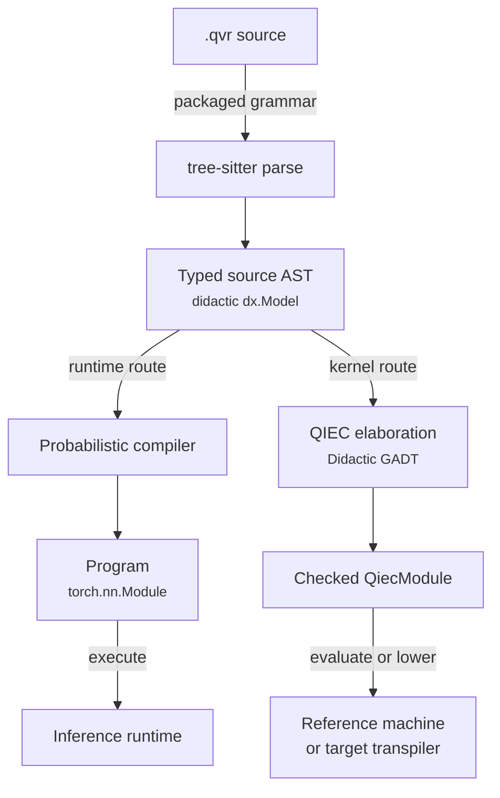

# The QVR DSL: Overview

QVR is a domain-specific language: its declarations express models using
objects, typed operations, random draws, and observations. Read `A -> B` as
"takes an input of type A and produces an output of type B"; for a
probability kernel, the output is random. The
[concepts introduction](../getting-started/concepts.md) explains the
distinction between relation scores, kernels, and fitted posteriors.


`.qvr` is the file format you write probabilistic programs in. A
`.qvr` file declares some types (objects and [continuous spaces](continuous-spaces.md#continuousspace-hierarchy)),
some morphisms (parameters, kernels, observed data), and one or
more `program` blocks that sample, observe, and return values.
Compilation produces a trainable [PyTorch
`nn.Module`](https://docs.pytorch.org/docs/stable/generated/torch.nn.Module.html).

```python
import torch
from quivers.dsl import loads

prog = loads("""
composition product_fuzzy [level=algebra]

object X : FinSet 3
object Y : FinSet 4

morphism f : X -> Y [role=latent]
export f
""")

optimizer = torch.optim.Adam(prog.parameters())
```

`load("model.qvr")` reads the same syntax from a file path.

The main program keywords describe a generative model: `sample x <- F(...)` draws a value,
`observe` scores data, `marginalize` integrates out a discrete latent,
`let` is a deterministic binding, and `return` names the program's
output.

A few features distinguish QVR from those alternatives:

- **First-class structured priors on weight matrices** via
  `morphism W : A -> B [role=latent] ~ Family(args)` with an
  `[over=..., iid_over=...]` axis-role clause on each `sample` /
  `observe` / `marginalize` step.
  [Matrix-Normal](https://en.wikipedia.org/wiki/Matrix_normal_distribution),
  LKJ [@lewandowski2009lkj],
  [Gaussian-process](https://en.wikipedia.org/wiki/Gaussian_process),
  and Horseshoe [@carvalho2010horseshoe] priors take
  the form they take on paper.
- **[Marginalization](dsl-programs-and-lets.md#scoped-marginalize) as a control-flow construct.**
  `marginalize z : K <- F(...)` followed by an indented body is a
  syntactic block, not a runtime flag; the compiler emits the
  [log-sum-exp](https://en.wikipedia.org/wiki/LogSumExp).
- **Compile-time effect signatures.** Every program declares its
  effect row in the option block:
  `program p(...) : A -> B [effects=[Sample, Score]]`. Allowed
  effects are `Pure`, `Sample`, `Score`, `Marginal`; the compiler
  rejects an effectful step inside a `[effects=[Pure]]` block
  before training starts.
- **Explicit mathematical structure.** The [semantics chapter](../semantics/index.md)
  states interpretations and their algebraic assumptions. Typed boundaries
  catch incompatible compositions; stronger categorical laws require the
  hypotheses of the selected structure. You can begin with the modeling
  syntax and consult that layer when deriving laws or extending the language.

## Compilation pipeline

Compilation first reads source syntax, then resolves names and checks
types, then constructs executable representations. An **abstract syntax
tree (AST)** is the structured representation of what was written.
**Elaboration** expands convenient syntax into more explicit typed
operations. The checked core provides a shared representation for
execution and translation; a backend still has to support the operations
that a particular model uses. The diagram gives the detailed paths.




The grammar at `grammars/qvr/` is authoritative. Quivers compiles that current
source from the checkout during development and ships it in the wheel, avoiding
a silent fallback to a stale grammar bundle. The AST nodes are documented in
[`ast_nodes`](../api/dsl/ast_nodes.md); resolution between
syntactic [`ObjectExpr`](../api/dsl/ast_nodes.md) trees and runtime
[`SetObject`](../api/core/objects.md) /
[`ContinuousSpace`](../api/continuous/spaces.md) values is handled
by the resolution mixin in
[`resolution.py`](../api/dsl/resolution.md). Each compiled program
extracts to a panproto `Schema` via
[`program_theory`](../api/dsl/program_theory.md), so diff, migrate,
and lens-generation tooling applies directly to `.qvr` programs.

The [`Compiler`](../api/dsl/compiler.md) transforms the AST to a
[`Program`](../api/program.md) by walking the module's statements
in source order, dispatching each to a per-form handler
(`_compile_statement`). A single sweep threads three concerns:

1. **Resolve declarations**: as each `object`, `space`, `morphism`,
   `contraction`, `schema`, `define`, or program declaration is
   visited, its type expressions are resolved through the mixin in
   [`quivers.dsl.compiler.resolution`](../api/dsl/resolution.md).
   `_resolve_any_space` walks an `ObjectExpr` and returns either a
   `SetObject` or a `ContinuousSpace`; `_resolve_type` and
   `_resolve_space` are type-narrowing wrappers.
2. **Type-check compositions**: domain and codomain agreement is
   enforced at the point of use, so ill-typed compositions fail
   during the same pass that constructs the morphism modules.
3. **Wrap the exported expression**: after all statements are
   handled, the compiler compiles the exported expression into a
   root morphism and wraps it in an
   [`nn.Module`](https://docs.pytorch.org/docs/stable/generated/torch.nn.Module.html)
   that manages the parameters, deductions, encoders, decoders,
   and losses accumulated along the way.

```python
from quivers.dsl import Compiler, parse

source = """
object X : FinSet 3
morphism f : X -> X [role=latent]
export f
""".strip()
ast = parse(source)
compiler = Compiler(ast)
program = compiler.compile()
```

### One checked core

Every executable declaration of a module elaborates to a computation of the
[QVR language reference](../reference/qvr/index.md): `index`, `family`,
`effect`, `instance`, `handler`, and typed `define` declarations map to it
directly, and a `program` is domain-specific notation for a named
computation over the module's canonical `random` and `score` instances, whose
`sample` and `observe` steps perform `Random.sample` and `Score.add`, whose
plates are typed tensor shapes, and whose `marginalize` blocks are helper
computations enumerated under the prelude's enumeration handler. Quivers
constructs the module's first-order projection through Didactic's `GADT` API,
which checks indexed-family declarations and constructor refinements through
Panproto; Didactic then negotiates the exact route `qvr-source/v0.20` to
`qiec-core/v1alpha1`, and the QIEC checker validates [effect rows](../reference/qvr/effects-and-handlers.md#effect-rows), handler
coverage, call graphs, and branch-local evidence over the whole module at
once.

The checked module is what every downstream tool reads. The reference
machine runs a `define` or a `program` through one entry-point invocation
([`invoke_entry`](../api/qiec/entries.md)); the torch runtime lowers a
program's calls of computations to its own steps where it can, and binds a
program that keeps a call it cannot lower to a
[`CheckedProgram`](../api/effects/checked_program.md), which scores the same
joint but cannot be fit; and the transpiler lowers a program's plan from its checked
computation and places the module's other computations beside it. Pyro,
NumPyro, PyMC, Edward2, Turing, Gen, WebPPL, and Church execute the complete
computation graph through generated host runtimes. Stan, BUGS, and JAGS accept
a checked, effect-free scalar subset and report a feature-specific capability
diagnostic for other computations. See
[QVR language reference](../reference/qvr/index.md) for the complete syntax
and target boundary, and the [QIEC developer note](../developer/qiec.md)
for the kernel and runtime ABI.

### Programs as panproto schemas

After compilation, the resolved environment can be exported as a
panproto `Schema` over `QVR_PROGRAM_PROTOCOL`:

```python
from quivers.dsl import parse, Compiler, extract_program_schema

source = """
object X : FinSet 3
morphism f : X -> X [role=latent]
export f
""".strip()
ast = parse(source)
compiler = Compiler(ast)
compiler.compile()
schema = extract_program_schema(compiler)  # Schema instance
```

The schema's vertices enumerate every declared object, space, and
morphism (with kinds drawn from `finset`, `product_set`,
`coproduct_set`, `free_monoid`, `empty_set`, `euclidean`,
`simplex`, `positive_reals`, `product_space`, plus the declaration
variants). This makes `panproto schema diff`,
`panproto lens generate`, and the rest of the panproto toolbox
available on `.qvr` programs without further work.

## Grammar

Use this table to look up how declarations and expressions fit together.
In the EBNF notation below, `|` separates alternatives, `[...]` marks
optional syntax, and `*` means zero or more repetitions. The declaration
and program guides explain these forms through examples.


The authoritative grammar is the tree-sitter source at
`grammars/qvr/grammar.js` in the quivers repository and in the installed wheel.
The summary
below is a human-readable EBNF view of the same productions; the
tree-sitter grammar is the source of truth.

```ebnf
module         := statement*

statement      := composition_decl
                | category_decl
                | rule_decl
                | schema_decl
                | object_decl
                | morphism_decl
                | bundle_decl
                | program_decl
                | contraction_decl
                | define_decl
                | export_decl
                | deduction_decl
                | signature_decl
                | encoder_decl
                | decoder_decl
                | loss_decl
                | pragma_outer
                | pragma_inner

(* Selects the module's composition rule. The `[level=LEVEL]` option
   fixes the algebraic level the surrounding morphisms must live in;
   the optional indented body declares a fresh rule inline (each entry
   is a let-expression). *)
composition_decl
               := 'composition' IDENT
                  [option_block]
                  [composition_rule_block]
composition_level              (* the value of the `level` option key *)
               := 'algebra' | 'semigroupoid' | 'bilinear_form' | 'rule'
composition_rule_entry
               := IDENT ['(' IDENT (',' IDENT)* ')'] '=' let_expr

(* Objects. The RHS is one of: an enum literal `{a, b, c}`,
   `FreeResiduated(...)`, `FreeMonoid(...)`, or any object
   expression (e.g. `FinSet N`, `Real n`, `Euclidean(...)`,
   products, coproducts, etc.). *)
object_decl    := 'object' IDENT ':' object_value
object_value   := enum_set_literal
                | free_residuated_expr
                | free_monoid_expr
                | object_expr

(* Morphisms. The role keyword (`latent` / `observed` / `kernel` /
   `embed` / `discretize`) and every other modifier live in the
   bracketed option block. An optional `~ Family(args)` initializer
   attaches a distribution family; without it the morphism is bare
   structural data. *)
morphism_decl  := 'morphism' IDENT ':' object_expr '->' object_expr
                  [option_block]
                  ['~' morphism_init]
morphism_init  := morphism_init_family | expr
morphism_init_family
               := IDENT '(' [draw_arg (',' draw_arg)*] ')'

(* Option block. Keys depend on the surrounding form. For
   morphisms / sample / observe / marginalize, the recognized keys
   include `role`, `effects`, `over`, `iid_over`, `via`, `init`,
   `reduction`. `[]` is the empty option block. *)
option_block   := '[' [option_entry (',' option_entry)*] ']'
option_entry   := IDENT '=' option_value
option_value   := IDENT | string | integer | float | option_list
option_list    := '[' [option_value (',' option_value)*] ']'

(* Operadic n-ary contraction. Inputs are named morphisms; the
   `wiring` / `share` / `rule` options live in the option block. *)
contraction_decl
               := 'contraction' IDENT
                  '(' contraction_input (',' contraction_input)* ')'
                  ':' object_expr '->' object_expr
                  [option_block]
contraction_input
               := IDENT ':' object_expr '->' object_expr

(* Bundle: a named tuple of rule references. *)
bundle_decl    := 'bundle' IDENT ':' '[' IDENT (',' IDENT)* ']'

(* Top-level production-style rule. *)
rule_decl      := 'rule' IDENT '(' IDENT (',' IDENT)* ')'
                  ':' object_expr (',' object_expr)*
                  '|-' object_expr

(* Schema: a parameterised morphism shape. *)
schema_decl    := 'schema' IDENT '(' schema_parameter (',' schema_parameter)* ')'
                  ':' object_expr '->' object_expr
schema_parameter
               := IDENT (',' IDENT)* ':' object_expr

(* Weighted deduction system: the agenda-based framework subsumes
   CKY, Earley, Viterbi, inside-outside, semi-naive Datalog, A*,
   Knuth, and bidirectional MLTT proof search. *)
deduction_decl := 'deduction' IDENT ':' object_expr '->' object_expr
                  [option_block] INDENT deduction_body_entry+ DEDENT
deduction_body_entry
               := deduction_atoms | deduction_binders | deduction_rule
                | deduction_lexicon | deduction_lexicon_from_file

(* Signature / encoder / decoder / loss for structural compression. *)
signature_decl := 'signature' IDENT ['(' IDENT (',' IDENT)* ')']
                  INDENT signature_body_entry+ DEDENT

encoder_decl   := 'encoder' IDENT ':' IDENT
                  ['(' IDENT (',' IDENT)* ')']
                  [option_block]
                  [INDENT encoder_body_entry+ DEDENT]

decoder_decl   := 'decoder' IDENT ':' IDENT
                  ['(' IDENT (',' IDENT)* ')']
                  [option_block]
                  INDENT decoder_body_entry+ DEDENT

loss_decl      := 'loss' IDENT [option_block]
                  INDENT loss_body_entry+ DEDENT

(* Program. The option block holds `effects`, `over`, etc. The
   body is an indented sequence of steps, terminated by a required
   `return`. *)
program_decl   := 'program' IDENT ['(' program_param (',' program_param)* ')']
                  ':' object_expr '->' object_expr
                  [option_block]
                  INDENT program_step* return_step DEDENT
program_param  := IDENT | (IDENT ':' param_kind)
param_kind     := 'FinSet' | 'Space' | 'Object'
                | 'Real' | 'Nat'
                | 'Mor' '[' object_expr ',' object_expr ']'
program_step   := sample_step | observe_step | marginalize_step
                | let_step | score_step

sample_step    := 'sample' var_pattern [':' object_expr]
                  '<-' IDENT ['(' draw_arg (',' draw_arg)* ')']
                  [option_block]
observe_step   := 'observe' IDENT [':' object_expr]
                  '<-' IDENT ['(' draw_arg (',' draw_arg)* ')']
                  [option_block]
marginalize_step
               := 'marginalize' IDENT [':' object_expr]
                  '<-' IDENT ['(' draw_arg (',' draw_arg)* ')']
                  [option_block]
                  INDENT program_step+ DEDENT
let_step       := 'let' IDENT '=' let_arith
score_step     := 'score' IDENT '=' let_arith
return_step    := 'return' return_pattern

define_decl    := 'define' IDENT '=' expr ['where' INDENT define_decl+ DEDENT]
export_decl    := 'export' expr

(* Pragmas. `#[...]` attaches to the next declaration; `#![...]`
   attaches to the enclosing module. *)
pragma_outer   := '#[' pragma_entry (',' pragma_entry)* ']'
pragma_inner   := '#![' pragma_entry (',' pragma_entry)* ']'
pragma_entry   := IDENT ['=' option_value]
```

Each declaration form is detailed in its own page:
[declarations](dsl-declarations.md),
[programs and let-expressions](dsl-programs-and-lets.md),
and [contractions](dsl-contractions.md). The
[grammar fragment in the semantics chapter](../semantics/grammar.md)
gives the productions a categorical denotation.

## Comments

Lines starting with `#` are ignored:

```text
# This is a comment
object X : FinSet 3  # inline comment

# Define morphisms
morphism f : X -> X [role=latent]
```

### Doc comments

Lines starting with `#!` are *doc comments*: they're attached to
the declaration that immediately follows and remain available through the
AST, the panproto schema, and tooling (`qvr check --json`, LSP
hover). Plain `#` line comments are dropped at parse time.

```qvr
#! The terminal vocabulary; cardinality 256 is one byte.
object Token : FinSet 256
#! Latent token-to-category embedding learned during training.
morphism emit : Token -> Token [role=latent]
```

Doc comments are recognized on every declaration that carries a
`docs:` field, including `object`, `morphism`, `composition`,
`bundle`, `contraction`, `schema`, `program`, `deduction`,
`signature`, `encoder`, `decoder`, `loss`, `let`, and `export`.

## Error handling

The DSL provides two error types:

- [`ParseError`](../api/dsl/parser.md#quivers.dsl.parser.ParseError):
  syntactic error (the tree-sitter grammar reported an error node,
  or a required field was missing in the parse tree).
- [`CompileError`](../api/dsl/compiler.md#quivers.dsl.compiler.CompileError):
  semantic error (type mismatch, undefined name, ill-formed program
  structure).

```python
from quivers.dsl import loads, ParseError, CompileError

bad_source = """
object X : FinSet 3
morphism f : X -> Y [role=latent]
export f
""".strip()
try:
    prog = loads(bad_source)
except ParseError as e:
    print(f"Parse error: {e}")
except CompileError as e:
    print(f"Compilation error: {e}")
```

Tree-sitter's lexer is integrated with the grammar, so lexical
errors raise `ParseError`.

## Tips

1. **Always declare objects before using them** in morphisms.
2. **Algebra must come first** (if specified).
3. **Use `define` to name top-level compositions** and `let` for program-local values.
4. **Programs are the main output**: use them for
   [inference](inference-foundations.md).
5. **Type errors in composition** happen at compile time, not
   runtime.

## Where to next

- [DSL Declarations](dsl-declarations.md): every declaration form
  (objects, morphisms, spaces, kernels, algebras, deductions,
  aliases, combinators, exports).
- [Programs and Let-Expressions](dsl-programs-and-lets.md): the
  `program` block syntax, bind / observe / marginalize / let
  steps, the axis-role clause, factor expressions, the
  let-expression primitives, and inline distribution
  families.
- [Contractions](dsl-contractions.md): operadic n-ary contractions,
  type-driven wiring inference, `share`, and the explicit `wiring`
  escape hatch.

## Further reading

- [@carvalho2010horseshoe]
