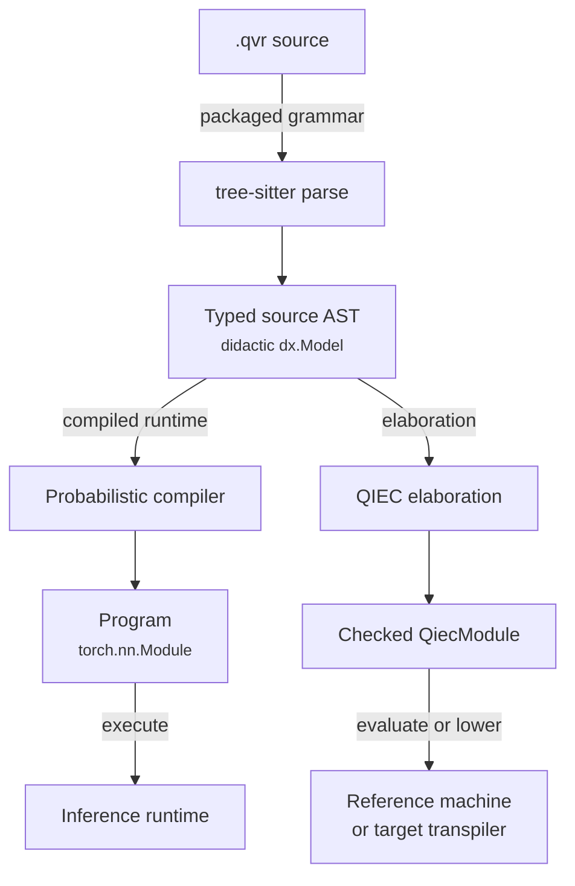

# The QVR DSL: Overview

QVR is the modeling language of quivers, written in `.qvr` files. A file declares
types (finite objects and [continuous spaces](continuous-spaces.md#continuousspace-hierarchy)),
morphisms (parameter tables, Markov kernels, observed data), and usually one or more
`program` blocks that draw, observe, and return values. `A -> B` is the type of
something that takes an input of type `A` and produces an output of type `B`, which
for a kernel is random. Compiling a file gives a trainable PyTorch
[`nn.Module`](https://docs.pytorch.org/docs/stable/generated/torch.nn.Module.html),
and [Concepts](../getting-started/concepts.md) introduces composition, the choice of
`Algebra`, and the steps of a program.

```python
import torch
from quivers.dsl import loads

prog = loads("""
composition product_fuzzy [level=algebra]

object X : FinSet 3
object Y : FinSet 4

morphism f : X -> Y [role=latent]
export f
""")

optimizer = torch.optim.Adam(prog.parameters())
```

`load("model.qvr")` reads the same syntax from a file.

Inside a program, `sample x <- F(...)` draws a value, `observe` scores data,
`marginalize` sums out a discrete latent variable, `let` binds a deterministic
value, and `return` gives the program's output. Compared with probabilistic
programming languages such as Stan and Pyro [@carpenter2017stan; @bingham2019pyro],
QVR differs in three ways:

- **Priors on weight matrices.** A learnable table takes a prior directly,
  `morphism W : A -> B [role=latent] ~ Family(args)`, and a draw marks which axes
  form one joint event with the `[over=..., iid_over=...]` clause after its family.
  [Matrix-normal](https://en.wikipedia.org/wiki/Matrix_normal_distribution),
  [LKJ](https://en.wikipedia.org/wiki/Lewandowski-Kurowicka-Joe_distribution)
  [@lewandowski2009lkj], [Gaussian-process](https://en.wikipedia.org/wiki/Gaussian_process),
  and horseshoe [@carvalho2010horseshoe] priors are written with their usual
  parameters ([Continuous Families](continuous-families.md)).
- **[Marginalization](dsl-programs-and-lets.md#scoped-marginalize) as a block.**
  `marginalize z : K <- F(...)` followed by an indented body sums `z` out of the
  body's likelihood, and the compiler emits the
  [log-sum-exp](https://en.wikipedia.org/wiki/LogSumExp) over its values.
- **Declared effects.** A program may declare which effects its body uses, as in
  `program p : A -> B [effects=[Sample, Score]]`, from `Pure`, `Sample`, `Score`, and
  `Marginal`. The compiler rejects a body that uses an effect the declaration omits,
  for instance a `sample` step in a program declared `[effects=[Pure]]`.

[Semantics](../semantics/index.md) gives each form its mathematical meaning and
states the assumptions under which the composition laws hold.

## Compilation pipeline

The compiler parses the source with a [tree-sitter](https://tree-sitter.github.io/)
grammar into an abstract syntax tree (AST), resolves names, checks types, and then
builds executable values along two routes. *Elaboration* translates convenient
source forms into explicit typed core terms. The core is the Quivers Indexed Effect
Core (QIEC), the typed language with indexed families, effect rows, and handlers to
which every executable declaration elaborates
([language reference](../reference/qvr/index.md)).



The *compiled runtime* is the PyTorch implementation of a module (`Program`,
`MonadicProgram`), used for gradients, stochastic variational inference, and Markov
chain Monte Carlo. The *reference machine* is the library's interpreter for QIEC, the
closest standard notion being a definitional (reference) interpreter
[@reynolds1972definitional]. It runs entry points and computes a program's log joint
density, and it fixes what a checked program means operationally.

The [`Compiler`](../api/dsl/compiler.md) builds a [`Program`](../api/program.md) in
one pass over the module's declarations in source order. As it reaches each `object`,
`morphism`, `contraction`, `schema`, `define`, or program declaration, it resolves the
declaration's type expressions to finite objects
([`SetObject`](../api/core/objects.md)) or continuous spaces
([`ContinuousSpace`](../api/continuous/spaces.md)) and checks that domains and
codomains agree where morphisms are composed, so an ill-typed composition fails in
that same pass. It then compiles the exported expression and wraps it in a module
that holds the parameters, deductions, encoders, decoders, and losses collected along
the way. The AST classes are documented in [`ast_nodes`](../api/dsl/ast_nodes.md).

```python
from quivers.dsl import Compiler, parse

source = """
object X : FinSet 3
morphism f : X -> X [role=latent]
export f
""".strip()
ast = parse(source)
compiler = Compiler(ast)
program = compiler.compile()
```

### One checked core

Every executable declaration of a module elaborates to a QIEC computation. `index`,
`family`, `effect`, `instance`, `handler`, and typed `define` declarations are core
forms already. A `program` is notation for a named computation over the built-in
effect instances `random` and `score`: its `sample` and `observe` steps request their
operations, its plates become tensor shapes, and each `marginalize` block becomes a
helper computation that an enumeration handler sums. The QIEC checker then validates
[effect rows](../reference/qvr/effects-and-handlers.md#effect-rows), handler coverage,
and call graphs for the whole module at once.

Every downstream tool reads the checked module. The reference machine runs a `define`
or a `program` through one call of an entry point
([`invoke_entry`](../api/qiec/entries.md)). The compiled runtime lowers a program's
calls of other computations to its own steps where it can. A program with a call it
cannot lower becomes a [`CheckedProgram`](../api/effects/checked_program.md), which
runs on the reference machine, scores the same joint, and cannot be fitted. The
transpilers lower the well-typed computation to each target language;
[Transpiler support](../transpile-support.md) lists what each target accepts.

### Programs as panproto schemas

A compiled module can be exported as a schema of
[panproto](https://github.com/panproto/panproto), the schema and migration toolkit
used to version QVR's grammar, under the protocol `QVR_PROGRAM_PROTOCOL`:

```python
from quivers.dsl import parse, Compiler, extract_program_schema

source = """
object X : FinSet 3
morphism f : X -> X [role=latent]
export f
""".strip()
ast = parse(source)
compiler = Compiler(ast)
compiler.compile()
schema = extract_program_schema(compiler)  # Schema instance
```

The schema has one vertex for each declared object, space, and morphism, with kinds
such as `finset`, `product_set`, `coproduct_set`, `free_monoid`, `empty_set`,
`euclidean`, `simplex`, `positive_reals`, and `product_space`. panproto's `schema diff`
and `lens generate` then apply to `.qvr` modules.

## Grammar

The grammar is the tree-sitter source `grammars/qvr/grammar.js`, which the wheel
includes. The summary below writes its main productions in EBNF, where `|` separates
alternatives, `[...]` marks an optional part, and `*` and `+` mean zero or more and
one or more repetitions. The declarations of the core language (`index`, `family`,
`effect`, `instance`, `handler`, and typed `define`) are specified in the
[language reference](../reference/qvr/index.md) and abbreviated here.

```ebnf
module         := statement*

statement      := index_decl | family_decl | effect_decl | instance_decl
                | handler_decl | computation_decl
                | composition_decl | category_decl | rule_decl | schema_decl
                | object_decl | morphism_decl | bundle_decl | program_decl
                | contraction_decl | define_decl | export_decl
                | deduction_decl | signature_decl | encoder_decl
                | decoder_decl | loss_decl
                | pragma_outer | pragma_inner

(* Core-language declarations; see the language reference. *)
index_decl     := 'index' IDENT '=' index_ctor ('|' index_ctor)*
family_decl    := 'family' IDENT ...
effect_decl    := 'effect' IDENT ...
instance_decl  := 'instance' IDENT ':' effect_ref ...
handler_decl   := 'handler' IDENT ...
computation_decl
               := 'define' IDENT telescope ... (* a typed computation *)

(* Selects the module's composition rule. The `[level=LEVEL]` option
   states the laws the rule claims; the optional indented body defines
   a rule inline, one let-expression per entry. *)
composition_decl
               := 'composition' IDENT [option_block]
                  [INDENT composition_rule_entry+ DEDENT]
composition_level              (* the value of the `level` option key *)
               := 'algebra' | 'semigroupoid' | 'bilinear_form' | 'rule'
composition_rule_entry
               := IDENT ['(' IDENT (',' IDENT)* ')'] '=' let_expr

category_decl  := 'category' IDENT (',' IDENT)*

(* Objects. The right side is an enum literal `{a, b, c}`,
   `FreeResiduated(...)`, `FreeMonoid(...)`, or any object
   expression (`FinSet N`, `Real n`, products, coproducts, ...). *)
object_decl    := 'object' IDENT ':' object_value
object_value   := enum_set_literal | free_residuated_expr
                | free_monoid_expr | object_expr

(* Morphisms. The role (`latent`, `observed`, `kernel`, `embed`,
   `discretize`) and other modifiers live in the option block. An
   optional `~ Family(args)` attaches a distribution family. *)
morphism_decl  := 'morphism' IDENT (',' IDENT)* ':' object_expr '->' object_expr
                  [option_block] ['~' morphism_init]
morphism_init  := IDENT '(' [draw_arg (',' draw_arg)*] ')' | expr

option_block   := '[' [option_entry (',' option_entry)*] ']'
option_entry   := IDENT '=' option_value
option_value   := IDENT | string | integer | float | option_list | option_call
option_list    := '[' [option_value (',' option_value)*] ']'

(* Many-input contraction; `wiring` and `rule` live in the option block. *)
contraction_decl
               := 'contraction' IDENT
                  '(' contraction_input (',' contraction_input)* ')'
                  ':' object_expr '->' object_expr [option_block]
contraction_input
               := IDENT ':' object_expr '->' object_expr

bundle_decl    := 'bundle' IDENT ':' '[' [IDENT (',' IDENT)*] ']'

(* Top-level categorial grammar rule. *)
rule_decl      := 'rule' IDENT '(' IDENT (',' IDENT)* ')'
                  ':' object_expr (',' object_expr)* ('|-' | '⊢') object_expr

(* Rule schema: a rule template with typed parameters. *)
schema_decl    := 'schema' IDENT '(' schema_parameter (',' schema_parameter)* ')'
                  ':' object_expr '->' object_expr
schema_parameter
               := IDENT (',' IDENT)* ':' object_expr

deduction_decl := 'deduction' IDENT ':' object_expr '->' object_expr
                  [option_block] INDENT deduction_body_entry+ DEDENT
deduction_body_entry
               := deduction_atoms | deduction_binders | deduction_rule
                | deduction_lexicon | deduction_lexicon_from_file

signature_decl := 'signature' IDENT ['(' IDENT (',' IDENT)* ')']
                  INDENT signature_body_entry+ DEDENT
encoder_decl   := 'encoder' IDENT ':' IDENT ['(' IDENT (',' IDENT)* ')']
                  [option_block] [INDENT encoder_body_entry+ DEDENT]
decoder_decl   := 'decoder' IDENT ':' IDENT ['(' IDENT (',' IDENT)* ')']
                  [option_block] INDENT decoder_body_entry+ DEDENT
loss_decl      := 'loss' IDENT [option_block] INDENT let_arith DEDENT

(* Program. The body is an indented sequence of steps ending in a
   required `return`. *)
program_decl   := 'program' IDENT ['(' program_param (',' program_param)* ')']
                  ':' object_expr '->' object_expr [option_block]
                  INDENT program_step* return_step DEDENT
program_param  := IDENT | (IDENT ':' param_kind)
param_kind     := 'FinSet' | 'Space' | 'Object' | 'Real' | 'Nat'
                | 'Mor' '[' object_expr ',' object_expr ']'
program_step   := sample_step | observe_step | marginalize_step
                | let_step | score_step

sample_step    := 'sample' var_pattern [':' object_expr]
                  '<-' IDENT ['(' draw_arg (',' draw_arg)* ')'] [option_block]
observe_step   := 'observe' IDENT [':' object_expr]
                  '<-' IDENT ['(' draw_arg (',' draw_arg)* ')'] [option_block]
marginalize_step
               := 'marginalize' IDENT [':' object_expr]
                  '<-' IDENT ['(' draw_arg (',' draw_arg)* ')'] [option_block]
                  INDENT program_step+ DEDENT
let_step       := 'let' IDENT '=' let_arith
score_step     := 'score' IDENT '=' let_arith
return_step    := 'return' return_pattern

define_decl    := 'define' IDENT '=' expr ['where' INDENT define_decl+ DEDENT]
export_decl    := 'export' expr

pragma_outer   := '#[' pragma_entry (',' pragma_entry)* ']'
pragma_inner   := '#![' pragma_entry (',' pragma_entry)* ']'
pragma_entry   := IDENT ['=' option_value]
```

[Declarations](dsl-declarations.md),
[programs and let-expressions](dsl-programs-and-lets.md), and
[contractions](dsl-contractions.md) describe each form, and
[the grammar fragment of Semantics](../semantics/grammar.md) gives the productions
their denotations.

## Comments

The character `#` starts five kinds of token, told apart by the character after it:

| Token | Form | Meaning |
|---|---|---|
| line comment | `#` followed by anything except `!`, `[`, or `{` | ignored to the end of the line |
| block comment | `#{ ... }#` | ignored, possibly across lines |
| doc comment | `#!` not followed by `[` | attached to the next declaration |
| outer pragma | `#[ ... ]` | options for the next declaration |
| inner pragma | `#![ ... ]` | options for the enclosing module |

```text
# This is a comment
object X : FinSet 3  # inline comment

# Define morphisms
morphism f : X -> X [role=latent]
```

### Doc comments

A doc comment attaches to the declaration that follows it and stays available
through the AST, the panproto schema, `qvr check --json`, and editor hover, while a
plain `#` comment is dropped at parse time. Every declaration form accepts doc
comments.

```qvr
#! The terminal vocabulary; cardinality 256 is one byte.
object Token : FinSet 256
#! Latent token-to-category embedding learned during training.
morphism emit : Token -> Token [role=latent]
```

## Error handling

The DSL raises two error types:

- [`ParseError`](../api/dsl/parser.md#quivers.dsl.parser.ParseError) for a
  syntactic error: the grammar reported an error node or a required field is
  missing. Lexical errors are parse errors too, since tree-sitter's lexer is part of
  the grammar.
- [`CompileError`](../api/dsl/compiler.md#quivers.dsl.compiler.CompileError) for a
  semantic error: a type mismatch, an undefined name, or an ill-formed program.

```python
from quivers.dsl import loads, ParseError, CompileError

bad_source = """
object X : FinSet 3
morphism f : X -> Y [role=latent]
export f
""".strip()
try:
    prog = loads(bad_source)
except ParseError as e:
    print(f"Parse error: {e}")
except CompileError as e:
    print(f"Compilation error: {e}")
```

## Tips

1. Declare objects before the morphisms that use them.
2. Use `define` to name compositions at the top level and `let` for values inside a
   program.
3. Fit [programs](inference-foundations.md) to data. An exported morphism is a
   trainable module too, but the inference drivers take programs.
4. Composition type errors are compile-time errors.

## Where to next

- [DSL Declarations](dsl-declarations.md): objects, morphisms, spaces, kernels,
  composition rules, deductions, combinators, and exports.
- [Programs and Let-Expressions](dsl-programs-and-lets.md): `program` blocks, their
  steps, the `over` clause, factor expressions, primitives, and inline distribution
  families.
- [Contractions](dsl-contractions.md): contractions of several inputs, wiring inference,
  and the explicit `wiring` option.
