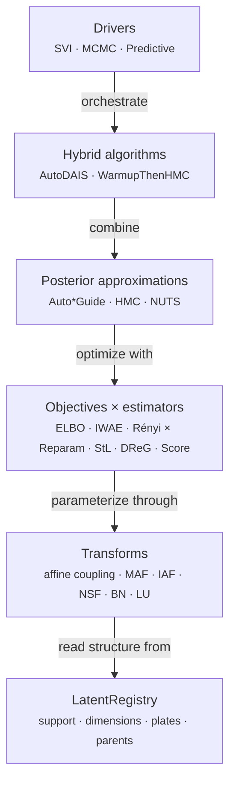
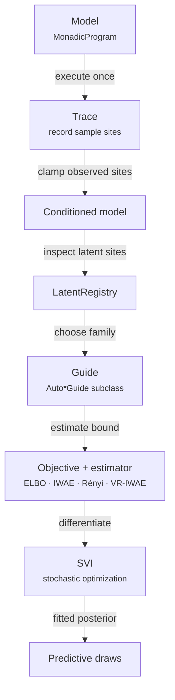

# Inference Foundations

Inference asks which unobserved values are plausible after seeing data. With $z$ the
latent values, $y$ the observations, and $x$ the known inputs, a model gives the prior
and the likelihood, so the posterior is $p(z \mid x, y) \propto p(y, z \mid x)$.
Evaluating the joint density at a candidate $z$ is cheap, and inference uses such
evaluations to approximate the posterior. [Variational inference](inference-svi.md)
fits an adjustable approximation to it, and [MCMC](inference-mcmc.md) builds a sequence
of draws from it.

## Architecture

For a first model, list its named sample sites, decide which are observed, and choose
an inference driver. The `quivers.inference` subpackage has six layers. Each can be
used on its own, and all are exported from
[`quivers.inference`](../api/index.md#inference-package):



The objectives are the evidence lower bound (ELBO), the importance weighted
autoencoder bound (IWAE) [@burda2016iwae], and the variational Rényi bound
[@li2016renyi], with reparameterized, score-function, sticking-the-landing (StL)
[@roeder2017sticking], and doubly reparameterized (DReG) [@tucker2019dreg] gradient
estimators. The transforms, which build
[normalizing flows](https://en.wikipedia.org/wiki/Flow-based_generative_model), are
affine coupling layers [@dinh2017realnvp], masked and inverse autoregressive flows (MAF,
IAF) [@papamakarios2017maf; @kingma2016iaf], neural spline flows (NSF)
[@durkan2019splines], batch normalization (BN) [@dinh2017realnvp], and invertible
linear layers in LU form [@kingma2018glow]. `AutoDAIS` is differentiable annealed
importance sampling [@geffner2021uha; @zhang2021dais].

Every guide and MCMC kernel reads one `LatentRegistry`, the list of a model's latent
sites with their supports, sizes, plates, and parents. It is built from a run of the
model, `LatentRegistry.from_trace(model, trace(model, x, observations))`, as MCMC always
does and a guide does when constructed with `x=`, or from the program's steps with
`LatentRegistry.from_model(model, observed_names)`. It converts between a dict of site
values and one unconstrained vector, and maps each site with the
[bijector](https://mc-stan.org/docs/reference-manual/transforms.html) that
[`torch.distributions.constraint_registry.biject_to`](https://docs.pytorch.org/docs/stable/distributions.html#torch.distributions.constraint_registry.biject_to)
gives for its support.

## The variational pipeline

A positive scale and a real-valued mean have different supports, but an optimizer or a
Hamiltonian sampler works on one unconstrained real vector. A *bijector* is an
invertible differentiable map between an unconstrained space and a constrained
support, and the registry applies one to each site. Densities in the unconstrained
coordinates include the [Jacobian correction](https://mc-stan.org/docs/stan-users-guide/reparameterization.html#changes-of-variables),
the log absolute determinant of the map's Jacobian, so that corresponding regions in
the two coordinate systems get the same probability [@stanReparameterization].
[Flows](continuous-spaces.md#normalizing-flows) and
[constrained guides](inference-svi.md#autonormalguide) use the same correction.



## Trace and sample sites

A *trace* is the record of [one run](../reference/qvr/probabilistic-programs.md#running-and-scoring)
of a program, and a *sample site* is a named point where the run draws or scores a
value [@wingate2011lightweight]. For a model with a latent `mu` and an observed `y`, a
trace records a value of `mu`, the given `y`, and the log density of each, and the log
joint density is the sum of the sites' log densities, as in Pyro's effect handlers
[@pyroEffects]. A deterministic `let` is recorded with log density zero, since it makes
no random choice. Each site is a
[`SampleSite`](../api/inference/trace.md#quivers.inference.trace.SampleSite):

<!-- python: skip -->
```python
from quivers.inference import trace, Trace, SampleSite

model = ...  # MonadicProgram

# Execute model with tracing
tr = trace(model, x)

# Access sites
sites = tr.sites  # dict[site_name -> SampleSite]

for name, site in sites.items():
    print(f"{name}: {site.log_prob}")
```

A `SampleSite` records:

- `name`: the site's name;
- `morphism`: the distribution it was drawn from, or `None` for a `let`;
- `value`: the drawn or observed value;
- `log_prob`: the value's log density, shape `(batch,)`, zero for a `let`;
- `is_observed`: whether the site was fixed to an observed value;
- `is_deterministic`: whether the site is a `let`.

## Input rows are independent runs

An input of `B` rows is `B` independent runs of the whole program. Each run draws its
own value of every site and observes the program's data through its own plates. The
rows a program observes come from its data and its plates, never from the input's rows,
so a program whose observations live in a plate takes a one-row input such as
`torch.zeros(1, 1)`.
[`MonadicProgram.log_joint`](../api/continuous/programs.md#quivers.continuous.programs.MonadicProgram.log_joint)
returns one joint per run, shape `(B,)`, and the joint of all the runs is its sum. A
trace records each site's density per run, shape `(B,)`, and its `log_joint` agrees. A
value given to `log_joint`, to a trace, or to a handler is either one value per run,
along a leading axis of length `B`, or one value that every run shares. Each `let` and
`score` step reads one run's values, so a `factor`, a collection, a reduction, or an
index reads the binding's own axes and never the run axis.

The drivers that target one run's latents refuse an input of more than one row and say
to pass one. They are [MCMC](inference-mcmc.md#mcmc-hmc-and-nuts), the
[Laplace approximation](https://en.wikipedia.org/wiki/Laplace%27s_approximation)
[@tierney1986laplace], annealed importance sampling, and `lift_to_bayesian_program`,
which places a prior on every parameter of a deterministic model [@mackay1992bayesian],
applied to a program with a plate. The variational objectives sum their terms over
runs. Each run draws its own latents from the guide, so the loss for `B` runs is a
`B`-sample estimate of `B` copies of the one-run objective, and its optimum is the
one-run posterior.

The latents of a program are the sites a run reaches.
[`LatentRegistry.from_trace`](../api/inference/guide.md#quivers.inference.registry.LatentRegistry.from_trace)
reads them from a trace at the caller's input and data, including every position of a
scanned program cell. MCMC builds its registry that way, and a guide does when it is
constructed with `x=` (and `observations=`). `LatentRegistry.from_model` reads a
program's own steps and refuses a program that scans or that calls a program that
draws.

## Latent site shapes

A *draw* is one value of a latent site on its constrained support, with shape
[`LatentSite.constrained_shape`](../api/inference/guide.md#quivers.inference.registry.LatentSite.constrained_shape):
`()` for a scalar site, `(d,)` for a `d`-dimensional site, `(d, d)` for a Cholesky
factor of a correlation matrix, and `(|A|, ...)` for a site plated over `A`. Within one
run, a site outside any plate leads with a run axis of length one,
`(1, *constrained_shape)`, and a plated site holds its plate's rows,
`constrained_shape`. Across `B > 1` runs, a value given or recorded per run leads with
the run axis, `(B, *constrained_shape)`, for both kinds of site.

| Surface | Site outside any plate | Plated site |
|---|---|---|
| One draw (`constrained_shape`) | `()`, `(d,)` | `(n,)`, `(n, d)` for a plate of size `n` |
| [`MCMCResult.samples`](../api/inference/mcmc.md#quivers.inference.mcmc.MCMCResult) | `(chains, draws, *constrained_shape)` | `(chains, draws, *constrained_shape)` |
| `MCMCResult.r_hat`, `MCMCResult.ess` | `constrained_shape` | `constrained_shape` |
| Trace value, `Guide.rsample`, one run | `(1, *constrained_shape)` | `constrained_shape` |
| Trace value, `B > 1` runs | `(B, *constrained_shape)` | `(B, *constrained_shape)` |
| `Guide.rsample`, `B > 1` runs | `(B, *constrained_shape)` | `constrained_shape`, shared by every run |
| [`PotentialFn`](../api/inference/mcmc.md#quivers.inference.mcmc.PotentialFn) input to `log_joint` | `(1, *constrained_shape)` | `constrained_shape` |
| [`Predictive`](../api/inference/predictive.md) output | `(num_samples, B, *constrained_shape)` | `(num_samples, *constrained_shape)` for one run, else `(num_samples, B, *constrained_shape)` |

[`LatentRegistry.trace_values`](../api/inference/guide.md#quivers.inference.registry.LatentRegistry.trace_values)
turns one draw into the values of `B` runs that share it, by expanding each site
outside any plate across the run axis. MCMC uses it with one run when it scores a
position, so a custom density reached through `log_joint` sees a leading axis of size
one on every such site.
[`LatentRegistry.trace_row`](../api/inference/guide.md#quivers.inference.registry.LatentRegistry.trace_row)
reads one run back as a draw per site, which is how a guide sample starts an MCMC
chain.

## Conditioning on observations

To *clamp* a site is to use a given value whenever a run reaches it, which makes the
site's likelihood available to inference. Clamping does not replace the prior draws at
other sites with posterior draws, which is the inference algorithm's job. A latent site
is also different from an `nn.Parameter`, which is optimized as a model or guide
parameter unless the model places a prior on it.
[`condition()`](../api/inference/conditioning.md#quivers.inference.conditioning.condition)
clamps sites to given values:

<!-- python: skip -->
```python
from quivers.inference import condition, Conditioned

model = ...  # MonadicProgram

# Observed values (e.g., from an experiment)
observations = {
    "y_1": torch.tensor(1.5),
    "y_2": torch.tensor(-0.3),
}

# Create conditioned model
conditioned = condition(model, observations)

# Trace the conditioned model: observed sites are clamped to the data
tr = conditioned.trace(x)
```

The result is a
[`Conditioned`](../api/inference/conditioning.md#quivers.inference.conditioning.Conditioned)
model that wraps the original and fixes the observed sites.

### Data inputs: per-row covariates and index arrays {#host-data-per-row-covariates-and-index-arrays}

A *data input* is a name that a program reads but no step binds, such as a covariate
or an index array, whose value is given at run time, as with a variable of a Stan
`data` block [@carpenter2017stan]. In the `condition` dict, or the `observations` dict of an
inference call, a key that matches no sample or observe site is a data input, visible
to `let` expressions:

<!-- python: skip -->
```python
import torch
from quivers.dsl import loads
from quivers.inference import condition

model = loads('''
object Subj : FinSet 4
object Resp : FinSet 12

program p : Resp -> Resp
    sample by_subj : Subj <- Normal(loc=0.0, scale=1.0)
    let mu = by_subj[subj_idx]
    observe r : Resp <- Normal(loc=mu, scale=1.0)
    return r
export p
''').morphism

subj_idx = torch.tensor([0, 1, 2, 3, 0, 1, 2, 3, 0, 1, 2, 3])
r_obs    = torch.zeros(12)

cond = condition(model, {"subj_idx": subj_idx, "r": r_obs})
tr   = cond.trace(torch.zeros(1, 1))   # one run; its 12 rows come from Resp
```

`r` matches the observed site `r` and is clamped as usual. `subj_idx` matches no site,
so it is a data input, and `let mu = by_subj[subj_idx]` reads the subject effect of
each response row. A data input that is missing raises a `CompileError` that names it.

## Debugging

Tracing a run shows each site's log density:

<!-- python: skip -->
```python
from quivers.inference import trace

tr = trace(model, x)

for name, site in tr.sites.items():
    print(f"{name}: log_prob={site.log_prob.item():.4f}")
```

The [ELBO](inference-svi.md#elbo-evidence-lower-bound) during training shows
divergence or a poor guide fit ([SVI](inference-svi.md#svi-stochastic-variational-inference)).

## Where to next

- [Variational Inference: SVI](inference-svi.md): guides, objectives, gradient
  estimators, the training loop, and predictive sampling.
- [MCMC and Hybrid Samplers](inference-mcmc.md): HMC, NUTS, hybrid samplers, and
  predictive sampling from chains.
- [Analysis: Fitting and Diagnostics](analysis-fitting-and-diagnostics.md): fitting,
  model comparison, and posterior predictive checks built on these pieces.
