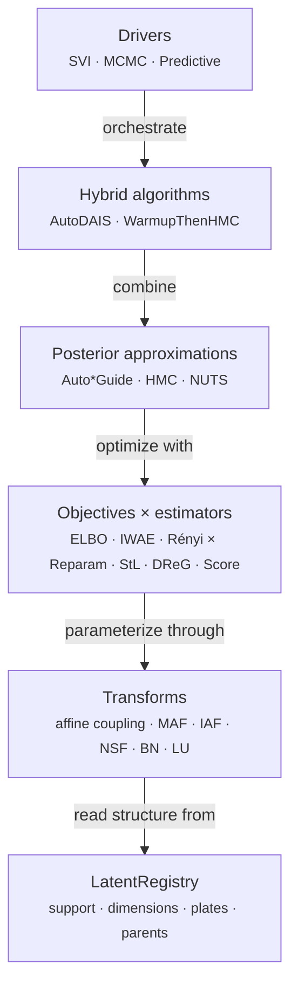
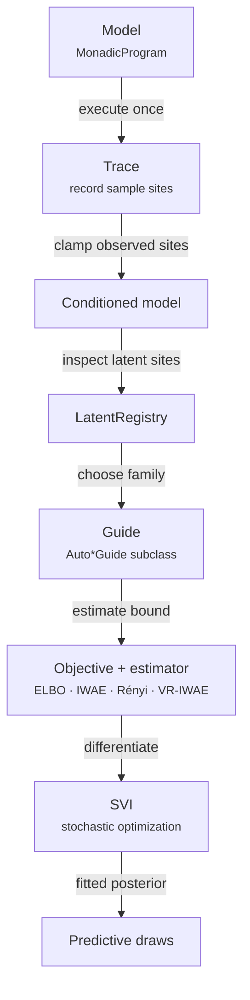

# Inference Foundations

This page introduces the inference stack's architecture, the trace
and sample site interface, and the conditioning API used to
clamp observations. Variational inference (guides,
objectives, SVI) is covered in
[Variational Inference: SVI](inference-svi.md); gradient-based MCMC is covered in
[MCMC and Hybrid Samplers](inference-mcmc.md).

## Architecture

Inference asks which unobserved values are plausible after seeing data.
Write `z` for latent values, `y` for observations, and `x` for known
inputs. A model supplies the prior and likelihood, hence
$p(z\mid x,y) \propto p(y,z\mid x)$. Evaluating a candidate `z` gives its joint density
$p(y,z\mid x)$. Inference uses these evaluations to approximate how
posterior mass is distributed across possible values of `z`.

For a first model, list its named sample sites, identify which are
observed, and choose an inference driver.
[SVI](inference-svi.md) fits an adjustable approximation to the posterior;
[MCMC](inference-mcmc.md) constructs a sequence of posterior draws.
The registry records the remaining latent sites; the driver updates or
samples their values.

The inference subpackage is a six-layer stack, each layer consumable
independently and re-exported from
[`quivers.inference`](../api/index.md#inference-package):



Every guide and MCMC kernel consumes a single
`LatentRegistry.from_model(model, observed_names)`,
which flattens / unflattens between site-keyed dicts and a single
unconstrained vector and routes every per-site bijector through
[`torch.distributions.constraint_registry.biject_to`](https://docs.pytorch.org/docs/stable/distributions.html#torch.distributions.constraint_registry.biject_to).

## The variational pipeline

The latent registry gives algorithms a consistent numerical representation.
A positive scale and a real-valued mean have different supports, but an
optimizer or Hamiltonian sampler can operate on one unconstrained real
vector. Per-site bijections map its pieces back to valid values. Density
calculations include [Jacobian corrections](https://mc-stan.org/docs/stan-users-guide/reparameterization.html#changes-of-variables) [@stanReparameterization] for this coordinate change;
the corrected density gives the same probability to corresponding regions
in the two coordinate systems. [Flows](continuous-spaces.md#normalizing-flows)
and [constrained guides](inference-svi.md#autonormalguide) use this correction.



## Trace and sample sites

A trace is a record of [one execution](../reference/qvr/probabilistic-programs.md#running-and-scoring). For a model with latent `mu` and
observed `y`, it records a candidate `mu`, the supplied `y`, and both
local log densities. A *site* is the named point where a value is drawn
or scored. Repeated executions give that same site different values. The [joint log density adds the sites' contributions](https://pyro.ai/examples/effect_handlers.html#A-first-look-at-Poutine:-Pyro%E2%80%99s-library-of-algorithmic-building-blocks) [@pyroEffects].
A deterministic `let` records a computed value with zero additional
log density, because it introduces no independent random choice.

A trace records all stochastic operations in a program. Each sample
point is a
[`SampleSite`](../api/inference/trace.md#quivers.inference.trace.SampleSite).

<!-- python: skip -->
```python
from quivers.inference import trace, Trace, SampleSite

model = ...  # MonadicProgram

# Execute model with tracing
tr = trace(model, x)

# Access sites
sites = tr.sites  # dict[site_name -> SampleSite]

for name, site in sites.items():
    print(f"{name}: {site.log_prob}")
```

A `SampleSite` records:

- `name`: identifier of the sample
- `morphism`: the generating distribution (`None` for `let` bindings)
- `value`: sampled or observed value
- `log_prob`: log-density of the value under the morphism, shape `(batch,)` (zero for `let` bindings)
- `is_observed`: whether the site was clamped to an observed value
- `is_deterministic`: whether the site is a deterministic `let` binding

## Input rows are independent runs

An input of `B` rows is `B` independent runs of the whole program: each
run draws its own value of every site, and observes the program's data
through its own plates. The rows a program observes come from its data
and its plates, never from the input's rows, so a program whose
observations live in a plate takes a one-row input such as
`torch.zeros(1, 1)`.
[`MonadicProgram.log_joint`](../api/continuous/programs.md#quivers.continuous.programs.MonadicProgram.log_joint)
returns one joint per run, shape `(B,)`, and the joint of all the runs
is its sum; a trace records each site's density per run, shape `(B,)`,
and its `log_joint` agrees. A value given to `log_joint`, to a trace, or
to a handler is either one value per run, along a leading axis of
length `B`, or one value every run shares. Each `let` and `score` step
reads one run's values, so a `factor`, a collection, a reduction, or an
index reads the binding's own axes and never the run axis.

The posterior drivers that target one run's latents,
[MCMC](inference-mcmc.md#mcmc-hmc-and-nuts), the Laplace approximation,
annealed importance sampling, and the Bayesian lift of a program with a
plate, refuse an input of more than one row and say to pass one. The
variational objectives sum their per-run terms: each run draws its own
latents from the guide, so the loss of `B` runs is a `B`-sample estimate
of `B` copies of the one-run objective, and its optimum is the one-run
posterior.

The latents of a program are the sites a run reaches:
[`LatentRegistry.from_trace`](../api/inference/guide.md#quivers.inference.registry.LatentRegistry.from_trace)
reads them off a trace at the caller's input and data, every position of
a scanned program cell included. MCMC builds its registry that way, and
a guide does when it is constructed with `x=` (and `observations=`).
`LatentRegistry.from_model` reads a program's own steps and refuses a
program that scans or calls a program that draws.

## Latent site shapes

A *draw* is one value of a latent site on its constrained support. Its
shape is the site's
[`LatentSite.constrained_shape`](../api/inference/guide.md#quivers.inference.registry.LatentSite.constrained_shape):
`()` for a scalar site, `(d,)` for a `d`-dimensional site, `(d, d)`
for a correlation-Cholesky factor, and `(|A|, ...)` for a plate site
over `A`. Within one run, a site that is not plated leads with a run
axis of length one, `(1, *constrained_shape)`, and a plated site holds
its plate's rows, `constrained_shape`. Across `B` runs a value given or
recorded per run leads with the run axis: `(B, *constrained_shape)` for
both kinds of site once `B > 1`.

| Surface | Non-plate site | Plate site |
|---|---|---|
| One draw (`constrained_shape`) | `()`, `(d,)` | `(n,)`, `(n, d)` for a plate of size `n` |
| [`MCMCResult.samples`](../api/inference/mcmc.md#quivers.inference.mcmc.MCMCResult) | `(chains, draws, *constrained_shape)` | `(chains, draws, *constrained_shape)` |
| `MCMCResult.r_hat`, `MCMCResult.ess` | `constrained_shape` | `constrained_shape` |
| Trace value, `Guide.rsample`, one run | `(1, *constrained_shape)` | `constrained_shape` |
| Trace value, `B > 1` runs | `(B, *constrained_shape)` | `(B, *constrained_shape)` |
| `Guide.rsample`, `B > 1` runs | `(B, *constrained_shape)` | `constrained_shape`, shared by every run |
| [`PotentialFn`](../api/inference/mcmc.md#quivers.inference.mcmc.PotentialFn) input to `log_joint` | `(1, *constrained_shape)` | `constrained_shape` |
| [`Predictive`](../api/inference/predictive.md) output | `(num_samples, B, *constrained_shape)` | `(num_samples, *constrained_shape)` for one run, else `(num_samples, B, *constrained_shape)` |

[`LatentRegistry.trace_values`](../api/inference/guide.md#quivers.inference.registry.LatentRegistry.trace_values)
lifts one draw to the values of `B` runs that share it, by expanding
each non-plate site across the run axis; MCMC uses it with one run when
it scores a position, so a custom density reached through `log_joint`
sees a leading axis of size one on every non-plate site.
[`LatentRegistry.trace_row`](../api/inference/guide.md#quivers.inference.registry.LatentRegistry.trace_row)
reads one run back as a draw per site, which is how a guide sample
seeds an MCMC chain.

## Conditioning on observations

To *clamp* a site is to reuse a supplied value whenever execution reaches
that site. This makes its likelihood available to inference. It does
not replace prior draws at other sites with posterior draws: that
requires the inference algorithm. Also distinguish a random latent
site from an `nn.Parameter`; the latter is an optimized model or guide
parameter unless the model explicitly puts a prior on it.

The
[`condition()`](../api/inference/conditioning.md#quivers.inference.conditioning.condition)
function clamps observations, fixing certain variables:

<!-- python: skip -->
```python
from quivers.inference import condition, Conditioned

model = ...  # MonadicProgram

# Observed values (e.g., from an experiment)
observations = {
    "y_1": torch.tensor(1.5),
    "y_2": torch.tensor(-0.3),
}

# Create conditioned model
conditioned = condition(model, observations)

# Trace the conditioned model: observed sites are clamped to the data
tr = conditioned.trace(x)
```

The conditioned model is a
[`Conditioned`](../api/inference/conditioning.md#quivers.inference.conditioning.Conditioned)
instance that wraps the original model and enforces observation
constraints.

### Host data: per-row covariates and index arrays

Keys in the `condition` data dict that don't match any declared
sample / observe site are exposed to the program's runtime
environment as deterministic values, visible to `let`-expression
evaluation. Supply per-row covariates or group indices this way when
fitting a hierarchical regression:

<!-- python: skip -->
```python
import torch
from quivers.dsl import loads
from quivers.inference import condition

model = loads('''
object Subj : FinSet 4
object Resp : FinSet 12

program p : Resp -> Resp
    sample by_subj : Subj <- Normal(0.0, 1.0)
    let mu = by_subj[subj_idx]
    observe r : Resp <- Normal(mu, 1.0)
    return r
export p
''').morphism

subj_idx = torch.tensor([0, 1, 2, 3, 0, 1, 2, 3, 0, 1, 2, 3])
r_obs    = torch.zeros(12)

cond = condition(model, {"subj_idx": subj_idx, "r": r_obs})
tr   = cond.trace(torch.zeros(1, 1))   # one run; its 12 rows come from Resp
```

`r` matches the observed sample site `r : Resp <- Normal(mu, 1.0)`
and is clamped as usual. `subj_idx` doesn't match any site; it
lands in the runtime environment, and `let mu = by_subj[subj_idx]`
advance-indexes into the per-subject draw. Free variables in `let`
expressions (names not bound by any sample / observe / let / lambda
step) resolve against the data dict at trace time; if the value is
missing the runtime raises a clear `KeyError`.

## Debugging

Enable tracing to inspect sites and log probabilities:

<!-- python: skip -->
```python
from quivers.inference import trace

tr = trace(model, x)

for name, site in tr.sites.items():
    print(f"{name}: log_prob={site.log_prob.item():.4f}")
```

Monitor the [ELBO](inference-svi.md#elbo-evidence-lower-bound) during training to detect divergence or poor guide
fit (see [SVI](inference-svi.md#svi-stochastic-variational-inference)).

## Where to next

- [Variational Inference: SVI](inference-svi.md): guides,
  objectives, gradient estimators, the SVI training loop, and
  predictive sampling.
- [MCMC and Hybrid Samplers](inference-mcmc.md): [HMC](inference-mcmc.md#mcmc-hmc-and-nuts), NUTS,
  hybrid samplers, and predictive sampling from MCMC chains.
- [Analysis Pipelines: Fitting and Diagnostics](analysis-fitting-and-diagnostics.md):
  the higher-level fit / compare / posterior-predictive-check
  interface built on top of these primitives.
