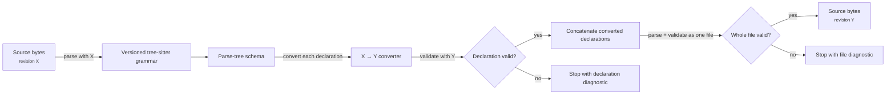

# Migrating `.qvr` source between grammar revisions

QVR's grammar changes between releases. `qvr migrate` rewrites `.qvr` source written
for one grammar revision into source for a later one, such as moving a role keyword
into an option block. Each converted declaration is parsed with the target revision's
grammar, and so is the assembled file before it is written, so a migration either
produces source that the target grammar accepts or stops with a diagnostic. Parsing
checks the syntax only. Checking and running the migrated model, with `qvr check` and
a few representative runs, tests its types and behavior.

## What `qvr migrate` does {#what-qvr-migrate-does}

For each file, the migrator parses the source with the grammar of the source revision,
converts each top-level declaration, checks it against the target grammar, and checks
the assembled file:



A declaration whose kind has no converter for a hop is passed on unchanged and then
checked against the target grammar like any other, so it stops the migration if the
target grammar does not accept it. In that case the migrator also prints, on standard
error, the revisions at which the grammar rule was introduced and last present
([Blame on migration failure](#vcs-blame-on-migration-failure)).

A migration across several revisions composes the conversions between adjacent
revisions. The installed package includes the grammar of every revision as a compiled
parser, so `qvr migrate` never compiles a parser at run time.

## Declaration options

The declaration-option migration renames three header options:

| Declaration | Source option | Target option |
| --- | --- | --- |
| Morphism | `role=latent` | `role=parameter` |
| Program | `over=model` | `posterior_of=model` |
| Composition | `level=bilinear_form` | `level=magmoid` |

The parameter role declares a learnable morphism. A posterior program reads the
named model's latent variables. The [magmoid level](../semantics/composition-rules.md#1-levels) selects a composition rule without
requiring associativity or identities. These meanings are preserved by the migration.
Comments, strings, user-defined names, `weights=latent`, and event-axis `over=` options
retain their original bytes. Both spellings fit the option grammar, so checking the
migrated source also tests whether its option names are accepted by the compiler.

## Common invocations

`--from` names the grammar revision the source was written for, as a release tag such
as `vX.Y.Z`. It is required, since a `.qvr` file does not record its revision and the
migrator does not guess. `--to` defaults to the grammar of the installed release.

Migrate one file in place:

```bash
qvr migrate --from vX.Y.Z model.qvr
```

Migrate every `.qvr` file under a directory:

```bash
qvr migrate --from vX.Y.Z models/
```

Migrate between two given revisions:

```bash
qvr migrate --from vX.Y.Z --to vA.B.C model.qvr
```

Report what would change and write nothing:

```bash
qvr migrate --from vX.Y.Z --dry-run models/
```

Write migrated copies to another directory:

```bash
qvr migrate --from vX.Y.Z --output migrated/ models/
```

Check the whole chain of conversions without migrating any file
([`--check`](#-check-mode-coverage-against-the-vcs)):

```bash
qvr migrate --check
```

## What survives migration

Kept:

- **Declarations with a converter.** Each becomes the equivalent declaration in the
  target syntax, as `latent f : A -> B` becomes `morphism f : A -> B [role=latent]`.
- **Top-level comments.** File headers and comments between declarations pass through
  unchanged.
- **Comments in bodies.** Comments inside `program`, `deduction`, `marginalize`,
  `signature`, `encoder`, `decoder`, `loss`, and the bodies of composition rules pass through
  as written, in document order among the converted entries.
- **Comments in lexicon blocks.**
- **Doc comments.** `#!` lines move with the declaration they document.
- **Comments in multi-line brackets.** Where the source revision allows a multi-line
  `[...]`, `(...)`, or `{...}`, comments inside it are kept.

Changed or dropped:

- **Comments inside single-line brackets.** A one-line bracketed list cannot contain
  a comment, so a comment there must move into a multi-line bracket, opened with a
  newline after the bracket, to be kept.
- **Body keywords that became options.** A `deduction` body that gave `semiring LogProb`,
  `start S`, and `depth 6` on their own lines becomes the header option block
  `[semiring=LogProb, start=S, depth=6]`. Program effects (`! Score, Sample` becomes
  `[effects=[Score, Sample]]`) and marginalize plates (`over G` becomes `[over=G]`) move
  the same way.

## The migration chain

The chain is the sequence of grammar revisions, one per release whose grammar
differs, declared as the tuple `CHAIN` in `quivers.cli.migrations`. Each adjacent pair
has one of three kinds of hop:

- a converter that rewrites the declarations whose syntax changed;
- an empty converter table, for a pair whose changes need no rewriting, with both
  endpoints still parsed;
- an identity hop, for grammars that are byte-identical or where the later grammar
  only adds forms, which checks the source against the next grammar and keeps its
  bytes.

A hop that only adds forms, such as the addition of indexed families and effects, does
not invent indices, [effect rows](../reference/qvr/effects-and-handlers.md#effect-rows),
or handlers in older source. `qvr migrate --check` lists every hop.

## `--check` mode: coverage against the VCS

The grammar's history is kept as a [panproto](https://github.com/panproto/panproto)
repository, one commit per distinct grammar revision, with each grammar stored as a
schema whose vertices are its rule names. `qvr migrate --check` compares the schemas of
every adjacent pair on the chain and reports:

- **added**: rules in the target grammar that the source grammar lacks;
- **removed**: rules in the source grammar that the target grammar lacks;
- **UNCOVERED removed rules**: removed rules for which the hop declares no converter
  in its `SOURCE_RULE_COVERAGE`. A source file that uses such a rule fails to migrate
  at that declaration.

The command exits with a nonzero code when any pair has an uncovered removal or an
identity hop whose grammars unexpectedly differ.

## VCS blame on migration failure

When a hop has no converter for a declaration's kind, the migrator looks up the rule in
the grammar history and prints, for instance:

```text
qvr migrate [vP.Q.R -> vX.Y.Z]: no converter for 'continuous_decl'.
VCS blame: introduced at vM.N.O; last present at vM.N.O.
```

The declaration is then checked against the target grammar and stops the migration if
it does not parse there. The message names the release whose hop needs a converter.

## Limits

- **No backward migration.** Migration runs forward along the chain only.
- **Text-based emission.** The migrator writes each target declaration as text and
  then parses it, rather than building it as a panproto schema and printing that.

## Maintaining the migration chain

When a release changes the grammar:

1. Tag the release in git.
2. Rebuild the schema history with `python grammars/qvr/vcs/build_schemas.py`, which
   adds a commit only when the tagged `grammars/qvr/grammar.js` differs from the
   previous tag's.
3. Rebuild the parser of each revision with `python grammars/qvr/vcs/build_parsers.py`.
   The wheel build compiles the current parser and every stored revision again for the
   target platform and records which source each library was built from.
4. Append the revision to `CHAIN` in `src/quivers/cli/migrations/__init__.py`.
5. If the grammar changed structurally, write a hop module `vP_Q_R_to_vX_Y_Z.py` with
   one converter per changed declaration kind and a `SOURCE_RULE_COVERAGE` frozenset
   of the source rules it handles, and register it in `MIGRATORS`.
6. If the grammar is byte-identical to the previous release, register
   `_identity.migrator(previous, current)` in `MIGRATORS`.
7. Run `qvr migrate --check` to confirm that the new hop covers every removed rule.

The migrators do not read the grammar history to perform a migration: they walk the
parsed source. The history serves `--check` and the blame message.
[`grammars/qvr/vcs/README.md`](https://github.com/quivers-dev/quivers/blob/main/grammars/qvr/vcs/README.md)
describes the workflow, and [The QVR DSL: Overview](dsl-overview.md) the syntax.
