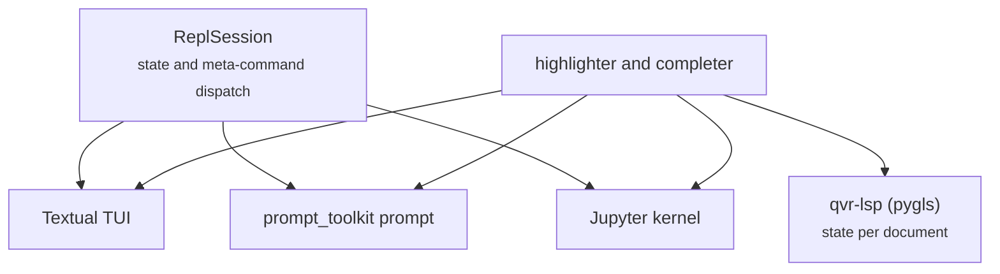

# Interactive tools: REPL, kernel, and language server

quivers has four interactive frontends for QVR. The read-eval-print loop (REPL),
`qvr repl`, inspects and runs QVR in one long-lived session, and its terminal user
interface (TUI) adds panes around that session. A Jupyter kernel gives the same session
in notebooks, and a server for the
[Language Server Protocol](https://microsoft.github.io/language-server-protocol/) (LSP)
gives the same checks in an editor. All four use one bundled
[tree-sitter](https://tree-sitter.github.io/) parser for QVR, the same compiler
([`quivers.dsl.Compiler`](../api/dsl/compiler.md)), and one highlighting table, so a
name has the same color in the TUI, the editor, and notebook output.
[QVR execution and tooling](../reference/qvr/execution-and-tooling.md) gives the
shorter reference for entry points, providers, and the LSP.

## Installation

quivers requires Python 3.14 or newer. The TUI and the language server are optional
dependency groups, and the base install has the library and the `qvr check`
subcommand.

### With `pip`

```bash
pip install 'quivers[repl,lsp]'
```

### With `uv` as a global tool

```bash
uv tool install --python 3.14 'quivers[repl,lsp]'
```

`uv tool install` puts the `qvr`, `qvr-lsp`, and `qvr-kernel` commands on the `PATH` in
a virtual environment of their own, apart from any project's environment.

### From a local checkout (editable)

```bash
uv tool install --reinstall --python 3.14 --editable \
    /path/to/quivers --with 'quivers[repl,lsp]'
```

`--editable` installs from the working tree, so local changes take effect at once, and
the trailing `--with` adds the optional groups again, which uv otherwise drops.

### What the extras bring in

| Extra | Pulls in |
| --- | --- |
| `[repl]` | [Textual](https://textual.textualize.io/), [prompt_toolkit](https://python-prompt-toolkit.readthedocs.io/), [rich](https://rich.readthedocs.io/), [ipykernel](https://ipykernel.readthedocs.io/), [jupyter_client](https://jupyter-client.readthedocs.io/) |
| `[lsp]` | [pygls](https://github.com/openlawlibrary/pygls), `lsprotocol` |

Renderers that `:plate --open` uses when they are installed, which no group installs:

| Optional dependency | What it does for the REPL |
| --- | --- |
| [`daft`](https://docs.daft-pgm.org/) (via `pip install daft`) | Renders `:plate PROGRAM --open` to a PNG through matplotlib |
| [Graphviz](https://graphviz.org/) (the `dot` binary) | Renders `:plate` and `:graph` with `--open` to a PNG through `dot -Tpng` |
| LaTeX with `tikz-network` and `bayesnet` | Compiles the `--tikz` output |

Without `daft` or `dot`, `:plate --open` prints Mermaid source instead.

### Verifying the install

```bash
python -c "import quivers; print(quivers.__version__)"
qvr check docs/examples/source/lda.qvr      # batch-validate one or more files
qvr run --help                              # inspect entry-point execution
qvr repl --help                              # confirm the TUI is reachable
```

### After install

| Command | What it does |
| --- | --- |
| `qvr repl` | Textual TUI (or prompt_toolkit fallback if stdin is not a TTY) |
| `qvr repl --plain` | Force the single-line prompt_toolkit frontend |
| `qvr repl FILE.qvr` | Load FILE on startup, then drop to the prompt |
| `qvr run FILE.qvr [NAME [JSON ...]]` | Execute one entry point (a `define` computation or a `program`), or list them when no name is given |
| `qvr lsp` / `qvr-lsp` | Run the language server over stdio, for an editor's configuration; add `--target TARGET` to report what that transpile target cannot express |
| `qvr kernel install --user` / `qvr-kernel install --user` | Register a Jupyter kernelspec named `quivers` |
| `qvr check FILE...` | Parse and compile files; add `--target TARGET` to report the features that target lacks; exits with a nonzero code on any error |

## The REPL

A first session loads a small model, lists its
[entry points](../reference/qvr/execution-and-tooling.md#list-entry-points) with
`:run`, reads one with `:info NAME`, shows its step dependencies with `:graph NAME` and
its plates with `:plate NAME`, and runs it with explicit data as described under
`:run`. Running a program draws its random values, or uses given ones, and scores them,
while fitting a posterior is the job of an [inference driver](inference-foundations.md).
`:trace EXPR` shows how a morphism expression's types are inferred.


### Starting it

```bash
qvr repl                                              # blank session
qvr repl docs/examples/source/seq2seq.qvr             # load on startup
qvr repl --plain                                      # single-line prompt_toolkit mode
qvr repl --plain < commands.txt                       # non-TTY scripted mode
```

When standard input is a terminal and Textual is installed, the TUI starts, and
`--plain` selects the single-line prompt_toolkit frontend.

### Layout (TUI)

```
+---- Status bar -----------------------------------------+
|                                                         |
|  Input editor                  |  Env filter            |
|  (multi-line TextArea          +-----------------------+
|   with bracket pairing,        |                       |
|   auto-indent, Tab completion) |  Env tree             |
|                                |  (objects/spaces/     |
+--------------------------------+   morphisms/rules,    |
|  Output log                    |   click any leaf to   |
|  (history of evaluated         |   :info it)           |
|   commands and rendered        |                       |
|   responses)                   |                       |
+--------------------------------+-----------------------+
|  Watches  (hidden when empty; pinned :watch results)    |
+---------------------------------------------------------+
|  Diagnostics (hidden when empty; errors with locations) |
+---------------------------------------------------------+
|  Footer: visible key bindings                           |
```

The watches and diagnostics strips are hidden when empty.

### Status bar

The top bar shows, separated by `·`:

- the loaded file path (or `<no file>`),
- the module's `Algebra` (`ProductFuzzyAlgebra`, `LogProbAlgebra`, …),
- counts such as `N obj · M space · K morph · J rule · L qiec`, and
- the active runtime as `runtime:LABEL`, and, when `:set target=` names one, the
  transpile target whose limits `:load` reports, as `target:NAME`. After a successful `:run`, the same fragment names the entry
  point and its kind, `entry:NAME(program)` or `entry:NAME(computation)`,
  its value as `last:NAME=VALUE:TYPE`, and a program's `log_joint=`, and after a
  failed one it shows `failed:NAME[CODE]`, so a run out of fuel reads
  `failed:spin[qiec-run-fuel]`. A detached runtime is shown in yellow.

It refreshes after every evaluation, reload, runtime change, or watch update.

### Environment browser

The right-hand `Tree` widget groups bindings by namespace:

- `objects`, every `object` declaration of a finite type;
- `spaces`, every `object` declaration of a continuous type;
- `morphisms` and `programs`, every `morphism`, `program`, and `define`;
- `rules`, the `rule` declarations;
- `indices`, `families`, `constructors`, `effects`, `operations`, `instances`,
  `handlers`, and `computations`, the declarations of the Quivers Indexed Effect Core
  (QIEC), the typed core language of QVR, with compact signatures.

The root and each namespace expand on every refresh. Click a leaf (or arrow-key to it and press Enter) to fire
`:info NAME` in the output log.

Above the tree is a one-line **filter input**. Type any substring
and the tree fuzzy-collapses to the bindings whose names contain it.
Clear the filter to bring everything back.

### Output log

Rendered responses appear here in source order. Bodies tagged as QVR
(every `:type`, `:info`, `:doc`, `:dump`, `:watch`, `:browse` result)
are passed through the shared
[`tokenize`](https://github.com/quivers-dev/quivers/blob/main/src/quivers/cli/repl_highlight.py)
pipeline and rendered with the
[`STYLE_TABLE`](https://github.com/quivers-dev/quivers/blob/main/src/quivers/cli/repl_highlight.py)
colors. A name the session knows gets its semantic color even when the surrounding
line is not a QVR declaration, so one name always reads the same way.

Identifiers rendered as type / function / namespace are also
**clickable links**. Clicking any name fires `:info NAME`. The
`-- declared at PATH:LINE:COL` footer underneath each `:info` body
is also clickable and opens that file at that line in `$EDITOR`
(falling back to `$VISUAL`, then `vi`).

### Input editor

The input pane is a multi-line `TextArea` with three additions:

1. **Bracket pairing.** Typing `(`, `[`, or `{` inserts the matching
   closer and parks the cursor between them.
2. **Auto-indent on Enter.** Lines that end with `(`, `[`, `{`, `:`,
   `->`, `=`, or `<-` get one extra indent on the next line so
   `program` / `deduction` blocks stay aligned without effort.
3. **Tab completion** (described below).

The evaluation key ([Key bindings](#key-bindings)) evaluates the buffer and clears it
on success.

### Meta-commands

Meta-commands start with `:`, as in GHCi, the Haskell REPL. A command must be written
in full or with the short form in the second column.

| Command | Short | What it does |
| --- | --- | --- |
| `:load FILE` | `:l` | Parse + elaborate, rebind the session env |
| `:reload` | `:r` | Re-`:load` the last file, print added/removed/changed names |
| `:type EXPR` | `:t` | Print a value-level GHCi-style signature (`f :: A -> B`); type-level names are handled by `:kind` |
| `:kind T` | `:k` | Resolve a type-level name or expression (`object X : FinSet 3`, `FinSet 3 :: FinSet 3`) |
| `:transpile TARGET` |  | Emit the loaded module for `stan`, `numpyro`, `pyro`, `pymc`, `edward2`, `turing`, `gen`, `church`, `webppl`, `bugs`, or `jags` |
| `:runtime [PROVIDER\|FILE.json]` |  | Show the current runtime, attach a registered provider, or load an explicit provider configuration |
| `:run [NAME [JSON ...] [--data NAME=JSON] [--site NAME=JSON] [--static NAME=TERM] [--fuel STEPS] [--seed N]]` |  | Execute an entry point, a `define` computation or a `program`, with checked arguments; alone, list the entry points |
| `:detach` |  | Detach every runtime provider from the session |
| `:info NAME` | `:i` | Show NAME's declaration verbatim from the source, plus its location and doc comment. Pass `--python` for the didactic AST `repr()` instead |
| `:doc NAME` |  | Render only the doc comment(s) for NAME |
| `:browse [PATH]` | `:b` | List every binding, optionally filtered by a top-level namespace (`objects`/`spaces`/`morphisms`/`rules`/...) or by a `::`-separated scope path (`lda`, `lda::z`, `CCG::fwd_app`). Paths show that binding's inner scope. |
| `:plate PROGRAM` | `:p` | Render PROGRAM's plate diagram. Default is a Rich table; flags `--mermaid` / `--dot` / `--tikz` / `--daft` emit alternative formats; `--open` renders to PNG via daft or graphviz and opens with the system viewer. |
| `:graph PROGRAM` | `:g` | Vertical step-flow view of PROGRAM (one row per sample / observe / let / marginalize / return step with its dependency parents). Same `--mermaid` / `--dot` / `--open` flags as `:plate`. |
| `:where NAME` |  | List every scope path whose final segment is NAME (top-level and nested). Useful for finding every site a binding is referenced. |
| `:effects PROGRAM` |  | Compare PROGRAM's declared `[effects=[...]]` set against the effect set the compiler infers from the body. |
| `:shape PROGRAM` |  | Pretty-print PROGRAM's `ChainShape`: each step's depth, kind, intermediate axis size, and source location. |
| `:dump NAME [--json]` |  | Pretty-print NAME's AST node (`--json` for didactic's `model_dump_json`) |
| `:edit NAME` |  | Open `$EDITOR` on NAME's source, splice the edited text back into the module, recompile |
| `:trace EXPR` |  | Step through elaboration of a morphism expression, surfacing each intermediate domain/codomain |
| `:save [FILE]` | `:s` | Write the live module to FILE (or back to the loaded path) via [`module_to_source`](../api/dsl/emit.md) |
| `:watch EXPR` | `:w` | Pin EXPR for re-eval on every recompile; result appears in the Watches strip |
| `:unwatch [EXPR]` |  | Remove one watch, or clear all when no argument is given |
| `:set k=v` |  | Toggle session options (`highlight`, `unicode`, `show_axes`, `paranoid`, `autoload_on_save`, `theme`, `target`) |
| `:help [CMD]` | `:h` | Without arg: full command list. With one: detailed help for CMD |
| `:quit` | `:q` / `:exit` | Exit the REPL |

A line without a leading `:` is parsed as statements, compiled into the live module,
and added to the session. If it does not parse as statements, it is read as an
expression and passed to `:type`.

### Command reference

The examples below use the [LDA gallery model](../examples/lda.md), a latent Dirichlet
allocation topic model [@blei2003lda]:

```
qvr repl docs/examples/source/lda.qvr
```

#### `:load FILE` / `:l FILE`

Parse and elaborate `FILE`, rebinding the session environment to
the result. It replaces the loaded module. Diagnostics
(parse errors, constraint violations, compile errors) populate
the bottom strip and move the cursor selection to the first error
location.

```
> :load docs/examples/source/lda.qvr
loaded docs/examples/source/lda.qvr: 6 binding(s)
```

#### `:reload` / `:r`

Load the most recently loaded file again and print the added, removed, and changed
bindings. It also runs by itself when the file's modification time changes (checked
every second), so saving in an editor updates the session.

```
> :reload
reloaded lda.qvr
  + morphism foo : Word -> Word
  - sample tau
```

#### `:type EXPR` / `:t EXPR`

Print an expression's type as a `name :: type` line. The argument is a name, a `::`
scope path, or an expression. Types of parameters come before `=>`, so `lda` below
takes two `Real` parameters and is a program from `Token` to `Mix`. `:kind` handles
objects, spaces, and other type-level names.

```
> :type lda
lda :: (Real, Real) => Token -> Mix

> :type lda::theta
theta :: Doc -> Topic
```

#### `:kind T` / `:k T`

Resolve a type-level name or expression. Named objects and spaces
print as declarations, and standalone type expressions print as
`expression :: resolved-type`.

```
> :kind FinSet 20
FinSet 20 :: FinSet 20

> :kind Doc
object Doc : FinSet 20

> :kind Vec
family Vec[A : Type](n : Nat) : Type
```

Index sorts, [indexed families](../reference/qvr/types-and-indexed-families.md#family-declarations), and effect interfaces participate in the
same kind lookup, the prelude's interfaces included: `:kind Random` prints
`effect Random` without a declaration in the module. `:type` likewise renders
signatures for effect instances,
[handlers](../reference/qvr/effects-and-handlers.md#handler-declarations), constructors, operations, and typed computations.

#### `:transpile TARGET`

Emit the loaded module for one registered backend without
changing session state. Targets are `stan`, `numpyro`, `pyro`, `pymc`,
`edward2`, `turing`, `gen`, `church`, `webppl`, `bugs`, and `jags`.

```
> :transpile stan
data {
  // ...
}
```

[Transpiler support](../transpile-support.md) lists which features each target
accepts. An unsupported feature is reported at its source location.

#### `:runtime [PROVIDER|FILE.json]`

With no argument, show the active runtime-provider configuration and its
source. A bare name selects the built-in `core` provider or an installed
`quivers.qiec_runtime` entry point. A path loads the same non-executable JSON
configuration accepted by `qvr run --runtime`:

```json
{
  "providers": [
    {
      "name": "core",
      "options": {
        "handlers": {
          "pass": {"kind": "passthrough"}
        }
      }
    }
  ]
}
```

Provider names are resolved only when explicitly selected. The source handler
declaration continues to determine its types, coverage, forwarding policy, and
[resumption](../reference/qvr/effects-and-handlers.md#resumption-grades) grades, and the runtime configuration gives the behavior held in the running Python process.

#### `:run [NAME [JSON ...] [--data NAME=JSON] [--site NAME=JSON] [--static NAME=TERM] [--fuel STEPS] [--seed N]]`

Execute an entry point of the checked module: a `define` computation or a
`program`. `:run` alone lists the entry points with their signatures.
Positional values must be JSON literals and appear in declaration order. A
polymorphic computation requires one `--static NAME=TERM` assignment for every
static binder, written as in source: closed types such as
`Int` or `Vec[Int](S(Z))`, index terms such as `3`, `S(Z)`, or the shape
`[2, 3]`, and effect applications such as `State[Int]`, all declared in the
module.

A program runs forward on the reference machine, the library's interpreter for QIEC:
`--data NAME=JSON` gives a parameter by name as an alternative to the positional form, `--site NAME=JSON`
conditions one of its sample sites and leaves every other site drawn, and
`--seed N` seeds the reference generator the draws use. The response carries
the program's value and the log joint of the drawn and given sites together
with its observations and scores. A program's extents are read off its data,
and an extent no data fixes, the object parameter of a program template, is
given with `--static NAME=TERM`. A program's handlers are fixed by the run,
so the session's runtime configuration applies to computations only.

Named computations may recurse without bound, so `--fuel STEPS` caps the
number of evaluation steps. A run that exhausts its budget fails with the
`qiec-run-fuel` diagnostic rather than running forever.

```
> :run identity 7 --static A=Int
{
  "kind": "computation",
  "value": 7,
  "type": "Int",
  "runtime": "core",
  "trace_events": 5
}
```

The command validates value arguments and the result against the specialized
types, creates fresh runtime attachments for the invocation, and records a
stable execution [trace](inference-foundations.md#trace-and-sample-sites). Failures retain `qiec-run-*` diagnostic codes in both
the plain and TUI frontends.

#### `:detach`

Remove every runtime provider from the session and clear the last-run status.
Pure computations whose argument and result types require a provider validator
will then fail with `qiec-run-validator`. Use `:runtime core`, another provider
name, or a JSON configuration path to attach a runtime again.

#### `:info NAME [--python]` / `:i NAME`

Show NAME's declaration verbatim from the source (with the
doc comment if any), plus the source location. With `--python`,
prints the didactic AST `repr()` instead.

```
> :info lda
program lda(alpha : Real, beta : Real) : Token -> Mix
    sample theta : Doc <- Dirichlet(concentration=alpha) [over=Topic, iid_over=Doc]
    sample phi : Topic <- Dirichlet(concentration=beta) [over=Vocab, iid_over=Topic]

    marginalize z : Topic <- Categorical(probs=theta) [over=Doc, reduction=logsumexp]
        observe w : Token <- Categorical(probs=phi[z]) [via=word_idx]

    return theta

-- declared at docs/examples/source/lda.qvr:24:0

> :info lda::theta
sample theta : Doc <- Dirichlet(concentration=alpha) [over=Topic, iid_over=Doc]
-- sample-site inside lda at docs/examples/source/lda.qvr:25:4
```

#### `:doc NAME`

Render only the doc comment for NAME (lines prefixed with `#!` in
the source). Returns "(no doc comment)" when none exists. Works
with scoped paths as well.

```
> :doc lda
lda: (no doc comment)
```

#### `:browse [PATH]` / `:b [PATH]`

Without an argument, lists every binding in the module grouped by
top-level kind (objects / spaces / morphisms / rules / programs /
deductions / signatures / encoders / decoders / losses / bundles
/ contractions / indices / families / constructors / effects / operations /
instances / handlers / computations). With a `::`-path argument, lists the binding's
inner scope.

```
> :browse
objects:
  Doc : FinSet 20
  Token : FinSet 200
  Topic : FinSet 3
  Vocab : FinSet 50
spaces:
  Mix : Real 3
programs:
  lda(alpha : Real, beta : Real) : Token -> Mix
    sample theta : Doc <- Dirichlet(concentration=alpha)
    sample phi : Topic <- Dirichlet(concentration=beta)
    marginalize z : Topic <- Categorical(probs=theta)
      observe w : Token <- Categorical(probs=phi)
    return theta

> :browse lda
program lda(alpha : Real, beta : Real) : Token -> Mix
  param alpha : Real
  param beta : Real
  sample theta : Doc <- Dirichlet(concentration=alpha)
  sample phi : Topic <- Dirichlet(concentration=beta)
  marginalize z : Topic <- Categorical(probs=theta)
  return theta

> :browse lda::z
marginalize z : Topic <- Categorical(probs=theta)
  observe w : Token <- Categorical(probs=phi)
```

#### `:plate PROGRAM [--mermaid|--dot|--tikz|--daft|--open]` / `:p PROGRAM`

Render PROGRAM's plate-notation diagram. Default is a Rich table
listing every variable with its kind, family, plate stack, and
dependency parents. Flags emit alternate sources or open a
rendered image.

```
> :plate lda
plate graph of lda  (Token -> Mix)

#  kind            variable  family       plates       parents
-  --------------  --------  -----------  -----------  -------
1  ○ latent        theta     Dirichlet    Doc          alpha
2  ○ latent        phi       Dirichlet    Topic        beta
3  ⊘ marginalized  z         Categorical  Topic        theta
4  ● observed      w         Categorical  Doc x Token  phi, z

plates:
  Doc [20]
  Topic [3]
  Token [200] parent=Doc
```

| Flag | Output |
| --- | --- |
| (default) | Rich table in the TUI; plain ASCII in `--plain` mode |
| `--mermaid` | Mermaid `graph TD` source. Paste into mermaid.live or a markdown file |
| `--dot` | Graphviz DOT source. Pipe through `dot -Tpng > plate.png` |
| `--tikz` | LaTeX TikZ + `tikz-network` snippet. Drop into a LaTeX document |
| `--daft` | Python script using the [`daft`](https://docs.daft-pgm.org/) library. Run it to produce SVG / PNG / PDF |
| `--open` | Render to a temp PNG via daft or `dot`, open with the system default viewer. Falls back to printing Mermaid source if no renderer is installed |

Badges in the table view:

| Badge | Kind |
| --- | --- |
| `○` | latent (unobserved sample) |
| `●` | observed (clamped at runtime) |
| `⊘` | marginalized (integrated out by an enclosing marginalize block) |
| `·` | deterministic (a `let` binding) |

#### `:graph PROGRAM [--mermaid|--dot|--open]` / `:g PROGRAM`

Vertical step-flow view of PROGRAM. One row per program step
(sample / observe / let / marginalize / return) with its
dependency parents on the side. Differs from `:plate` in that
the rows are *steps* (program-source order) rather than
*variables* (which a `let` can introduce mid-stream).

```
> :graph lda
program lda: Token -> Mix

#  kind          step                                                  parents
-  ------------  ----------------------------------------------------  -------
1  latent        sample theta : Doc <- Dirichlet(concentration=alpha)  alpha
2  latent        sample phi : Topic <- Dirichlet(concentration=beta)   beta
3  marginalized  marginalize z : Topic <- Categorical(probs=theta)     theta
4  observed      observe w : Token <- Categorical(probs=phi)           phi, z
```

Same `--mermaid` / `--dot` / `--open` flags as `:plate`.

#### `:where NAME`

List every scope path in the loaded module whose final segment
is `NAME`, sorted by depth (top-level first). Useful for finding
every site a binding is referenced.

```
> :where theta
references to 'theta':
  sample-site    lda::theta

> :where Doc
references to 'Doc':
  object         Doc
```

#### `:effects NAME`

For a probabilistic PROGRAM, compare its declared `[effects=[...]]` option block against
the effect set the compiler infers from the body's step kinds
(`Sample` from sample-sites, `Score` from observes, `Marginal`
from marginalize blocks, `Pure` otherwise).

```
> :effects lda
program lda:
  declared : {(none)}
  inferred : {Marginal, Sample, Score}
  checked  : !{random : Random, score : Score}
  (no [effects=[...]] declared)
```

If the program declares `[effects=[Pure]]` but the body contains
a sample site, the output flags a `! leak` line. If it declares
`[effects=[Sample, Score]]` but the body never observes, the
output flags an `! unused` line.

For a checked declaration, the same command reports the corresponding stable
contract: an effect's operations (a prelude interface is marked as such), a
handler's coverage, forwarding policy, and clause grades, or a computation's
declared row entries, tail, and `lacks` constraints together with the row the
checker infers for its body once every call in it is expanded to its callee's
signature, rendered with the instances' source names. A program's report adds
a `checked` line with the row of the computation it elaborates to.

```
> :effects State
effect State
  operations: {get, put}

> :effects exchange
computation exchange:
  instances : {left, right}
  tail      : (closed)
  lacks     : {(none)}
  inferred  : !{left : State[Int], right : State[Int]}
```

An operation is addressed through its interface or through an instance, and
an instance's static arguments replace the interface's binders:

```
> :type State.put
State.put : S -> Unit

> :type cell.put
cell.put : Int -> Unit

> :type random.sample
random.sample[a : Type] : Site[a] * Sampleable[a] -> a
```

#### `:shape PROGRAM`

Pretty-print PROGRAM's `ChainShape`: each step's depth, kind,
intermediate axis size, source location. Useful for auditing
chain depth before fitting.

```
> :shape lda
chain shape (log_prob):
  #  depth  kind         name        size
  -  -----  -----------  ----------  ----
  1   1      latent       theta       20
  2   2      latent       phi         3
  3   3      marginalize  z           3
  4   4      observe      w           200
```

#### `:dump NAME [--json]`

Print NAME's AST node. The default is Python `repr()`, and `--json` emits
the didactic `model_dump_json(indent=2)` so the structure is
machine-readable.

```
> :dump lda
ProgramDecl(name='lda', params=None, type_params=(ScalarParam(name='alpha', …), …), …)
```

#### `:edit NAME`

Open `$EDITOR` on NAME's source slice, then splice the edited
text back into the module and recompile. Saves the resulting
source via [`module_to_source`](../api/dsl/emit.md). When the
edit does not parse, the original declaration is retained and the
parse error appears in the diagnostics strip.

```
> :edit lda
   (vim opens on the lda program; on quit, the new lda compiles
   and the env is rebound)
```

#### `:trace EXPR`

Step through elaboration of `EXPR` as a morphism expression. For
each intermediate sub-expression, shows the inferred
domain / codomain. Useful for understanding why a composition
fails to type-check.

```
> :trace f >> g
f : A -> B
g : B -> C
(f >> g) : A -> C
```

#### `:save [FILE]` / `:s [FILE]`

Write the live module to `FILE` (or back to the loaded path if
no argument) via
[`module_to_source`](../api/dsl/emit.md). Captures any
`:edit`-driven changes and any statements typed at the prompt.

```
> :save my_edits.qvr
saved my_edits.qvr
```

#### `:watch EXPR` / `:w EXPR`

Pin `EXPR` to the Watches strip. The pinned expression is
re-evaluated after every recompile, so each `:reload` (or every
edit on disk under the file watcher) updates the displayed
value. The strip is hidden when no watches are pinned.

```
> :watch lda::theta
> :watch sigmoid(0.5)
```

#### `:unwatch [EXPR]`

Remove one watch (when `EXPR` matches an existing one) or all
watches (when called with no argument).

```
> :unwatch lda::theta
> :unwatch
```

#### `:set KEY=VALUE`

Toggle session options. The options table:

| Key | Default | What it does |
| --- | --- | --- |
| `highlight` | `true` | Apply syntax highlighting to output |
| `unicode` | `true` | Use Unicode glyphs (×, →, ⊗, ⊘) in pretty-prints |
| `show_axes` | `true` | When printing morphisms, annotate each axis with its name |
| `paranoid` | `false` | Re-run constraint checks after every recompile |
| `autoload_on_save` | `true` | Re-load the file when its mtime advances |
| `theme` | `ansi_dark` | Rich/Pygments syntax theme; see the [Themes](#themes) section below for the full list |
| `target` | (none) | A transpile target whose capability diagnostics `:load` and `:reload` report beside the module's own, as `qvr check --target` does; setting it reloads the file, and `qvr repl --target TARGET` sets it at startup |

```
> :set show_axes=true
> :set paranoid=true
```

#### `:help [CMD]` / `:h`

In the TUI, opens the modal help dialog (also bound to `F1`) with
the full command list grouped by category and a live filter
input. In `--plain` mode, prints the help text to stdout. With an
argument, prints detailed help for one command.

```
> :help plate
:plate PROGRAM [--mermaid|--dot|--tikz|--daft|--open]
  Render PROGRAM's plate-notation diagram. …
```

#### `:quit` / `:q` / `:exit`

Exit the REPL. The Textual binding `Ctrl-Q` does the same. In the
[Jupyter kernel](#the-jupyter-kernel) it ends the cell instead.

### Scope paths (`::`)

Every meta-command that takes a binding name accepts a
`::`-separated scope path. The leftmost segment is a top-level
declaration, and each later segment looks up a named child in
that declaration's scope. Examples on the LDA gallery example:

```
> :type lda::theta
theta :: Doc -> Topic

> :browse lda::z
marginalize z : Topic <- Categorical(probs=theta)
  observe w : Token <- Categorical(probs=phi)

> :where theta
references to 'theta':
  sample-site    lda::theta
```

What each container kind exposes as named children:

| Container | Children |
|---|---|
| `program` | typed parameters + body steps (sample / observe / let / marginalize / score / return); every program is a scope, with or without typed parameters |
| `marginalize` | the same set of program-step kinds, nested inside the marginalize block |
| `deduction` | rules + atoms + lexicon entries |
| `signature` | sorts + constructors + binders + vertex_kinds + edge_kinds |
| `encoder` (inline body) | op_rules + init_rules + message_rules + update_rules + var_inits |
| `decoder` | per-constructor heads |
| `bundle` | member rule names |
| `contraction` | declared input parameter names |
| `object` / `morphism` / `rule` / `loss` / `category` | none (leaf) |

The env tree on the right side of the TUI carries each binding's
full `::` path on its node data, and clicking any node, top-level or
nested, fires `:info PATH` against that exact binding. Tab
completion completes `lda::` to the program's children, `lda::z::`
to the inner marginalize's children, and so on. A bare-name
prefix like `thet` also offers nested names (`lda::theta`) without the enclosing
prefix.

### Program exploration

Five commands work together for understanding a program's
structure:

* `:graph PROGRAM`, vertical step-flow view (one row per program
  step with its dependency parents). The TUI default, with
  `--mermaid` / `--dot` / `--open` for external formats.
* `:plate PROGRAM`, plate-notation diagram of the program's
  random variables. Default is a Rich table with one row per
  variable + the plates it inhabits + its dependency parents. Flags
  `--mermaid`, `--dot`, `--tikz`, `--daft` emit alternate sources;
  `--open` renders to PNG via daft or graphviz and launches the
  system viewer.
* `:where NAME`, every scope path that references NAME (including
  cross-references between programs and rules).
* `:effects PROGRAM`, declared `[effects=[...]]` set vs the set
  the compiler infers from the body. Catches `[effects=[Pure]]`
  programs that accidentally contain a sample.
* `:shape PROGRAM`, the program's `ChainShape`: step kind, chain
  depth, intermediate axis size, source location. Useful for
  auditing chain depth before fitting.

### Key bindings

Every binding below reaches the application on macOS, Linux, and Windows without
configuring the terminal.

| Key | Action |
| --- | --- |
| `Ctrl-G` | Evaluate the buffer |
| `Ctrl-O` | Evaluate the buffer (alternate) |
| `F8` | Evaluate the buffer (Fn-row alternate) |
| `Ctrl-Up` | Recall the previous input from history |
| `Ctrl-Down` | Advance to the next input |
| `Tab` | Cycle completion candidates at the cursor |
| `Ctrl-P` | Open the command palette (fuzzy meta-command picker) |
| `Ctrl-L` | Clear the eval log |
| `Ctrl-R` | Reload the loaded file |
| `Ctrl-Q` | Quit |
| `F1` | Show the meta-command help in the eval log |
| `Ctrl-Enter`, `Ctrl-J` | Evaluate (hidden fallback; only fires in terminals that forward Ctrl-Enter, like Wezterm/Kitty/Windows Terminal/iTerm2 with a CSI-u keymap) |

Inside the TextArea, all of Textual's emacs-style editing bindings
remain available: `Ctrl-A`/`Ctrl-E` line nav, `Ctrl-W` delete word
back, `Ctrl-K` kill to end of line, `Ctrl-X`/`Ctrl-C`/`Ctrl-V`
cut/copy/paste, `Ctrl-Z`/`Ctrl-Y` undo/redo. The eval bindings
above use `priority=True` so they fire even though `Ctrl-G` is not
otherwise a TextArea action.

> **macOS Fn-row note.** `F5` is reserved by macOS Dictation, `F3`
> and `F4` by Mission Control and Launchpad, `F11` by Show Desktop.
> `F8` is the only function key macOS does not already claim by
> default. Enable "Use F1, F2, etc. keys as standard function keys"
> in System Settings → Keyboard if you want to use F-keys without
> holding Fn.

> **Ctrl-Enter, Alt-Enter, Cmd-Enter.** These never reach the
> application on macOS Terminal.app or the default iTerm2 profile.
> The terminal emulator drops them at the wire layer. To make them
> work the emulator must be configured to send them: in iTerm2
> map them to `\x1b[13;5u` (the CSI-u "modifyOtherKeys" encoding),
> and in Windows Terminal use the same string. Wezterm, Kitty, and
> Alacritty forward them by default.

### Tab completion

`Tab` at the cursor:

1. Builds a candidate list from four sources:
   - Meta-command names (`:load`, `:type`, …) when the prefix starts with `:`.
   - Names in the session: every declaration, and each nested constructor or
     operation, tagged with its namespace. After an effect instance and `.`, completion
     offers that interface's operations.
   - QVR keywords (`program`, `sample`, `observe`, `marginalize`, `object`, …), option
     keys (`over`, `iid_over`, `via`, …), and primitives and families (`Normal`,
     `softmax`, …).
   - File-system paths after `:load`.
2. Inserts the first candidate, replacing the prefix under the cursor.
3. Subsequent `Tab` presses cycle through the remaining candidates without rebuilding the list.

The LSP and the Jupyter kernel call the same completer.

### Command palette

`Ctrl-P` opens Textual's command palette pre-populated with every
meta-command. Type any substring to filter, and Enter selects.
Selecting a meta-command inserts it into the input pane with a
trailing space, ready for the argument.

### Input history

Every evaluated line is appended to `~/.config/quivers/history`
(`$XDG_CONFIG_HOME/quivers/history` if set). The file is plain
newline-separated entries, and the next `qvr repl` loads it.

- `Ctrl-Up` walks backwards from the most recent entry.
- `Ctrl-Down` walks forward, and past the end returns to an empty
  buffer.
- The recalled entry replaces the current input, and it can be edited directly.

The prompt_toolkit fallback (`qvr repl --plain`) uses the same file
through `prompt_toolkit.history.FileHistory`.

### File watcher / auto-reload

While a file is loaded, the TUI checks its modification time once per second. When it
changes, the session runs `:reload` and logs `auto-reload`. Any
diagnostics from the new parse show up immediately in the
Diagnostics strip, and any pinned `:watch` expressions re-evaluate
against the new env.

The option is on by default and controlled by
`:set autoload_on_save=true|false`.

### Watches

`:watch EXPR` pins EXPR for re-evaluation after every recompile: every `:load`,
`:reload`, statement line, or automatic reload. The
result appears in a dedicated **Watches** strip (auto-hidden when
empty) above the diagnostics strip. Format: `watch EXPR => result`,
syntax-highlighted.

```
qvr> :watch f
watch f => morphism f : Alpha -> Beta [role=latent]
qvr> object Gamma : FinSet 7
qvr> morphism g : Alpha -> Gamma [role=latent]
qvr> :watch g
# both f and g are pinned; changing Alpha updates both
```

`:unwatch EXPR` removes one, and `:unwatch` alone clears every watch.

### Inline diagnostic markers

Every error diagnostic with a known location (parse errors, compile
errors, constraint violations) selects the offending span in the
input pane to show where the failure originated. The Diagnostics
strip shows the same message in human-readable form:

```
[error] compile:5:12: undefined object 'X'
```

The strip is hidden when there are no diagnostics.

### Click handlers

Two frontends are click-aware:

- **Identifiers in rendered output.** Clicking a type-, function-,
  or namespace-colored identifier fires `:info NAME` in the eval
  log. Works on any text the renderer painted with one of those
  semantic colors: env-known names, grammar-classified types,
  built-in functions, algebras.
- **`PATH:LINE:COL` footers.** The `-- declared at ...` line under
  every `:info` body is a clickable link that launches
  `$EDITOR +LINE PATH` (for instance `vi +5 model.qvr`,
  `code --goto model.qvr:5`).

### Themes

`:set theme=NAME` controls the Rich syntax theme used when bodies
are rendered through `rich.syntax.Syntax`. Useful values:

- `ansi_dark` (default), `ansi_light`
- `monokai`, `dracula`, `solarized-dark`, `solarized-light`
- `nord`, `gruvbox-dark`, `github-dark`
- any other [Pygments style](https://pygments.org/styles/) shipped with your install

The Textual app itself follows your terminal's color scheme, and the
theme option only affects fenced QVR / JSON blocks in `:info` and
`:dump` output.

### Bracket pairing and auto-indent

In the input TextArea:

- typing `(`, `[`, or `{` inserts the matching closer and leaves the cursor between;
- Enter after `(`, `[`, `{`, `:`, `->`, `=`, or `<-` adds one level of indentation (four
  spaces by default) on the new line;
- indentation is otherwise kept as typed.

These rules follow the usual shape of `program` and `deduction` blocks and do not
consult the grammar.

### Plain mode

`qvr repl --plain` (or any non-TTY invocation) uses
[prompt_toolkit](https://python-prompt-toolkit.readthedocs.io/)
instead of Textual. The same `ReplSession` drives the prompt, so every meta-command
works the same way, with these differences:

- Single-line input, with prompt_toolkit's built-in history
  navigation (Up/Down) instead of `Ctrl-Up`/`Ctrl-Down`.
- Output is rendered through [Rich](https://rich.readthedocs.io/) if
  available, plain text otherwise.
- No env tree, no watches panel, no command palette, no click
  handlers.

Plain mode also runs scripts: a text file of meta-commands and statements, one per
line, on standard input.

## The Jupyter kernel

`qvr-kernel install --user` registers a `quivers` kernelspec. After
that, every Jupyter frontend (Notebook, JupyterLab, VS Code
notebooks, `jupyter console`) sees QVR as a first-class language.

```bash
qvr-kernel install --user
jupyter console --kernel quivers
```

```
In [1]: :load model.qvr
loaded model.qvr: 17 binding(s)

In [2]: :type backbone
backbone :: Source * Target -> Combined

In [3]: object Extra : FinSet 8
        morphism g : Extra -> Combined [role=latent]
installed module: 19 binding(s)
```

Cell semantics:

- Leading-`:` lines are dispatched as meta-commands.
- Other lines are appended to the live module and compiled.
- Blank lines separate independent chunks within a cell, so a cell can mix
  meta-commands and declarations.
- `:quit` ends the cell: the chunks after it are not run, and the
  kernel stays up. Shut the kernel down from the front end.

Notebook features:

- **Tab completion** routes through the same completer as the TUI
  and LSP.
- **Inspect (`Shift-Tab`)** routes through `:info`, showing the
  declaration in the inspector panel.
- The kernelspec advertises `pygments_lexer: qvr` so cell content
  is highlighted by the bundled Pygments lexer.

## The Language Server

`qvr-lsp` speaks the Language Server Protocol over stdio. Started as
`qvr lsp --target stan` or `qvr-lsp --target stan`, it also reports what the selected
transpile target cannot express. Without a target it reports the parser, constraint,
compiler, and QIEC diagnostics. In any editor with LSP support it provides hover, go-to-definition, references, document
symbols, semantic highlighting, completion, formatting, and live
diagnostics. Hover and go-to-definition also read a
[scope path](#scope-paths) such as `lda::theta` written anywhere in the
document, a comment included: hover shows the step that binds the site and
its kind, and go-to-definition jumps to the site's name in that step.

The server also handles `workspace/didChangeConfiguration`. Either
`{"qvr": {"transpileTarget": "stan"}}` or
`{"transpileTarget": "stan"}` changes the selected backend and immediately
reanalyzes every open document. An empty target disables target-specific
diagnostics without restarting the server.

### VS Code / Cursor

The [`vscode-qvr`](https://github.com/quivers-dev/quivers/tree/main/editors/vscode-qvr)
extension in the repository ships:

- the TextMate grammar (for the initial render before the LSP
  attaches),
- a [`vscode-languageclient`](https://github.com/microsoft/vscode-languageclient-node)
  bridge that auto-discovers `qvr-lsp` in:
  1. an explicit `qvr.lsp.path` setting (supports `${workspaceFolder}` expansion),
  2. `<workspace>/.venv/bin/qvr-lsp` (uv / venv convention),
  3. `<workspace>/.venv/Scripts/qvr-lsp.exe` (Windows venv),
  4. `$VIRTUAL_ENV/bin/qvr-lsp`,
  5. plain `qvr-lsp` on `$PATH`.

Settings:

| Key | Default | Purpose |
| --- | --- | --- |
| `qvr.lsp.enabled` | `true` | Master toggle |
| `qvr.lsp.path` | `qvr-lsp` | Override the executable path |
| `qvr.lsp.args` | `[]` | Extra CLI arguments |
| `qvr.transpileTarget` | `""` | A transpile target whose limits the server reports as diagnostics; an empty string turns them off |

To build the extension from source and install it:

```bash
cd editors/vscode-qvr
npm install
npx tsc -p .
npx @vscode/vsce package --allow-missing-repository --no-yarn
code --install-extension vscode-qvr-*.vsix         # or cursor --install-extension
```

### Zed

The [`zed-extension-qvr`](https://github.com/quivers-dev/quivers/tree/main/editors/zed-extension-qvr)
extension exports `qvr-lsp` as a `language_server`. Symlink the
extension into Zed's extensions directory:

```bash
mkdir -p ~/.config/zed/extensions
ln -s "$PWD/editors/zed-extension-qvr" ~/.config/zed/extensions/qvr
```

Reload extensions from the command palette. Zed spawns `qvr-lsp` on
`$PATH` automatically when you open a `.qvr` file.

### Neovim

```lua
require("lspconfig").configs.qvr = {
  default_config = {
    cmd = { "qvr-lsp" },
    filetypes = { "qvr" },
    root_dir = require("lspconfig.util").root_pattern(
      "pyproject.toml", ".git"
    ),
  },
}
require("lspconfig").qvr.setup({})
```

### Capabilities

Every capability advertised by `qvr-lsp`:

| LSP method | What it returns |
| --- | --- |
| `textDocument/publishDiagnostics` | Parser, constraint-solver, compiler, and QIEC diagnostics, and the selected target's limits, with source ranges |
| `textDocument/hover` | The declaration and inferred kind or type as fenced `qvr` blocks, with the didactic AST `repr()` beneath a collapsed `<details>`; nested constructors and operations are addressable symbols. At a call site, a **Call** pane first shows the signature the call instantiates its callee at (`identity[Int](value : Int) : Int !{}` for `identity[Int](7)`); a computation adds an **Inferred row** pane with the row its body performs once every call is expanded to its callee's signature; the operation of a `perform instance.op(...)` request shows an **Operation** pane with the instance's instantiated signature above the interface's own |
| `textDocument/definition` | Jump to the originating declaration |
| `textDocument/references` | Every occurrence that resolves to the selected declaration: a computation's call sites, an operation's requests and clauses, a binder's uses inside its scope |
| `textDocument/prepareRename` / `textDocument/rename` | Rename a declaration the document makes (a computation, an operation, a handler, an instance, or a lexical binder) at every reference; a prelude name or a keyword is refused |
| `textDocument/documentSymbol` | All top-level declarations plus their nested symbols: a computation's parameters, locals, scoped instances, branch binders, and call sites (a recursive call marked as such); a handler's clauses, each with its binders and calls; a program's steps, a call step detailed by its callee, a marginalize block's scope nested beneath it |
| `textDocument/completion` | Env names, members and qualified instance operations (the prelude's `random.sample` included), grammar keywords, builtins, and paths, from the same source as the REPL completer |
| `textDocument/semanticTokens/full` | Env-aware semantic token stream classified by the Pygments lexer's own rules, so a handler clause's operation, a call's callee, a resumption grade, and a handler option key color the same everywhere |
| `textDocument/formatting` | Re-emission of the current QVR AST via [`module_to_source`](../api/dsl/emit.md); a document whose checked module fails to lower is left unformatted |
| `textDocument/didOpen` / `didChange` / `didSave` / `didClose` | Incremental sync, full re-analysis per change |
| `workspace/didChangeConfiguration` | Update the selected transpile target and republish diagnostics for every open document, re-running only the capability pass over the already checked module |

### Hover format

A hover shows two panes:

````markdown
Optional doc comment lines if the decl had `#!` doc-comment lines above it.

**QVR source**

<!-- compile: false -->
```qvr
morphism f : Alpha -> Beta [role=latent]
```

---

**AST (didactic)**

<details><summary><i>click to expand</i></summary>

<!-- python: skip -->
```python
MorphismDecl(morphism_kind='latent', name='f', domain=TypeName(...), ...)
```

</details>
````

- The QVR block is cut from the original source, so its formatting and comments are
  kept.
- A horizontal rule separates the panes.
- The Python AST is the didactic `repr()`, in a collapsed `<details>` element.

## Architecture

The three session frontends drive one `ReplSession`, and the language server keeps its
own state for each document while sharing the highlighter and the completer:



Components shared across all frontends:

- [`quivers.cli.repl_session`](https://github.com/quivers-dev/quivers/blob/main/src/quivers/cli/repl_session.py), `ReplSession`, the meta-command dispatcher, the live env, the watch list.
- [`quivers.cli.repl_complete`](https://github.com/quivers-dev/quivers/blob/main/src/quivers/cli/repl_complete.py), `all_completions(session, prefix)`, which combines completions from the environment, grammar, and file paths.
- [`quivers.cli.repl_highlight`](https://github.com/quivers-dev/quivers/blob/main/src/quivers/cli/repl_highlight.py), `tokenize`, `STYLE_TABLE`, `to_rich_text`, `to_semantic_token_data`, one classifier for every renderer.

Each frontend is a thin adapter:

- [`quivers.cli.repl_tui`](https://github.com/quivers-dev/quivers/blob/main/src/quivers/cli/repl_tui.py). Textual app.
- [`quivers.cli.repl_prompt`](https://github.com/quivers-dev/quivers/blob/main/src/quivers/cli/repl_prompt.py), prompt_toolkit single-line frontend.
- [`quivers.kernel.quivers_kernel`](https://github.com/quivers-dev/quivers/blob/main/src/quivers/kernel/quivers_kernel.py), ipykernel adapter.
- [`quivers.lsp.server`](https://github.com/quivers-dev/quivers/blob/main/src/quivers/lsp/server.py), pygls server.

The shared classifier gives a name such as `Source` the same category and color in
every frontend.
