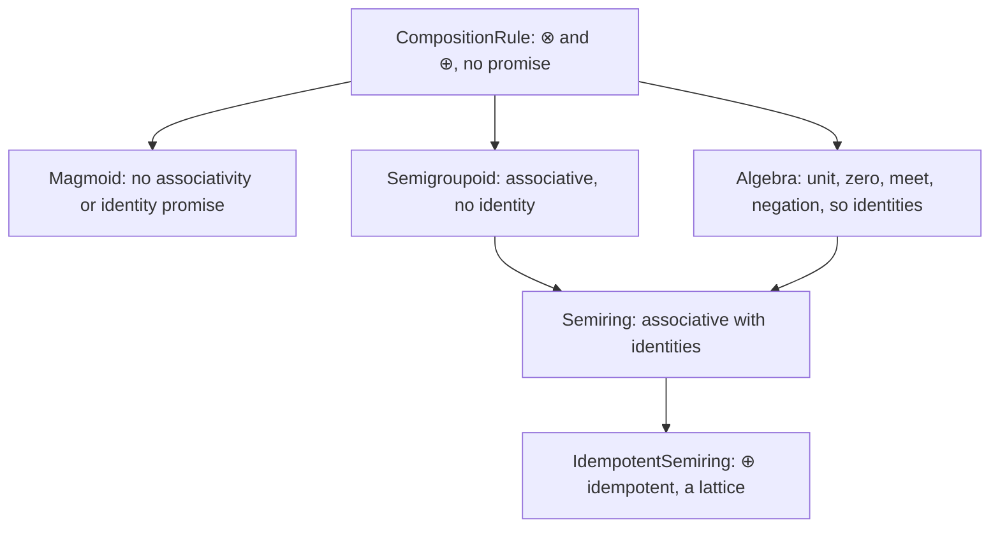

# Transformations and Composition Rules

A morphism's scores live in one [`Algebra`](core.md#algebras-enrichment-algebras).
Two mechanisms move between algebras or change how scores combine. A *transformation*
rewrites a morphism's scores into another `Algebra`, and a *composition rule* fixes
the operations $\otimes$ and $\bigoplus$ that [`>>`](morphisms.md#composition-the-operator)
uses. A [contraction](#operadic-contractions) combines more than two morphisms under the composition
rule.

## First-class transformations

The library has two kinds of transformation, and in QVR both are values of the sort
`Trans`:

- An *entrywise map* $\varphi : \mathcal V \to \mathcal W$ (class
  [`CarrierMap`](../api/core/transformations.md)) sends each score to a
  score in the target `Algebra`, one entry at a time. When $\varphi$ is monotone and
  preserves $\otimes$, $\bigoplus$, and the unit up to inequality, applying it to
  every morphism is a [change of base](https://ncatlab.org/nlab/show/change+of+enriching+category)
  [@kelly1982basic].
- A *morphism transformation* (class
  [`MorphismTransformation`](../api/core/transformations.md)) rewrites the
  whole tensor and may read several entries at once. Row normalization by
  [softmax](https://en.wikipedia.org/wiki/Softmax_function), L1 and L2 row
  normalization, and Bayesian inversion under a prior [@cho2019disintegration] are
  of this kind.

The difference matters for composition. Suppose a row contains `[0.2, 0.8]`. A
threshold at `0.5` decides each entry on its own and gives `[0, 1]`. Softmax compares
the entries and gives approximately `[0.354, 0.646]`, a row that sums to one, so
raising one score lowers the normalized weight of the others. An entrywise map
commutes with composition only when it preserves both combining operations, and
thresholding does not preserve product: two scores of `0.6` each pass the threshold,
while their product `0.36` fails. Thresholding before or after composing can thus give
different relations.

QVR binds transformations with `define`, composes them with `>>>`, and applies them
with the postfix `change_base`. Transformation names live in their own namespace,
apart from morphism names.

### Transformations without arguments {#singletons}

These transformations take no argument:

| Name | Source | Target | Entrywise action |
|---|---|---|---|
| `expectation` | `Markov` | `ProductFuzzy` | clamp to $[0, 1]$ |
| `material_implication` | `ProductFuzzy` | `Godel` | clamp to $[0, 1]$ |
| `log_prob` | `ProductFuzzy` | `LogProb` | $\log$ |
| `max_plus` | `ProductFuzzy` | `MaxPlus` | $\log$ |
| `threshold` | `ProductFuzzy` | `Boolean` | $1$ if the score exceeds $0.5$, else $0$ |
| `boolean_embedding` | `Boolean` | `ProductFuzzy` | inclusion |
| `probability_clamp` | `Real` | `Probability` | clamp to $[0, 1]$ |
| `probability_to_real` | `Probability` | `Real` | inclusion |
| `counting_from_real` | `Real` | `Counting` | clamp below at $0$, then floor |
| `counting_to_real` | `Counting` | `Real` | inclusion |

Each is an entrywise map. The logarithms clamp their input below at $10^{-30}$, so a
score of zero becomes a large negative number.

### Constructors

These transformations take one argument, an object or a morphism:

| Constructor | Argument | Source | Target |
|---|---|---|---|
| `softmax(B)` | object | `ProductFuzzy` | `Markov` |
| `l1_normalize(B)` | object | `Real` | `Markov` |
| `l2_normalize(B)` | object | `Real` | `Real` |
| `bayes_invert(prior)` | morphism | `Markov` | `Markov` |

The object argument of the normalizers names the output axes over which each row is
normalized. All four are morphism transformations.

### Binding and composing transformations

Morphisms and transformations compose in different pipelines. `f >> g` joins two
morphisms through a shared object and requires the codomain of `f` to equal the
domain of `g`. `t1 >>> t2` applies one transformation after another and requires the
target `Algebra` of `t1` to equal the source of `t2`. The compiler checks both
boundaries.

```qvr
composition product_fuzzy [level=algebra]
object A : FinSet 3
object B : FinSet 4
morphism f : A -> B [role=latent]

define s    = softmax(B)
define pipe = s >>> expectation
define g    = f.change_base(pipe)
export g
```

Here `softmax(B)` goes from `ProductFuzzy` to `Markov` and `expectation` goes back, so
`g` is a row-normalized morphism with scores in `ProductFuzzy`. Since `expectation`
only clamps to $[0, 1]$, the row `[0.2, 0.8]` from above ends as approximately
`[0.354, 0.646]`. The argument of `change_base` may be a singleton, a defined name, a
constructor call, or a `>>>` chain.

### Python API

`quivers.core.trans` provides the same operations, and QVR's `>>>` compiles to
`compose_trans`:

<!-- python: skip -->
```python
from quivers.core.trans import compose_trans
from quivers.core.morphism_transformations import softmax
from quivers.core.algebra_morphisms import MARKOV_TO_PRODUCT_FUZZY

pipe = compose_trans(softmax(B), MARKOV_TO_PRODUCT_FUZZY)
g    = f.change_base(pipe)
```

## The hierarchy of composition rules {#the-composition-rule-hierarchy}

A *composition rule* (class [`CompositionRule`](../api/core/algebras.md)) is the
pair of operations $\otimes$ and $\bigoplus$ that `>>` uses:

$$
(f \gg g)[i, k] = \bigoplus_j f[i, j] \otimes g[j, k].
$$

Its *level* records which laws the rule claims. Associativity lets
`(f >> g) >> h` be regrouped as `f >> (g >> h)`, and an identity lets a
morphism that changes nothing be inserted. For this matrix product both follow when $\otimes$
and $\bigoplus$ form a [semiring](https://en.wikipedia.org/wiki/Semiring)
[@goodman1999semiring], and product with noisy-OR is not one
([Core Types](core.md#productfuzzyalgebra)). The classes are:



A rule declared at the `Semigroupoid` level makes its morphisms a
[semicategory](https://ncatlab.org/nlab/show/semicategory), composition that is
associative but may lack identities [@tilson1987categories], provided the rule really
is associative. An `Algebra` gives identities but does not claim associativity. A
`Semiring` claims both, and the eight built-in semirings are of that class
([Core Types](core.md#algebras-enrichment-algebras)). `Magmoid` is the class for a
composition rule with no associativity or identity guarantee, whose morphisms form a
[magmoid](https://ncatlab.org/nlab/show/magmoid). The library checks no level's laws
when it runs.

Each module declares its rule with `composition` and a level:

| Declaration | Required class | Operations the compiler accepts |
|---|---|---|
| `composition X [level=algebra]` | `Algebra` (a `Semiring` qualifies) | `>>`, `@`, `identity(A)`, `f.dagger`, `f.trace(A)`, `cup(A)`, `cap(A)` |
| `composition X [level=semigroupoid]` | `Semigroupoid` (a `Semiring` qualifies) | `>>`, `@` |
| `composition X [level=bilinear_form]` | `Magmoid` | `>>`, `@` |
| `composition X [level=rule]` | any `CompositionRule` | whatever the resolved rule's class allows |

Using `identity`, `dagger`, `trace`, `cup`, or `cap` in a module whose rule is not an
`Algebra` raises a `CompileError` that names the operation and the rule's level.

### User-defined inline rules

A `composition` declaration can define its rule in an indented body. Each entry's
right side is an arithmetic expression of the kind allowed in `let`:

```qvr
composition my_sum_product [level=algebra]
    tensor_op(a, b) = a * b
    join(t) = sum(t)
    unit = 1.0
    zero = 0.0

object A : FinSet 3
morphism f : A -> A [role=latent]
define g = f >> f
export g
```

```qvr
composition average_rule [level=bilinear_form]
    tensor_op(a, b) = (a + b) * 0.5
    join(t) = sum(t)

object A : FinSet 3
morphism f : A -> A [role=latent]
define g = f >> f
export g
```

The first rule is ordinary sum-product. The second averages its operands, which is
not associative, so it is declared at the `bilinear_form` level. The entries each
level requires are:

| Level | Required | Optional |
|---|---|---|
| `algebra` | `tensor_op`, `join`, `unit`, `zero` | `negation`, `meet` |
| `semigroupoid` | `tensor_op`, `join` | |
| `bilinear_form` | `tensor_op`, `join` | |

The compiler builds inline rules without checking any law. The Python constructors
check a little. `CustomAlgebra` tests that the unit is a left and right identity for
$\otimes$ and that the zero absorbs on the left, on five sample values.
`CustomSemigroupoid` tests that the scalar $\otimes$ is associative on a fixed random
sample, unless `verify_associative=False` is passed. `CustomMagmoid` checks
nothing. A passing test does not establish a law, since it covers finitely many
inputs, and associativity of the scalar $\otimes$ does not by itself make composition
associative.

### Material implication

The QVR rule `material_impl` uses the
[Reichenbach implication](https://en.wikipedia.org/wiki/T-norm_fuzzy_logics)
$a \otimes b = 1 - a + a b$ [@baczynski2008fuzzy] with the product as its reduction,
$\bigoplus_j x_j = \prod_j x_j$:

```qvr
composition material_impl [level=bilinear_form]
object A : FinSet 3
object B : FinSet 3
morphism f : A -> B [role=latent]
morphism g : B -> B [role=latent]
define composed = f >> g
export composed
```

The library registers it as a `Magmoid`, since neither its $\otimes$ nor its
composition is associative, so a module declares it at the `bilinear_form` level. For one-element objects composition is $\otimes$
itself, and with every score $0$ the two groupings give $(0 \otimes 0) \otimes 0 = 0$
and $0 \otimes (0 \otimes 0) = 1$. Parenthesize chains under this rule explicitly. The transformation
`material_implication` in the table above is a different object, an entrywise map
into `Godel`.

## Contractions of several inputs {#operadic-contractions}

Binary composition `f >> g` sums over one shared axis. A `contraction` declaration
combines three or more morphisms in one step, as a
[tensor contraction](https://en.wikipedia.org/wiki/Tensor_contraction) written in
[einsum](https://numpy.org/doc/stable/reference/generated/numpy.einsum.html) notation
and evaluated under the module's composition rule. Operations of several inputs of this
kind compose by plugging outputs into inputs, and wiring diagrams are the standard
account of that structure [@spivak2013operad].
[DSL Contractions](dsl-contractions.md) covers the QVR syntax in full.

### Wiring spec

A wiring spec lists the axes of each input, separated by commas, and the axes of the
output after an arrow:

```text
"sp, sq, pqo -> so"
```

Letters that appear in the inputs and not in the output are reduced with the rule's
$\bigoplus$, and each output letter must appear in at least one input. In this spec,
`s` and `o` index the output and `p` and `q` range over intermediate values. Each
choice of `p` and `q` gives the $\otimes$-product of three entries, and the rule's
$\bigoplus$ combines those products.

### Declaration

```qvr
composition product_fuzzy [level=algebra]
object A : FinSet 2
object B : FinSet 3
object C : FinSet 4
object D : FinSet 5

contraction op_apply (
    arg1 : A -> B,
    arg2 : A -> C,
    kernel : B * C -> D,
) : A -> D [rule=product_fuzzy, wiring="sp,sq,pqd->sd"]

morphism a1 : A -> B [role=latent]
morphism a2 : A -> C [role=latent]
morphism k : B * C -> D [role=latent]
define combined = op_apply(a1, a2, k)
export combined
```

`op_apply` can then be called wherever a morphism expression is allowed. Each call
checks the number of arguments against the declaration and each argument's domain
and codomain sizes (number of elements) against the declared signature.

### Validation

The compiler checks the wiring spec where it is declared and raises `CompileError`
there, not at a call site, when:

- an input lists no letters;
- a letter appears twice within one input, which would ask for a diagonal or a trace;
- the output repeats a letter;
- an output letter appears in no input.

### Python API

`quivers.core.wiring` provides the corresponding functions:

<!-- python: skip -->
```python
from quivers.core.wiring import einsum_wiring, contract

wiring = einsum_wiring(PRODUCT_FUZZY, "sp, sq, pqo -> so")
out    = contract(wiring, arg1, arg2, kernel)
```

`EinsumWiring` accepts any `CompositionRule`, including material implication:

<!-- python: skip -->
```python
from quivers.core.algebras import material_implication

mi = material_implication()
wiring = einsum_wiring(mi, "ij, jk -> ik")
out    = wiring.apply(f_tensor, g_tensor)
```

## See also

- [QVR tutorial chapter 7](../tutorials/qvr/07-categorical.md): transformations and
  composition rules in a worked model.
- [Python tutorial chapters 6 and 7](../tutorials/python/06-first-class-trans.md): the
  Python API.
- [Composition rules](../semantics/composition-rules.md): the denotation of each
  level.
- [Semirings, t-norms, and change of base](../semantics/algebras.md): the built-in instances and the
  registry of entrywise maps.
