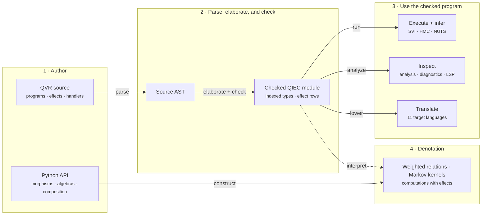

<div class="qv-home" markdown="block">

<section class="qv-hero" markdown="block">
<div class="qv-hero__copy" markdown="block">

# Functional probabilistic programming for PyTorch.

<p class="qv-hero__lede">quivers is a Python library for typed composition of weighted relations, Markov kernels, and probabilistic programs, with a PyTorch runtime.</p>

<div class="qv-hero__actions">
  <a href="getting-started/installation/" class="md-button md-button--primary">Install quivers</a>
  <a href="getting-started/quickstart/" class="md-button">Run the quickstart</a>
</div>

</div>

<div class="qv-hero__code" markdown="block">

```qvr
object Item : FinSet 100

program regression : Item -> Item [effects=[Sample, Score]]
    sample sigma  <- HalfNormal(scale=1.0)
    sample beta_0 <- Normal(loc=0.0, scale=5.0)
    sample beta_1 <- Normal(loc=0.0, scale=2.0)
    let mu = beta_0 + beta_1 * x
    observe y : Item <- Normal(loc=mu, scale=sigma)
    return y

export regression
```

</div>
</section>

<nav class="qv-pathways" aria-label="Choose a documentation path" markdown="block">
<article class="qv-pathway" markdown="block">

## [Fit a model](getting-started/quickstart.md)

Install quivers, write a regression in QVR, fit it with variational inference, and read the posterior.

</article>
<article class="qv-pathway" markdown="block">

## [Learn QVR](tutorials/qvr/01-first-model.md)

From a first regression through hierarchical models, mixtures, effect handlers, weighted deduction, and transpilation.

</article>
<article class="qv-pathway" markdown="block">

## [Read the semantics](semantics/index.md)

The denotation of each well-typed QVR phrase and the conditions under which its laws hold.

</article>
<article class="qv-pathway" markdown="block">

## [Read the source](getting-started/architecture.md)

The subpackages of the library, what each provides, and how they depend on one another.

</article>
</nav>

## The modeling language

QVR is the modeling language of quivers. Programs are written in `.qvr` files,
which the compiler parses, checks, and elaborates to a typed core language, the
[Quivers Indexed Effect Core (QIEC)](reference/qvr/index.md), before running,
fitting, or transpiling them.

The program above is a [Bayesian linear regression](https://en.wikipedia.org/wiki/Bayesian_linear_regression).
Each `sample` step draws a latent variable from its prior, `let` computes a value
from earlier ones, and `observe` scores the responses `y` under the likelihood,
with one draw for each element of the finite set `Item`. The name `x` is bound
nowhere in the program, so the compiler treats it as a
[data input](reference/qvr/probabilistic-programs.md#host-data), a value the
program reads and the caller gives at run time. The option
`[effects=[Sample, Score]]` declares the effects the body may perform, and the
compiler rejects a body that performs any other.

## Syntax, denotation, and implementation

<div class="qv-crosswalk" markdown="block">
<section class="qv-crosswalk__stage" markdown="block">

### QVR syntax

Probabilistic programs, effects and handlers, indexed families, weighted deduction systems, and tree autoencoders share one typed source language.

[Read the language reference](reference/qvr/index.md)

</section>
<section class="qv-crosswalk__stage" markdown="block">

### Denotation

Each well-typed phrase denotes a weighted relation between finite sets, a [Markov kernel](https://en.wikipedia.org/wiki/Markov_kernel), or a computation with effects.

[Open the semantics](semantics/index.md)

</section>
<section class="qv-crosswalk__stage" markdown="block">

### Implementation

The compiler elaborates checked QVR to QIEC, runs it in PyTorch, and transpiles it to eleven other probabilistic programming languages.

[Inspect the API](api/index.md)

</section>
</div>

## What composes

A morphism `f : A -> B` between finite sets is stored as a PyTorch tensor of
shape `(|A|, |B|)`. Its entries are weights combined by the two operations of an
[`Algebra`](api/core/algebras.md): $\otimes$ combines the weights along a path,
and $\bigoplus$ combines alternative paths. Composition `f >> g` contracts the
shared axis, so entry $(a, c)$ of the result is $\bigoplus_b f(a, b) \otimes g(b, c)$.
Composition is associative when the two operations form a
[semiring](https://en.wikipedia.org/wiki/Semiring), in which $\otimes$
distributes over $\bigoplus$ [@goodman1999semiring]. The
default `Algebra`, product with [noisy-OR](getting-started/concepts.md#3-an-algebra-chooses-how-weights-combine),
is not distributive, so regrouping a chain of compositions can change its result.

The compiler checks domains and codomains before any tensor is evaluated:
`f >> g` requires the codomain of `f` to equal the domain of `g`. Beyond
sequential composition,
[`f @ g`](guides/morphisms.md#tensor-product-the-operator) runs two morphisms
side by side on a pair of inputs,
[`change_base`](api/core/morphisms.md) applies an entrywise map or a row
normalization to a morphism's weights, and a program's `marginalize` step
[sums a discrete latent variable out](tutorials/qvr/04-marginalize.md#a-two-component-gaussian-mixture)
of the likelihood. Probabilistic programs, weighted deduction systems declared
with `deduction` (for instance a [CKY](https://en.wikipedia.org/wiki/CYK_algorithm)
parser), and tree autoencoders declared with `signature` elaborate to the same
core language.

The library also provides:

- [Distribution families](api/continuous/families.md): more than fifty, discrete and continuous
- [Stochastic variational inference (SVI)](guides/inference-svi.md): automatic guides and several objectives
- [Hamiltonian Monte Carlo (HMC)](guides/inference-mcmc.md), with the No-U-Turn Sampler (NUTS) [@hoffman2014nuts]
- [Diagnostics](guides/analysis-fitting-and-diagnostics.md): convergence statistics, posterior predictive checks, and model comparison through ArviZ
- [Formulas](guides/analysis-data-and-formulas.md): mixed-effects regression from R-style formulas
- [Static analysis](api/analysis/index.md) of program structure, including plate diagrams
- [Interactive tools](guides/repl-and-lsp.md): a REPL, a Jupyter kernel, and a language server
- [Transpilation](transpile-support.md) to Stan, PyMC, NumPyro, Pyro, Edward2, Turing, Gen, Church, WebPPL, BUGS, and JAGS. A target that cannot express a feature the program uses reports it at the feature's source location.

## Architecture

Solid arrows are computation steps, and dotted arrows are interpretation.



## Foundations

The [denotational semantics](semantics/index.md) interprets each well-typed QVR
phrase as a weighted relation, a Markov kernel, or a computation with effects. It
draws on enriched category theory [@kelly1982basic], categorical treatments of
probability [@giry1982categorical; @fritz2020synthetic], and the monadic
semantics of effects [@moggi1991notions]. The inference algorithms follow the
standard sources for SVI [@hoffman2013svi], HMC [@neal2011mcmc], and NUTS
[@hoffman2014nuts].

</div>
