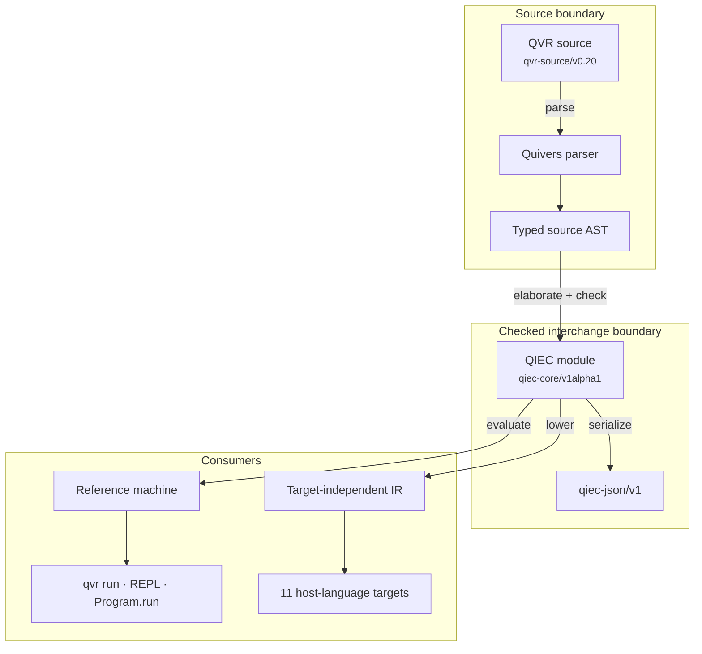

# QVR language reference

QVR is the modeling language of quivers, written in `.qvr` files, which the compiler parses,
checks, elaborates to QIEC, and then runs, fits, or transpiles. The *Quivers Indexed Effect Core*
(QIEC) is the typed core language that every executable QVR declaration elaborates to. It has
indexed families, effect rows, and handlers, and both the [reference machine](../../developer/qiec.md#reference-evaluator), the
library's interpreter for QIEC, and the transpilers read it. Its checker, serialization, and runtime interface are specified in the
[QIEC developer note](../../developer/qiec.md).

A *computation* is a typed procedure that returns a value and may perform
[effects](https://en.wikipedia.org/wiki/Effect_system): requests, such as drawing a random value,
that a *handler* answers, possibly by resuming the suspended computation
[@plotkin2003algebraic; @plotkin2009handlers]. Its
*effect row* lists the effect instances it may still request [@leijen2014koka]. *Elaboration* is
the compiler step that rewrites a declaration into explicit QIEC terms. A `define` declaration
writes a computation directly, and a probabilistic `program`, a `deduction`, a `parser(...)`
built from rule schemata, and a structural `encoder`, `decoder`, or `loss` elaborate to
computations. Since every declaration reaches the same core, `qvr run`, `Program.run`, the REPL, the language server,
and the transpilers report the same types, [effect rows](effects-and-handlers.md#effect-rows),
and diagnostic codes.

## Pages

| To | Read |
| --- | --- |
| declare finite index types, [indexed families](types-and-indexed-families.md#family-declarations), constructors, or case analyses | [Types and indexed families](types-and-indexed-families.md) |
| declare an effect, create effect instances, write rows, or handle requests | [Effects and handlers](effects-and-handlers.md) |
| write `define`, call a computation, recurse, branch, or distinguish pure and effectful binding | [Computations](computations.md) |
| map, traverse, fold, or normalize a tensor of fixed shape | [Finite collection expressions](collection-expressions.md) |
| write a model with draws, observations, calls, [marginalization](probabilistic-programs.md#exact-marginalization), groups, or scans | [Probabilistic programs](probabilistic-programs.md) |
| see what parsers, deductions, and structural models elaborate to | [Generated computation graphs](generated-computations.md) |
| list and run entry points, attach providers, inspect [execution traces](../../guides/inference-foundations.md#trace-and-sample-sites), use the language server, or check a target | [Execution and tooling](execution-and-tooling.md) |

The production rules of the grammar are summarized in the
[QIEC fragment of the grammar](../../semantics/grammar.md#11-qiec-fragment).

## A minimal mixed module

The module below declares an indexed family `Measurement`, whose type records whether a value is
present, an effect `Robust` with a handler `half_weight` that halves the value it is asked to
shrink, a pure computation `robustify` that installs that handler, and a probabilistic program
`observations` that calls `robustify`. Every handler in it has a body written in QVR, so it runs
with the built-in `core` [runtime provider](execution-and-tooling.md#runtime-providers) alone.

<!-- compile: qiec -->
```qvr
index Availability = Observed | Missing

family Measurement(s : Availability) : Type
    constructor Present : Real -> Measurement(Observed)
    constructor Absent : Measurement(Missing)

effect Robust
    shrink : Real -> Real

instance robust : Robust

handler half_weight for Robust : Real -> Real [coverage=total, forwards=none, implementation=authored]
    return x =>
        return x
    shrink(x : Real) resumes 1 =>
        resume(0.5 * x)

define robustify(x : Real) : Real !{} =
    handle robust with half_weight in
        let adjusted <- perform robust.shrink(x)
        return adjusted

object Row : FinSet 8

program observations : Row -> Row
    sample location <- Normal(loc=0.0, scale=2.0)
    sample scale <- HalfNormal(scale=1.0)
    let centre <- robustify(location)
    observe y : Row <- Normal(loc=centre, scale=scale)
    return y

export observations
```

`robustify` and `observations` are both [entry points](execution-and-tooling.md#list-entry-points),
the named computations a module exposes to `qvr run` and `Program.run`. `observations` performs
effects through the two built-in [effect instances](effects-and-handlers.md#prelude-interfaces)
`random` and `score`, and each invocation installs a handler for both. The call to `robustify` is
pure because `half_weight` handles the only effect its body performs.

## Compilation and execution map

The diagram follows a source file from parsing to its two consumers. The *reference machine* is the
library's interpreter for QIEC, the closest standard notion being a definitional interpreter
[@reynolds1972definitional], and it fixes what a checked program means operationally
([reference machine](../../developer/qiec.md#reference-evaluator)). The transpilers lower the same
module to an intermediate representation (IR) shared by all targets and render it for each target.



The three identifiers in the diagram name the source grammar, the core, and the serialized form.
They are listed under [format identifiers](execution-and-tooling.md#format-identifiers).

## Target support

The reference machine runs every checked computation and every distribution family. A computation
that calls a neural network, such as a structural
[encoder](../../guides/structural-compression-signatures-and-encoders.md#encoder-blocks), also
needs a runtime provider that holds the PyTorch module. A transpile target either emits the whole
reachable computation graph or refuses it with a stable `qiec:capability:*` diagnostic, and it never
drops an unsupported body. What each target accepts is listed under
[Transpilation](execution-and-tooling.md#transpilation).

## Tutorials and examples

The QVR tutorials on [indexed data and total functions](../../tutorials/qvr/09-indexed-data.md),
[effects and handlers](../../tutorials/qvr/10-effects-and-handlers.md),
[parsing as an effectful computation](../../tutorials/qvr/11-parsing-and-search.md), and
[tree autoencoders](../../tutorials/qvr/12-structural-autoencoders.md) build one feature
each. The [Amortized Bayesian Semantics](../../examples/amortized-bayesian-semantics.md) example
combines indexed data, effects, probabilistic programs, and attachments in one model.
