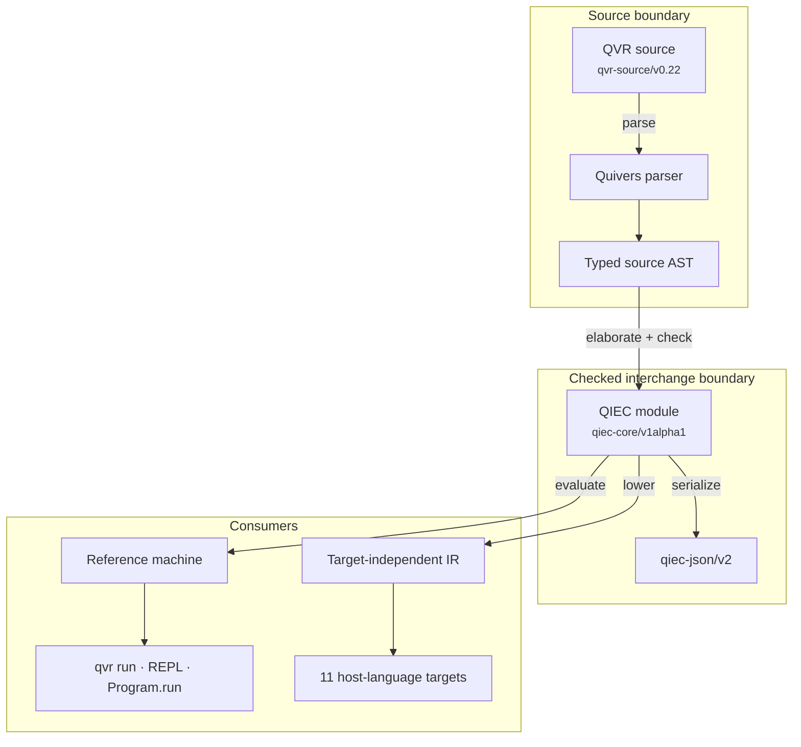

# QVR language reference

QVR is the modeling language of quivers, written in `.qvr` files, which the compiler parses,
checks, elaborates to QIEC, and then runs, fits, or transpiles. The *Quivers Indexed Effect Core*
(QIEC) is the typed core language that every executable QVR declaration elaborates to. It has
indexed families, effect rows, and handlers, and both the [reference machine](../../developer/qiec.md#reference-evaluator), the
library's interpreter for QIEC, and the transpilers read it. Its checker, serialization, and runtime interface are specified in the
[QIEC developer note](../../developer/qiec.md).

A *computation* is a typed procedure that returns a value and may perform
[effects](https://en.wikipedia.org/wiki/Effect_system): requests, such as drawing a random value,
that a *handler* answers, possibly by resuming the suspended computation
[@plotkin2003algebraic; @plotkin2009handlers]. Its
*effect row* lists the effect instances it may still request [@leijen2014koka]. *Elaboration* is
the compiler step that rewrites a declaration into explicit QIEC terms. A `define` declaration
writes a computation directly, and a probabilistic `program`, a `deduction`, a `parser(...)`
built from rule schemata, and a structural `encoder`, `decoder`, or `loss` elaborate to
computations. Since every declaration reaches the same core, `qvr run`, `Program.run`, the REPL, the language server,
and the transpilers report the same types, [effect rows](effects-and-handlers.md#effect-rows),
and diagnostic codes.

## Pages

| To | Read |
| --- | --- |
| declare closed index sorts, [indexed families](types-and-indexed-families.md#family-declarations), constructors, or case analyses | [Types and indexed families](types-and-indexed-families.md) |
| declare an effect, create effect instances, write rows, or handle requests | [Effects and handlers](effects-and-handlers.md) |
| write `define`, call a computation, recurse, branch, or distinguish pure and effectful binding | [Computations](computations.md) |
| map, traverse, fold, or normalize a tensor of fixed shape | [Finite collection expressions](collection-expressions.md) |
| write a model with draws, observations, calls, [marginalization](probabilistic-programs.md#exact-marginalization), groups, or scans | [Probabilistic programs](probabilistic-programs.md) |
| see what parsers, deductions, and structural models elaborate to | [Generated computation graphs](generated-computations.md) |
| list and run entry points, attach providers, inspect [execution traces](../../guides/inference-foundations.md#trace-and-sample-sites), use the language server, or check a target | [Execution and tooling](execution-and-tooling.md) |

The production rules of the grammar are summarized in the
[QIEC fragment of the grammar](../../semantics/grammar.md#11-qiec-fragment).

## Parameter telescopes {#parameter-telescopes}

A *telescope* is an ordered parameter list whose later types may mention earlier
parameters [@debruijn1991telescopic]. QVR uses this structure to express dependencies
between an input's type and the indices or objects chosen for a computation.
The two stages are visible in both computation and program headers:

```text
define f[n : Nat](x : Tensor[Real]([n])) : Real !{} = ...
program p[Row : FinSet](x : Tensor[Real]([Row])) : Row -> Out
    ...
```

Parameter lists may use hanging multiline layout, and an explicit empty runtime
list is written `()`. The same list layout applies to a computation's static
and value telescopes and to a family's index telescope. Line breaks inside
the delimiters do not begin a body or change a parameter's stage.

The brackets contain static parameters used in checking and specialization.
The parentheses contain runtime values. A runtime value may vary between
executions of one specialized program; a static argument selects that program's
types and structure. Supplying an argument implicitly is a separate question:
binding can recover an omitted extent from a tensor's checked shape, but that
extent still occupies the static context.

A program runtime parameter `(count : Nat)` is an integer value restricted to
nonnegative values. Its checked representation uses the arithmetic type `Int`
and retains the nonnegative restriction in the input contract. This differs
from `[n : Nat]`, which binds a static index and can determine a tensor shape.

A static telescope follows the declaration's name, before its runtime
parameters and type. A declaration option block, such as `[effects=[Sample]]`,
follows the type. Position and the binder form `name : kind` distinguish a
telescope from options, whose entries use names or `name=value`.

The table gives the corresponding interpretation for each declaration and application.

| Construct | Static information | Runtime information |
| --- | --- | --- |
| `define f[A : Type](x : A)` and `f[Real](value)` | type, index, or effect arguments in brackets | value parameters and arguments in parentheses |
| `program p[Row : FinSet](x : Tensor[Real]([Row]))` | shared QIEC static telescope, extended with object and morphism binders | covariates, responses, and scalar hyperparameters |
| `schema app[X, Y : Cat] : ...` and `rule app[X, Y] : ...` | category-pattern variables filled by static substitution | the resulting morphism's arguments, after matching |
| `construct C[A, n](field) as F[A](n)` | family parameters and constructor indices | constructor fields |
| parameterized effects and handlers | interfaces, indices, and types selected by their static telescopes | operation arguments, return values, and resumed values |
| `family Vec[A : Type](n : Nat) : Type` | both the uniform parameter `A` and the refinable index `n` | no value is supplied by declaring the family |
| `Tensor[A]([n])` | element type and shape | tensor entries supplied by a value parameter |
| `contraction f(g : A -> B, ...)` | the declared types of its inputs | supplied morphisms to compose under the contraction's wiring |

Parentheses thus do not universally mean runtime application. In a *family type*,
`Vec[A](n)` separates uniform parameters from indices that constructors and case
analysis refine; both belong to static type information. And a distribution
application such as `Normal(loc=mean, scale=sigma)` receives runtime distribution
parameters, though its named argument syntax differs from an ordinary positional call.
For instance, the `concentration` argument of a tail family is a runtime
real value, while `[n : Nat]` may fix the number of responses. A parameter
that changes a distribution's support is still a value parameter; it does
not become a static index merely because it is called a shape parameter.

Rule and schema variables use brackets because they are substituted in types
and patterns. A contraction's morphism inputs remain parenthesized because the
contraction combines the supplied morphisms. Likewise, names attached to an
encoder or decoder identify supplied components, rather than quantified type
variables. These forms retain their own typing rules while making the stage
of a program or computation parameter explicit.

Input annotations have no probabilistic effect. An annotation says which values
are admissible; `sample`, `observe`, `score`, and explicit effect requests say
what execution does. This separation lets a response and a covariate share one
type while retaining different roles in fitting and prediction.

Shared syntax does not imply that every executor supports every specialization.
The symbolic checker accepts QIEC type, effect, and index binders alongside
program object and morphism binders. The tensor compiler specializes supported
finite objects and natural-number extents; a structured computation may remain
a `CheckedProgram`, with its checked interface intact. The
[execution reference](execution-and-tooling.md) gives the separate capability boundary.

The shared binder sorts do not yet give every source application the same
argument grammar. A program call's `[...]` currently accepts names and
signed numeric literals, followed by kind checking. It does not accept
arbitrary structured type, effect, or index-constructor expressions there.
Typed `define` calls use the QIEC static-argument grammar. This is a
restriction of the current program-call syntax, separate from what its
checked telescope can represent.

## A minimal mixed module

The module below declares an indexed family `Measurement`, whose type records whether a value is
present, an effect `Robust` with a handler `half_weight` that halves the value it is asked to
shrink, a pure computation `robustify` that installs that handler, and a probabilistic program
`observations` that calls `robustify`. Every handler in it has a body written in QVR, so it runs
with the built-in `core` [runtime provider](execution-and-tooling.md#runtime-providers) alone.

<!-- compile: qiec -->
```qvr
index Availability = Observed | Missing

family Measurement(s : Availability) : Type
    constructor Present : Real -> Measurement(Observed)
    constructor Absent : Measurement(Missing)

effect Robust
    shrink : Real -> Real

instance robust : Robust

handler half_weight for Robust : Real -> Real [coverage=total, forwards=none, implementation=authored]
    return x =>
        return x
    shrink(x : Real) resumes 1 =>
        resume(0.5 * x)

define robustify(x : Real) : Real !{} =
    handle robust with half_weight in
        let adjusted <- perform robust.shrink(x)
        return adjusted

object Row : FinSet 8

program observations : Row -> Row
    sample location <- Normal(loc=0.0, scale=2.0)
    sample scale <- HalfNormal(scale=1.0)
    let centre <- robustify(location)
    observe y : Row <- Normal(loc=centre, scale=scale)
    return y

export observations
```

`robustify` and `observations` are both [entry points](execution-and-tooling.md#list-entry-points),
the named computations a module exposes to `qvr run` and `Program.run`. `observations` performs
effects through the two built-in [effect instances](effects-and-handlers.md#prelude-interfaces)
`random` and `score`, and each invocation installs a handler for both. The call to `robustify` is
pure because `half_weight` handles the only effect its body performs.

## Compilation and execution map

The diagram follows a source file from parsing to its two consumers. The *reference machine* is the
library's interpreter for QIEC, the closest standard notion being a definitional interpreter
[@reynolds1972definitional], and it fixes what a checked program means operationally
([reference machine](../../developer/qiec.md#reference-evaluator)). The transpilers lower the same
module to an intermediate representation (IR) shared by all targets and render it for each target.



The three identifiers in the diagram name the source grammar, the core, and the serialized form.
They are listed under [format identifiers](execution-and-tooling.md#format-identifiers).

## Target support

The reference machine runs every well-typed computation and every distribution family. A computation
that calls a neural network, such as a structural
[encoder](../../guides/structural-compression-signatures-and-encoders.md#encoder-blocks), also
needs a runtime provider that holds the PyTorch module. A transpile target either emits the whole
reachable computation graph or refuses it with a stable `qiec:capability:*` diagnostic, and it never
drops an unsupported body. What each target accepts is listed under
[Transpilation](execution-and-tooling.md#transpilation).

## Tutorials and examples

The QVR tutorials on [indexed data and total functions](../../tutorials/qvr/09-indexed-data.md),
[effects and handlers](../../tutorials/qvr/10-effects-and-handlers.md),
[parsing as an effectful computation](../../tutorials/qvr/11-parsing-and-search.md), and
[tree autoencoders](../../tutorials/qvr/12-structural-autoencoders.md) build one feature
each. The [Bayesian Semantics Case Study](../../examples/bayesian-semantics-case-study.md)
combines indexed data, effects, probabilistic programs, and attachments in one model.
