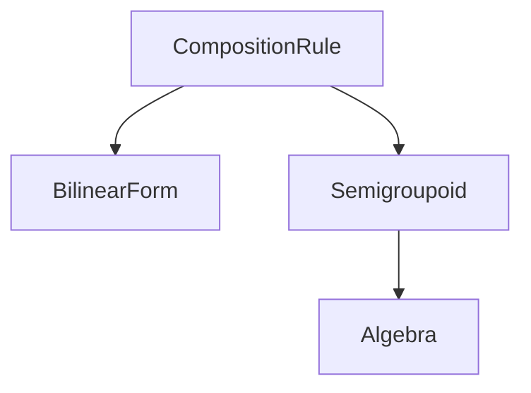

# Composition rules

A *composition rule* is the library's name for a pair of operations, a binary product $\otimes$
and a reduction $\bigoplus$, that `>>` uses to compose finite weighted morphisms by the matrix
product of [Setting §2](setting.md#2-v-enriched-relations). Every [`Algebra`](algebras.md) is a
composition rule, and so are rules that claim fewer laws. A rule's *level* states which laws it
claims, and the compiler allows an operation only at a level whose laws it needs. The same
operations also evaluate many-input einsum contractions and, through morphism transformations,
convert a morphism from one rule to another.

## 1. Levels

**Definition.** A composition rule $\mathcal R = (V, \otimes, \bigoplus)$ consists of a set $V$, a
binary operation $\otimes : V \times V \to V$, and for every finite index set $I$ a reduction
$\bigoplus : V^I \to V$. No law is assumed.

The composite of $f \in V^{A \times B}$ and $g \in V^{B \times C}$ is the matrix product

$$
(f \mathbin{>\!>} g)[a, c] = \bigoplus_{b \in B} f[a, b] \otimes g[b, c],
$$

which evaluates for any rule. Which equations it satisfies depends on the laws of $\mathcal R$:

- A [*semicategory*](https://ncatlab.org/nlab/show/semicategory) (also *semigroupoid*) has an
  associative composition and need not have identities [@tilson1987categories]. The matrix
  product is associative when $\otimes$ is associative, $\bigoplus$ is associative and commutative
  with a zero, and $\otimes$ distributes over $\bigoplus$ on both sides.
- A category also has identities. The matrix product has them when, in addition, $\otimes$ has a
  unit $\mathbf 1$ and the zero of $\bigoplus$ annihilates, that is, when $\mathcal V$ is a
  semiring ([Setting §2](setting.md#2-v-enriched-relations)).
- A rule with neither guarantee makes composites of three or more morphisms depend on the
  parenthesization. The morphisms then form a
  [magmoid](https://ncatlab.org/nlab/show/magmoid): composition with no associativity and no
  identities.

The library has one class for each level the user may declare:



| Level keyword | Class | Claim |
|---|---|---|
| `rule` | `CompositionRule` | none |
| `bilinear_form` | `BilinearForm` | none |
| `semigroupoid` | `Semigroupoid` | associative composition |
| `algebra` | `Algebra` | associative composition with identities, plus a meet and a negation |

`BilinearForm` names a rule with no associativity or identity guarantee. It is not a bilinear form
in the sense of linear algebra, which is linear in each argument. Linearity in each argument is
the distributivity that this level does not claim. A level is a claim the library does not prove:
the eleven built-in instances are all of class `Algebra`, and three of them fail distributivity
([Semirings, t-norms, and change of base §2](algebras.md#2-algebraic-scope)).

## 2. The denotation of `>>` at each level {#2-the-denotation-of-at-each-level}

Let $\mathcal R$ be the module's composition rule. Then

$$
\llbracket f \mathbin{>\!>} g \rrbracket_{\mathcal{R}}[a, c] = \bigoplus_{b \in B} \llbracket f \rrbracket[a, b] \otimes \llbracket g \rrbracket[b, c]
$$

at every level. What a rewrite of a composite may assume depends on the laws $\mathcal R$
satisfies:

| Laws of $\mathcal R$ | Equations on `>>` |
|---|---|
| none | none beyond the formula |
| the semicategory conditions of §1 | $f \mathbin{>\!>} (g \mathbin{>\!>} h) = (f \mathbin{>\!>} g) \mathbin{>\!>} h$ |
| a semiring | associativity and $\mathrm{id}_A \mathbin{>\!>} f = f = f \mathbin{>\!>} \mathrm{id}_B$ |

The compiler allows `identity(A)`, `cup(A)`, `cap(A)`, `f.dagger`, and `f.trace(A)` only when the
module's rule is an `Algebra`. In a module whose `composition` declaration has
`[level=semigroupoid]`, `[level=bilinear_form]`, or `[level=rule]`, each of these raises a
`CompileError`. The conditions under which these operations satisfy their equations are stated in
[Expressions §3](expressions.md).

## 3. Declaring a composition rule

The `composition` declaration selects the module's rule. Without a body it looks up a built-in
rule by name and checks that its class is at least the declared level. With a body it defines a
rule whose operations are `let` arithmetic expressions:

```
composition NAME [level=algebra]
    tensor_op(a, b) = E_⊗
    join(t)         = E_⊕
    unit            = E_1
    zero            = E_0
    negation(a)     = E_¬     # optional
    meet(t)         = E_∧     # optional

composition NAME [level=semigroupoid]
    tensor_op(a, b) = E_⊗
    join(t)         = E_⊕
```

The bodies for `[level=bilinear_form]` and `[level=rule]` have the same two entries as
`semigroupoid`. A declaration without a `level` option has level `rule`. The built-in names are
the eleven instances of [Semirings, t-norms, and change of base](algebras.md) (in snake case:
`product_fuzzy`, `log_prob`, and so on), the de Morgan duals `reichenbach`, `boolean_dual`,
`dual_lukasiewicz`, and `dual_godel`, and `material_impl`.

The declaration denotes the rule $(V, \otimes, \bigoplus)$ whose operations are the denotations of
the entry bodies, together with $\mathbf 1$, $\mathbf 0$, $\neg$, and the meet at the `algebra`
level. The compiler checks that:

1. each entry the level requires is present: `tensor_op` and `join` at every level, and also
   `unit` and `zero` at the `algebra` level;
2. `tensor_op`, `join`, `negation`, and `meet` are written as functions, `key(params) = body`,
   and `unit` and `zero` as values, `key = body`;
3. the class built for the rule (`CustomAlgebra`, `CustomSemigroupoid`, or `CustomBilinearForm`)
   matches the level.

Beyond these checks, the laws a level claims are the author's responsibility. At the
`semigroupoid` level the constructor tests associativity of $\otimes$ on one fixed random sample
of four scalars, which does not test distributivity. At the `algebra` level it tests
$\mathbf 1 \otimes a = a = a \otimes \mathbf 1$ and $\mathbf 0 \otimes a = \mathbf 0$ on five values
of $a$ in $[0, 1]$.

## 4. Einsum contractions {#4-operadic-contractions}

A *contraction* composes several morphisms at once. It is written in
[Einstein summation](https://en.wikipedia.org/wiki/Einstein_notation) (einsum) notation, a string
such as `ab,bc,cd->ad` that names each axis by a letter and reduces every letter absent from the
output [@vasilache2018tensor]. Under the module's rule, $\otimes$ replaces multiplication and
$\bigoplus$ replaces the sum, so `ab,bc->ac` is the composite `>>`.

Let the inputs $T_1, \dots, T_n$ have letter sequences $\mathrm{spec}_1, \dots, \mathrm{spec}_n$
over a set $\mathcal L$ of letters, let $Y \subseteq \mathcal L$ be the output letters, and let
$\mathcal L_c = \mathcal L \setminus Y$ be the reduced letters. The wiring is *flat* when no letter
occurs twice within one input or within the output. The library accepts only flat wirings, so a
diagonal or a trace cannot be written as a contraction. For a flat wiring the contraction denotes

$$
\llbracket \Phi \rrbracket(T_1, \dots, T_n)[y] = \bigoplus_{c} \bigotimes_{i = 1}^{n} T_i\bigl[(y, c)|_{\mathrm{spec}_i}\bigr],
$$

where $c$ ranges over assignments of an index to each reduced letter, and $(y, c)|_{\mathrm{spec}_i}$
is the index of $T_i$ read off the output index $y$ and the assignment $c$. The runtime evaluates
the formula in four steps: it broadcasts each input to all of $\mathcal L$, folds the inputs
from left to right with $\otimes$, reduces the letters of $\mathcal L_c$ with $\bigoplus$, and
permutes the remaining axes into the order of the output. For a rule that is not a commutative
semiring, the result can depend on this order of the inputs.

A contraction is declared as

```
contraction NAME (x_1 : A_1 -> B_1, ..., x_n : A_n -> B_n) : DOM -> COD [rule=R, wiring="SPEC"]
```

where `rule=R` is required and names one of the built-in rules of §3, and `wiring="SPEC"` is an
optional flat einsum string that the compiler otherwise infers from the declared types. An
expression calls the contraction as `NAME(e_1, ..., e_n)`.

Contractions of this kind are operations of the
[operad](https://ncatlab.org/nlab/show/operad) of wiring diagrams, in which an operation with $n$
inputs can be plugged into an input of another
[@spivak2013operad; @vagner2015algebras]. When $\mathcal R$ is a commutative semiring, evaluating
a wiring diagram built by plugging gives the same tensor as evaluating its parts one after another.
For other rules no such equation is claimed.

## 5. Morphism transformations {#5-first-class-transformations}

A *transformation* is a value that converts a morphism over one rule into a morphism over
another. It is either an entrywise map of class `AlgebraHomomorphism`
([Semirings, t-norms, and change of base §3](algebras.md#3-base-change)) or a
`MorphismTransformation`, the library's class for maps that rewrite a whole matrix, such as a row
normalization. Each transformation $t$ has a source rule and a target rule, and we write
$t : \mathrm{Trans}[\mathcal V, \mathcal W]$ when its source is $\mathcal V$ and its target is
$\mathcal W$. Transformations live in their own namespace, separate from morphisms. They may be
bound with `let`, composed with `>>>`, and passed to `change_base`.

### 5.1 Composition

For $t_1 : \mathrm{Trans}[\mathcal V, \mathcal W]$ and $t_2 : \mathrm{Trans}[\mathcal W, \mathcal X]$,
the sequential composite $t_1 \mathbin{>\!>\!>} t_2 : \mathrm{Trans}[\mathcal V, \mathcal X]$ acts on a
morphism $f$ over $\mathcal V$ by

$$
\llbracket t_1 \mathbin{>\!>\!>} t_2 \rrbracket(f) = \llbracket t_2 \rrbracket\bigl(\llbracket t_1 \rrbracket(f)\bigr).
$$

This is composition of functions, so `>>>` is associative. The library stores a chain as one
flat `TransSeq` and applies its steps in order. A mismatch between the target of one step and the
source of the next, compared as rule instances, raises an error before any tensor is computed.

### 5.2 Constructors

| Constructor | Argument | Source | Target | Action |
|---|---|---|---|---|
| `softmax(B)` | object $B$ | ProductFuzzy (by default) | Markov | [softmax](https://en.wikipedia.org/wiki/Softmax_function) along the axis of $B$ |
| `l1_normalize(B)` | object $B$ | Real (by default) | Markov | sets negative entries to zero, then divides by the sum along the axis of $B$ |
| `l2_normalize(B)` | object $B$ | Real (by default) | the source | divides by the Euclidean norm along the axis of $B$ |
| `bayes_invert(p)` | prior $p$ on $A$ | Markov | Markov | Bayesian inversion of a kernel $A \to B$ to a kernel $B \to A$ |

For a stochastic matrix $f : A \to B$ and a prior $p$ on $A$, the
[Bayesian inversion](https://en.wikipedia.org/wiki/Bayes%27_theorem) is the kernel
$f^\dagger_p : B \to A$ with

$$
f^\dagger_p(a \mid b) = \frac{f(b \mid a)\, p(a)}{\sum_{a'} f(b \mid a')\, p(a')},
$$

the conditional of the joint distribution $p(a) f(b \mid a)$ given $b$ [@cho2019disintegration].
It is determined only for $b$ of positive marginal probability. For a $b$ of marginal probability
zero, the runtime divides by a small constant instead of zero and returns a row of zeros, which is
not a distribution. The entrywise maps of
[Semirings, t-norms, and change of base §3](algebras.md#3-base-change) (`expectation`, `log_prob`,
`material_implication`, `threshold`, and the others) are transformations that take no argument,
written $t = \mathrm{NAME}$. A constructor is written $t = \mathrm{NAME}(\mathrm{arg})$.

### 5.3 The `change_base` method

The expression $f.\mathrm{change\_base}(t)$ denotes

$$
\llbracket f.\mathrm{change\_base}(t) \rrbracket = \llbracket t \rrbracket\bigl(\llbracket f \rrbracket\bigr),
$$

a morphism over the target of $t$. For a chain $t_1 \mathbin{>\!>\!>} \cdots \mathbin{>\!>\!>} t_k$
it is $\llbracket t_k \rrbracket \circ \cdots \circ \llbracket t_1 \rrbracket$ applied to
$\llbracket f \rrbracket$. Bayesian inversion also swaps the domain and the codomain.

### 5.4 Typing

The checker requires that the source of each step equal the target of the step before it, and
that the source of $t$ equal the rule of $f$ in $f.\mathrm{change\_base}(t)$. A mismatch is a
compile error that names the two rules, with the line and column of the expression.

## 6. Relation to the rest of the language

- In a module whose rule is a semiring, a finite weighted morphism denotes a morphism of
  $\mathbf{Mat}(\mathcal V)$ as on [Morphisms](morphisms.md), and every equation stated there
  holds.
- In a module whose rule is not a semiring, the same phrases denote the same matrices, computed
  by the same formulas, but the equations that need associativity or identities may fail.
  Declaring a lower level removes `identity`, `cup`, `cap`, `dagger`, and `trace` from the module
  and changes nothing else.
- A contraction call denotes the einsum of §4 applied to its arguments, and its result composes
  with other morphisms by `>>`.
- Morphism transformations act on the matrix a phrase denotes. Only the entrywise maps that are
  semiring homomorphisms commute with composition.
