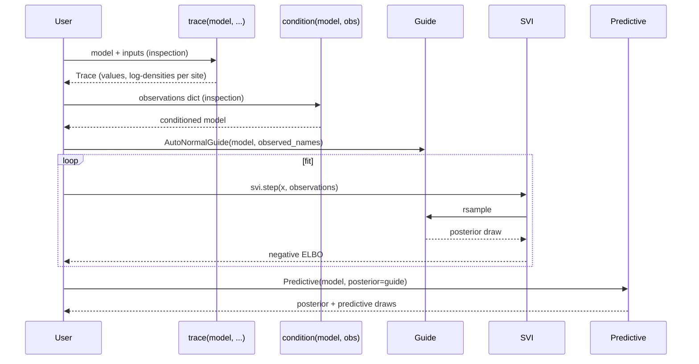

# 5. Variational inference

[Variational inference](https://en.wikipedia.org/wiki/Variational_Bayesian_methods) approximates a posterior by the member of a tractable family, the *guide*, that maximizes the evidence lower bound (ELBO) [@blei2017variational]. Stochastic variational inference (SVI) maximizes it by stochastic gradient steps [@hoffman2013svi]. This chapter builds a `MonadicProgram` by hand, records an execution trace, conditions on observations, fits a guide by SVI, and draws from the fitted approximation with `Predictive`. The interfaces follow Pyro's ([Pyro's SVI](https://pyro.ai/examples/svi_part_i.html)) [@pyroSVI].



`trace` and `condition` inspect the model. The fitting loop does not need them, because each `svi.step` receives the observations.

## Setup

```python
import torch
import torch.optim as optim
from quivers.core.objects import FinSet
from quivers.continuous.spaces import Euclidean
from quivers.continuous.families import ConditionalNormal
from quivers.continuous import Draw, MonadicProgram
from quivers.inference import (
    trace,
    condition,
    AutoNormalGuide,
    ELBO,
    SVI,
    Predictive,
)
```

## Building a model

A latent `z` with a Normal prior and an observation `y` with a Normal likelihood given `z`:

```python
Unit = FinSet(name="Unit", cardinality=1)
R = Euclidean(name="real", dim=1)

prior = ConditionalNormal(Unit, R)
likelihood = ConditionalNormal(R, R)

model = MonadicProgram(
    Unit, R,
    steps=[
        Draw(names=("z",), morphism=prior),           # z <- prior(unit)
        Draw(names=("y",), morphism=likelihood, args=("z",)),    # y <- likelihood(z)
    ],
    return_vars=("z", "y"),
)
```

Both families have learnable parameters (the prior's mean and scale, and the likelihood's map from `z` to a mean and scale), so the fit below estimates them together with the guide.

## Simulating observed data

Draw 50 rows from the model:

```python
torch.manual_seed(42)

# Sample from the prior
batch = torch.zeros(50, dtype=torch.long)  # 50 samples
samples = model.rsample(batch)

# Tuple returns come back as a dict keyed by variable name.
# Detach so the simulated observations don't carry a grad history
# back into the model parameters during SVI.
y_observed = samples["y"].detach()
print(y_observed.shape)  # [50, 1]
print(y_observed.mean(), y_observed.std())
```

Each row of the input is an [independent run](../../guides/inference-foundations.md#input-rows-are-independent-runs) of the program, so each simulated `y` has its own `z`.

## Tracing the model

An [execution trace](../../guides/inference-foundations.md#trace-and-sample-sites) records one run of a program: for each *site*, a named draw or observation, its value and its log density [@wingate2011lightweight].

```python
# Trace the model at a single point
x_single = torch.zeros(1, dtype=torch.long)
tr = trace(model, x_single)

# Inspect sites
print("Sites:", tr.sites.keys())  # {'z': SampleSite, 'y': SampleSite}

# Access a site
z_site = tr.sites["z"]
print("z value:", z_site.value)
print("z log_prob:", z_site.log_prob)
```

Each site has:

- `value`: the value drawn or observed.
- `log_prob`: its log density under the site's distribution.
- `is_observed`: whether the value was given by conditioning.
- `is_deterministic`: whether the site is a `Let` binding.

## Conditioning on observations

[`condition`](../../api/inference/conditioning.md) fixes the values of named sites:

```python
# Fix y to observed values
conditioned_model = condition(model, {"y": y_observed})

# Trace the conditioned model
tr_cond = conditioned_model.trace(x_single)

# Now y is fixed
print(tr_cond.sites["y"].is_observed)  # True
print(tr_cond.sites["y"].value)         # the conditioned values
print(tr_cond.sites["z"].is_observed)  # False (still latent)
```

`z` is still drawn from its prior, and `y` is scored at the given values.

## Creating a guide

[`AutoNormalGuide`](../../api/inference/guide.md) is a mean-field guide: it gives each latent site an independent Normal with a learnable mean and log scale.

```python
# Mean-field guide over the latent z; y is observed
guide = AutoNormalGuide(model, observed_names={"y"})
```

The guide skips the sites named in `observed_names`, so here it covers `z` alone, and it provides `rsample(x)` and `log_prob(x, samples)`:

```python
x = torch.zeros(4, dtype=torch.long)
posterior_samples = guide.rsample(x)
print(posterior_samples)  # dict: {"z": tensor, ...}

posterior_z = posterior_samples["z"]
print(posterior_z.shape)  # [4]
```

```python
log_q = guide.log_prob(x, posterior_samples)
print(log_q.shape)  # [4]
```

## Passing observations at runtime

A program reads the values of its observed sites from an `observations: dict[str, torch.Tensor]` keyed by site name. `MonadicProgram.rsample` takes it as a keyword argument, and `ELBO.forward` and `SVI.step` take it as the second positional argument, after the program input:

```python
observations = {"y": y_observed}            # shape matches the program's N
# Once SVI is set up (next section), pass observations into svi.step:
#     loss = svi.step(domain_input, observations)
```

## Setting up inference

```python
elbo = ELBO(num_particles=1)

optimizer = optim.Adam(list(model.parameters()) + list(guide.parameters()), lr=0.01)

svi = SVI(model, guide, optimizer, elbo)
```

An [`SVI`](../../api/inference/svi.md) driver pairs the model, the guide, an optimizer over both sets of parameters, and an [`Objective`](../../api/inference/elbo.md) such as [`ELBO`](../../api/inference/elbo.md).

## Training loop

Each step takes a minibatch of 10 observations. The input has one row for each observation, so each row is one run, with its own `z`, that observes one `y`:

```python
num_steps = 5
losses = []

# Prepare observed data
observations = {"y": y_observed}  # 50 observed values
batch_size = 10
n_batches = len(y_observed) // batch_size

for step in range(num_steps):
    # Shuffle and batch observations
    indices = torch.randperm(len(y_observed))
    batch_losses = []

    for i in range(n_batches):
        batch_idx = indices[i*batch_size:(i+1)*batch_size]
        batch_obs = {"y": y_observed[batch_idx]}

        # One SVI step: the observations dict flows through the
        # objective at evaluation time, so the model itself does not
        # need to be re-wrapped per batch.
        loss = svi.step(
            torch.zeros(batch_size, dtype=torch.long), batch_obs
        )

        batch_losses.append(loss)

    epoch_loss = sum(batch_losses) / len(batch_losses)
    losses.append(epoch_loss)

    print(f"Step {step}: Loss {epoch_loss:.4f}")
```

For latent $z$ and observations $y$, the ELBO of a guide $q$ is

$$
\operatorname{ELBO}(q) = \mathbb{E}_{q(z)}\bigl[\log p(y, z) - \log q(z)\bigr] = \mathbb{E}_{q(z)}\bigl[\log p(y \mid z)\bigr] - \operatorname{KL}\bigl(q(z) \,\|\, p(z)\bigr).
$$

The first form is the expected log joint density plus the entropy of $q$. The second is the expected log likelihood minus the KL divergence from the guide to the prior. Since $\log p(y) = \operatorname{ELBO}(q) + \operatorname{KL}(q(z) \,\|\, p(z \mid y))$, maximizing the ELBO minimizes the KL divergence from the guide to the posterior. The expectation is estimated from draws of $q$ (`num_particles` of them), and `SVI.step` returns the negative ELBO, the loss it minimizes.

The guide here has one mean and one scale, shared by every run, whereas each run has its own `z`. The objective is the sum of the runs' ELBOs, so the fitted guide is one distribution that serves all 50 observations at once, not the posterior of any one `z`. A model in which all observations share one latent variable observes them through a plate, as the QVR programs of [chapter 1 of the QVR track](../qvr/01-first-model.md) do. A falling loss does not by itself show that the approximation is adequate. Check it against an analytic posterior or a well-diagnosed MCMC fit when one is available.

## Posterior inference

[`Predictive`](../../api/inference/predictive.md) draws `z` from the fitted guide and `y` from the model given each draw:

```python
# Create a Predictive: posterior samples from the guide
predictive = Predictive(model, posterior=guide, num_samples=100)

# Sample posterior at a new point
x_new = torch.zeros(1, dtype=torch.long)
posterior_samples = predictive(x_new)

print(posterior_samples.keys())  # dict with z and y
z_posterior = posterior_samples["z"]
print(z_posterior.shape)  # [100, 1] (num_samples, batch)
```

```python
# Posterior mean and std
z_mean = z_posterior.mean(dim=0)
z_std = z_posterior.std(dim=0)
print(f"z posterior: mean={z_mean.item():.3f}, std={z_std.item():.3f}")

# Central 95% credible interval
z_quantile_lower = z_posterior.quantile(0.025, dim=0)
z_quantile_upper = z_posterior.quantile(0.975, dim=0)
print(f"95% interval: [{z_quantile_lower.item():.3f}, {z_quantile_upper.item():.3f}]")
```

## Inspecting guide and model draws

A trace of the conditioned model draws `z` from the prior and scores the fixed observations. A draw from the fitted guide comes from the approximation instead:

```python
# Model draw from a trace that scores the observed y
tr_true = conditioned_model.trace(x_new)
z_model = tr_true.sites["z"].value

# Posterior from guide
z_guide = guide.rsample(x_new)["z"]

print(f"Model draw: {z_model.item():.3f}")
print(f"Guide z: {z_guide.item():.3f}")
```

## Next

[Chapter 6](06-first-class-trans.md) treats transformations between algebras as values: `MorphismTransformation` and `AlgebraHomomorphism`, composition with `>>>`, and change of base. The [inference guide](../../guides/inference-foundations.md) documents traces, conditioning, guides, objectives, and SVI in full.
