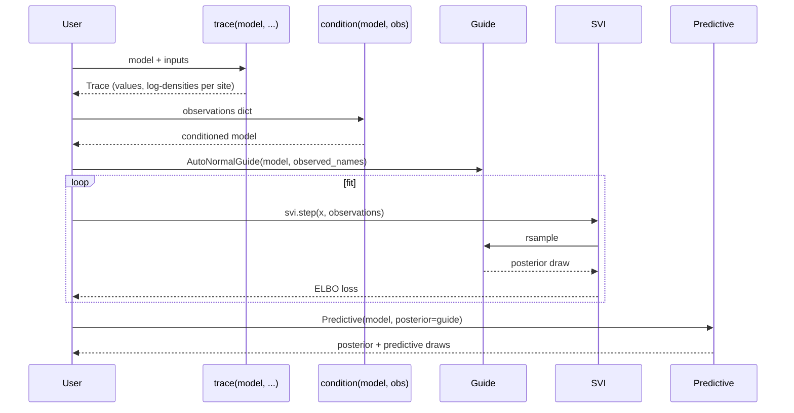

# Tutorial 5: Variational Inference

Variational inference fits a tractable guide to a program's [posterior](../../getting-started/concepts.md#4-a-probabilistic-program-describes-how-data-could-arise). This chapter defines and conditions a model, constructs a guide and ELBO objective, optimizes them with SVI, and uses `Predictive` to draw from the fitted approximation and simulate observations. Blei and colleagues provide a statistical introduction to variational inference [@blei2017variational]; Hoffman and colleagues develop stochastic variational inference [@hoffman2013svi]. These sources explain the objectives and approximations, while the code below demonstrates Quivers' interfaces.

The pipeline:



Suppose `z` is an unknown temperature and `y` is a noisy reading. A prior
assigns plausibility to temperatures before the reading; the likelihood
assigns a score to the reading under each temperature. Their product,
normalized over temperatures, is the posterior we want.

The [guide](https://pyro.ai/examples/svi_part_i.html#Guide) is an adjustable
distribution used to approximate that posterior [@pyroSVI]. A [Normal guide](../qvr/06-inference-zoo.md#step-2-which-variational-guide)
can move its center and widen or narrow its spread. SVI draws candidate
temperatures from it, evaluates the model and guide scores, and adjusts those
parameters. For instance, concentrating around 10 degrees would fit poorly
if both the prior and a precise reading favor 20 degrees; the objective
penalizes the guide for proposing temperatures with low model density.

## Concepts

- **Trace**: Record of a program execution with sample sites and log-densities
- **Conditioning**: Fixing observed variables to particular values
- **Guide**: A variational approximation to the posterior distribution
- **ELBO**: Evidence Lower Bound, a loss function for variational inference
- **SVI**: Stochastic Variational Inference, a gradient-based optimization algorithm
- **Predictive**: Posterior sampling using the fitted guide

## Setup

```python
import torch
import torch.optim as optim
from quivers.core.objects import FinSet
from quivers.continuous.spaces import Euclidean
from quivers.continuous.families import ConditionalNormal
from quivers.continuous import Draw, MonadicProgram
from quivers.inference import (
    trace,
    condition,
    AutoNormalGuide,
    ELBO,
    SVI,
    Predictive,
)
```

## Building a model

Create a simple generative model: latent variable z drives observation y.

```python
Unit = FinSet(name="Unit", cardinality=1)
R = Euclidean(name="real", dim=1)

prior = ConditionalNormal(Unit, R)
likelihood = ConditionalNormal(R, R)

model = MonadicProgram(
    Unit, R,
    steps=[
        Draw(names=("z",), morphism=prior),           # z <- prior(unit)
        Draw(names=("y",), morphism=likelihood, args=("z",)),    # y <- likelihood(z)
    ],
    return_vars=("z", "y"),
)
```

## Simulating observed data

Generate synthetic observations from the model (as if from an experiment):

```python
torch.manual_seed(42)

# Sample from the prior
batch = torch.zeros(50, dtype=torch.long)  # 50 samples
samples = model.rsample(batch)

# Tuple returns come back as a dict keyed by variable name.
# Detach so the simulated observations don't carry a grad history
# back into the model parameters during SVI.
y_observed = samples["y"].detach()
print(y_observed.shape)  # [50, 1]
print(y_observed.mean(), y_observed.std())
```

In practice, these observations come from real data. Here we simulate for illustration.

## Tracing the model

A trace records the values and log-densities at each site (random variable):

```python
# Trace the model at a single point
x_single = torch.zeros(1, dtype=torch.long)
tr = trace(model, x_single)

# Inspect sites
print("Sites:", tr.sites.keys())  # {'z': SampleSite, 'y': SampleSite}

# Access a site
z_site = tr.sites["z"]
print("z value:", z_site.value)
print("z log_prob:", z_site.log_prob)
```

Each site has:

- `value`: The sampled value
- `log_prob`: The log-probability under the distribution
- `is_observed`: Whether this site is conditioned (fixed)
- `is_deterministic`: Whether it is a let binding

## Conditioning on observations

Wrap the model to fix observed variables:

```python
# Fix y to observed values
conditioned_model = condition(model, {"y": y_observed})

# Trace the conditioned model
tr_cond = conditioned_model.trace(x_single)

# Now y is fixed
print(tr_cond.sites["y"].is_observed)  # True
print(tr_cond.sites["y"].value)         # matches y_observed[0]
print(tr_cond.sites["z"].is_observed)  # False (still latent)
```

The conditioned model still allows the latent variable z to vary.

## Creating a guide

A guide is a variational approximation to the posterior. It has the same interface as the model but is typically simpler (e.g., a mean-field normal distribution).

```python
# Create a guide: assumes posterior over z and y is normal
guide = AutoNormalGuide(model, observed_names={"y"})
```

The `AutoNormalGuide`:

1. Identifies latent (non-observed) variables: just `z` in this case
2. Creates learnable parameters for the mean and log-scale of a normal distribution
3. Provides `rsample(x)` and `log_prob(x, samples)` methods

Sample from the guide:

```python
x = torch.zeros(4, dtype=torch.long)
posterior_samples = guide.rsample(x)
print(posterior_samples)  # dict: {"z": tensor, ...}

posterior_z = posterior_samples["z"]
print(posterior_z.shape)  # [4]
```

Compute the guide's log-probability:

```python
log_q = guide.log_prob(x, posterior_samples)
print(log_q.shape)  # [4]
```

## Passing observations at runtime

Programs that use indexed observes (`observe r : N <- F(args)`) read their response tensors from a runtime `observations: dict[str, torch.Tensor]` keyed by the observed-variable name. The dict is forwarded to `MonadicProgram.rsample` (kwarg) and to `ELBO.forward` / `SVI.step` (positional, after the program input):

```python
observations = {"y": y_observed}            # shape matches the program's N
# Once SVI is set up (next section), pass observations into svi.step:
#     loss = svi.step(domain_input, observations)
```

There is no `.qvr`-level data block; observation tensors live in Python at the call site.

## Setting up inference

Define the ELBO loss and optimizer:

```python
elbo = ELBO(num_particles=1)

optimizer = optim.Adam(list(model.parameters()) + list(guide.parameters()), lr=0.01)

svi = SVI(model, guide, optimizer, elbo)
```

The [`SVI`](../../api/inference/svi.md) object pairs:

- `model`: the generative `MonadicProgram`. Observations are supplied to each step rather than baked in via [`condition`](../../api/inference/conditioning.md).
- `guide`: the variational posterior.
- `optim`: optimizer over the model and guide parameters.
- `objective`: an [`Objective`](../../api/inference/elbo.md) such as [`ELBO`](../../api/inference/elbo.md).

## Training loop

Run inference to optimize the guide's parameters:

```python
num_steps = 5
losses = []

# Prepare observed data
observations = {"y": y_observed}  # 50 observed values
batch_size = 10
n_batches = len(y_observed) // batch_size

for step in range(num_steps):
    # Shuffle and batch observations
    indices = torch.randperm(len(y_observed))
    batch_losses = []

    for i in range(n_batches):
        batch_idx = indices[i*batch_size:(i+1)*batch_size]
        batch_obs = {"y": y_observed[batch_idx]}

        # One SVI step: the observations dict flows through the
        # objective at evaluation time, so the model itself does not
        # need to be re-wrapped per batch.
        loss = svi.step(
            torch.zeros(batch_size, dtype=torch.long), batch_obs
        )

        batch_losses.append(loss)

    epoch_loss = sum(batch_losses) / len(batch_losses)
    losses.append(epoch_loss)

    if step % 10 == 0:
        print(f"Step {step}: Loss {epoch_loss:.4f}")
```

The ELBO loss combines:

1. **Model likelihood**: How well the model explains observations under the guide's samples
2. **KL divergence**: How close the guide is to the prior (regularization)

$$
\operatorname{ELBO}(q)
= \mathbb{E}_{q(z)}\!\left[\log p(\text{obs}, z)-\log q(z)\right].
$$

When the joint factors as $p(\text{obs}\mid z)p(z)$, this is equivalently the expected log likelihood minus $\operatorname{KL}(q(z)\|p(z))$. `SVI.step` minimizes the negative ELBO.

In the [ELBO](https://pyro.ai/examples/svi_part_i.html#ELBO), `log p(obs, z)`
rewards values compatible with the prior and observations; the expected
negative `log q(z)` is the guide's entropy [@pyroSVI]. Maximizing their sum
equivalently minimizes the KL divergence from the guide to the posterior,
when the relevant expectations are finite. The expectation is estimated
using guide draws, commonly called particles. Increasing their number
estimates the same expectation with a larger sample.

`SVI.step` returns a loss to minimize, the negative ELBO, so a downward loss
trend is the expected direction. Neither a smooth curve nor a small loss proves
the posterior approximation is adequate. Inspect uncertainty and predictive
checks, and compare with an analytic or well-diagnosed reference when available.

## Posterior inference

After training, use the guide to make predictions on new data:

```python
# Create a Predictive: posterior samples from the guide
predictive = Predictive(model, guide, num_samples=100)

# Sample posterior at a new point
x_new = torch.zeros(1, dtype=torch.long)
posterior_samples = predictive(x_new)

print(posterior_samples.keys())  # dict with z and y
z_posterior = posterior_samples["z"]
print(z_posterior.shape)  # [100, 1] (num_samples, batch)
```

Analyze the posterior:

```python
# Posterior mean and std
z_mean = z_posterior.mean(dim=0)
z_std = z_posterior.std(dim=0)
print(f"z posterior: mean={z_mean.item():.3f}, std={z_std.item():.3f}")

# Posterior credible interval
z_quantile_lower = z_posterior.quantile(0.025, dim=0)
z_quantile_upper = z_posterior.quantile(0.975, dim=0)
print(f"95% CI: [{z_quantile_lower.item():.3f}, {z_quantile_upper.item():.3f}]")
```

## Inspecting guide and model draws

Tracing a conditioned model draws `z` from its model distribution and scores the fixed observation. Drawing from the fitted guide instead uses the approximate posterior learned from that observation. The two calls below expose these different distributions:

```python
# Model draw from a trace that scores the observed y
tr_true = conditioned_model.trace(x_new)
z_model = tr_true.sites["z"].value

# Posterior from guide
z_guide = guide.rsample(x_new)["z"]

print(f"Model draw: {z_model.item():.3f}")
print(f"Guide z: {z_guide.item():.3f}")
```

To validate a guide against a reference posterior, use an analytic posterior where available or compare with a sufficiently diagnosed MCMC fit.

## More complex models

The same pattern extends to complex models. For instance, with the PDS model from Tutorial 4:

<!-- python: skip -->
```python
from quivers.dsl import loads

prog_pds = loads("""
object Entity : FinSet 1
object Truth : FinSet 2
object Resp : FinSet 1

program factivity : Entity -> Truth * Truth * Truth * Resp
    sample theta_know <- LogitNormal(mu=0.0, sigma=1.0)
    sample theta_cg <- LogitNormal(mu=0.0, sigma=1.0)
    let cg_complement = 1
    sample tau_know <- Bernoulli(probs=theta_know)
    sample cg_matrix <- Bernoulli(probs=theta_cg)
    sample sigma <- Uniform(low=0.0, high=1.0)
    observe response <- TruncatedNormal(mu=theta_know, sigma=sigma, low=0.0, high=1.0)
    return (tau_know, cg_complement, cg_matrix, response)
""")
model_pds = prog_pds.morphism

# Observed response judgments from a linguistic experiment
observed_responses = torch.tensor([0.8, 0.6, 0.7, 0.9, 0.5])

# Build a guide and an SVI loop. Observations are routed through
# ``svi.step`` rather than wrapped into the model.
guide_pds = AutoNormalGuide(model_pds, observed_names={"response"})

elbo = ELBO(num_particles=1)
optimizer = optim.Adam(
    list(model_pds.parameters()) + list(guide_pds.parameters()),
    lr=0.01,
)
svi = SVI(model_pds, guide_pds, optimizer, elbo)

# Run training... pass {"response": observed_responses} as the
# observations dict on each step.
```

## Summary

You have:

- Built a probabilistic model and simulated observations
- Traced a model to inspect sites and log-probabilities
- Conditioned a model on observed data
- Created an AutoNormalGuide as a posterior approximation
- Set up and ran a variational inference training loop
- Used Predictive for posterior sampling
- Distinguished conditioned forward draws from posterior draws

The same trace–guide–objective–SVI sequence applies to other quivers probabilistic programs; the model's sites and support constraints determine the appropriate guide.

## Next

[Tutorial 6](06-first-class-trans.md) covers first-class transformations: `MorphismTransformation` and `AlgebraHomomorphism` as values, the `>>>` composition operator, and change-of-base pipelines.

## Further reading

- **[Inference Guide](../../guides/inference-foundations.md):** Detailed documentation of trace, conditioning, guides, ELBO, and SVI
- **[Continuous Morphisms](../../guides/continuous-spaces.md):** More on distributions and spaces
- **[DSL Guide](../../guides/dsl-overview.md):** Writing models in `.qvr` syntax
