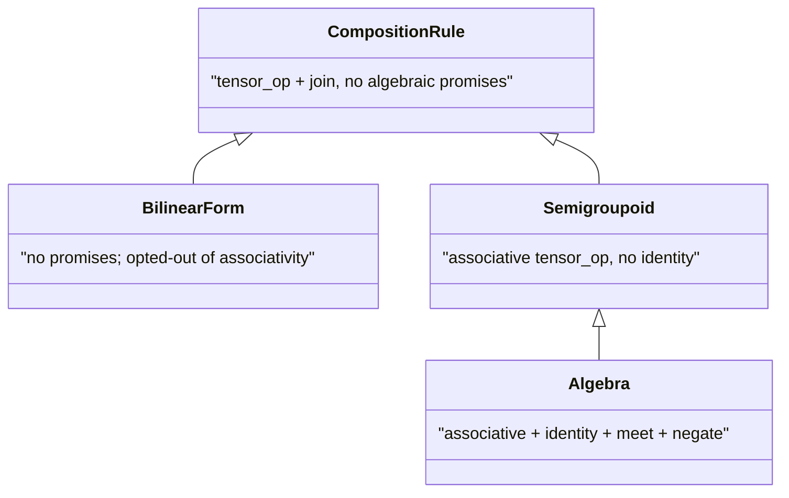

# 7. Composition rules beyond algebras

`f >> g` needs two operations on weights: a product $\otimes$ (the method `tensor_op`) that combines the entries along a path, and a sum $\oplus$ (the method `join`) that reduces the shared axis. A [`CompositionRule`](../../api/core/algebras.md) is any such pair. The laws the pair satisfies decide which rewrites of a composite keep its value: associativity allows replacing `(f >> g) >> h` by `f >> (g >> h)`, and an identity allows inserting an identity morphism. When $\otimes$ and $\oplus$ form a [semiring](https://en.wikipedia.org/wiki/Semiring), the matrix product they define is associative and the identity matrix is its unit [@mohri2002semiring]. Without those laws a rewrite can change the result, as [chapter 1](01-first-quiver.md#composition) showed for `PRODUCT_FUZZY`. A rule's class records which laws it claims, and [`EinsumWiring`](../../api/core/wiring.md) computes contractions of more than two tensors.

## The hierarchy

A rule's class states which laws it claims. Only `semigroupoid(...)` tests its claim, on random inputs, and no class proves it:

| Class (QVR level) | Claims | Structure of the morphisms |
|---|---|---|
| `Algebra` (`algebra`) | associativity and an identity, plus a unit, a zero, a meet, and a negation | a [category](https://ncatlab.org/nlab/show/category) |
| `Semigroupoid` (`semigroupoid`) | associativity, no identity | a [semicategory](https://ncatlab.org/nlab/show/semicategory) (semigroupoid) [@tilson1987categories] |
| `BilinearForm` (`bilinear_form`) | nothing | a [magmoid](https://ncatlab.org/nlab/show/magmoid): composition with no laws |
| `CompositionRule` (`rule`) | nothing | the base class of the three above |

The name `BilinearForm` does not mean a [bilinear form](https://en.wikipedia.org/wiki/Bilinear_form) in the linear algebra sense, a map linear in each argument. It marks a rule that claims no associativity and no identity.



Code that needs `identity`, `dagger`, `trace`, `cup`, or `cap` requires an `Algebra`, code that rebrackets composites requires at least a `Semigroupoid`, and code that only contracts tensors accepts any `CompositionRule`.

```python
from quivers.core.algebras import (
    CompositionRule, Semigroupoid, BilinearForm, Algebra,
    PRODUCT_FUZZY, REAL,
    material_implication, semigroupoid, bilinear_form,
)
```

Every built-in algebra is a subclass of `Algebra`, so also of `Semigroupoid` and `CompositionRule`. The class records a claim, not a fact: `PRODUCT_FUZZY` is an `Algebra`, but its product does not distribute over its noisy-OR, and its composition is not associative.

## Building a semigroupoid

`material_implication()` returns a `CustomSemigroupoid` whose $\otimes$ is the Reichenbach implication $a \to b = 1 - a + ab$ [@baczynski2008fuzzy] and whose $\oplus$ is the product. This $\otimes$ has the left identity 1, since $1 \to b = b$, but no two-sided identity, which is why the rule is not an `Algebra`. It is also not associative: with $a = b = c = 0.5$, $(a \to b) \to c = 0.625$ and $a \to (b \to c) = 0.875$. The helper thus skips the associativity test that `semigroupoid(...)` runs, and composites under it must keep their bracketing.

```python
import torch
from quivers.core.algebras import material_implication

mi = material_implication()
print(type(mi).__mro__)        # (CustomSemigroupoid, Semigroupoid, CompositionRule, ABC, object)

f = torch.tensor([[0.3, 0.5, 0.2]])
g = torch.tensor([
    [0.6, 0.4],
    [0.1, 0.9],
    [0.7, 0.2],
])
out = mi.compose(f, g, n_contract=1)
print(out.shape)               # torch.Size([1, 2])
```

`semigroupoid(name, tensor_op, join)` builds a rule from an associative $\otimes$ and a reduction:

```python
from quivers.core.algebras import semigroupoid

def bounded_sum(a, b):
    return (a + b).clamp(max=1.0)

def max_reduce(t, dim):
    if isinstance(dim, int):
        dim = (dim,)
    result = t
    for d in sorted(dim, reverse=True):
        result = result.max(dim=d).values
    return result

bsm = semigroupoid("BoundedSumMax", bounded_sum, max_reduce)
```

At construction it tests associativity of $\otimes$ on a fixed set of random inputs and raises if the test fails. `verify_associative=False` skips the test, for an operation known to be associative whose test fails only by rounding.

## Building a rule without laws

`bilinear_form(name, tensor_op, join)` builds a rule that claims nothing. The midpoint $(a + b)/2$ is not associative:

```python
from quivers.core.algebras import bilinear_form

def midpoint(a, b):
    return 0.5 * (a + b)            # not associative

def sum_reduce(t, dim):
    if isinstance(dim, int):
        dim = (dim,)
    return t.sum(dim=dim)

bf = bilinear_form("Midpoint", midpoint, sum_reduce)

# Three-way composition order matters:
a, b, c = torch.tensor(0.3), torch.tensor(0.5), torch.tensor(0.7)
left  = bf.tensor_op(bf.tensor_op(a, b), c)
right = bf.tensor_op(a, bf.tensor_op(b, c))
assert not torch.allclose(left, right)
```

`bilinear_form(...)` runs no test. Rules whose reduction is not the addition of a semiring, such as a top-$k$ truncation or a sum weighted by a softmax, generally lose associativity and belong at this level.

## Operations that need an identity

`unit`, `identity_tensor`, and the operations of a [compact closed category](https://ncatlab.org/nlab/show/compact+closed+category) (`cup`, `cap`, `dagger`, `trace`, which bend, transpose, and loop wires) need an identity, so a rule below `Algebra` lacks them and raises `AttributeError`:

```python
from quivers.core.algebras import material_implication

mi = material_implication()
for attribute in ("unit", "identity_tensor"):
    try:
        getattr(mi, attribute)
    except AttributeError:
        print(attribute, "is unavailable on", type(mi).__name__)
```

In QVR, `identity(A)`, `cup(A)`, `cap(A)`, `f.dagger`, and `f.trace(A)` fail to compile in a module declared `composition X [level=semigroupoid]` or `[level=bilinear_form]` ([chapter 7 of the QVR track](../qvr/07-categorical.md#composition-rules-and-their-laws)).

## Contractions of several tensors {#operadic-n-ary-contractions}

Binary composition is `f >> g`, with the shared axis taken from the morphisms' types. [`EinsumWiring`](../../api/core/wiring.md) is for a contraction of three or more tensors at once, such as

$$
\mathrm{out}[s, o] = \bigoplus_{p, q}\Big(\mathrm{arg}_1[s, p] \otimes \mathrm{arg}_2[s, q] \otimes \mathrm{kernel}[p, q, o]\Big).
$$

The spec is written in [Einstein summation](https://en.wikipedia.org/wiki/Einstein_notation) (einsum) notation, as in `torch.einsum`: each input lists its axis letters, the right side of the arrow lists the output letters, and a letter that appears in an input and not in the output is reduced by $\oplus$. `torch.einsum` fixes $\otimes$ and $\oplus$ to product and sum, so `torch.einsum("sp, sq, pqo -> so", a, b, c)` equals `einsum_wiring(REAL, "sp, sq, pqo -> so").apply(a, b, c)`. Operations of this kind form the operad of wiring diagrams [@spivak2013operad].

```python
from quivers.core.wiring import EinsumWiring, einsum_wiring, contract

wiring = einsum_wiring(PRODUCT_FUZZY, "sp, sq, pqo -> so")
print(wiring.input_arity)       # 3
print(wiring.composition_rule)  # ProductFuzzyAlgebra()

torch.manual_seed(0)
arg1   = torch.rand(4, 3)
arg2   = torch.rand(4, 5)
kernel = torch.rand(3, 5, 2)
out    = wiring.apply(arg1, arg2, kernel)
print(out.shape)                # torch.Size([4, 2])
```

`apply` computes in four steps:

1. Broadcast each input to the set of all axis letters, with singleton axes for missing letters.
2. Combine the inputs from left to right with $\otimes$.
3. Reduce the contracted axes with $\oplus$.
4. Permute the remaining axes into the output order.

Since step 2 folds from the left, the order of the inputs matters for a rule whose $\otimes$ is not associative. `EinsumWiring` accepts any `CompositionRule`, including rules below `Algebra`:

```python
mi    = material_implication()
wmi   = einsum_wiring(mi, "ij, jk -> ik")
out   = wmi.apply(
    torch.rand(2, 2),
    torch.rand(2, 2),
)
```

## Validation

`einsum_wiring` checks the spec when it is built and raises `ValueError` when:

- An input is empty.
- An input repeats a letter (`"ii, jk -> ik"`), since a diagonal or trace contraction is not supported.
- The output repeats a letter (`"ij, jk -> iik"`).
- An output letter appears in no input (`"ij, jk -> iz"`).

`apply` checks the number of tensors and the number of axes of each. A size mismatch between inputs surfaces as PyTorch's broadcasting error.

## From QVR

A `composition` declaration selects a built-in rule by name, or defines one inline with an indented body. Each of the following declarations compiles on its own (a module has one):

<!-- compile: false -->
```qvr
composition my_real [level=algebra]
    tensor_op(a, b) = a * b
    join(t)         = sum(t)
    unit            = 1.0
    zero            = 0.0

composition my_semi [level=semigroupoid]
    tensor_op(a, b) = a * b
    join(t)         = sum(t)

composition my_bf [level=bilinear_form]
    tensor_op(a, b) = (a + b) * 0.5
    join(t)         = sum(t)

composition product_fuzzy [level=rule]
```

`level` is one of `algebra`, `semigroupoid`, `bilinear_form`, and `rule`. Without a body, the name selects a rule from the built-in catalog (`product_fuzzy`, `material_impl`, and the others), and the compiler checks that it has the declared level.

A `contraction` declares a named contraction of several morphisms:

```qvr
object A : FinSet 4
object B : FinSet 3
object C : FinSet 5
object D : FinSet 2
morphism arg1_morph : A -> B [role=latent]
morphism arg2_morph : A -> C [role=latent]
morphism kernel_morph : B * C -> D [role=latent]

contraction op_apply (
    arg1 : A -> B,
    arg2 : A -> C,
    kernel : B * C -> D,
) : A -> D [rule=product_fuzzy, wiring="sp, sq, pqd -> sd"]

define combined = op_apply(arg1_morph, arg2_morph, kernel_morph)
export combined
```

`op_apply` can be called wherever a morphism is expected. Each call checks the number of arguments and the number of entries of each against the declared signature, then applies the `EinsumWiring` to the arguments' tensors. Without `wiring=`, the compiler infers the spec from the axis names of the signature ([contractions guide](../../guides/dsl-contractions.md)).

## Next

[Chapter 8](08-analysis-pipelines.md) fits regression formulas: a `fit("y ~ x + (1|g)", data=df, ...)` call, the QVR program it compiles to, the No-U-Turn Sampler (NUTS), PSIS-LOO model comparison, and posterior predictive checks.
