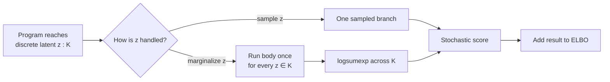

# 4. Mixtures and discrete latents

When a model has a discrete latent variable, you can sample it, which incurs score-function variance when pathwise gradients are unavailable, or marginalize it over its finite support. Marginalization produces a deterministic contribution from that latent and often improves gradients, but its cost grows with the support and the body of the block.

QVR makes finite marginalization a first-class block. The body runs once per
value in an enumerable support; the runtime combines the resulting scope
weights with the prior by `logsumexp`. This operation exactly sums out a
finite discrete latent and is the categorical-prior form of
Rao–Blackwellization [@casella1996rao].
It does not numerically integrate a continuous latent: a `marginalize` whose
family has no finite support follows the ordinary sampling path, and an
explicit reduction on such a family is rejected.

A mixture gives several possible explanations for one observation. If the
components have [prior probabilities](../../getting-started/concepts.md#4-a-probabilistic-program-describes-how-data-could-arise) `0.3` and `0.7`, and assign likelihood
values `0.2` and `0.5` to the observation, its marginal likelihood is
`0.3 * 0.2 + 0.7 * 0.5 = 0.41`. Both explanations contribute; neither needs
to be chosen in a random draw. Density values for continuous observations
need not lie below one, but the [mixture weights](../../examples/mixture-model.md#understanding-the-model) still sum to one. The [Stan mixture derivation](https://mc-stan.org/docs/stan-users-guide/finite-mixtures.html#summing-out-the-responsibility-parameter) takes this calculation from latent component labels to a sum of weighted densities [@stanFiniteMixtures].

The implementation works with logarithms to avoid multiplying many tiny
numbers. Adding log likelihoods represents multiplication; `logsumexp`
represents adding the underlying positive weights. This finite sum is exact
for the eliminated assignment. Uncertainty about component means and scales
still requires inference.

## A two-component Gaussian mixture

Each observation comes from one of two Gaussian clusters; we don't know which.

=== "QVR"

    ```qvr
    object Item : FinSet 500
    object Component : FinSet 2
    object Weights : Real 2
    program gmm : Item -> Weights [effects=[Sample, Score, Marginal]]
        sample probs <- Dirichlet(concentration=1.0) [over=Component]
        sample mu_k : Component <- Normal(loc=0.0, scale=5.0)
        sample sd_k : Component <- HalfNormal(scale=1.0)

        marginalize z : Component <- Categorical(probs=probs) [over=Item]
            observe y : Item <- Normal(loc=mu_k[z], scale=sd_k[z]) [via=item_idx]
        return probs

    export gmm
    ```

=== "Pyro (enumerated)"

    <!-- python: skip -->
    ```python
    @config_enumerate
    def model(data):
        probs = pyro.sample("probs", dist.Dirichlet(torch.ones(2)))
        mu_k  = pyro.sample("mu_k",  dist.Normal(0., 5.).expand([2]).to_event(1))
        sd_k  = pyro.sample("sd_k",  dist.HalfNormal(1.).expand([2]).to_event(1))
        with pyro.plate("data", len(data)):
            z = pyro.sample("z", dist.Categorical(probs),
                            infer={"enumerate": "parallel"})
            pyro.sample("y", dist.Normal(mu_k[z], sd_k[z]), obs=data)
    ```

=== "Stan"

    ```stan
    data { int N; vector[N] y; }
    parameters {
        simplex[2] probs;
        ordered[2] mu_k;
        vector<lower=0>[2] sd_k;
    }
    model {
        probs ~ dirichlet([1, 1]');
        mu_k  ~ normal(0, 5);
        sd_k  ~ normal(0, 1);
        for (n in 1:N) {
            vector[2] lp;
            for (k in 1:2)
                lp[k] = log(probs[k])
                      + normal_lpdf(y[n] | mu_k[k], sd_k[k]);
            target += log_sum_exp(lp);
        }
    }
    ```

`probs` is one point on the component simplex; the annotation on `mu_k` and
`sd_k` instead draws one scalar for each component. The
`marginalize ... [over=Item]` block gives each row its own latent assignment;
the host supplies `item_idx = arange(500)`, the identity fibration from rows to
those groups. This implements the Stan `log_sum_exp` pattern. The `Marginal`
entry in the optional effect summary records the finite reduction.

## Fitting the mixture

The gallery's
[`mixture_model.qvr`](../../examples/source/mixture_model.qvr) uses the
closed-form `MixtureNormal` family instead. The code below shows the explicit
finite-marginalization form so that the latent support and grouping rule remain
visible.

<!-- python: skip -->
```python
import torch
from quivers.dsl import loads
from quivers.inference import AutoNormalGuide, ELBO, SVI

GMM_SRC = """
object Item : FinSet 500
object Component : FinSet 2
object Weights : Real 2

program gmm : Item -> Weights
    sample probs <- Dirichlet(concentration=1.0) [over=Component]
    sample mu_k : Component <- Normal(loc=0.0, scale=5.0)
    sample sd_k : Component <- HalfNormal(scale=1.0)

    marginalize z : Component <- Categorical(probs=probs) [over=Item]
        observe y : Item <- Normal(loc=mu_k[z], scale=sd_k[z]) [via=item_idx]
    return probs

export gmm
"""

program = loads(GMM_SRC)
model   = program.morphism

torch.manual_seed(0)
true_mu = torch.tensor([-2.0, 2.0])
true_sd = torch.tensor([0.5, 0.7])
z_true  = torch.bernoulli(torch.full((500,), 0.6)).long()
y_data  = (torch.randn(500) * true_sd[z_true] + true_mu[z_true]).unsqueeze(0)

guide = AutoNormalGuide(model, observed_names={"y", "item_idx"})
elbo  = ELBO(num_particles=1)
optimizer = torch.optim.Adam(
    list(model.parameters()) + list(guide.parameters()), lr=1e-2,
)
svi = SVI(model, guide, optimizer, elbo)
x_tensor = torch.zeros(1, 1)
observations = {
    "y": y_data,
    "item_idx": torch.arange(500, dtype=torch.long),
}
for _ in range(20):                            # bump to ~3000 for real fits
    svi.step(x_tensor, observations)
```

The `marginalize` block is integrated out exactly at every SVI step, so the gradients on `mu_k`, `sd_k`, and `probs` flow through a smooth `logsumexp`. No discrete-sampling variance contaminates the ELBO.

## Hierarchical mixtures with grouping

Suppose each observation belongs to one of `G` groups, and the categorical mixture proportions vary by group. The marginalization has to respect group membership: the log-likelihood over the discrete latent gets aggregated *per group*, not per row. The `marginalize` header declares the grouping plate (`over G`); each observe inside the body carries its own `via <idx>` clause naming the fibration from its response plate into the grouping plate.

```qvr
object Item : FinSet 1000
object Group : FinSet 20
object Component : FinSet 3
object Weights : Real 3
program grouped_mixture : Item -> Weights [effects=[Sample, Score, Marginal]]
    sample probs : Group <- Dirichlet(concentration=1.0) [over=Component, iid_over=Group]
    sample mu_k : Component <- Normal(loc=0.0, scale=5.0)
    sample sd_k : Component <- HalfNormal(scale=1.0)

    marginalize z : Component <- Categorical(probs=probs) [over=Group]
        observe y : Item <- Normal(loc=mu_k[z], scale=sd_k[z]) [via=group_idx]
    return probs

export grouped_mixture
```

The `[over=Group]` entry declares the grouping plate. The free host-data name
`group_idx` is the integer-valued fibration from observation rows into that
plate; `[via=group_idx]` gathers each row into its group before the reduction.
It is data, not a sampled `HalfNormal` latent. The block contributes

$$
\sum_{g \in G}\ \log\!\sum_{k=1}^{K}\exp\!\left[\log \pi_{g,k} + \sum_{n:\ \mathrm{group\_idx}(n)=g}\ \log f(y_n \mid \mu_k, \sigma_k)\right]
$$

to the log-density, which is the right Kan extension along the fibration `Item -> G` and requires aggregating the component-specific row log likelihoods within each group before applying a mixture reduction. A grouped block can contain multiple observes, each with its own `[via=<idx>]` entry, when several heterogeneous response axes share the same per-group class indicator; the per-axis log-likelihoods scatter-sum into the same `(|G|, K)` accumulator before the log-sum-exp.

Grouping changes the statistical question. With one component per row,
each row can choose a different explanation, giving a product of mixture
likelihoods. With one component shared by a group, all rows must be explained
by the same component, so their likelihoods multiply before the component
sum. A group with two rows thus contributes
`sum_k pi[k] * f(y1 | k) * f(y2 | k)`, not
`(sum_k pi[k] * f(y1 | k)) * (sum_k pi[k] * f(y2 | k))`.

## When to marginalize vs sample

The decision is a straight cost-benefit:

- `marginalize` costs roughly `K × (body cost)` per evaluation. The reward is exact gradients with respect to the discrete-prior parameters and zero Monte Carlo variance on the discrete latent.
- Sampling the discrete latent with `ScoreFunction` (REINFORCE) evaluates one sampled branch but introduces Monte Carlo variance. The variance depends on the prior, the component likelihoods, and any control variate.

There is no repository-wide support-size threshold at which one method wins. Profile the full model. For larger supports, possible alternatives include score-function estimators with baselines or a relaxed proxy such as the Concrete distribution [@maddison2017concrete]; each changes the computational or statistical tradeoff.

| Discrete support per row | Recommendation |
|---|---|
| Small finite `K` and cheap body | Start with `marginalize`. |
| Larger finite `K` or expensive body | Profile marginalization against a sampled estimator. |
| Very large or unbounded support | Use a sampled estimator or a model-specific approximation. |
| Continuous-discrete mixture | `marginalize` the discrete part, reparameterize the continuous part. |



## Try this

- Change the model to four components and inspect the recovered means.
  Mixture models have a label-switching symmetry
  [@stephens2000labels]; sorting draws
  after inference can summarize exchangeable components, but a deterministic
  `sort(mu_k)` inside the likelihood is not the same as an ordered prior.
- Convert the grouped mixture to a `marginalize` without the `over` / `via` clauses and observe the difference: per-row marginalization versus per-group.
- Combine with chapter 3's plate-draws: a hierarchical mixture where each group has its own `mu_k` drawn from a hyperprior.

## Next

[Chapter 5](05-time-series.md) examines sequence-shaped models: HMMs,
state-space models, and chart-based weighted deduction.


## Sources and further reading

- *The Concrete Distribution: A Continuous Relaxation of Discrete Random Variables* [@maddison2017concrete].
- *Rao-Blackwellisation of sampling schemes* [@casella1996rao].
- *Dealing with label switching in mixture models* [@stephens2000labels].
