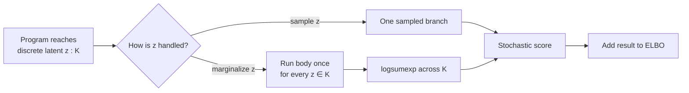

# 4. Mixtures and discrete latents

A discrete latent variable can be sampled or summed out. Sampling it rules out the [reparameterization gradient](https://en.wikipedia.org/wiki/Reparameterization_trick), so SVI must fall back on the [score-function estimator](https://en.wikipedia.org/wiki/Policy_gradient_method) and its higher variance [@ranganath2014bbvi]. Summing it out, or [marginalizing by enumeration](https://pyro.ai/examples/enumeration.html) [@pyroEnumeration; @stanFiniteMixtures], removes that variance at a cost that grows with the size of the support. It is an instance of [Rao–Blackwellization](https://en.wikipedia.org/wiki/Rao%E2%80%93Blackwell_theorem), the replacement of a sampled quantity by its conditional expectation [@casella1996rao].

QVR writes enumeration as a `marginalize` block. The block body runs once for each value of the latent, and the runtime combines the resulting log weights with the log prior probabilities by `logsumexp`. The latent must have a finite support, such as the elements of a `FinSet` under a `Categorical` prior. `marginalize` does not integrate a continuous latent variable.

## A two-component Gaussian mixture

Each observation comes from one of two Normal components, and the component is unknown.

=== "QVR"

    ```qvr
    object Item : FinSet 500
    object Component : FinSet 2
    object Weights : Real 2
    program gmm : Item -> Weights [effects=[Sample, Score, Marginal]]
        sample probs <- Dirichlet(concentration=1.0) [over=Component]
        sample mu_k : Component <- Normal(loc=0.0, scale=5.0)
        sample sd_k : Component <- HalfNormal(scale=1.0)

        marginalize z : Component <- Categorical(probs=probs) [over=Item]
            observe y : Item <- Normal(loc=mu_k[z], scale=sd_k[z]) [via=item_idx]
        return probs

    export gmm
    ```

=== "Pyro (enumerated)"

    <!-- python: skip -->
    ```python
    @config_enumerate
    def model(data):
        probs = pyro.sample("probs", dist.Dirichlet(torch.ones(2)))
        mu_k  = pyro.sample("mu_k",  dist.Normal(0., 5.).expand([2]).to_event(1))
        sd_k  = pyro.sample("sd_k",  dist.HalfNormal(1.).expand([2]).to_event(1))
        with pyro.plate("data", len(data)):
            z = pyro.sample("z", dist.Categorical(probs),
                            infer={"enumerate": "parallel"})
            pyro.sample("y", dist.Normal(mu_k[z], sd_k[z]), obs=data)
    ```

=== "Stan"

    ```stan
    data { int N; vector[N] y; }
    parameters {
        simplex[2] probs;
        ordered[2] mu_k;
        vector<lower=0>[2] sd_k;
    }
    model {
        probs ~ dirichlet([1, 1]');
        mu_k  ~ normal(0, 5);
        sd_k  ~ normal(0, 1);
        for (n in 1:N) {
            vector[2] lp;
            for (k in 1:2)
                lp[k] = log(probs[k])
                      + normal_lpdf(y[n] | mu_k[k], sd_k[k]);
            target += log_sum_exp(lp);
        }
    }
    ```

The option `[over=Component]` on `probs` makes the Dirichlet draw one point of the [probability simplex](https://en.wikipedia.org/wiki/Simplex#Probability) on `Component`, whereas the annotation `mu_k : Component` draws one independent scalar for each component. `[over=Item]` on the `marginalize` header gives each item its own component assignment. `[via=item_idx]` names an *index map* from observation rows to those items, given as an integer array: here `item_idx = arange(500)`, the identity, since each row is its own item. The block computes the same sum as the Stan `log_sum_exp` loop.

## Fitting the mixture

The gallery program [`mixture_model.qvr`](../../examples/source/mixture_model.qvr) writes the same model with the `MixtureNormal` family, which sums the components in closed form. The explicit `marginalize` block below shows the support and the grouping.

```python
import torch
from quivers.dsl import loads
from quivers.inference import AutoNormalGuide, ELBO, SVI

GMM_SRC = """
object Item : FinSet 500
object Component : FinSet 2
object Weights : Real 2

program gmm : Item -> Weights
    sample probs <- Dirichlet(concentration=1.0) [over=Component]
    sample mu_k : Component <- Normal(loc=0.0, scale=5.0)
    sample sd_k : Component <- HalfNormal(scale=1.0)

    marginalize z : Component <- Categorical(probs=probs) [over=Item]
        observe y : Item <- Normal(loc=mu_k[z], scale=sd_k[z]) [via=item_idx]
    return probs

export gmm
"""

program = loads(GMM_SRC)
model   = program.morphism

torch.manual_seed(0)
true_mu = torch.tensor([-2.0, 2.0])
true_sd = torch.tensor([0.5, 0.7])
z_true  = torch.bernoulli(torch.full((500,), 0.6)).long()
y_data  = torch.randn(500) * true_sd[z_true] + true_mu[z_true]

guide = AutoNormalGuide(model, observed_names={"y", "item_idx"})
elbo  = ELBO(num_particles=1)
optimizer = torch.optim.Adam(
    list(model.parameters()) + list(guide.parameters()), lr=1e-2,
)
svi = SVI(model, guide, optimizer, elbo)
x_tensor = torch.zeros(1, 1)
observations = {
    "y": y_data,
    "item_idx": torch.arange(500, dtype=torch.long),
}
for _ in range(20):                            # bump to ~3000 for real fits
    svi.step(x_tensor, observations)
```

The assignment `z` is summed out exactly at every SVI step, so the gradients with respect to `mu_k`, `sd_k`, and `probs` pass through a differentiable `logsumexp`, and the ELBO estimate has no Monte Carlo variance from `z`.

## Hierarchical mixtures with grouping

Suppose each observation belongs to one of $G$ groups, and all observations in a group share one component. The likelihoods of a group's observations must then be multiplied within each component before the sum over components. `[over=Group]` on the `marginalize` header declares one assignment for each group, and `[via=group_idx]` on the observe statement names the index map from observation rows to groups.

```qvr
object Item : FinSet 1000
object Group : FinSet 20
object Component : FinSet 3
object Weights : Real 3
program grouped_mixture : Item -> Weights [effects=[Sample, Score, Marginal]]
    sample probs : Group <- Dirichlet(concentration=1.0) [over=Component, iid_over=Group]
    sample mu_k : Component <- Normal(loc=0.0, scale=5.0)
    sample sd_k : Component <- HalfNormal(scale=1.0)

    marginalize z : Component <- Categorical(probs=probs) [over=Group]
        observe y : Item <- Normal(loc=mu_k[z], scale=sd_k[z]) [via=group_idx]
    return probs

export grouped_mixture
```

`group_idx` is a [data input](01-first-model.md#data-inputs-and-the-observations-dict): an integer array $\iota$ with $\iota(n)$ the group of row $n$. The rows of group $g$ are the [fiber](https://en.wikipedia.org/wiki/Fiber_(mathematics)) $\iota^{-1}(g)$. With $\pi_{g,k}$ the probability of component $k$ in group $g$ and $f(\cdot \mid \mu_k, \sigma_k)$ the Normal density of component $k$, the block adds

$$
\sum_{g \in G}\ \log\!\sum_{k=1}^{K}\exp\!\left[\log \pi_{g,k} + \sum_{n \in \iota^{-1}(g)}\ \log f(y_n \mid \mu_k, \sigma_k)\right]
$$

to the log joint density. A group with two rows thus contributes $\sum_k \pi_{g,k}\, f(y_1 \mid k)\, f(y_2 \mid k)$, not $\bigl(\sum_k \pi_{g,k} f(y_1 \mid k)\bigr)\bigl(\sum_k \pi_{g,k} f(y_2 \mid k)\bigr)$. A block may contain several observe statements, each with its own `[via=...]` index map, when several response arrays share one assignment for each group. Their log likelihoods are added into one array of shape $(|G|, K)$ before the `logsumexp`. The [hierarchical programs guide](../../guides/programs-hierarchical.md) covers product groups and nested blocks.

## When to marginalize and when to sample

- `marginalize` costs about $K$ times the cost of the body for each evaluation. It gives exact gradients with respect to the parameters of the discrete prior and no Monte Carlo variance from the latent.
- Sampling the latent with the [`ScoreFunction`](../../api/inference/estimators.md) estimator evaluates one branch but adds variance, which depends on the prior, the component likelihoods, and any control variate.

No fixed support size decides between them, so profile the full model. For large supports, the options include score-function estimators with baselines and continuous relaxations such as the Concrete distribution [@maddison2017concrete], each with its own computational and statistical cost.

| Discrete support per row | Recommendation |
|---|---|
| Small finite `K` and cheap body | Start with `marginalize`. |
| Larger finite `K` or expensive body | Profile marginalization against a sampled estimator. |
| Very large or unbounded support | Use a sampled estimator or an approximation designed for the model. |
| Mixed continuous and discrete latents | `marginalize` the discrete part and reparameterize the continuous part. |



## Try this

- Fit four components and inspect the recovered means. Permuting the components leaves a mixture likelihood unchanged (label switching) [@stephens2000labels]. Sorting the draws after inference summarizes exchangeable components, but a deterministic `sort(mu_k)` inside the likelihood is not the same model as an ordered prior.
- Remove `[over=Group]` and `[via=group_idx]` from the grouped mixture and compare the fit: each row then has its own assignment.
- Combine the grouped mixture with the plates of [chapter 3](03-hierarchical.md): give each group its own `mu_k`, drawn around a population mean.

## Next

[Chapter 5](05-time-series.md) builds sequence models: hidden Markov models, state space models, and chart parsing by weighted deduction.
