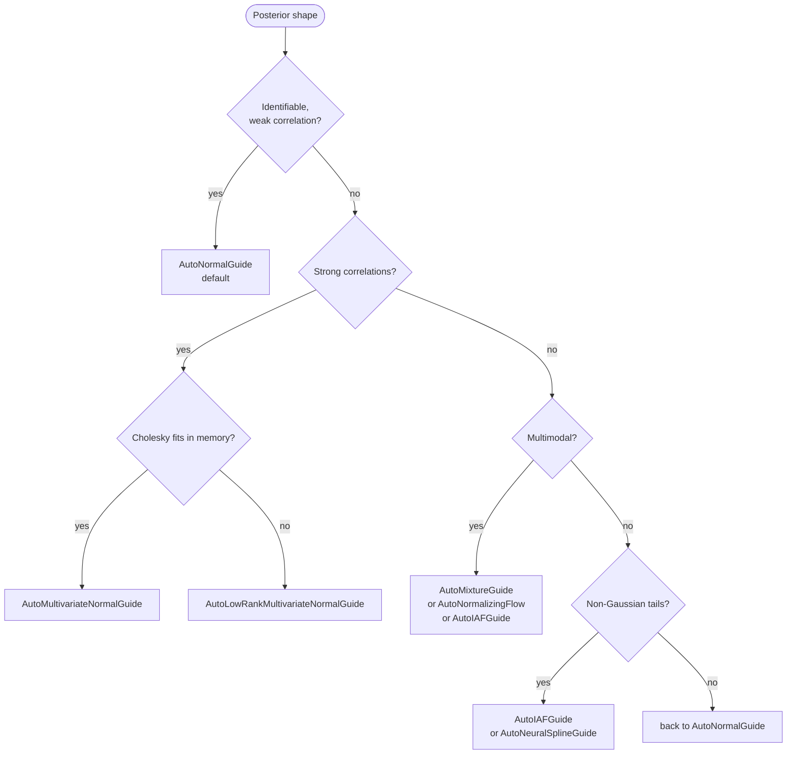

# 6. Choosing an inference algorithm

`quivers.inference` provides eleven [guide](../../api/inference/guide.md) classes, seven [objectives](../../api/inference/elbo.md), four gradient [estimators](../../api/inference/estimators.md), Markov chain Monte Carlo (MCMC) kernels for [Hamiltonian Monte Carlo](https://en.wikipedia.org/wiki/Hamiltonian_Monte_Carlo) (HMC) [@neal2011mcmc], the No-U-Turn Sampler (NUTS) [@hoffman2014nuts], Metropolis–Hastings, and Gibbs updates, and two hybrids of variational inference (VI) and MCMC. The right combination depends on the [posterior geometry](03-hierarchical.md#centered-or-non-centered), the computational budget, and the quantities the analysis needs. Choose VI, MCMC, or a hybrid first. For VI, then choose a guide (which distributions the approximation can represent), an objective (what is optimized), and a gradient estimator (how its gradient is estimated).

## Step 1: VI, MCMC, or hybrid?

| Posterior shape | First choice |
|---|---|
| Smooth, roughly unimodal, fewer than 1000 latents | VI. |
| Strongly correlated or curved | NUTS, with diagnostics. A reparameterization may still be needed. |
| Well-separated modes | Several initializations, comparing the regions reached. Separate modes may need a mixture guide or a sampler designed to move between modes. |
| Hierarchical with a funnel | NUTS, or VI on the non-centered parameterization. |
| More than 1000 continuous latents | VI, unless the compute budget is large. |
| Mixed discrete and continuous, small discrete support | VI with a `marginalize` block ([chapter 4](04-marginalize.md)), or HMC on the continuous remainder. |
| Unknown | `AutoNormalGuide` with `ELBO`, which is cheap and whose failures are informative. |

VI turns inference into optimization and can scale to many latent variables [@blei2017variational]. HMC and NUTS are asymptotically exact under regularity conditions, but a finite run has Monte Carlo error and needs convergence diagnostics. Run times depend on the model and the hardware, so benchmark the alternatives on the model at hand.

## Step 2: Which variational guide?



| Guide | Family | When |
|---|---|---|
| `AutoNormalGuide` | [Mean-field](https://en.wikipedia.org/wiki/Variational_Bayesian_methods) Normal | Default: cheap, scales, often adequate. |
| `AutoDeltaGuide` | A point mass at the [maximum a posteriori](https://en.wikipedia.org/wiki/Maximum_a_posteriori_estimation) (MAP) estimate | A MAP estimate with no posterior uncertainty. |
| `AutoMultivariateNormalGuide` | Full-covariance Normal, parameterized by a [Cholesky factor](https://en.wikipedia.org/wiki/Cholesky_decomposition) | Strong posterior correlations, with few enough latent dimensions $D$ for a dense $D \times D$ factor. Memory and cost per step grow as $O(D^2)$. |
| `AutoLowRankMultivariateNormalGuide` | Low-rank plus diagonal covariance | Hierarchical models with local correlations. `rank` defaults to 5. |
| `AutoLaplaceApproximation` | The [Laplace approximation](https://en.wikipedia.org/wiki/Laplace%27s_approximation): a Normal at the MAP with covariance the inverse Hessian of the negative log posterior [@tierney1986laplace] | A quadratic approximation at the MAP, after `AutoDeltaGuide`. |
| `AutoNormalizingFlow` | A [normalizing flow](https://en.wikipedia.org/wiki/Flow-based_generative_model): a Normal base pushed through invertible learned maps [@rezende2015flows] | Multimodal or heavy-tailed posteriors. The caller passes the list of transforms. |
| `AutoIAFGuide` | Inverse autoregressive flow (IAF) [@kingma2016iaf] | A general non-Gaussian guide. |
| `AutoNeuralSplineGuide` | Rational-quadratic neural spline flow [@durkan2019splines] | Posteriors on bounded support, where it is often more accurate than IAF. |
| `AutoMixtureGuide` | Mixture of at least two component guides | Multimodal posteriors. The objectives sum over the components exactly. |
| `AutoGuideList` | Different guides for different latent variables | Mixed families, given as a dict of component guides. |
| `AutoStructured` | One factor for each site, with chosen dependencies between sites | Keeping specific posterior dependencies. |

The [inference benchmarks](../../developer/inference-benchmarks.md) report how these guides recover known posteriors on a fixed set of problems.

## Step 3: Which objective?

| Objective | Bound | When |
|---|---|---|
| `ELBO(num_particles=1)` | Evidence lower bound (ELBO) | Default. |
| `ELBO(num_particles=K)` | ELBO averaged over $K$ draws | Lower gradient variance, with the bound itself unchanged. |
| `IWAEBound(num_particles=K)` | Importance weighted bound [@burda2016iwae] | Tighter than the ELBO for $K > 1$. |
| `RenyiBound(alpha, num_particles=K)` | Variational Rényi bound [@li2016renyi] | Equals the ELBO at $\alpha = 1$ and the importance weighted bound at $\alpha = 0$. |
| `VRIWAEBound(alpha, num_particles=K)` | Variational Rényi importance weighted bound [@daudel2023vriwae] | $\alpha$ moves the fit between covering the posterior's mass ($\alpha$ near 0) and seeking one mode ($\alpha$ near 1). $K$ tightens it. |
| `ChiVI(n, num_particles=K)` | $\chi^n$ upper bound (CUBO) [@dieng2017chi] | An upper bound on $\log p(y)$, which with the ELBO brackets it. The objective minimizes $\exp(n\,\mathrm{CUBO}_n)$ with an unbiased gradient. Needs $K \ge 2$, $n > 1$, and a guide that starts wider than the posterior. |
| `RWS(num_particles=K)` | Reweighted wake-sleep, wake phase [@bornschein2015rws] | Separate model and guide updates from self-normalized importance weights. Takes no estimator. |
| `DReGsBound(num_particles=K)` | Importance weighted bound with doubly reparameterized gradients [@tucker2019dreg] | Lower variance guide gradients at large $K$. |

`ELBO()` is the usual starting point. An importance weighted bound gives a flow guide a tighter target when the posterior is multimodal. `RenyiBound` with $\alpha < 1$ penalizes a guide that misses posterior mass more heavily than the ELBO does.

## Step 4: Which gradient estimator?

| Estimator | What it does | When |
|---|---|---|
| `Reparameterized` | [Reparameterization (pathwise) gradient](https://en.wikipedia.org/wiki/Reparameterization_trick) [@kingma2014autoencoding] | Default. |
| `StickingTheLanding` | Drops the score term of $\log q$ by detaching the guide parameters in it [@roeder2017sticking] | Noisy gradients near convergence, when the guide is close to the posterior. Valid for `ELBO` and other one-draw bounds. The multi-draw bounds reject it. |
| `DoublyReparameterized` | Doubly reparameterized gradients [@tucker2019dreg], extended to the Rényi and VR-IWAE bounds | `IWAEBound(K)` at large $K$. `ChiVI` rejects it, and so does a mixture guide on a multi-draw bound. |
| `ScoreFunction` | [Score-function](https://en.wikipedia.org/wiki/Policy_gradient_method) (REINFORCE) estimator with the draws held fixed [@ranganath2014bbvi] | Guides whose draws are not differentiable. |

`IWAEBound(num_particles=16, estimator=DoublyReparameterized())` combines importance weighting with doubly reparameterized guide gradients. A larger $K$ gives a tighter bound at a cost in time and memory, so choose it by profiling.

## Calling SVI

<!-- python: skip -->
```python
from quivers.inference import (
    AutoIAFGuide, IWAEBound, DoublyReparameterized, SVI,
)

guide = AutoIAFGuide(model, observed_names={"y"}, num_flows=4)
objective = IWAEBound(num_particles=16, estimator=DoublyReparameterized())
optimizer = torch.optim.Adam(
    list(model.parameters()) + list(guide.parameters()), lr=1e-3,
)
svi = SVI(model, guide, optimizer, objective)

for step in range(5000):
    loss = svi.step(x_data, {"y": y_data})
```

## Calling NUTS

<!-- python: skip -->
```python
from quivers.inference import NUTSKernel, MCMC

kernel = NUTSKernel(
    target_accept=0.85,
    max_tree_depth=10,
    mass_matrix="diagonal",
)
mcmc = MCMC(
    kernel,
    num_warmup=1000,
    num_samples=2000,
    num_chains=4,
    init_strategy="prior",
)
result = mcmc.run(model, x_data, {"y": y_data})
print(result.r_hat)                       # per-site split-Rhat
print(result.ess)                         # per-site effective sample size
print("divergences:", result.total_divergences)
```

Check R-hat, effective sample size, and divergences before using the draws. [Chapter 8](08-diagnostics-and-comparison.md#convergence-diagnostics) gives the thresholds and the usual remedies.

## Hybrid samplers

- `WarmupThenHMC(guide, kernel, svi_steps, mcmc_warmup, mcmc_samples)` runs `svi_steps` of SVI and then starts MCMC chains from draws of the trained guide, which can shorten HMC's warmup.
- `AutoDAIS(base, model, observations, num_steps=..., init_step_size=...)` follows each draw of a base guide with `num_steps` Hamiltonian transitions without accept or reject steps along an annealing path, as in differentiable annealed importance sampling (DAIS) [@zhang2021dais; @geffner2021uha]. Each draw carries the importance weight of its own trajectory, so `ELBO()` estimates a valid lower bound on the log evidence. It can represent posteriors that a mean-field guide misses, at extra cost. Use the default `Reparameterized` estimator, since the guide has no density at arbitrary points.

<!-- python: skip -->
```python
from quivers.inference import AutoDAIS, ELBO

base   = AutoNormalGuide(model, observed_names={"y"})
guide  = AutoDAIS(
    base, model, observations={"y": y_data},
    num_steps=8, init_step_size=0.05,
)
elbo   = ELBO()
svi    = SVI(model, guide, optimizer, elbo)
```

## Predictive

[`Predictive`](../../api/inference/predictive.md) takes the result of either kind of inference:

<!-- python: skip -->
```python
from quivers.inference import Predictive

# `posterior` accepts either a trained Guide or an MCMCResult
pred = Predictive(model, posterior=guide,       num_samples=1000)
pred = Predictive(model, posterior=mcmc_result, num_samples=1000)

posterior_predictive = pred(x_test)           # dict of (num_samples, ...) tensors
```

## Try this

- Fit the eight-schools model of [chapter 3](03-hierarchical.md) with each guide and compare the posterior of `tau` with a NUTS reference.
- Fit the mixture of [chapter 4](04-marginalize.md) with an `AutoMixtureGuide` of four `AutoNormalGuide` components and with one `AutoNormalGuide`, and allow for label switching when comparing the modes found.
- On a posterior whose high-density region is a ring, compare `AutoDAIS` with `AutoIAFGuide`.

## Next

[Chapter 7](07-categorical.md) describes the composition rules behind `>>` and the maps between them.
